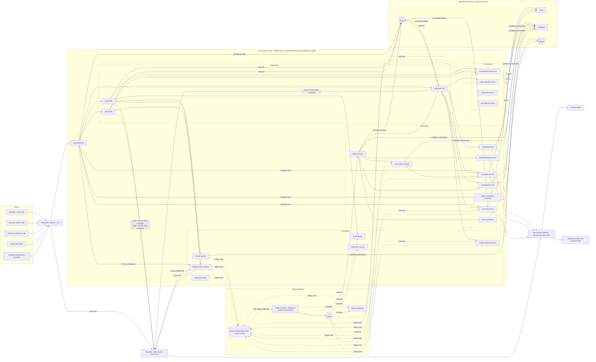

# RFC-0001 - WAVER Software Architecture
Status: PROPOSED (v1.2 revision of ACCEPTED BASELINE)
Revision 1.3 (2026-10-19): aligned with ADR-0020..0027 (adopted Redis, Keycloak, HashiCorp Vault, Temporal, Apicurio Registry + Avro + Debezium on Kafka Connect, Qdrant, Istio ambient; frontend tooling per ADR-0027 referenced only).
Owners: WAVER Architecture (named owner TBD)
Reviewers: TBD
Date: 2026-10-19
Version: 1.3

## Summary
Defines the overall distributed architecture of WAVER: the six planes, the control-plane / data-plane split, the experience plane, the end-to-end request path, the Kafka event backbone (Avro + Apicurio Registry, Debezium outbox relay), local read models that keep the data plane alive without the control plane (AR-013), the shared infrastructure adopted in v1.3 (Keycloak, Redis, Vault, Temporal, Qdrant, Istio ambient mesh), the shared platform chassis (`waver-platform-starter`), the deployment units and how every Architecture Requirement (AR-001..AR-015) is satisfied. Detailed designs live in the RFCs referenced from each section.

## Context / Problem
WAVER is a B2B2B platform (WAVER → Resellers → Customers) to build, integrate, run and govern enterprise AI agents (Master §1, §5). The v1.1 baseline fixed principles (microservices, database per service, Clean/Hexagonal, planes) but left the request path, the edge, the shared runtime chassis and the AR enforcement mechanisms undefined. MICROSERVICES_MAP v1.2 added the Experience plane, model-gateway, handoff, approval and support services and folded the engines into `agent-runtime` (ADR-0019). On 2026-10-19 the product owner adopted the infrastructure components that v1.2 had excluded (ADR-0020..ADR-0027). This RFC is the single picture that every other RFC plugs into.

## Goals
- One authoritative description of planes, deployables, shared infrastructure and their interaction styles.
- A request path where audience isolation (ADR-0006, ADR-0009) and tenant isolation (ADR-0010) hold by construction.
- Data-plane workloads already authorized keep running when any control-plane service, admin UI or BFF is down (AR-013).
- Every AR maps to a concrete, testable mechanism (table in "Requirements / ARs").
- Only the approved stack (TECH_STACK, ADR-0001: Angular, Java 25 / Spring Boot 4.x, PostgreSQL, Kafka, Docker, Kubernetes) plus the infrastructure adopted by ADR-0020..ADR-0027: Redis, Keycloak, HashiCorp Vault, Temporal, Apicurio Registry with Kafka Connect / Debezium, Qdrant and Istio (ambient mode).
- PostgreSQL stays the source of truth for every business fact; Redis, Qdrant and Temporal never hold data that cannot be rebuilt or reconciled from the owning service's database (Temporal holds process state, owned by the same service as the process).

## Non-goals
- Per-service domain design (RFC-0011..RFC-0021).
- Choosing cloud provider, observability backend, CI provider, payment gateway (open in TECH_STACK; this design keeps them pluggable). Whether Redis, PostgreSQL, Kafka or Vault auto-unseal KMS are managed offerings depends on the cloud choice.
- Multi-region / data residency (open product decision, Scope §24).

## Requirements / ARs
| AR | Mechanism in this architecture | Verified by |
|---|---|---|
| AR-001 Service and layer isolation | One bounded context per service (RFC-0002); Maven modules `domain/application/adapters/bootstrap` (ADR-0007) | ArchUnit rules in `waver-platform-test`; architecture review |
| AR-002 Database ownership | `waver_<service>` database with **dynamic, short-lived credentials per service** from the Vault database secrets engine (ADR-0022); no cross-DB grants. Shared infrastructure is partitioned per owner: Redis ACL user restricted to `waver:<prefix>:*` (ADR-0020), Qdrant collections + API key per owning service (ADR-0025), Temporal task queues per service (ADR-0023) | Vault policy lint (one DB role per service); DB grant audit job; Redis ACL review in the Helm chart |
| AR-003 Implementation isolation | Monorepo dependency rule: services depend only on `platform/*` and generated clients (ADR-0015); no service reads another service's Redis keys, Qdrant collections or signals another service's workflows | Maven Enforcer ban on `services/*` cross-deps; ArchUnit rule on Temporal/Redis client usage |
| AR-004 Cross-service communication | REST/OpenAPI `/v{major}` (RFC-0005, RFC-0008) and CloudEvents (binary mode, Avro `data`) on versioned topics (ADR-0012, ADR-0024, RFC-0006); allowed sync edges enforced by Istio `AuthorizationPolicy` generated from RFC-0002 §4 (ADR-0026) | Contract tests; registry compatibility check; staging test that a call outside the graph is denied by the mesh; NetworkPolicy allow-lists |
| AR-005 Independent lifecycle | Per-service Flyway migrations, Helm chart, version, pipeline (path-based CI), dashboards; Temporal worker build IDs per service release | CI pipeline per `services/<svc>` |
| AR-006 Idempotency | `Idempotency-Key` store in Redis (`waver:idem:<service>:*`, response copied to PostgreSQL when audit needs it); inbox table for consumers; outbox for producers (relayed by Debezium); Temporal activities idempotent | Starter integration tests; duplicate-delivery tests; workflow replay tests |
| AR-007 Domain purity | Domain module has no Spring/JPA/Kafka/HTTP/Redis/Temporal dependency | Maven module graph + ArchUnit |
| AR-008 Tenant context | Keycloak token (claims from identity-access) → `TenantContext` → `SET LOCAL waver.*` → RLS; `ce_orgid`/`ce_workspaceid` Kafka headers; `orgId` in Redis key segments, Qdrant `org_id` payload filter, Temporal `OrgId` search attribute (RFC-0003) | Tenant isolation test kit (extended to Redis, Qdrant, Temporal); migration linter |
| AR-009 Auditability | Starter `AuditRecorder` → outbox → `audit-service` (append-only, hash-chained); Keycloak login/admin events and the Vault audit device correlated with audit records | Audit coverage tests for annotated sensitive use cases |
| AR-010 Versioned production | Runtime executes only `Deployment` → immutable `AgentVersion` (RFC-0016); infra config via Helm releases; Keycloak realm configuration as code | Runtime has no API to read drafts; E2E test |
| AR-011 Entitlement authority | `entitlement-service` events → local entitlement snapshots in builder, runtime, tool-runtime, channel (RFC-0013) | Negative tests: capability without entitlement is rejected |
| AR-012 Safe suspension | Separate lifecycle states for commercial, financial and technical status; suspension never deletes; purge is an approved Temporal workflow in tenant-service (RFC-0003, RFC-0017) | Workflow and lifecycle tests; purge requires approval |
| AR-013 Plane isolation | Data-plane services hold persistent local read models; separate node pools and DB clusters for control vs data plane; Temporal namespaces per plane (`waver-agent`, `waver-capability`, `waver-automation` separate from `waver-commercial`) | Chaos test: scale control plane to zero, data plane keeps serving |
| AR-014 Failure isolation | Resilience4j defaults in starter (timeouts, retries, circuit breaker, bulkhead) as the **only** synchronous retry layer, mesh retries disabled (ADR-0026); outbox, DLQ (RFC-0005, RFC-0006); every Redis use has a documented degradation (ADR-0020) | Fault-injection tests with WireMock/Testcontainers; Redis-unavailable chaos test |
| AR-015 Compatibility | Major version in URL/topic; Avro `BACKWARD_TRANSITIVE` per subject in Apicurio Registry; CI compatibility checks on `contracts/*`; Temporal workflow changes versioned (worker versioning) | CI gate on `contracts/openapi` and `contracts/events`; workflow replay tests |

## Proposed Design

### 1. Planes
| Plane | Services | Plane type | Primary concern |
|---|---|---|---|
| Experience | edge-gateway, control-bff, partner-bff, workspace-bff | Edge (stateless; sessions in Redis) | Audience isolation, sessions, screen composition |
| Commercial | reseller, customer, catalog, marketplace, contract, entitlement, provisioning, billing, support | Control plane | Catalog ≠ Contract ≠ Entitlement ≠ Usage |
| Agent | agent-builder, evaluation (control); agent-runtime (+ objective/flow engine modules), memory, model-gateway, handoff (data) | Mixed | Define vs execute (Builder ≠ Runtime) |
| Capability | tool-registry (control); tool-runtime, connector, knowledge, channel (data) | Mixed | Reusable capabilities, credentials, channels |
| Automation | trigger, workflow, scheduler | Data plane | Starting and coordinating executions |
| Platform | tenant, identity-access, audit, notification, usage-metering, approval | Shared foundation | Tenancy, access model, audit, usage, approvals |

**Control plane** = definitions and commercial state: Agents, AgentVersions, Deployments, Contracts, Entitlements, Tools (registry), configurations. Changes are low-volume, strongly consistent inside one service and propagated as events.
**Data plane** = executions: Conversations, AgentRuns, ToolExecutions, Messages, ObjectiveState, FlowState, retrievals, model calls. High volume, latency-sensitive, horizontally scaled.
**Foundation** services are consumed by both; data-plane services never call them synchronously on the hot path except Keycloak JWKS (cached) and the Redis quota counters owned by usage-metering (ADR-0020) — see §5.

**Shared infrastructure** (not bounded contexts, own no business facts): Keycloak (identity provider, ADR-0021), Redis (ADR-0020), Vault (ADR-0022), Temporal (ADR-0023), Apicurio Registry and Kafka Connect / Debezium (ADR-0024), Qdrant (ADR-0025), Istio ambient mesh (ADR-0026). Each is used through per-service isolation units (key prefix, collection, namespace/task queue, Vault policy, client) so it never becomes a hidden integration channel between services (RFC-0002 §8).

### 2. Container overview (C4 level 2)

Arrows show the main paths only; the full allowed synchronous graph is in RFC-0002 §4. Every service owns one PostgreSQL database (grouped as a single node here) and obtains its credentials from Vault (all services → Vault not drawn). Every workload sits in the mesh; Keycloak and the shared infrastructure are also mesh members and are reachable only by the service accounts allowed by their `AuthorizationPolicy`.

### 3. Request path (interactive user)
```mermaid
sequenceDiagram
  participant B as Browser (Angular)
  participant I as Ingress (TLS)
  participant G as edge-gateway
  participant R as Redis
  participant F as workspace-bff
  participant KC as Keycloak
  participant S as agent-builder-service
  participant DB as waver_agent_builder
  B->>I: HTTPS + __Host session cookie + X-XSRF-TOKEN
  I->>G: forward (host app.<base-domain>) over mesh mTLS
  G->>R: RedisRateLimiter (per org / IP / route token bucket)
  G->>G: strip untrusted headers, size limit, inject X-Correlation-Id, traceparent, X-Request-Deadline
  G->>F: route by host (mTLS, AuthorizationPolicy edge-gateway → workspace-bff)
  F->>R: load session (Spring Session Data Redis)
  F->>KC: refresh / token exchange for aud=agent-builder (only on cache miss)
  F->>S: GET /v1/agents?domainId=... Authorization: Bearer (exchanged, aud=agent-builder)
  S->>S: validate JWT (cached Keycloak JWKS), build TenantContext, authorize (RFC-0004)
  S->>DB: BEGIN; SET LOCAL waver.org_id=...; SELECT ... (RLS)
  S-->>F: 200 JSON
  F-->>B: screen-shaped JSON
```
Rules:
- TLS terminates at the ingress; edge-gateway → BFF → services runs over Istio ambient mTLS (ztunnel, `PeerAuthentication` STRICT) with an `AuthorizationPolicy` per destination (ADR-0026). The mesh authenticates workloads; the JWT still authenticates the principal and the tenant (defence in depth).
- Browsers never hold access tokens (ADR-0021, previously ADR-0008). BFFs never hold business rules (ADR-0009).
- Hosts (base domain open): `control.` → control-bff, `partner.` → partner-bff, `app.` → workspace-bff, `api.` → workspace-bff public routes (API keys / client credentials, RFC-0004), `auth.` → Keycloak (OIDC endpoints and WAVER-themed login pages; the Keycloak admin console is not exposed on this host), `hooks.` → signed provider webhooks routed directly to the owning service (ADR-0009 amendment).
- Each BFF accepts only tokens whose `org_type` matches its audience (PLATFORM / RESELLER / CUSTOMER).
- If Redis is unavailable, edge rate limiting fails open to a local in-memory limiter and BFF sessions are lost (users re-login); no business data is affected (ADR-0020).

### 4. Event backbone
- Kafka is the only asynchronous integration channel (ADR-0004). Envelope: CloudEvents 1.0 in **binary mode** — attributes and the WAVER extensions (`orgid`, `correlationid`, `causationid`, `actorid`, `actortype`, conditional `workspaceid`, `domainid`, `supportgrantid`, plus `aggregateversion`, `traceparent`) travel as `ce_*` Kafka headers; the Kafka value is the Avro-encoded `data` (ADR-0012 envelope rules, ADR-0024 format).
- Schemas: Avro `.avsc` files in `contracts/events/<context>/<EventName>.v<N>.avsc` are the source of truth, registered in **Apicurio Registry** (Confluent-compatible API) by the CI pipeline only (`auto.register.schemas=false`); compatibility `BACKWARD_TRANSITIVE` within a major version.
- Producers write domain state and `outbox_event` (Avro payload + CloudEvents header columns) in one transaction; the **Debezium** PostgreSQL connector on **Kafka Connect** (Outbox Event Router SMT, one replication slot per producing database) publishes from the WAL. The polling relay of v1.2 is removed.
- Consumers are idempotent via `processed_event(consumer_group, event_id)` inbox; registry-aware Avro deserializer with build-time generated specific records; retries via Spring Kafka retry topics; poison messages to `<topic>.dlq` (RFC-0006).
- Topics follow `waver.<context>.<aggregate>.v<major>`, keyed by aggregate ID. Only the owning service has write ACLs on its topics (in practice, the Kafka Connect principal writes on behalf of the outbox connector that reads only that service's database).
- Canonical chain (Master §9.3): `ContractActivated` → entitlement-service (`EntitlementGranted`) → provisioning-service (`ProvisioningSucceeded`, produced by the provisioning Temporal workflow) → billing, notification, audit consumers.
- Long-running processes (sagas, dunning, renewals, purge, agent runs that wait, tool approvals, customer workflows, knowledge ingestion) run as **Temporal workflows owned by the service that owns the process** (ADR-0023); they publish events through the same outbox from activities and never replace Kafka as the integration channel between services.

### 5. Local read models (AR-013)
Data-plane services persist the control-plane facts they need in their own database, built from events and bootstrapped from snapshot APIs (RFC-0005 §9).
| Consumer | Read model | Source events | Behaviour when source is down |
|---|---|---|---|
| agent-runtime | `rm_deployment` (active Deployment → AgentVersion snapshot incl. compiled config) | `DeploymentActivated`, `DeploymentRolledBack`, `AgentVersionCreated` | Serves last activated version |
| agent-runtime, tool-runtime, channel-service, agent-builder | `rm_entitlement` (capability, limits, status per org/workspace) | `EntitlementGranted/Changed/Suspended/Revoked` | Serves last known snapshot; fail closed if never received |
| agent-runtime, channel-service, tool-runtime | `rm_org_status` (ACTIVE/SUSPENDED/TERMINATED) | `OrganizationStatusChanged` | Last known status |
| tool-runtime | `rm_tool_version` (schemas, ExecutionPolicy) | `ToolVersionPublished`, `ToolDeprecated` | Executes known versions |
| agent-runtime | `rm_quota_state` (fallback snapshot) | `QuotaThresholdReached`, `QuotaExceeded`, `waver.usage-metering.quota-state.v1` | Live HARD-quota checks use the Redis counters `waver:quota:<quotaCounterId>` through the `usage-metering-client` (contracts/clients, ADR-0015) (ADR-0020); if Redis is unavailable the snapshot is used and usage-metering's PostgreSQL counter stays authoritative |
| channel-service | `rm_channel_route` (ChannelConnection → Deployment) | `DeploymentActivated` + own data | Routes to last known deployment |
| services evaluating domain roles | `rm_authz_grant` | `MembershipChanged`, `RoleAssigned` | Last known grants |
Every read model stores `source_event_id` and `source_version` and exposes staleness as a metric (RFC-0009). Redis caches (L2) may sit in front of a read model but never replace it: a Redis entry is not durable and is not a read model.

### 6. Platform chassis: `waver-platform-starter`
One Spring Boot starter (no domain code, ADR-0015) consumed by every service; versions pinned by `waver-platform-bom`. Infrastructure modules are opt-in per service and enforce the per-service isolation units of RFC-0002 §8.
| Module | Provides | ARs |
|---|---|---|
| `security` | Resource-server config for Keycloak tokens (realm `waver`), JWKS cache, audience check, Keycloak token-exchange client, `@RequiresPermission`, support-grant enforcement | AR-008, AR-009 |
| `tenancy` | `TenantContext` from token/event (`ce_*` headers)/workflow headers, transaction hook issuing `SET LOCAL waver.*`, tenant-aware executors, Kafka listeners and Temporal context propagator | AR-008 |
| `web` | problem+json errors, `Idempotency-Key` store (Redis `waver:idem:<service>:*`, optional PostgreSQL copy for audit), ETag/If-Match, cursor pagination, correlation and deadline headers | AR-006, AR-015 |
| `client` | Auto-config for generated HTTP interface clients: base URL, auth, deadline, Resilience4j defaults (the single retry layer; mesh retries disabled) | AR-004, AR-014 |
| `messaging` | Outbox table in Debezium Outbox Event Router layout, inbox, CloudEvents binary-mode mapper (`ce_*` headers), Apicurio-aware Avro serializer/deserializer (`auto.register.schemas=false`), retry/DLQ defaults | AR-004, AR-006, AR-015 |
| `audit` | `AuditRecorder` writing audit facts through the outbox | AR-009 |
| `redis` | Lettuce/Spring Data Redis config with the service's ACL user and enforced key prefix (`waver:<prefix>:*`), tenant-aware key builder, two-level cache (Caffeine L1 + Redis L2, event-driven eviction), short locks (`RedisLockRegistry`), quota check-and-increment client (Lua, owned by usage-metering), Redis Streams publisher/subscriber for run output, Spring Session Data Redis for BFFs, documented fallbacks when Redis is down | AR-002, AR-006, AR-014 |
| `temporal` | Temporal Java SDK auto-config: namespace per plane, task queues `<service>.<workflow>`, worker build IDs per release, `OrgId`/`WorkspaceId`/`DomainId` search attributes, TenantContext and trace propagation into activities, idempotent activity base (outbox for events), ArchUnit rule "workflows call infrastructure only through activities" (replaces the v1.2 `process` module and its PostgreSQL timer poller, ADR-0018) | AR-006, AR-013, AR-014 |
| `vault` | Vault Kubernetes auth, dynamic PostgreSQL credential renewal and connection-pool rotation, Transit client (encrypt/decrypt with `orgId` context, sign/verify), KV access for platform secrets not delivered by Vault Secrets Operator | AR-002, AR-008 |
| `vector` | Qdrant client config restricted to the service's own collections and API key, mandatory tenant filter (`org_id` + scope filters) built from `TenantContext`, never from the request body; collection alias helpers for re-embedding (used by knowledge-service and memory-service only) | AR-002, AR-008 |
| `readmodel` | Generic event-fed read-model base (upsert by version, bootstrap from snapshot API) | AR-013 |
| `observability` | Micrometer metrics/tracing (OpenTelemetry format), JSON logs with `traceId`, `orgId`, `correlationId`; Redis, Temporal, Kafka client metrics | AR-005 |
`waver-platform-test` ships Testcontainers setups (PostgreSQL, Kafka with Apicurio Registry, Redis, Qdrant, Keycloak, Vault dev server), the Temporal test framework with replay tests, the tenant isolation test kit (RFC-0003 §9, extended to Redis, Qdrant and Temporal) and ArchUnit rules.
The Helm library chart generates, from each service's declared dependencies, the Istio `AuthorizationPolicy`, the NetworkPolicy, the Vault role/policy binding, the Redis ACL entry and (for producers) the Debezium outbox connector configuration (RFC-0015).

### 7. Deployment units
33 backend deployables (4 experience + 9 commercial + 6 agent + 5 capability + 3 automation + 6 platform), one Docker image and one Helm chart each (ADR-0007, ADR-0015). Angular apps `control`, `partner`, `workspace` (Nx workspace, ADR-0027) are static bundles served by three small `frontend-<app>` images on the same host as their BFF (ADR-0009, RFC-0021).
| Kubernetes namespace | Deployables | Node pool | PostgreSQL grouping (default) |
|---|---|---|---|
| `waver-edge` | edge-gateway, 3 BFFs | `edge` | None (BFF sessions in Redis, ADR-0020) |
| `waver-platform` | tenant, identity-access, audit, notification, usage-metering, approval | `control` | `identity-access` isolated together with Keycloak's database (tier-0); others on control cluster |
| `waver-commercial` | 9 commercial services | `control` | Control-plane cluster |
| `waver-agent` | agent-builder, evaluation (control pool); agent-runtime, memory, model-gateway, handoff (data pool) | split | Builder/evaluation on control cluster; runtime/memory on data cluster |
| `waver-capability` | tool-registry (control pool); tool-runtime, connector, knowledge, channel (data pool) | split; connector-service optionally `secure` pool (ADR-0014, ADR-0022) | Data-plane cluster(s) |
| `waver-automation` | trigger, workflow, scheduler | `data` | Data-plane cluster |
Separate node pools and separate PostgreSQL clusters for control and data plane keep chat load from starving commercial operations (DEPENDENCY_RULES). Each service still has its own database and its own Vault-issued credentials inside a cluster. Details: RFC-0014, RFC-0015.

Shared infrastructure components (per environment; namespaces and sizing in RFC-0015):
| Component | Purpose | Tier | Own storage | ADR |
|---|---|---|---|---|
| Keycloak (≥ 2 replicas, Infinispan clustering) | OIDC/OAuth 2.1 provider, realm `waver`, Organizations, brokering, MFA | tier-0 | Own PostgreSQL database | ADR-0021 |
| Vault (HA, integrated Raft, auto-unseal via KMS once chosen) + Vault Secrets Operator | Secrets, dynamic DB credentials, Transit | tier-0 | Raft | ADR-0022 |
| Redis (HA cluster or managed) | Sessions, rate limits, quota counters, idempotency, caches, locks, run-output streams | tier-1 (degradable) | In-memory, non-authoritative | ADR-0020 |
| Temporal (frontend, history, matching, worker services; Temporal Web) | Durable workflows | tier-1 commercial / tier-0 for data-plane waits | Own PostgreSQL (persistence + visibility) | ADR-0023 |
| Apicurio Registry | Avro schema registry | tier-1 | Own PostgreSQL | ADR-0024 |
| Kafka Connect (distributed) + Debezium | Outbox relay from WAL | tier-1 | Kafka internal topics | ADR-0024 |
| Qdrant (HA cluster) | Vector search for knowledge and memory | tier-1 (data plane) | Own volumes + snapshots; rebuildable from PostgreSQL | ADR-0025 |
| Istio ambient (istiod, ztunnel DaemonSet, waypoints, egress gateway) | mTLS, authorization, egress control, L7 traffic splitting | tier-0 | — | ADR-0026 |

## APIs / Events / Data Ownership
- Data ownership is exactly MICROSERVICES_MAP v1.3; boundaries and allowed dependencies are in RFC-0002. Shared infrastructure owns no business data.
- External surfaces: three BFF APIs (private to their Angular app), public API on `api.` (RFC-0008), OIDC endpoints and login pages on `auth.` served by Keycloak (RFC-0004), provider webhooks on `hooks.`.
- Internal surfaces: `/v1/...` per service (CONVENTIONS), events on `waver.<context>.<aggregate>.v1` with Avro schemas registered in Apicurio (RFC-0006, `07_API_EVENTS/EVENT_CATALOG.md`), run-output streams `waver:run-stream:<agentRunId>` in Redis (RFC-0005 §12).
- Shared code: only `platform/*` and generated clients/schemas from `contracts/*`.

## Security & Privacy
- Defence in depth for tenancy: token claims → authorization in service → RLS in database (RFC-0003, RFC-0004); the same tenant context drives Redis key segments, Qdrant payload filters and Temporal search attributes.
- Zero-trust transport: STRICT mTLS between all workloads and `AuthorizationPolicy` per destination generated from RFC-0002 §4 (ADR-0026); NetworkPolicies remain as a second L3/L4 layer.
- Audience isolation by construction: `workspace-bff` has no client for marketplace, catalog pricing, reseller or wholesale APIs (ADR-0009), and no mesh authorization to reach them.
- Egress: only `model-gateway-service` reaches LLM providers (ADR-0017); only `connector-service` (and future `connector-runner-*`) reaches tenant external systems; channel-service reaches channel providers; Keycloak reaches customer IdPs; billing reaches payment/fiscal providers. Enforced by the Istio egress gateway with `ServiceEntry` allow-lists (ADR-0026) plus NetworkPolicy; connector-service keeps its application-level SSRF checks.
- Secrets: no secret material in Git, Helm values or images; platform secrets delivered by Vault Secrets Operator, PostgreSQL credentials are dynamic (ADR-0022).
- Tenant credentials live only in `connector-service` as Vault Transit ciphertext (key `tenant-credentials`, context = `orgId`); the only plaintext exceptions are the audited leases to model-gateway (`LLM_PROVIDER_KEY`) and channel-service (`CHANNEL_PROVIDER_TOKEN`), implemented as Transit decrypt permissions scoped by Vault policy (ADR-0014 ownership, ADR-0022 mechanism).
- Sensitive actions require permission check + audit record; support access is explicit, time-boxed and visible to the customer (RFC-0004).
- LGPD: events carry IDs and minimal state; PII only to entitled consumers; no PII in Redis keys; Temporal workflow inputs carry IDs, not PII; purge is an audited Temporal workflow (RFC-0003 §7, RFC-0010).

## Reliability & Failure Modes
| Failure | Impact | Mitigation |
|---|---|---|
| Any control-plane service down | Admin screens for that context fail | Data plane continues from read models (§5); BFF returns partial screens with problem+json per widget |
| Keycloak down | No new logins, refresh or token exchange; existing access tokens valid ≤ 5 min | Cached JWKS; cached exchanged and service tokens; BFF sessions survive; Keycloak tier-0 (≥ 2 replicas, Infinispan, isolated DB) |
| identity-access down | Membership/role administration fails; Keycloak claims mapper serves its short cache, then new token issuance fails closed | ≥ 3 replicas (default), isolated DB; existing tokens unaffected |
| Redis unavailable | Higher latency; sessions lost; rate limits approximate | Documented fallbacks (ADR-0020): re-login; local limiter (fail-open); quota from PostgreSQL counter + local snapshot; cache miss; token streaming replaced by complete-message delivery from events |
| Vault unavailable | New pods cannot start; tenant credential decryption fails closed | HA Raft cluster; running pods keep current DB leases until TTL; unseal/recovery runbook |
| Temporal unavailable | Timers, waits and sagas paused; no new workflow starts | Hot path does not depend on Temporal; workflows resume from history when back; starts retried by the owning service |
| Kafka unavailable | Events delayed | Outbox retains events; read models stale but serving; staleness alerts |
| Kafka Connect / Debezium stopped | Events delayed; WAL grows on producing databases | Alert on replication-slot lag and connector task failures; runbook; disk headroom per DB |
| Apicurio Registry unavailable | New schema IDs cannot be resolved | Serializers/deserializers cache schemas; registrations only at release time |
| Qdrant degraded | Retrieval slower or unavailable | Policy-driven degradation in the turn (RFC-0011); PostgreSQL full-text part of hybrid retrieval still available; collection rebuildable from PostgreSQL |
| Istio control plane (istiod) down | No config changes; existing workloads keep their certificates and policies until rotation | Multiple istiod replicas; ztunnel as DaemonSet with PDB; upgrade runbook |
| agent-runtime overloaded | Chat latency | HPA on in-flight runs; per-org concurrency caps; control plane on separate pool unaffected |
| Data-plane DB cluster degraded | Executions fail/slow | Control plane on separate cluster; runtime rejects new runs with retryable error; channels queue inbound messages |
| LLM provider outage | Runs fail | model-gateway fallback routing (RFC-0019) |
| Bad deploy of one service | Context degraded | Independent rollback (Helm), contracts backward compatible within major, Temporal worker versioning keeps running workflows on the previous build |
| Event consumer bug | Read model divergence | DLQ + replay (registry-aware tooling); snapshot rebuild endpoint |

## Observability
- Every request/event carries `traceparent` and `correlationid`; logs and metrics are tagged with `orgId` (and `workspaceId` where present) for per-tenant diagnosis (RFC-0009).
- Golden signals per service; plane-level dashboards (control vs data); read-model staleness; outbox lag measured as Debezium replication-slot lag and Kafka Connect task status; consumer lag; per-org cost from `ModelCallCompleted`.
- Infrastructure signals: Redis memory, evictions and latency; Temporal schedule-to-start latency and workflow failures (Temporal Web for operators); Qdrant query latency; Keycloak login and token metrics; Vault audit log; Istio L4/L7 metrics and authorization-deny counts.
- Export in open formats (OpenTelemetry-compatible via Micrometer); backend is an open decision.

## Testing Strategy
- ArchUnit + Maven Enforcer: layer rules, no cross-service imports, `workspace-bff` forbidden clients, workflow determinism rules.
- Tenant isolation test kit on every repository and API, Redis key builder, Qdrant filter and Temporal context propagation (RFC-0003).
- Contract tests: OpenAPI conformance and Avro compatibility against Apicurio in CI (RFC-0005, RFC-0006).
- Temporal workflow replay tests for every workflow change (ADR-0023).
- Plane-isolation chaos test in staging: scale all control-plane deployables to 0; assert active Deployments still answer on every first-class channel.
- Infrastructure chaos tests in staging: Redis unavailable (no data loss, documented degradation), mesh denies a call outside the dependency graph.
- E2E per audience (Playwright): customer cannot reach marketplace/wholesale endpoints by any URL.

## Deployment / Rollout / Rollback
- Vertical slices (DELIVERY_ROADMAP): platform chassis + infrastructure baseline (Istio, Vault, Keycloak realm, Redis, Kafka with Kafka Connect and Apicurio, Temporal) + tenant + identity first, then commercial chain, then agent build/run (Qdrant with knowledge/memory).
- Each service deploys independently (rolling update, PDBs); schema migrations are forward-only and expand/contract so the previous version keeps working during rollout; Temporal workers use build IDs so in-flight workflows complete on compatible code.
- Rollback = previous Helm release; data migrations never require rollback because they are backward compatible.
- Infrastructure configuration as code: Keycloak realm via Admin API in the pipeline, Vault policies, Istio policies and Debezium connectors generated by the Helm library chart.
- Environments: `dev` → `staging` → `production` plus PR previews for frontends/BFFs (CONVENTIONS).

## Alternatives Considered
| Alternative | Why not |
|---|---|
| Modular monolith first | Contradicts ADR-0002 and AR-002/AR-003. |
| Synchronous queries from runtime to control plane per turn | Violates AR-013 and adds latency; replaced by local read models. |
| Single shared PostgreSQL cluster | Data-plane load could starve control plane; kept as a deployment option for `dev` only. |
| v1.2 minimal-infrastructure baseline (PostgreSQL + Kafka only: Spring Authorization Server, Kubernetes Secrets + envelope encryption, PostgreSQL state machines, polling outbox relay, pgvector, no mesh) | Superseded on 2026-10-19 by ADR-0020..ADR-0026: exact rate/quota enforcement, off-the-shelf IdP features, dynamic credentials, durable workflows, runtime schema compatibility, scalable vector search and zero-trust transport, at the cost of more components to operate. |
| Service mesh as the retry/timeout layer | Rejected: Istio provides mTLS, authorization and egress control; retries stay in Resilience4j to keep one retry layer aware of idempotency and deadlines (ADR-0026, RFC-0005). |

## Risks
- 33 deployables for a young team: mitigated by the shared starter, Helm library chart and vertical-slice rollout.
- Eight additional infrastructure components (Keycloak, Redis, Vault, Temporal, Apicurio Registry, Kafka Connect/Debezium, Qdrant, Istio) increase operational load and tier-0 surface (Keycloak, Vault, Istio): mitigated by managed offerings where the chosen cloud provides them, per-component runbooks, HA by default and chaos tests of the documented degradations.
- Licensing: Redis 8 (RSALv2/SSPLv1/AGPLv3, OPEN_DECISIONS D-37) and Vault (BSL 1.1, D-38) need legal confirmation; Valkey and OpenBao are the API-compatible fallbacks.
- Read-model drift: mitigated by version checks, staleness metrics and rebuild from snapshot APIs.
- Starter becoming a hidden monolith: platform owners review every change; no domain code allowed.
- Shared infrastructure becoming a hidden integration channel (one service reading another's keys, collections or workflows): mitigated by per-service ACLs/API keys/policies and ArchUnit rules (RFC-0002 §8).

## Open Questions
1. ~~Ingress for provider webhooks and anonymous web-chat traffic (`hooks.`, widget host).~~ Closed: ADR-0009 amendment (2026-10-19) routes `hooks.` directly to channel-service, connector-service and trigger-service receivers.
2. Serving of Angular bundles (BFF vs static container) — RFC-0021.
3. ~~In-cluster mTLS before a service mesh is approved (RFC-0010).~~ Closed by ADR-0026 (Istio ambient, STRICT mTLS).
4. Audit transport: audit-service is "consumer only"; this RFC proposes a per-context audit topic written through the outbox; topic naming must be confirmed in RFC-0006 because "audit" is not an aggregate.
5. Cloud provider, managed PostgreSQL/Kafka/Redis and the KMS used for Vault auto-unseal (TECH_STACK open).
6. SLO targets per tier (engineering) and customer-facing SLAs (business) — RFC-0009 / commercial.
7. Redis quota counters are owned by usage-metering but checked and incremented by data-plane services (ADR-0020); the ACL for this single cross-service prefix (`waver:quota:*`, check-and-increment script only) must be confirmed in RFC-0013/RFC-0020.

## Decision
PROPOSED. On acceptance this revision replaces the v1.1 ACCEPTED BASELINE text of RFC-0001; MICROSERVICES_MAP v1.3 remains the authoritative service list.
