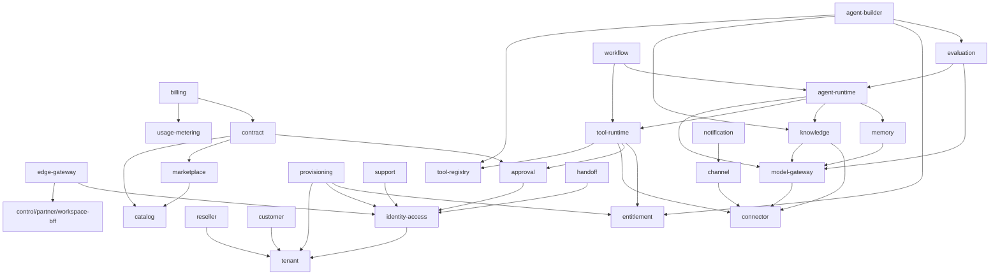

# RFC-0002 - Domain & Service Boundaries
Status: PROPOSED
Revision 1.3 (2026-10-19): aligned with ADR-0020..0027 (adopted Keycloak, Redis, HashiCorp Vault, Temporal, Apicurio Registry + Avro + Debezium, Qdrant, Istio ambient).
Owners: WAVER Architecture (named owner TBD)
Reviewers: TBD
Date: 2026-10-19
Version: 1.3

## Summary
Formalizes the bounded contexts, the context map (upstream/downstream relationships, conformist vs anti-corruption layer, published language), aggregate ownership per service (consistent with MICROSERVICES_MAP v1.2), the split between the identity context (identity-access-service) and the Keycloak identity provider, the allowed synchronous dependency graph (acyclic) with the explicitly forbidden dependencies, how shared infrastructure (Redis, Qdrant, Temporal, schema registry, Vault, Istio) is partitioned so it creates no cross-service coupling, the rules for adding a new service, and a frozen glossary of terms (Master §16 step 1: "freeze terminology and bounded contexts").

## Context / Problem
The product baselines use overlapping words ("domain", "environment", "integration", "license", "plan", "status") and the v1.1 service list left owners ambiguous (Organization, Quote, PricingRule, Suspension, Deployment). Without frozen boundaries and vocabulary, teams build the same concept twice or couple services through shared tables (AR-001, AR-002, AR-003).

## Goals
- Every aggregate has exactly one owning service.
- The synchronous dependency graph is explicit, acyclic and enforced (Istio `AuthorizationPolicy` + NetworkPolicy + generated-client allow-list).
- Shared infrastructure never becomes a shared data model or a hidden integration channel between services.
- Every cross-context relationship has a declared pattern (published language, ACL, conformist, customer/supplier).
- One glossary used in code, APIs, events, UI copy keys and docs.

## Non-goals
- Internal aggregate design of each service (service RFCs).
- Event payload schemas (RFC-0006, `contracts/events`).
- Adding new services beyond MICROSERVICES_MAP v1.3.

## Requirements / ARs
AR-001 (explicit bounded contexts), AR-002 (database ownership), AR-003 (implementation isolation), AR-004 (versioned APIs/events only), AR-011 (entitlement authority), AR-013 (no data-plane → control-plane sync dependency on the hot path), AR-015 (published language is versioned). ADR-0002, ADR-0003, ADR-0009, ADR-0015, ADR-0016, ADR-0017, ADR-0019, ADR-0020 (Redis), ADR-0021 (Keycloak), ADR-0022 (Vault), ADR-0023 (Temporal), ADR-0024 (Apicurio Registry, Avro, Debezium), ADR-0025 (Qdrant), ADR-0026 (Istio).

## Proposed Design

### 1. Word "domain"
"Domain" (capitalized) always means the **business Domain** inside a Workspace (Sales, Support, ...). DDD domains are called **contexts** or **bounded contexts** in all WAVER documents and code.

### 2. Bounded contexts and ownership
| Context (event `<context>`) | Service | Plane | Subdomain type | Owned aggregates |
|---|---|---|---|---|
| tenant | tenant-service | Platform | Core-supporting | Organization, OrganizationRelationship, Workspace, Domain |
| identity | identity-access-service | Platform | Generic (security-critical) | User, Membership, Role, Permission, ServiceAccount, ApiKey, SupportAccessGrant, IdpConfiguration |
| reseller | reseller-service | Commercial | Core | ResellerProfile, ResellerTier, ResellerAgreement, ResellerOnboarding, ResellerScore |
| customer | customer-service | Commercial | Core | CustomerProfile, BillingProfile, CustomerOwnership, CustomerLifecycle, SuspensionCase |
| catalog | catalog-service | Commercial | Core | Product, SKU, Bundle, SolutionPack, AddOn, PriceBook, WholesalePrice, RetailPrice, PricingRule, DiscountPolicy |
| marketplace | marketplace-service | Commercial | Core | Publisher, Listing, ListingVersion, AvailabilityRule, Certification |
| contract | contract-service | Commercial | Core | Quote, Contract, ContractVersion, ContractItem, Amendment, Renewal, Cancellation |
| entitlement | entitlement-service | Commercial | Core | Entitlement, EntitlementLimit, FeatureFlag |
| provisioning | provisioning-service | Commercial | Supporting | ProvisioningJob |
| billing | billing-service | Commercial | Core | Invoice, InvoiceLine, Payment, Credit, Adjustment, LedgerEntry, DunningCase (later Commission, RevenueShare, Settlement) |
| support | support-service | Commercial | Supporting | SupportCase, Escalation, SlaPolicy |
| agent-builder | agent-builder-service | Agent (control) | Core | Agent, AgentDraft, AgentVersion, ObjectiveDefinition, Flow, FlowVersion, FlowNode, FlowTransition, PolicyDefinition, ToolBinding, KnowledgeBinding, ChannelBinding, Environment, Deployment, Release |
| agent-runtime | agent-runtime (modules objective-engine, flow-engine) | Agent (data) | Core | AgentRun, Session, Conversation, Message, ExecutionContext, ObjectiveState, FlowState |
| memory | memory-service | Agent (data) | Supporting | MemoryEntry, MemoryScope, RetentionPolicy |
| evaluation | evaluation-service | Agent (control) | Supporting | TestSuite, TestCase, Dataset, EvaluationRun, EvaluationResult, ReleaseGate |
| model-gateway | model-gateway-service | Agent (data) | Generic | ModelCatalog, ModelProfile, RoutingRule, ProviderAccount, ModelCall |
| handoff | handoff-service | Agent (data) | Supporting | HandoffTicket, Queue, Assignment, HandoffSla |
| tool-registry | tool-registry-service | Capability (control) | Core | Tool, ToolVersion, ToolPermission, ExecutionPolicyTemplate |
| tool-runtime | tool-runtime-service | Capability (data) | Core | ToolExecution, ExecutionApprovalLink |
| connector | connector-service | Capability (data) | Core | Connector, ConnectorVersion, Connection, Credential, WebhookEndpoint |
| knowledge | knowledge-service | Capability (data) | Core | KnowledgeBase, KnowledgeSource, Document, Chunk, RetrievalConfig |
| channel | channel-service | Capability (data) | Supporting | Channel, ChannelConnection, ChannelSession, OutboundDelivery |
| trigger | trigger-service | Automation | Supporting | Trigger, WebhookRoute |
| workflow | workflow-service | Automation | Supporting | Workflow, WorkflowVersion, WorkflowStep, WorkflowRun |
| scheduler | scheduler-service | Automation | Generic | Schedule |
| audit | audit-service | Platform | Generic | AuditEvent |
| notification | notification-service | Platform | Generic | NotificationTemplate, NotificationPreference, Notification, DeliveryAttempt |
| usage-metering | usage-metering-service | Platform | Supporting | Meter, UsageRecord, UsageAggregation, QuotaCounter |
| approval | approval-service | Platform | Generic | ApprovalPolicy, ApprovalRequest, ApprovalDecision |
Experience services (edge-gateway, BFFs) own no business aggregates (HTTP sessions only, stored in Redis, ADR-0020).

Clarified owners (v1.2): Organization → tenant; commercial customer ownership → customer (`CustomerOwnership`), structural link → tenant (`OrganizationRelationship`); Quote → contract; PricingRule → catalog; SuspensionCase → customer (decision), with technical effects in entitlement (`EntitlementSuspended`) and tenant (`OrganizationStatusChanged`); Deployment → agent-builder (the runtime only holds a read model).

**Identity context vs identity provider (ADR-0021).** Keycloak is shared infrastructure, not a bounded context and not a WAVER service. The split is:
| Concern | Keycloak (realm `waver`) | identity context (identity-access-service) |
|---|---|---|
| Credentials, login, password policy, recovery, e-mail verification, MFA/WebAuthn, step-up (ACR) | Owner (runtime) | Defines which roles require MFA/step-up |
| Token issuance, JWKS, key rotation, token exchange, service-account clients | Owner | Requests client creation through the Admin API during provisioning |
| Enterprise SSO (identity brokering, one IdP per Keycloak organization) | Executes the federation | Owns `IdpConfiguration` and `VerifiedDomain` (request, approval) and pushes them via the Admin API |
| Keycloak organization per WAVER Organization | Holds the IdP-side mirror (members, domains, brokers) | Owns the mapping Organization ↔ Keycloak organization and the memberships it mirrors |
| User, Membership, RoleAssignment, Role, Permission, ServiceAccount, ApiKey, SupportAccessGrant | Only coarse claims in tokens, produced by the claims mapper SPI from identity-access data | Owner (source of truth) |
identity-access-service is the only WAVER service that writes Keycloak configuration at runtime (Admin API); realm, clients, flows and mappers are otherwise managed as code by the pipeline. No other service calls the Keycloak Admin API; services only use the OIDC endpoints (JWKS, token, token exchange) through the starter.

### 3. Context map
Patterns: **OHS/PL** = open host service with published language (versioned OpenAPI and Avro schemas in `contracts/*`, event schemas registered in Apicurio Registry, ADR-0024); **CF** = conformist (downstream uses upstream model as is); **ACL** = anti-corruption layer (downstream translates into its own model in an adapter); **C/S** = customer/supplier (downstream needs are negotiated in the upstream contract).
| Upstream | Downstream | Pattern | Integration | Notes |
|---|---|---|---|---|
| tenant | all services | OHS/PL, CF | Events `waver.tenant.*` + `GET /v1/organizations/{id}` | Tenancy IDs are conformed everywhere |
| identity | all services | OHS/PL, CF | JWT claims (issued by Keycloak, values supplied by identity-access through the claims mapper SPI), Keycloak JWKS, membership events | Claims per CONVENTIONS; services never call the Keycloak Admin API |
| catalog | marketplace | C/S, CF | API + `ProductPublished` | Listing references SKU IDs |
| catalog, marketplace | contract | C/S, ACL | API (price/availability at quote time) | Contract snapshots prices into ContractVersion; never re-reads them later |
| contract | entitlement | C/S, ACL | `ContractActivated/Amended/Cancelled/Expired` | ACL maps ContractItem → Entitlement(+Limit) via SKU entitlement template |
| customer | entitlement, tenant | C/S, ACL | `CustomerSuspended/Restricted/Reactivated/Terminated` | Commercial decision → technical effect |
| entitlement | provisioning, agent-builder, agent-runtime, tool-runtime, channel | OHS/PL, CF | `waver.entitlement.entitlement.v1` → local read models | AR-011 |
| contract, usage-metering | billing | C/S, ACL | API + `UsageAggregated` | Billing owns its own line model |
| agent-builder | agent-runtime, evaluation, channel | OHS/PL, CF | `DeploymentActivated`, `AgentVersionCreated` | Runtime executes immutable snapshots |
| tool-registry | tool-runtime, agent-builder | OHS/PL, CF | API + `ToolVersionPublished` | Schemas are the published language |
| connector | tool-registry | C/S, ACL | Connector manifest → Tools (RFC-0018) | Connector actions surface as Tools |
| connector | tool-runtime, knowledge, channel, model-gateway | OHS/PL | `POST /v1/connections/{id}/invocations` etc. | Credentials never leave connector-service (ADR-0014) except the audited leases to model-gateway (`LLM_PROVIDER_KEY`) and channel-service (`CHANNEL_PROVIDER_TOKEN`), decrypted through Vault Transit under their own policies (ADR-0022) |
| model-gateway | agent-runtime, memory, knowledge, evaluation | OHS/PL, CF | API (streaming) + `ModelCallCompleted` | Model profiles, not vendor IDs (ADR-0017) |
| agent-runtime | handoff, usage-metering, audit, workflow | OHS/PL | `HandoffRequested`, `AgentRun*` | |
| agent-runtime | channel, workspace-bff | OHS/PL | SSE endpoint `GET /v1/conversations/{conversationId}/stream?inputId=` (RFC-0011) of agent-runtime, backed by its private Redis Streams (ADR-0020, RFC-0005 §12, RFC-0011) | Transport of partial output only; persisted Messages and `AgentMessageCreated` remain the record |
| usage-metering | agent-runtime, tool-runtime, model-gateway, channel | OHS/PL | Real-time quota counters `waver:quota:<quotaCounterId>` in Redis via the `usage-metering-client` published by usage-metering in `contracts/clients/` (ADR-0015, ADR-0020) (ADR-0020) | Check-and-increment only; usage-metering's PostgreSQL `quota_counter` is authoritative |
| all producers | audit | CF (audit conforms) | Events | audit-service never calls back |
| all producers | usage-metering | ACL | `ModelCallCompleted`, `ToolExecutionCompleted`, `AgentRunCompleted`, `MessageDelivered` | Meters translate facts into UsageRecords |
| approval | contract, tool-runtime, support, tenant, customer | OHS/PL | API create request + `ApprovalGranted/Rejected/Expired` | Generic approval owner |
| channel | notification | C/S | API (deliver) | Notifications reuse channel adapters |

### 4. Allowed synchronous dependency graph
Only the edges below may exist as generated clients, Istio `AuthorizationPolicy` rules (ADR-0026) and NetworkPolicy egress rules; all three are generated from the same declared dependencies. Everything else is asynchronous.

BFF edges: each BFF may call only the services its audience may use (ADR-0009); the per-BFF allow-list lives in RFC-0008 and is CI-enforced. The graph is acyclic; a topological order is: connector, tenant, catalog, usage, tool-registry → identity, marketplace, model-gateway, entitlement, channel → approval, memory, knowledge, reseller, customer, support, handoff, notification, provisioning → contract, tool-runtime → billing, agent-runtime → evaluation, workflow → agent-builder → BFFs → edge-gateway.
Edges marked "(cached)" in MICROSERVICES_MAP (tool-runtime → tool-registry, tool-runtime → entitlement) are used only for read-model bootstrap/reconciliation, not per execution. Calls into agent-runtime from evaluation and workflow are **start-run commands** answered with `202 Accepted`; completion comes back as events, which keeps synchronous chains within the 2-hop limit of RFC-0005.
Edges to and from shared infrastructure are not service-to-service edges and do not count in the graph or the topological order, but they are equally declared and mesh-authorized (§8): every service → Keycloak OIDC endpoints and Vault; identity-access → Keycloak Admin API; Keycloak → identity-access claims endpoint (the only inbound infrastructure call into a service); declared services → Redis, Qdrant, Temporal frontend, Apicurio Registry; Kafka Connect → producing services' PostgreSQL databases (replication only).

### 5. Forbidden dependencies
| Forbidden | Reason |
|---|---|
| Any data-plane service → contract, catalog, marketplace, billing, reseller, customer (sync) | AR-013; data plane uses entitlement/org-status read models |
| agent-runtime / tool-runtime / channel → agent-builder, entitlement, tenant (sync, per turn) | AR-013; read models from events |
| workspace-bff → marketplace, catalog pricing, reseller, wholesale/margin endpoints | ADR-0006, ADR-0009 |
| Any service → BFF or edge-gateway | Experience plane is the edge only |
| Any service → audit-service (sync write) | Audit is fed by events only |
| tenant-service, connector-service, catalog-service, tool-registry-service, usage-metering-service, scheduler-service, trigger-service → any service (sync) | Leaf services in the graph; keeps it acyclic |
| Any service other than model-gateway → LLM provider endpoints | ADR-0017; enforced by the Istio egress gateway `ServiceEntry` allow-list (ADR-0026) |
| Any service other than connector-service (and future connector-runner) → tenant external systems | ADR-0014, ADR-0016; enforced by egress gateway allow-lists plus connector SSRF checks |
| objective-engine module ↔ flow-engine module | ADR-0019 |
| Any reverse edge of §4 | Would create a cycle |
| Direct DB access, shared schema, shared JPA entities across services | AR-002, AR-003 |
| Reading or writing another service's Redis keys, Qdrant collections, Vault paths or Kafka Connect connectors | AR-002; ADR-0020, ADR-0022, ADR-0024, ADR-0025 (declared exceptions in §8 only) |
| Starting, signalling, querying or cancelling another service's Temporal workflows | AR-003/AR-004, ADR-0023: interact through the owner's API or events |
| Any service other than identity-access → Keycloak Admin API | ADR-0021; realm configuration is otherwise managed as code |
| Using shared infrastructure as an integration channel (e.g., a Redis key written for another service to read) | Integration is REST or Kafka only (ADR-0004); the quota counters of §8 are the only declared exception |

### 6. Rules for adding a new service
A new deployable is justified only if it is a new bounded context (or a declared extraction such as `connector-runner-<group>` or an engine module from ADR-0019). Checklist, all mandatory:
1. ADR or RFC amendment updating MICROSERVICES_MAP (owned aggregates, events, sync deps).
2. Context map row(s) with pattern for every relationship.
3. Sync dependencies added to §4 without creating a cycle (CI computes the graph from the Helm values `dependencies.dependsOn` / `dependencies.allowedClients` (RFC-0015) and generated-client usage; access to shared infrastructure is declared separately under the `platform:` values and rendered into AuthorizationPolicy) and within plane rules of §5.
4. Own database `waver_<service>` with a Vault database-secrets role (dynamic credentials, ADR-0022), Flyway migrations, RLS on tenant-owned tables (ADR-0010).
5. OpenAPI in `contracts/openapi/<service>/v1.yaml`; Avro event schemas in `contracts/events/<context>/<EventName>.v<N>.avsc`, registered by CI in Apicurio Registry (ADR-0024); a Debezium outbox connector if it produces events.
6. Built on `waver-platform-starter`; ArchUnit rules pass; Helm chart from the library chart (generates `AuthorizationPolicy`, NetworkPolicy, Vault role/policy, Redis ACL); dashboards and alerts (AR-005).
7. Plane classification (control / data / foundation / edge) and node pool assignment.
8. Threat model if it handles credentials, money, identity or tool execution (SECURITY_BASELINE).
9. Shared-infrastructure footprint declared per §8: Keycloak client `svc-<service>`, Redis key prefix, Qdrant collections, Temporal namespace and task queues, egress `ServiceEntry` hosts — each owned by the new service alone.
Native apps (CRM, scheduling) follow the same rule and expose their actions as Tools in tool-registry (Scope §19).

### 7. Glossary (frozen terms)
| Term | Definition | Owner | Do not use |
|---|---|---|---|
| Organization | Tenant entity of type PLATFORM, RESELLER or CUSTOMER | tenant | account, company, client, tenant (in UI) |
| OrganizationRelationship | Structural link PLATFORM→RESELLER or RESELLER→CUSTOMER | tenant | parent/child org |
| Workspace | Operational environment of a CUSTOMER Organization; contains Domains | tenant | project, environment |
| Domain | Business boundary inside a Workspace (Sales, Support, custom) with own agents, knowledge, data, policies | tenant | department, area, DDD domain |
| User | A human identity (global, identified by verified e-mail) | identity | account |
| Membership | A User's participation in one Organization, with role assignments at org/workspace/Domain scope | identity | |
| Role / Permission | Named bundle of permissions / atomic `<context>:<resource>:<action>` right (RFC-0004) | identity | profile |
| ServiceAccount / ApiKey | Non-human principal of an Organization / secret credential bound to a ServiceAccount | identity | token (for API key) |
| SupportAccessGrant | Explicit, time-boxed, approved access of support staff to a tenant | identity | impersonation (informal) |
| Keycloak organization | IdP-side mirror of one Organization in realm `waver` (members, verified domains, brokered IdP); never used as a business identifier | identity (mapping) | tenant, realm (for a single org) |
| Agent | Intelligent unit that belongs to one Domain | agent | bot, assistant |
| AgentStrategy | OBJECTIVE_DRIVEN or FLOW_DRIVEN, chosen at creation (ADR-0005) | agent | mode |
| AgentDraft | Editable configuration; never executed in production | agent | |
| AgentVersion | Immutable snapshot of an Agent's definition | agent | revision |
| Environment | Product concept: development/staging/production or custom target for Deployments (≠ infrastructure environment) | agent | stage |
| Deployment | Binding of one AgentVersion to one Environment; what the runtime executes | agent | publish (as noun) |
| Release | Act/record of activating or rolling back a Deployment | agent | |
| Tool / ToolVersion | Executable capability independent of agents / versioned contract with input/output schema | tool | action, function |
| ToolBinding | Link of an AgentVersion to a ToolVersion with granted ToolPermissions | agent | |
| ToolExecution | One execution of a Tool | tool-runtime | tool call (in data) |
| Connector / ConnectorVersion | Supported integration type (declarative, coded or custom API) / its versioned manifest or code | connector | integration, plugin |
| Connection | Installation of a Connector for an Organization (optionally a Workspace/Domain) | connector | integration instance |
| Credential | Encrypted secret/authorization of a Connection; write-only | connector | secret (in APIs) |
| KnowledgeBase / KnowledgeSource | Scoped retrieval corpus / origin of documents | knowledge | dataset |
| MemoryEntry | Remembered fact for session, user/customer or Domain scope; separate from Knowledge | memory | |
| Channel / ChannelConnection | Channel type (Web Chat, WhatsApp, E-mail, API, Voice) / configured instance | channel | |
| AgentRun / Session / Conversation / Message | One execution / a user interaction span / message thread / single message | runtime | chat, job |
| HandoffTicket | Request for a human to take over a Conversation | handoff | |
| Trigger / Workflow / Schedule | Starts executions / coordinates multi-step automation / user-defined cron | trigger / workflow / scheduler | |
| Product / SKU / Listing | Commercial product / sellable unit / marketplace presentation with lifecycle | catalog / marketplace | |
| PriceBook | Prices per currency and validity | catalog | price list |
| Quote / Contract / ContractVersion / ContractItem | Proposal / agreement / immutable change snapshot / contracted line | contract | proposal, order |
| Entitlement / EntitlementLimit | Technical permission resulting from a contract / quota, quantity, period or restriction | entitlement | license, plan, subscription |
| ProvisioningJob | Idempotent application of entitlement changes to the platform | provisioning | |
| Meter / UsageRecord / QuotaCounter | Measured unit definition / measured consumption / running counter for limits | usage-metering | |
| Invoice / DunningCase | Billing document / collection process for overdue invoices | billing | |
| SuspensionCase | Decision record for restricting/suspending a customer | customer | block |
| ApprovalRequest | Request requiring human decision under an ApprovalPolicy | approval | |
| AuditEvent | Append-only record of a sensitive action | audit | log |
| ModelProfile | Abstract model choice (`fast`, `balanced`, `high-quality`) mapped by routing rules | model | model name |
"License" and "seat" are UI words for quantity-type EntitlementLimits; there is no separate License aggregate in v1 (see Open Questions).

### 8. Shared infrastructure without shared state
Shared infrastructure (ADR-0020..ADR-0026) is deployed once per environment, but every use is partitioned into an **isolation unit owned by exactly one service**. Sharing a cluster is an operational choice; it never creates a shared model, a shared table-equivalent or an integration path between contexts.
| Infrastructure | Isolation unit per owning service | Boundary rule | Declared cross-service exceptions |
|---|---|---|---|
| Redis (ADR-0020) | Key prefix `waver:<use>:<service>:*` (sessions `waver:sess:<bff>:*`, idempotency `waver:idem:<service>:*`, caches `waver:cache:<service>:*`) + ACL user per service restricted to its prefixes | No service reads another service's keys; no business fact lives only in Redis | `waver:quota:*` (owner usage-metering; data-plane services may only run its scripts through the `usage-metering-client`, ADR-0020). Run-output streams `waver:run-stream:*` are private to agent-runtime (consumers use its SSE endpoint) |
| Qdrant (ADR-0025) | Collections `knowledge_chunks_v<N>` (knowledge-service), `memory_entries_v<N>` (memory-service) + one API key per service limited to its collections | Source of truth stays in the owner's PostgreSQL; no other service queries these collections — they call the owner's API | None |
| Temporal (ADR-0023) | Namespace per plane (`waver-commercial`, `waver-agent`, `waver-capability`, `waver-automation`, `waver-platform`); task queues `<service>.<workflow>`; workflow IDs prefixed by the owning service | Only the owning service starts, signals, queries or cancels its workflows; others use its API or events. Sharing a namespace grants nothing (namespace = retention/permission scope, not ownership) | None |
| Apicurio Registry (ADR-0024) | Subjects per topic / event type, registered by CI from `contracts/events/<context>/` | Only the producing context changes its schemas; consumers read schemas and generate their own specific records | None |
| Kafka Connect + Debezium (ADR-0024) | One outbox connector and replication slot per producing database, reading only that service's `outbox_event` table | The connector is configured by the owning service's chart; it publishes only to the owner's topics | None |
| Vault (ADR-0022) | Kubernetes auth role + policy per service; database-secrets role per `waver_<service>`; KV path `secret/<service>/*` | No service reads another service's paths | Transit `tenant-credentials`: encrypt by connector-service; decrypt leases for model-gateway (`LLM_PROVIDER_KEY`) and channel-service (`CHANNEL_PROVIDER_TOKEN`) only |
| Keycloak (ADR-0021) | One client per service (`svc-<service>`), one per BFF | Only identity-access uses the Admin API | Keycloak's claims mapper calls identity-access (inbound) |
| Istio (ADR-0026) | Workload identity = Kubernetes service account per service | `AuthorizationPolicy` generated from §4 and the infrastructure edges above | — |
Exceptions are declared here and in the owning RFC; adding one requires an RFC amendment, like a new edge in §4.

## APIs / Events / Data Ownership
- Aggregate ownership: §2 (mirrors MICROSERVICES_MAP v1.3).
- Event topics per context: `waver.<context>.<aggregate>.v1` using the `<context>` keys of §2 (= EVENT_CATALOG §1 / CONVENTIONS) (e.g., `waver.tenant.organization.v1`, `waver.entitlement.entitlement.v1`, `waver.agent-builder.deployment.v1`).
- Snapshot APIs required from every upstream of a read model (RFC-0005 §7): `GET /v1/<resource>?updatedAfter=...&cursor=...`.

## Security & Privacy
- Boundaries double as security boundaries: credentials only in connector (as Vault Transit ciphertext), identity data only in identity-access and its Keycloak mirror, wholesale prices only in catalog/contract and never reachable by workspace-bff.
- Istio `AuthorizationPolicy` (STRICT mTLS, ADR-0026) and NetworkPolicies are generated from §4 and §8; a missing edge is a blocked call at two layers.
- Per-service isolation units in shared infrastructure (§8) are enforced by credentials (Redis ACL users, Qdrant API keys, Vault policies), not by convention.
- Event payloads follow minimal-state rules (CONVENTIONS); PII-bearing events are listed in the event catalog with entitled consumers.

## Reliability & Failure Modes
| Failure | Mitigation |
|---|---|
| Accidental cycle introduced | CI graph check fails the build |
| Undeclared sync call | Denied by the mesh `AuthorizationPolicy` and blocked by NetworkPolicy; detected in staging by mesh authorization-deny metrics |
| Service reads another service's Redis keys / Qdrant collection | Rejected by ACL / API key (`NOPERM` / 403); alert on denied commands |
| Two services signal the same workflow | Impossible across task queues/ID prefixes; ArchUnit rule restricts Temporal client usage to own workflow types |
| Upstream model change breaks downstream | Published language versioned; ACL adapters isolate translation; compatibility checks (AR-015) |
| Two services start owning the same concept | Glossary + map review in architecture review; ownership lint on `contracts/*` (one owner per schema) |

## Observability
- Service dependency graph from traces and Istio telemetry compared nightly with §4; unexpected edges or authorization denies raise an alert.
- Per-context event throughput and consumer lag dashboards.

## Testing Strategy
- ArchUnit: package layout `br.com.waver.<context>.{domain,application,adapters,bootstrap}`.
- Maven Enforcer: no `services/*` cross dependencies; BFF client allow-list.
- Graph test: parse Helm `dependencies.dependsOn` + generated client imports → assert acyclic and ⊆ §4; generated `AuthorizationPolicy` and NetworkPolicy sets equal the declared edges.
- Infrastructure footprint lint: Redis ACL prefixes, Qdrant API key scopes, Vault policies and Temporal task-queue names match §8 (one owner each).
- Staging test: a call outside the graph is denied by the mesh (ADR-0026).
- Glossary lint (docs and OpenAPI): flags forbidden synonyms in schema names.

## Deployment / Rollout / Rollback
Boundaries are introduced per vertical slice; a service not yet deployed is replaced by nothing (no temporary shared module). Changing an owner moves data through an explicit migration RFC with dual-write prohibited (one owner at a time, cut-over via events).

## Alternatives Considered
- Separate services for objective/flow engines: rejected by ADR-0019.
- Merging customer-service into tenant-service: rejected; commercial lifecycle and structural tenancy change for different reasons and audiences.
- Merging tool-registry and tool-runtime: rejected; control-plane registry vs data-plane execution have different scaling and availability needs.
- Treating Keycloak as the owner of memberships and roles (Keycloak groups/roles as the access model): rejected; Domain-scoped grants, ABAC and segregation of duties stay in the identity context, Keycloak carries only coarse claims (ADR-0021).
- Dedicated infrastructure instances per service (one Redis/Qdrant/Temporal per service): rejected for v1 for cost and operations; per-service isolation units with credentials (§8) give the same ownership guarantees.

## Risks
- Fine-grained contexts increase event volume and integration code; mitigated by shared starter and generated clients.
- Customer ownership split (customer vs tenant) needs strict event ordering; covered in RFC-0003 §6.
- Shared infrastructure invites shortcuts ("just read their Redis key"); mitigated by per-service credentials, the forbidden list of §5 and the footprint lint.
- Membership data mirrored into Keycloak organizations can drift from identity-access; mitigated by a reconciliation job in identity-access (RFC-0004).

## Open Questions
1. MICROSERVICES_MAP lists no event for connector manifests becoming Tools; RFC-0018 must define it (e.g., `ConnectorVersionPublished`) and add it to the map.
2. MICROSERVICES_MAP has no `OrganizationRelationshipChanged` event, needed for customer ownership transfer (RFC-0003). Proposal: add to tenant-service.
3. ~~`model-gateway → connector` for BYOK conflicts with ADR-0014.~~ Closed by ADR-0022: model-gateway obtains an audited lease (`LLM_PROVIDER_KEY`) from connector-service and decrypts it through Vault Transit under a policy scoped to its identity and that credential kind; details in RFC-0019.
4. Is "License" a distinct commercial concept (license allocation per user/agent, Scope §18) or always an EntitlementLimit? Business/product decision.
5. Entitlement granularity (org/workspace/Domain/agent/user/capability) is open (Master §15) and affects the entitlement read-model key.
6. Can a Conversation move between agents/Domains (Scope §24)? Affects runtime vs handoff ownership.

## Decision
PROPOSED.
