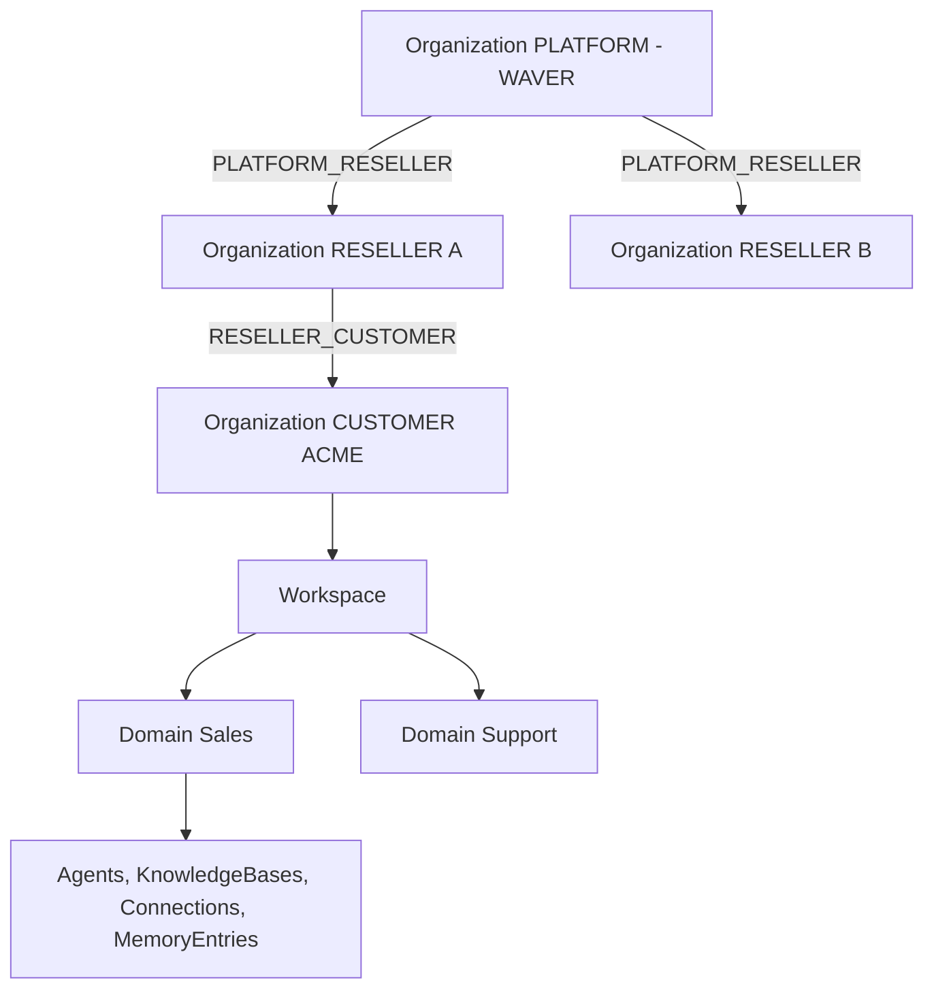
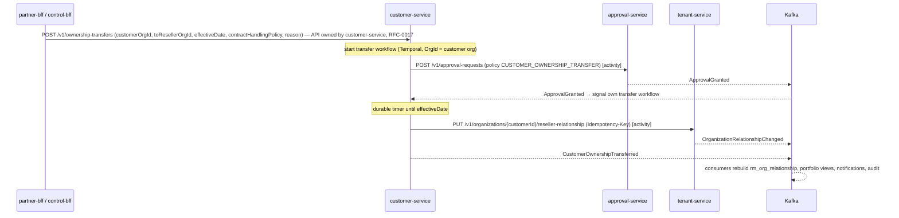

# RFC-0003 - Multi-Tenant Architecture
Status: PROPOSED
Revision 1.3 (2026-10-19): aligned with ADR-0020..0027 (adopted Redis, Keycloak Organizations, HashiCorp Vault Transit context, Temporal, CloudEvents binary mode with Avro, Qdrant).
Owners: WAVER Architecture (named owner TBD)
Reviewers: TBD
Date: 2026-10-19
Version: 1.3

## Summary
Defines Organization types and relationships (PLATFORM → RESELLER → CUSTOMER) and their mirror as Keycloak organizations, Workspace and Domain isolation, tenant context propagation from token to database (`SET LOCAL` + Row-Level Security), through events (`ce_*` headers), Temporal workflows (search attributes) and the shared stores (Redis key prefixes and ACLs, Qdrant payload filters), cross-tenant views for WAVER and resellers, the mechanics of customer ownership transfer between resellers, explicit (never implicit) Domain data sharing, the tenant lifecycle (create, suspend, terminate, purge as a Temporal workflow), noisy-neighbor controls and the tenant isolation test kit.

## Context / Problem
WAVER serves three nested audiences: WAVER sees the whole network, a reseller sees only its portfolio, a customer sees only its own operation (Commercial §1.1, §2.1). Inside a customer, Domains are real data boundaries (Master §2). ADR-0010 chose logical isolation with RLS; this RFC specifies how that works end to end, including the cross-tenant cases ADR-0010 only names.

## Goals
- Tenant isolation enforced twice: in the application (authorization) and in PostgreSQL (RLS); stores without row-level security (Redis, Qdrant, Temporal) get tenant scoping from the platform starter, never from request input, and are covered by the same test kit.
- A reseller can never read another reseller's customers; a customer never sees commercial data of its reseller or WAVER.
- No implicit data sharing between Domains.
- Suspension is reversible and distinct from termination and purge (AR-012).
- One heavy tenant cannot degrade others.

## Non-goals
- Dedicated database per tenant (future enterprise option, ADR-0010).
- Business rules for ownership transfer, retention periods, grace periods (Open Questions).
- Role catalog and permission evaluation details (RFC-0004).

## Requirements / ARs
AR-002, AR-008 (tenant context on every call and event), AR-009 (audited cross-tenant access), AR-012 (safe suspension), AR-013, AR-014. ADR-0003, ADR-0006, ADR-0010, ADR-0012 (envelope and inbox), ADR-0020 (Redis, supersedes ADR-0013), ADR-0021 (Keycloak), ADR-0022 (Vault), ADR-0023 (Temporal, supersedes ADR-0018), ADR-0024 (binary CloudEvents, Avro), ADR-0025 (Qdrant, supersedes ADR-0011).

## Proposed Design

### 1. Organization model (tenant-service)
| Entity | Key fields | Notes |
|---|---|---|
| Organization | `id`, `org_type` (PLATFORM, RESELLER, CUSTOMER), `legal_name`, `display_name`, `status`, `tax_metadata` (jsonb), `default_locale`, `created_at/by`, `updated_at/by`, `version` | Exactly one PLATFORM org (WAVER) |
| OrganizationRelationship | `id`, `parent_org_id`, `child_org_id`, `relationship_type` (PLATFORM_RESELLER, RESELLER_CUSTOMER), `status` (ACTIVE, ENDED), `valid_from`, `valid_to`, `ended_reason` | History kept; at most one ACTIVE RESELLER_CUSTOMER per customer |
| Workspace | `id`, `org_id` (CUSTOMER only), `name`, `slug`, `status`, `data_region` (reserved, nullable) | A CUSTOMER org may have several Workspaces (limit = EntitlementLimit) |
| Domain | `id`, `org_id`, `workspace_id`, `name`, `kind` (SALES, SUPPORT, MARKETING, FINANCE, CUSTOM), `status` | Business boundary; owns agents/knowledge/memory/connections via `domain_id` in owning services |

Invariants: PLATFORM and RESELLER orgs have no Workspaces in v1; RESELLER orgs have exactly one ACTIVE PLATFORM_RESELLER relationship; a CUSTOMER has exactly one ACTIVE RESELLER_CUSTOMER relationship (direct WAVER-sold customers, if ever allowed, would point to the PLATFORM org — business question).



**Mirror in Keycloak (ADR-0021).** Every Organization has exactly one Keycloak organization in realm `waver` (alias = WAVER `orgId`, so it is stable and opaque). identity-access-service owns the mapping (`kc_organization_id` on its organization link record) and drives the mirror through the Keycloak Admin API from tenant events:
| tenant event | identity-access action on Keycloak |
|---|---|
| `OrganizationCreated` | Create Keycloak organization (alias `orgId`, attribute `org_type`), disabled while PENDING |
| `OrganizationStatusChanged` → ACTIVE | Enable the organization |
| `OrganizationStatusChanged` → SUSPENDED | Keep enabled; login behaviour per suspension policy, enforced by identity-access through the claims mapper (RFC-0004) |
| `OrganizationStatusChanged` → TERMINATED | Disable the organization; members can no longer obtain tokens for it |
| purge (§7) | Delete the Keycloak organization and its brokered IdP; delete Keycloak users whose last membership is gone |
Memberships (identity-access) are mirrored as Keycloak organization members; verified e-mail domains and the customer's brokered IdP are attached to the Keycloak organization. Keycloak organizations are never the source of truth for tenancy: tokens get `org_id`/`org_type` from identity-access data via the claims mapper, and a daily reconciliation compares both sides.

### 2. Tenant-owned data in every service
- Every tenant-owned table has `org_id` and, when the resource lives below them, `workspace_id` and `domain_id` (CONVENTIONS, ADR-0010).
- Commercial aggregates that bind two organizations also carry `seller_org_id` (the reseller that issued them): Quote, Contract, ContractVersion, Invoice, DunningCase, SuspensionCase, SupportCase. `seller_org_id` is immutable history and is never rewritten by an ownership transfer.
- RLS is `ENABLE` + `FORCE` on every tenant-owned table; the application role is not owner and lacks `BYPASSRLS`; migrations use a separate owner role.

Standard policies (generated by the migration template; linter rejects tables without them):
```sql
-- isolation by owning org (all tenant-owned tables)
CREATE POLICY p_org ON agent
  USING (org_id = nullif(current_setting('waver.org_id', true), '')::uuid)
  WITH CHECK (org_id = nullif(current_setting('waver.org_id', true), '')::uuid);
-- Domain narrowing (tables with domain_id), restrictive: applies on top of p_org
CREATE POLICY p_domain ON agent AS RESTRICTIVE
  USING (current_setting('waver.domain_ids', true) IS NULL
         OR current_setting('waver.domain_ids', true) = ''
         OR domain_id = ANY (string_to_array(current_setting('waver.domain_ids', true), ',')::uuid[]));
-- two-party commercial tables add the seller side
CREATE POLICY p_seller ON contract
  USING (seller_org_id = nullif(current_setting('waver.org_id', true), '')::uuid);
```
`waver.workspace_ids` follows the same restrictive pattern as `waver.domain_ids`. A missing `waver.org_id` returns zero rows (ADR-0010).

#### 2.1 Tenant isolation outside PostgreSQL
Redis, Qdrant and Temporal have no row-level security. Their per-service isolation (RFC-0002 §8) separates **services**; tenant separation inside a service's partition is built by the platform starter from `TenantContext` (token, `ce_*` headers or workflow headers), never from request bodies or client headers, and is tested by the kit of §9.
| Store | Tenant isolation mechanism | Notes |
|---|---|---|
| Redis (ADR-0020) | ACL user per service restricted to its prefix (`~waver:<use>:<service>:*`). Tenant-scoped keys are produced only by the starter key builder and always carry the org segment right after the service prefix: `waver:cache:<service>:<name>:<orgId>:<id>`, `waver:idem:<service>:<orgId>:<key>`. Quota counters are keyed by `quotaCounterId`, which belongs to exactly one org in usage-metering. Edge rate-limit keys are per API key, `orgId` and route. Session keys (`waver:sess:<bff>:*`) are per session and hold the token's org. | No PII in keys; values with PII avoided or encrypted; TTL on every key. Purge deletes the org's keys by the org segment (`SCAN` + `UNLINK` per prefix) and TTLs bound anything missed. |
| Qdrant (ADR-0025) | Payload index on `org_id` with tenant-optimized indexing (`is_tenant`); every search carries a mandatory filter `org_id = <token org>` plus `workspace_id`, `domain_id` (own ∪ actively shared, §5), `knowledge_base_id` and `acl_tags`, built by the starter `vector` module and applied **inside** the vector search before ranking. Results are re-checked against PostgreSQL (chunk exists and is permitted) before use. | Large tenants may move to a dedicated shard/collection; the filter stays mandatory. Purge deletes points by `org_id` filter; collections are rebuildable from PostgreSQL. |
| Temporal (ADR-0023) | Namespaces are per plane, not per tenant. Every tenant workflow is started with search attributes `OrgId` (and `WorkspaceId`, `DomainId` when applicable); the starter's context propagator writes `TenantContext` into workflow and activity headers, and each activity re-establishes it (`SET LOCAL waver.*`) before touching the database. Workflow IDs derive from the owning aggregate ID (opaque UUIDv7). | Workflow inputs carry IDs, not PII. Starting a tenant workflow without `OrgId` is rejected by the starter. Temporal Web is restricted to WAVER operators and filtered by `OrgId` for support. |
| Kafka (ADR-0012, ADR-0024) | `ce_orgid` header mandatory on tenant-scoped topics (binary mode); `ce_workspaceid`, `ce_domainid` when applicable. | Avro `data` keeps minimal state. |
| Vault (ADR-0022) | Transit key `tenant-credentials` with derivation context = `orgId`: ciphertext created for org A cannot be decrypted with org B's context. | connector-service is the only encrypting service. |
| Keycloak (ADR-0021) | One Keycloak organization per Organization (§1); members, domains and brokered IdP are per organization; a token acts in one org only. | Federation of customer A never authenticates members of customer B. |

### 3. Tenant context propagation
| Step | Mechanism (waver-platform-starter) |
|---|---|
| Token | Issued by Keycloak; `org_id`, `org_type`, `ws_ids`, `roles`, `act`, `support_grant` (CONVENTIONS) produced by the claims mapper from identity-access data (RFC-0004). Tenant identity never comes from body or client headers. |
| Resource selectors | `workspaceId`/`domainId` in the URL path are accepted only after the authorization check proves they belong to the token org and that the principal may access them (RFC-0004). |
| `TenantContext` | Immutable request-scoped object `{orgId, orgType, workspaceIds, domainIds, principalId, actorChain, supportGrantId}`; propagated to virtual threads/async executors by the starter's context-aware executor. |
| Database | Transaction hook runs `SET LOCAL waver.org_id`, `waver.workspace_ids`, `waver.domain_ids` (comma lists; omitted when the principal has org-wide scope) before the first statement. Repository adapters outside a transaction fail fast. |
| Outgoing HTTP | Token exchange keeps the user's org in the derived token (RFC-0005 §6); no tenant headers. |
| Outgoing events | CloudEvents extensions in binary mode as Kafka headers (ADR-0024): `ce_orgid` (mandatory for tenant-scoped topics), `ce_workspaceid` and `ce_domainid` when applicable, `ce_actorid`, `ce_actortype`, `ce_supportgrantid` in support sessions. Written to the outbox row and published by Debezium. |
| Consuming events | Listener builds `TenantContext` from the `ce_orgid` header; rejects tenant-scoped events without it to DLQ; sets `SET LOCAL` the same way. Producer authenticity comes from Kafka write ACLs (only the owning service's outbox connector writes its topics). |
| Workflows and activities | Temporal workflows (ADR-0023) are started with `OrgId` search attributes and carry `TenantContext` in headers; each activity sets the context of its org per transaction (§2.1). Platform-wide workflows (e.g., purge orchestration) use the dedicated platform role (§4) only in the steps that need it. |
| Shared stores | Redis keys and Qdrant filters derive the org from `TenantContext` through the starter (§2.1). |

### 4. Cross-tenant views
Cross-tenant reads never relax `p_org`; they use separate database roles with their own policies, exposed only through dedicated query paths in services that own those views (ADR-0010).
| View | Who | DB role / policy | Allowed data | Audit |
|---|---|---|---|---|
| Reseller portfolio | RESELLER users (partner-bff) | `<svc>_portfolio_reader`: `org_id = ANY(waver.scope_org_ids)` read-only | Commercial and aggregated usage data of its ACTIVE customers: customer, contract, entitlement, provisioning, billing, usage-metering, support | Access logged per request (no per-row audit) |
| Seller side | RESELLER users | `p_seller` on two-party tables | Quotes, contracts, invoices it issued | Normal |
| WAVER oversight | PLATFORM users (control-bff) | `<svc>_platform_reader`: no tenant predicate, read-only | Commercial plane + aggregated metrics of the whole network | Every query path records an AuditEvent with filter parameters |
| Support access | Support staff with `support_grant` | Normal app role with `waver.org_id` = target org | Exactly what the grant scope allows (RFC-0004) | Every request audited |

`waver.scope_org_ids` is computed by the starter from a local read model `rm_org_relationship` (from tenant events) — the set of ACTIVE RESELLER_CUSTOMER children of the token org. Portfolio views **never** include operational data: conversations, messages, knowledge documents, memory, credentials, tool payloads. Those are reachable only through support access.

### 5. Domain isolation and explicit sharing
- Each Agent, KnowledgeBase, MemoryEntry, Connection (when Domain-scoped), ChannelConnection, Workflow and Trigger has a `domain_id`.
- A binding from an AgentVersion to a resource in another Domain is rejected by agent-builder unless an explicit **ResourceShare** exists.
- ResourceShare is owned by **tenant-service** (single owner and audit point for cross-Domain sharing, v1.2 review); resource-owning services (initially knowledge-service and connector-service) enforce shares from a local read model. Fields: fields `id`, `org_id`, `resource_type`, `resource_id`, `source_domain_id`, `target_domain_id`, `access` (READ, USE), `status` (PENDING_APPROVAL, ACTIVE, REVOKED), `granted_by`, `approval_request_id`.
- Creating a share requires admin rights on the source Domain (and an ApprovalRequest if the org's ApprovalPolicy demands it); emits `ResourceShareGranted/Revoked`; audited.
- Runtime retrieval filters by `domain_id IN (own ∪ actively shared)` inside the Qdrant search, **before** ranking (ADR-0025, §2.1). Memory is never shareable across Domains in v1.
- Workspace-level resources (e.g., an org-wide Connection) are explicitly typed as such (`domain_id` null + `scope = WORKSPACE`); they are usable by any Domain of the Workspace only if bound explicitly.

### 6. Customer ownership transfer between resellers (mechanics)
Business rules (eligibility, approvers, what happens to open invoices and contracts) are open; the mechanics are below. Each transfer is a Temporal workflow owned by customer-service (namespace `waver-commercial`, task queue `customer-service.ownership-transfer`, workflow ID derived from the transfer ID, ADR-0023); customer-service's own Kafka consumer signals its workflow on approval outcomes, and a durable timer waits for `effectiveDate`. The `ownership_transfer` table remains the business record served by the API.

| From | Event / action | To |
|---|---|---|
| REQUESTED | approval requested | PENDING_APPROVAL |
| PENDING_APPROVAL | ApprovalRejected / ApprovalExpired | REJECTED |
| PENDING_APPROVAL | ApprovalGranted, effectiveDate in future | SCHEDULED |
| PENDING_APPROVAL / SCHEDULED | effective time reached (Temporal timer) | APPLYING |
| APPLYING | tenant relationship switched, event published | COMPLETED |
| APPLYING | error after activity retries are exhausted | FAILED (manual review) |
| REQUESTED / PENDING_APPROVAL / SCHEDULED | cancelled by requester | CANCELLED |
Effects: old relationship gets `valid_to`, new ACTIVE one is created; historic two-party records keep their `seller_org_id`; customer operational data is untouched; Workspace IDs never change.

### 7. Tenant lifecycle
Technical status lives on Organization (tenant-service). Commercial lifecycle (customer-service) and financial state (billing DunningCase) are separate fields and are never collapsed into this status (Commercial §13.4).
| From | Trigger | To | Effect |
|---|---|---|---|
| — | customer-service registers a customer, or reseller-service approves a reseller (`POST /v1/organizations`) | PENDING | Organization exists for commercial records; no user access yet |
| PENDING | `ProvisioningSucceeded` (customer: Workspace created, admin invited) or `ResellerActivated` (reseller) | ACTIVE | Admin invitations sent |
| ACTIVE | `CustomerSuspended` / `ResellerSuspended` | SUSPENDED | Data plane blocks runs and channels per suspension policy; default: admin logins allowed read-only (policy is a business decision); data preserved |
| SUSPENDED | `CustomerReactivated` / `ResellerActivated` | ACTIVE | Read models updated; channels resume |
| ACTIVE / SUSPENDED | `CustomerTerminated` (or reseller termination) | TERMINATED | Access closed except export; retention window starts |
| TERMINATED | retention elapsed + purge ApprovalGranted | PURGING | `OrganizationStatusChanged(PURGING)` fan-out |
| PURGING | all services confirmed `TenantDataPurged` | PURGED | Tombstone keeps `id`, `org_type`, dates; audit records retained per audit policy |
RESTRICTED is not a technical org status; it is an entitlement-level restriction (no new deployments/expansion) applied by entitlement-service from `CustomerRestricted`.
**Purge is a Temporal workflow in tenant-service** (`TenantPurgeWorkflow`, namespace `waver-platform`, task queue `tenant-service.tenant-purge`, workflow ID = purge job ID, search attribute `OrgId` = target org; ADR-0023). The `purge_job` table (one row per job, one confirmation row per service) stays in tenant-service as the business and audit record exposed by the API; the workflow is the process:
1. Start only after the purge `ApprovalGranted` (two approvers, RFC-0004) and after the retention window has elapsed (durable timer from `TERMINATED`).
2. Activity: set status PURGING and publish `OrganizationStatusChanged(PURGING)` through the outbox.
3. Wait for confirmations: each service deletes the org's data with its owner role in batches — PostgreSQL rows by `org_id`, plus its own shared-store data (Redis keys by org segment, Qdrant points by `org_id` filter, its own tenant workflows cancelled/terminated, tenant-credential ciphertext with the rows; identity-access deletes the Keycloak organization, brokered IdP and orphaned Keycloak users) — and confirms through the synchronous API `POST /v1/purge-jobs/{id}/confirmations` (`service`, `rowsDeleted`). The API handler records the confirmation and signals tenant-service's own workflow.
4. Durable timers re-announce the purge to services that have not confirmed (default every 24 h) and escalate to manual review after N attempts (default 5).
5. Activity: once every service has confirmed, set PURGED and publish `TenantDataPurged` (tenant-service is the single producer); the tombstone is kept.
Kafka retention, backups, Qdrant snapshots and Temporal workflow history retention expire per their own TTLs (documented in RFC-0007); purge workflow histories contain IDs only. Purge is never triggered by non-payment (Master §7.1).

### 8. Noisy-neighbor controls
All numbers are engineering defaults, tunable per environment and overridable by EntitlementLimits.
| Layer | Control | Default |
|---|---|---|
| edge-gateway | Global token bucket per API key, `org_id`, route and IP with Spring Cloud Gateway `RedisRateLimiter` (ADR-0020); fails open to a local in-memory limiter when Redis is unavailable | 50 req/s per org (global), burst 100 |
| BFF / services | Max page size 200 (CONVENTIONS); statement timeout | `statement_timeout` 5 s control plane, 15 s data plane |
| agent-runtime | Max concurrent AgentRuns per org; queue overflow returns `429` with `Retry-After` / channel retry | 50 per org |
| tool-runtime | Concurrent executions per Connection | 10 |
| model-gateway | Per-org budget and tokens/minute (with usage-metering) | From EntitlementLimit; no default budget |
| Kafka consumers | Work dispatched round-robin by `orgid` inside each consumer batch | — |
| Temporal workers | Max concurrent activities per worker and task-queue rate limits; the owning service caps running workflows per org and type before starting a new one | 20 running workflows per org per workflow type |
| knowledge ingestion | Per-org ingestion concurrency (Temporal ingestion workflows) | 2 workflows |
| Qdrant | Per-org query concurrency in knowledge/memory services; large tenants moved to a dedicated shard/collection (ADR-0025) | 20 concurrent searches per org |
| Redis | Per-service memory budget and eviction policy (`volatile-*` only, never on quota or session prefixes); per-org key counts monitored | — |
| Kubernetes | Data plane on separate node pool; HPA on in-flight work | RFC-0015 |
Real-time quota counters live in Redis (`waver:quota:<quotaCounterId>`, owner usage-metering, ADR-0020) and make HARD quotas near-exact (overshoot limited to concurrent in-flight calls); usage-metering's PostgreSQL `quota_counter`, reconciled every minute, stays authoritative for billing. Edge limits protect capacity; they are not commercial quotas.

### 9. Tenant isolation test kit (`waver-platform-test`)
| Test | What it asserts | Runs |
|---|---|---|
| Repository A/B | For every JPA repository: data written as org A is invisible as org B and with no context | Every service build (Testcontainers PostgreSQL) |
| RLS presence | Every table with `org_id` has RLS enabled+forced and `p_org` | Migration linter in CI |
| Role privileges | App role is not owner and has no `BYPASSRLS` | Integration test |
| API A/B | Generated from OpenAPI: each `{id}` endpoint called with org B token on org A resource returns `404` | Service build |
| Event context | Tenant-scoped consumer rejects event without `ce_orgid` header; context applied from headers | Service build |
| Redis keys | Key builder never yields a tenant-scoped key without the org segment; data cached as org A is not returned with org B's context; ACL user cannot touch other prefixes | Services using the `redis` module (Testcontainers Redis) |
| Temporal context | Tenant workflow cannot start without `OrgId`; activities run with the workflow's org context; replay tests | Services with workflows (Temporal test framework) |
| Identity mirror | Token for a member of org A cannot be obtained for org B; brokered IdP of A does not authenticate B's members | identity-access + Keycloak (Testcontainers) |
| Domain narrowing | Domain-restricted principal cannot read another Domain's rows | Services with `domain_id` tables |
| Portfolio | Reseller A cannot see reseller B's customers; portfolio views return no operational tables | Commercial services + E2E |
| Audience | workspace app/BFF cannot reach marketplace/wholesale endpoints | E2E (Playwright) |
| Retrieval | No cross-tenant or cross-Domain point returned by Qdrant under any filter combination; filters come from the token, never the request body (ADR-0025) | knowledge, memory (Testcontainers Qdrant) |

## APIs / Events / Data Ownership
tenant-service API (internal, `/v1`):
| Method + path | Purpose |
|---|---|
| `POST /v1/organizations` | Create org (customer-service for CUSTOMER, reseller-service for RESELLER; PLATFORM org is seeded) |
| `GET /v1/organizations/{orgId}` | Read org (status, type) |
| `GET /v1/organizations?parentOrgId=&updatedAfter=&cursor=` | Snapshot for read models / portfolio |
| `PUT /v1/organizations/{orgId}/reseller-relationship` | Switch active reseller (customer-service only) |
| `POST /v1/organizations/{orgId}/status-transitions` | Admin transitions not driven by events (audited) |
| `POST /v1/organizations/{orgId}/purge-jobs` | Start purge after approval (starts `TenantPurgeWorkflow`) |
| `GET /v1/purge-jobs/{id}`, `POST /v1/purge-jobs/{id}/confirmations` | Purge status; per-service confirmation (signals the workflow) |
| `POST/GET /v1/workspaces`, `GET /v1/workspaces/{id}` | Workspace management |
| `POST/GET /v1/workspaces/{workspaceId}/domains`, `PATCH /v1/domains/{domainId}` | Domain management |
Events (topic → types): `waver.tenant.organization.v1` → OrganizationCreated, OrganizationStatusChanged, OrganizationRelationshipChanged (proposed); `waver.tenant.workspace.v1` → WorkspaceCreated; `waver.tenant.domain.v1` → DomainCreated; `waver.tenant.purge-job.v1` → TenantDataPurged; `waver.tenant.resource-share.v1` → ResourceShareGranted, ResourceShareRevoked; `waver.customer.customer.v1` → CustomerOwnershipTransferred, CustomerSuspended, ...

## Security & Privacy
- Defence in depth: authorization in the service + RLS in the database; a bug in one layer is caught by the other.
- Cross-tenant roles are read-only and only exist in services that own a portfolio/oversight view; their use is audited.
- Customer operational data is never part of portfolio or oversight views; access needs a SupportAccessGrant.
- Stores without RLS (Redis, Qdrant, Temporal) are tenant-scoped only through the starter (§2.1); direct client usage that bypasses the starter is forbidden by ArchUnit rules.
- Tenant credentials are Vault Transit ciphertext bound to the org context; Temporal Web and Redis are reachable only by WAVER operators and authorized service accounts (Istio `AuthorizationPolicy`).
- LGPD: export per org is a job per service writing to the org's export bundle (RFC-0007); purge is approved and audited; tombstones keep no PII.

## Reliability & Failure Modes
| Failure | Mitigation |
|---|---|
| Context not set (bug) | RLS returns zero rows; writes fail `WITH CHECK`; alert on `TENANT_CONTEXT_MISSING` errors |
| `rm_org_relationship` stale after transfer | Old reseller keeps portfolio visibility until event applied; staleness alert; transfer completion waits for tenant event publish |
| Suspension event lost/delayed | Outbox guarantees delivery; reconciliation job compares org status vs read models hourly |
| Purge partially fails | Purge workflow stays in PURGING; durable timers re-announce to unconfirmed services; manual review after N attempts (default 5); workflow survives restarts |
| Hot tenant | Controls of §8; per-org metrics identify it |
| Redis unavailable | Rate limiting fails open to local limiter; quota checks fall back to the PostgreSQL counter and local snapshot; caches miss; no tenant data lost (ADR-0020) |
| Qdrant filter bug | PostgreSQL final permission check drops chunks not permitted for the token's org/Domain; alert on dropped results |
| Keycloak mirror drift | Claims come from identity-access, so drift cannot widen tenancy; daily reconciliation repairs membership/organization differences |

## Observability
Metrics tagged `org_id` (cardinality controlled: tenant tags on business metrics and traces, not on high-cardinality infra metrics); per-org runs, errors, latency, cost; RLS-denied writes counter; read-model staleness; cross-tenant view usage counts; per-org Redis rate-limit rejections and quota denials; per-org running workflows (Temporal visibility by `OrgId`); purge workflow progress.

## Testing Strategy
§9 test kit is mandatory for every service; plus purge dry-run test in staging (covering PostgreSQL, Redis, Qdrant, Temporal and the Keycloak mirror); replay tests for the purge and ownership-transfer workflows; ownership transfer E2E; suspension/reactivation E2E proving data preserved and runs blocked/resumed.

## Deployment / Rollout / Rollback
Tenant-service and the starter's tenancy module ship in the first vertical slice; RLS templates are part of the service archetype from the first migration. Policy changes are forward-only migrations; rollback means a new migration restoring the previous policy.

## Alternatives Considered
- Schema-per-tenant / DB-per-tenant: rejected for v1 (ADR-0010).
- Denormalized `reseller_org_id` on all customer tables: rejected; ownership transfer would rewrite many rows across services. Portfolio scope from the relationship read model instead.
- Tenant ID in a trusted internal header: rejected; tenant context comes only from tokens/events (CONVENTIONS).
- Qdrant collection per tenant: rejected for v1; one collection per owning service with a tenant-indexed `org_id` payload filter, dedicated shard/collection only for large tenants (ADR-0025).
- Temporal namespace per tenant: rejected; namespaces per plane plus `OrgId` search attributes keep operations manageable.
- Keycloak realm per tenant: rejected; one realm `waver` with Keycloak Organizations (ADR-0021) keeps a global User and one set of clients.
- PostgreSQL state machine with timer polling for purge and transfers (ADR-0018): superseded by Temporal workflows (ADR-0023).

## Risks
- Large portfolios make `scope_org_ids` long; mitigated by passing it as an array setting and indexing `org_id`; revisit beyond ~10k customers per reseller.
- RLS adds planner overhead; mitigated by `org_id` leading every index.
- Restrictive Domain policies may surprise developers; covered by the test kit.
- Redis, Qdrant and Temporal have no database-enforced tenant isolation; a starter bypass would leak across tenants. Mitigated by mandatory starter modules, ArchUnit rules, the test kit and the PostgreSQL final check on retrieval.

## Open Questions
1. Customer ownership transfer business rules: eligibility, approvers (WAVER only? both resellers? customer consent?), treatment of active contracts, open invoices and credits.
2. After a transfer, does the old reseller keep read access to historic contracts/invoices it issued (current design: yes via `seller_org_id`)?
3. Retention periods after termination and suspension before purge (Commercial §20) — business/legal.
4. Can WAVER sell directly to customers (customer related to the PLATFORM org)?
5. Reseller default with WAVER (Master §15): does reseller suspension affect its customers' technical status? Current design: no automatic cascade.
6. ~~Should `domainid` become a CloudEvents extension?~~ Closed by ADR-0024: `domainid` is a conditional extension (`ce_domainid` header).
7. Data residency / `data_region` usage (Scope §24) — reserved field only; would also affect where Redis, Qdrant and Temporal data live.
8. Who may create a ResourceShare and whether approval is always required — product decision.
9. Should Temporal payloads be encrypted with a payload codec backed by Vault Transit (per-org context), or is the "IDs only, no PII in workflow inputs" rule sufficient? Security decision (RFC-0010).

## Decision
PROPOSED.
