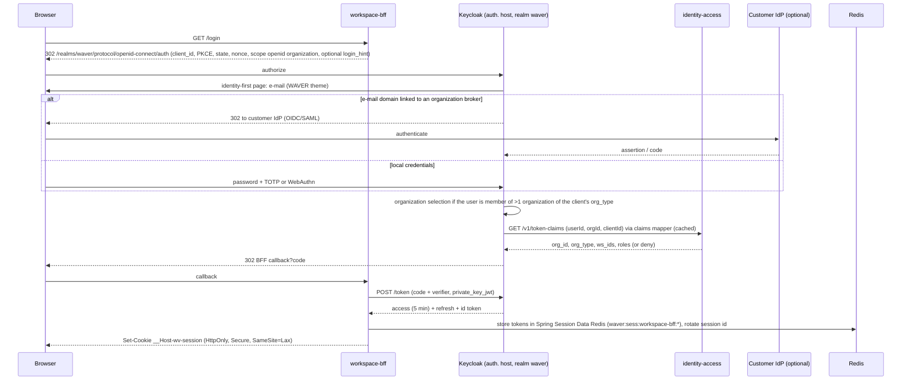

# RFC-0004 - Identity & Access Management
Status: PROPOSED
Revision 1.3 (2026-10-19): aligned with ADR-0020..0027 (adopted Keycloak as identity provider, Redis for BFF sessions, HashiCorp Vault for client keys and IdP secrets, Istio for internal endpoint authorization).
Owners: WAVER Architecture (named owner TBD)
Reviewers: TBD
Date: 2026-10-19
Version: 1.3

## Summary
Defines authentication, OIDC/OAuth 2.1 with **Keycloak** (realm `waver`, ADR-0021) and the split of responsibilities with `identity-access-service`: Keycloak runs login, MFA/WebAuthn, step-up (ACR), identity brokering per customer, token issuance and token exchange; identity-access-service owns users' business records, memberships, the RBAC role catalog with ABAC conditions on Organization / Workspace / Domain / resource, service accounts and API keys for the public API, support access (impersonation) and the identity audit events, and drives Keycloak through its Admin API. Also covers Keycloak Organizations, the protocol-mapper SPI that puts WAVER claims into tokens, BFF login and sessions in Redis, account lifecycle and configuration as code.

## Context / Problem
Three audiences (WAVER, Resellers, Customers) log into three portals, plus programmatic clients and 33 services. The commercial baseline (§11) defines roles and segregation of duties; the scope baseline (§4.4) requires permissions to respect Organization, Workspace, Domain and resource. ADR-0008 had embedded Spring Authorization Server in identity-access-service; on 2026-10-19 ADR-0021 replaced it with Keycloak so that login UX, MFA, federation, account recovery and admin tooling are not built in-house. CONVENTIONS fixes the claims. This RFC defines the flows, the Keycloak configuration, the role catalog, the evaluation model and support access.

## Goals
- One identity provider for all humans and machines (Keycloak); tokens never in the browser.
- identity-access-service remains the single source of truth for the access model; Keycloak holds only what it needs to authenticate and to issue tokens.
- Role catalog that implements Commercial §11 and segregation of duties.
- Permission decisions taken in services, deny-by-default, with tenant and Domain scope, and audited when sensitive.
- Support access that is explicit, time-boxed, approved, audited and visible to the customer.
- Keycloak configuration as code; no manual console changes in production.

## Non-goals
- Customer-defined custom roles (future; see Open Questions).
- End-user (consumer) identity for channel contacts (handled by channel/runtime as contact data, not Users).
- Network-level security, mTLS, WAF (RFC-0010, ADR-0026).
- Keycloak internals (Infinispan tuning, database sizing, upgrade procedure) beyond what WAVER configures — RFC-0015 and runbooks.

## Requirements / ARs
AR-008 (tenant context from token), AR-009 (authorization + audit for sensitive actions), AR-011 (entitlements are checked in addition to permissions), AR-013 (data plane keeps working on cached keys and read models), AR-014. ADR-0021 (Keycloak, supersedes ADR-0008), ADR-0009, ADR-0010, ADR-0014 (ownership rules), ADR-0020 (Redis sessions), ADR-0022 (Vault), ADR-0026 (Istio). SECURITY_BASELINE.

## Proposed Design

### 1. Components and registered clients
| Component | Responsibility |
|---|---|
| **Keycloak**, realm `waver` (Quarkus distribution, ≥ 2 replicas with Infinispan clustering, own PostgreSQL database isolated with `waver_identity_access` as tier-0, RFC-0001) | Login, password policy, account recovery, e-mail verification; MFA (TOTP, WebAuthn/passkeys) and step-up via ACR levels; identity brokering (OIDC/SAML, one broker per customer organization); token issuance, JWKS and key rotation; standard token exchange (RFC 8693); service-account clients; **Organizations** (one Keycloak organization per WAVER Organization, RFC-0003 §1) |
| **identity-access-service** (`waver_identity_access`) | Owner of User (business record), Membership, RoleAssignment, Role, Permission, ServiceAccount, ApiKey, SupportAccessGrant, IdpConfiguration, VerifiedDomain and the Organization ↔ Keycloak organization mapping. Drives Keycloak exclusively through the **Keycloak Admin API** (adapter behind the `IdentityProviderPort`): users, organization members, domains, brokered IdPs, clients, required actions, session logout. Serves the claims endpoint for the mapper. |
| **WAVER claims mapper** (Keycloak protocol-mapper SPI, Java, built and versioned with identity-access-service) | Adds `org_id`, `org_type`, `ws_ids`, `roles`, `act`, `support_grant` to tokens by calling identity-access `GET /v1/token-claims` (internal, mesh-restricted to Keycloak's service account); short in-process cache (default TTL 30 s, stale-serve up to 5 min if identity-access is unavailable, then fail closed) |
| **WAVER theme** (Keycloak theme) | Login, identity-first e-mail step, organization picker, MFA, recovery and e-mail templates in the WAVER brand; the only other custom Keycloak artefact (ADR-0021) |
Keycloak's admin console and Admin API are not exposed on the public `auth.` host; they are reachable only inside the mesh (identity-access and the deployment pipeline) and by WAVER operators through an internal host with SSO.

Registered clients (all managed as code, §13):
| Client | Type | Grants | Audience / notes |
|---|---|---|---|
| `control-bff`, `partner-bff`, `workspace-bff` | Confidential, `private_key_jwt` (assertion signed with a Vault Transit key, ADR-0022) | authorization_code + PKCE, refresh_token, token exchange | Each restricted to one `org_type` (PLATFORM / RESELLER / CUSTOMER): the claims mapper refuses to issue claims for an organization of another type |
| `edge-gateway` | Confidential, `private_key_jwt` | client_credentials, token exchange for API-key principals (§9) | Public API only |
| one client per service (`svc-<service>`) | Confidential, `private_key_jwt` (Vault Transit key `svc-<service>`, never leaves Vault) | client_credentials, token exchange | Own service identity; created by the pipeline |
| Customer ServiceAccount clients (`sa-<serviceAccountId>`) | Confidential, client secret or customer-registered `private_key_jwt` | client_credentials | Public API; org-bound; created by identity-access through the Admin API |

### 2. Interactive login via BFF

- A token always acts in **one** Organization. Switching org = new authorization request with `prompt=none` and `scope=organization:<orgId>` (Keycloak organization alias = WAVER `orgId`); the BFF replaces the session tokens.
- Login, MFA, organization-picker and recovery pages are Keycloak pages with the WAVER theme on the `auth.` host.
- Passwords: Keycloak password policy (Keycloak's default hashing, Argon2), minimum length 12, not equal to e-mail; Keycloak brute-force detection locks after 10 failures for 15 min (defaults); generic error messages (no user enumeration).
- The claims mapper denies token issuance (login fails with a generic message) when identity-access reports no ACTIVE membership in the requested organization, the organization type does not match the client, or the suspension policy blocks login (RFC-0003 §1, Open Question 8).

### 3. MFA and step-up
- Factors in v1: TOTP and **WebAuthn/passkeys** (Keycloak built-in); Keycloak recovery authentication codes (single use) as backup.
- Mandatory for every user of PLATFORM and RESELLER organizations (all their roles are administrative back-office roles). For CUSTOMER orgs: per-org policy (`mfaRequired`), default to be decided (Open Questions). identity-access decides who requires MFA (role catalog + org policy) and sets the Keycloak user attribute `wv_mfa_required` and the matching required action through the Admin API; a conditional sub-flow in the realm's browser flow enforces it.
- **Step-up via ACR**: realm ACR-to-LoA mapping `pwd` = 1 (password or federated without MFA), `mfa` = 2 (TOTP/WebAuthn or MFA-trusted IdP), `phr` = 3 (WebAuthn only, phishing-resistant; reserved). Sensitive permissions (marked `stepUp: true` in the catalog, e.g., purge, suspension override, credential write, support grant approval) require `acr` ≥ `mfa` and `auth_time` within 15 min (default). The service answers `401` problem `STEP_UP_REQUIRED` (with the required level); the BFF re-runs authorize with `acr_values=mfa` and `max_age=0`.
- Tokens include `acr`, `auth_time` and `amr` (Keycloak AMR mapper) for these checks.

### 4. SSO federation (identity brokering per customer)
| Entity (identity-access) | Fields |
|---|---|
| IdpConfiguration | `id`, `org_id`, `protocol` (OIDC, SAML2), `metadata` (issuer, endpoints / SAML metadata XML), `client_id`, `client_secret_ref` (Vault KV path, never stored in a database), `status` (DRAFT, ACTIVE, DISABLED), `enforced` (bool), `mfa_trusted` (bool), `group_role_mappings` (jsonb), `jit_membership` (bool, default false), `kc_idp_alias` |
| VerifiedDomain | `id`, `org_id`, `domain`, `verification_token`, `verified_at` (DNS TXT check by identity-access) |
- identity-access validates and approves an IdpConfiguration, then creates the Keycloak identity provider (alias `org-<orgId>`) and links it to the org's Keycloak organization with its verified domains through the Admin API. The client secret is written to Vault KV and delivered to Keycloak through Keycloak's vault SPI (file provider fed by Vault Secrets Operator), so Keycloak's IdP configuration holds only a `${vault.<key>}` reference.
- Home-realm discovery: Keycloak Organizations identity-first login redirects users whose verified e-mail domain belongs to an organization with a linked broker. When `enforced`, the broker is mandatory for that domain and identity-access removes local credentials of that org's members via the Admin API.
- Federated identities link to the same global User by verified e-mail only for brokers trusted for that verified domain (Keycloak first-broker-login flow without manual linking). Memberships still come from invitations or explicit group→role mappings, never from the IdP alone unless `jit_membership` is enabled by a CUSTOMER_ADMIN: Keycloak IdP mappers copy upstream groups into the user attribute `wv_idp_groups`; the claims mapper passes them to identity-access, which applies `group_role_mappings`/`jit_membership`, persists any resulting Membership/RoleAssignment change (events + audit) and returns the claims.
- MFA may be delegated to the customer IdP when `mfa_trusted` is set and the upstream assertion reports MFA (`amr`/`acr`); otherwise Keycloak's post-broker-login flow requires a WAVER second factor for users who need MFA.
- Outbound calls from Keycloak to customer IdPs leave through the Istio egress gateway with `ServiceEntry` per configured IdP host (ADR-0026); identity-access adds the entry when activating the configuration.

### 5. Access token (JWT, RS256/ES256, issued by Keycloak)
| Claim | Value |
|---|---|
| `iss` (`https://auth.<base-domain>/realms/waver`), `aud`, `azp`, `exp`, `iat`, `jti`, `scope`, `auth_time`, `acr`, `amr` | Standard (Keycloak) |
| `sub` | User ID or ServiceAccount ID or service client ID (WAVER UUIDv7; Keycloak users are created with the WAVER User ID as their ID/username so `sub` stays stable) |
| `org_id`, `org_type` | Organization the token acts in (claims mapper) |
| `ws_ids` | Workspaces accessible in that org; omitted for org-wide roles (claims mapper) |
| `roles` | Org-level role keys (§6) (claims mapper) |
| `act` | Actor chain (RFC 8693), e.g., `{ "sub": "svc-agent-runtime", "act": {...} }` (claims mapper on token exchange) |
| `support_grant` | `{ grantId, scope, exp }` only in support sessions (claims mapper) |
Keycloak's own `organization` claim is not used by services; `org_id` is the only tenant claim (CONVENTIONS). Defaults: access token 5 min; refresh token 8 h absolute (SSO session max), rotated on use with reuse detection, bound to the BFF session; realm signing keys rotated every 90 days (new key added as active, previous kept passive until all tokens signed with it have expired); JWKS at `/realms/waver/protocol/openid-connect/certs`, cached by services for 10 min and refetched on unknown `kid`. Domain-scoped grants and fine-grained permissions are **not** in the token (CONVENTIONS).

### 6. Role catalog (system roles, v1)
| Role key | Org type | Scope | Portal | Purpose (Commercial §11) |
|---|---|---|---|---|
| `PLATFORM_SUPER_ADMIN` | PLATFORM | Org | control | Full governance; every action audited; step-up; cannot approve own requests |
| `PLATFORM_COMMERCIAL` | PLATFORM | Org | control | Resellers, pricing, contracts with resellers, commercial catalog |
| `PLATFORM_FINANCE` | PLATFORM | Org | control | Billing, invoices, payments, credits, delinquency |
| `PLATFORM_PRODUCT_OPS` | PLATFORM | Org | control | Marketplace listings, versions, availability, lifecycle |
| `PLATFORM_SUPPORT` | PLATFORM | Org | control | Diagnosis; tenant data only through SupportAccessGrant |
| `RESELLER_OWNER` | RESELLER | Org | partner | Portfolio, contracts, allowed pricing, billing, reseller users |
| `RESELLER_SALES` | RESELLER | Org | partner | Customers, quotes, contracts; no technical secrets |
| `RESELLER_FINANCE` | RESELLER | Org | partner | Invoices, payments, suspension, financial reports |
| `RESELLER_SUPPORT` | RESELLER | Org | partner | Customers and support cases; no price/contract changes |
| `CUSTOMER_ADMIN` | CUSTOMER | Org | workspace | Workspaces, users, contracted resources, all Domains |
| `CUSTOMER_OPERATOR` | CUSTOMER | Workspace | workspace | Operational use per Domain roles |
| `DOMAIN_ADMIN` | CUSTOMER | Domain | workspace | Domain settings, Deployments, Connections, shares (proposed default) |
| `DOMAIN_BUILDER` | CUSTOMER | Domain | workspace | Edit agents/flows/objectives, run evaluations; no Deployment to production (proposed default) |
| `DOMAIN_OPERATOR` | CUSTOMER | Domain | workspace | Conversations, handoff inbox, knowledge upload (proposed default) |
| `DOMAIN_VIEWER` | CUSTOMER | Domain | workspace | Read-only (proposed default) |
Domain roles are role assignments with `scope_type = DOMAIN` on a Membership; they appear in the `rm_authz_grant` read model, not in tokens. Roles are **not** modelled as Keycloak realm/client roles or groups: identity-access computes the org-level role keys and the claims mapper inserts them, so there is a single source of truth.

### 7. Permission model and evaluation
- Permission key: `<context>:<resource>:<action>` (e.g., `contract:contract:activate`, `connector:credential:write`).
- Each service declares its permissions in `contracts/authz/permissions/<service>.yaml` (key, description, `sensitive`, `stepUp`, allowed org types); `contracts/authz/roles.yaml` maps system roles → permissions. identity-access imports both at deploy (Role/Permission aggregates) and serves them to UIs; services compile the same catalog version through the starter.
- Grant data: `RoleAssignment {id, membership_id, role_key, scope_type (ORG, WORKSPACE, DOMAIN), scope_id, granted_by, granted_at, expires_at}`.

Decision procedure in `waver-platform-starter` (`@RequiresPermission`):
1. Token valid (Keycloak issuer, signature, `exp`), `aud` contains the service; principal not revoked (support grants: §10).
2. **Tenant match**: resource `org_id` = token `org_id`, or the call uses a declared cross-tenant view (RFC-0003 §4).
3. **Scope match**: resource `workspace_id` ∈ `ws_ids` (if present); resource `domain_id` covered by an org/workspace role or a Domain grant from `rm_authz_grant`.
4. **RBAC**: some role effective at that scope grants the permission.
5. **ABAC conditions** (catalog-declared, evaluated against resource attributes provided by the service through `ResourceAttributesProvider`): resource state, ownership (reseller portfolio), amount thresholds, `support_grant.scope`, `acr`/`auth_time` freshness, segregation of duties.
6. **Entitlement** (AR-011) checked separately by the use case for commercially controlled capabilities.
Outcomes: `PERMIT`, `DENY`, `PERMIT_WITH_APPROVAL` (e.g., discount above policy → the use case creates an ApprovalRequest instead of executing). `DENY` returns `403` problem `ACCESS_DENIED` (or `404` when revealing existence would leak tenancy).

Initial matrix for sensitive permissions (product to validate):
| Permission | Granted to | Conditions |
|---|---|---|
| `catalog:price-book:activate` | PLATFORM_COMMERCIAL | Approval per ApprovalPolicy |
| `marketplace:listing:publish` | PLATFORM_PRODUCT_OPS | Approval (Commercial §11.1) |
| `contract:contract:activate` | RESELLER_OWNER, RESELLER_SALES | Own portfolio; discount within policy else approval |
| `customer:suspension-case:create` | RESELLER_OWNER, RESELLER_FINANCE | Own portfolio only; reason mandatory |
| `customer:suspension-case:override` | PLATFORM_SUPER_ADMIN, PLATFORM_FINANCE | Approval; step-up |
| `customer:ownership-transfer:request` | PLATFORM_COMMERCIAL, RESELLER_OWNER | Approval (rules open) |
| `agent:deployment:activate` | CUSTOMER_ADMIN, DOMAIN_ADMIN | Entitlement valid; release gate (RFC-0016) |
| `connector:credential:write` | CUSTOMER_ADMIN, DOMAIN_ADMIN | Step-up |
| `runtime:conversation:read` | CUSTOMER_ADMIN, DOMAIN_ADMIN, DOMAIN_OPERATOR | Domain scope |
| `identity:role-assignment:write` | PLATFORM_SUPER_ADMIN, RESELLER_OWNER, CUSTOMER_ADMIN, DOMAIN_ADMIN (Domain roles only) | Own org; cannot grant above own level |
| `identity:support-access-grant:approve` | See §10 | Requester ≠ approver; step-up |
| `tenant:organization:purge` | PLATFORM_SUPER_ADMIN | Approval with two approvers; step-up |
Segregation of duties enforced by conditions: requester ≠ approver (approval-service), RESELLER_SALES cannot read secrets, RESELLER_SUPPORT cannot change price/contract, nobody grants themselves a role.

### 8. Service identities and token exchange
All exchanges use Keycloak **standard token exchange** (RFC 8693) at the realm token endpoint; Keycloak client policies restrict, per requesting client, which audiences it may request. Tokens obtained by services are cached in-process only (never in Redis).
- **Own actions without tenant** (platform jobs, read-model bootstrap of platform-wide data): client_credentials token of `svc-<service>`, `aud` = target, no `org_id`; targets accept it only on endpoints declared platform-wide.
- **Own actions for a tenant** (event consumers, Temporal activities, sagas acting for the org in the event `ce_orgid`): token exchange with `subject_token` = the service's own token, `audience` = target and `scope=organization:<orgId>`. The claims mapper asks identity-access whether the (client, audience) pair is on the per-client allow-list for tenant actions; if so the result carries `org_id`/`org_type` of that org, no `roles` except the service role `SERVICE`, and `act = {sub: svc-<caller>}`; otherwise issuance is denied. Target services authorize `SERVICE` principals against permissions explicitly granted to that calling client in the catalog.
- **On behalf of a user**: caller presents the incoming user token as `subject_token`; result keeps `sub`, `org_id`, `ws_ids`, `roles`, `support_grant`, adds `act`, narrows `aud` to the target; scopes can only shrink.
- BFFs exchange the session token per target audience and cache the result until 30 s before expiry.
- Exchanges are cached in-process (Caffeine) keyed by (subject `jti`, audience); Keycloak sees at most one exchange per subject/audience per token lifetime.
Client authentication of WAVER clients uses `private_key_jwt` assertions signed through Vault Transit (sign only; the private key never leaves Vault, ADR-0022); public keys are registered on the Keycloak clients by the pipeline.
Detailed client behaviour: RFC-0005 §6.

### 9. Customer ServiceAccounts and API keys (public API)
| Entity (identity-access) | Fields |
|---|---|
| ServiceAccount | `id`, `org_id`, `name`, `status` (ACTIVE, DISABLED), role assignments like a Membership (least privilege, usually Domain-scoped), `kc_client_id` (`sa-<id>`), `created_by` |
| ApiKey | `id`, `org_id`, `service_account_id`, `prefix` (`wvk_`), `key_id`, `secret_hash` (HMAC-SHA-256 with a platform pepper kept in Vault Transit), `expires_at` (mandatory, default max 365 days), `last_used_at`, `status` (ACTIVE, REVOKED, EXPIRED) |
- Format `wvk_<keyId>_<secret>` (32 random bytes, base64url); shown once; prefix enables secret scanning.
- Each ServiceAccount has a Keycloak client `sa-<serviceAccountId>` (service account enabled), created and disabled by identity-access through the Admin API. Customers may use client_credentials on it directly (client secret shown once, or their own `private_key_jwt` key).
- `api.` host with an API key: edge-gateway verifies the key against identity-access (`POST /v1/api-key-verifications`, keyed by key hash; positive results cached in-process ≤ 60 s and evicted on `ApiKeyRevoked`), then obtains a 5-min Keycloak access token for the bound ServiceAccount through token exchange restricted to ServiceAccount principals (proposed mechanism, Open Question 9), cached by key hash until 30 s before expiry. Downstream sees a normal Keycloak JWT with `sub` = ServiceAccount. Revocation takes effect within the token lifetime (≤ 5 min).
- Rotation = create new key, deploy, revoke old.

### 10. Support access (impersonation)
SupportAccessGrant (identity-access) gives a named support user a token **in the target org** with `support_grant` claim and `act = {sub: <supportUserId>, org_id: <supportOrg>}`; the user never logs in as the customer's user. Mechanism: control-bff (or partner-bff) performs a token exchange with the support user's token as `subject_token` and `scope=organization:<targetOrgId>`; the claims mapper asks identity-access for an ACTIVE grant of that user for that org and, only then, emits the target `org_id`, `support_grant` and `act`, with roles limited by the grant scope. Without an ACTIVE grant, issuance is denied.
| Field | Notes |
|---|---|
| `id`, `target_org_id`, `target_workspace_id` (optional), `requester_user_id`, `requester_org_id`, `support_case_id` (mandatory), `scope` (READ_ONLY, READ_WRITE), `reason`, `requested_duration`, `approval_request_id`, `status`, `activated_at`, `expires_at`, `revoked_by` | Max duration default 4 h, default 60 min |
| From | Event | To |
|---|---|---|
| — | requested from support-service case | PENDING_APPROVAL |
| PENDING_APPROVAL | ApprovalGranted | APPROVED |
| PENDING_APPROVAL | ApprovalRejected / ApprovalExpired | REJECTED |
| APPROVED | support user starts session (step-up, `acr` ≥ `mfa`) | ACTIVE |
| APPROVED | not started within 24 h (default) | EXPIRED |
| ACTIVE | `expires_at` reached | EXPIRED |
| ACTIVE / APPROVED | revoked by customer admin, approver or requester | REVOKED |
- Visible to the customer: grants listed in Workspace (`/v1/support-access-grants?targetOrgId=`), notification to CUSTOMER_ADMINs on request, activation and end.
- Every request carrying `support_grant` is audited by the starter in the target service (`SupportAccessUsed`, method, path, resource IDs). READ_ONLY grants deny every non-GET.
- Revocation is immediate: services keep `rm_support_grant` (from `waver.identity.support-access-grant.v1`) and reject revoked grant IDs even if the token is still valid; identity-access also ends the support user's Keycloak sessions for that client through the Admin API.
- Credentials (connector-service) are never readable under support access (ADR-0014, ADR-0022).

### 11. Session management (BFF)
- **Spring Session Data Redis** in each BFF, keys `waver:sess:<bff>:*` (ADR-0020), with the principal index enabled for revocation by user. Cookie `__Host-wv-session`, HttpOnly, Secure, SameSite=Lax; Angular XSRF protection (`XSRF-TOKEN` cookie + `X-XSRF-TOKEN` header) on state-changing calls. Session values hold tokens and are protected by Redis ACL (BFF prefix only), TLS and AUTH; no PII in keys.
- Defaults: idle timeout 30 min (control, partner), 60 min (workspace); absolute 12 h (Keycloak SSO session limits aligned).
- Logout: BFF revokes the refresh token at Keycloak (`/protocol/openid-connect/revoke`), deletes the session, then RP-initiated logout at Keycloak (`/protocol/openid-connect/logout`); Keycloak back-channel logout notifies the other BFFs' sessions of the same SSO session.
- Global revocation: identity-access logs out the user's Keycloak sessions via the Admin API and publishes `UserSessionsRevoked` (deactivation, password reset, membership removal, admin action); BFFs delete sessions by principal; refresh fails afterwards.
- Redis loss: sessions disappear and users log in again (documented degradation, ADR-0020); no access is widened.
- Users can list and revoke their own sessions (`/v1/sessions`, identity-access, backed by Keycloak user sessions through the Admin API).

### 12. Account lifecycle
| Aggregate | From | Event | To |
|---|---|---|---|
| User | — | invitation accepted / SSO first login with membership | ACTIVE |
| User | — | invited | INVITED |
| User | ACTIVE | failed-login threshold (Keycloak brute-force detection) | LOCKED (auto-unlock after timeout or admin) |
| User | ACTIVE / LOCKED | admin deactivates or last membership removed | DEACTIVATED |
| User | DEACTIVATED | reactivated with membership | ACTIVE |
| User | DEACTIVATED | LGPD erasure approved | ANONYMIZED (ID kept, PII removed; Keycloak user deleted) |
| Membership | — | invitation sent | INVITED (expires after 7 days, default) |
| Membership | INVITED | accepted | ACTIVE |
| Membership | ACTIVE | org admin suspends | SUSPENDED |
| Membership | SUSPENDED | restored | ACTIVE |
| Membership | any | removed | REMOVED |
- Invitation: identity-access creates (or finds) the Keycloak user (ID = WAVER User ID), adds it to the Keycloak organization and triggers Keycloak's required-actions e-mail (verify e-mail, set password, configure MFA when required) in the WAVER theme; `UserInvited` drives in-app notifications.
- Membership changes are mirrored to Keycloak organization membership; a daily reconciliation in identity-access compares memberships with Keycloak organization members and repairs drift (identity-access wins).
- Keycloak login and admin events (logins, failures, lockouts, MFA enrolment) are imported by identity-access from the Admin API events endpoint (polling, default every 30 s) and turned into audit records and `UserLocked` (no extra Keycloak extension).
Organization suspension (RFC-0003 §7) does not change User/Membership state; login behaviour for suspended orgs follows the suspension policy.

### 13. Keycloak configuration as code
- Realm `waver` (token lifetimes, password policy, brute-force settings, ACR-to-LoA mapping, authentication flows, required actions, Organizations enabled, client policies for token exchange, AMR mapper, WAVER claims mapper, theme, event settings) and all WAVER clients (`*-bff`, `edge-gateway`, `svc-*`) are versioned in the monorepo and applied by the deployment pipeline through the Admin API; changes go through code review.
- Tenant-driven objects (Keycloak organizations, members, domains, brokered IdPs, `sa-*` clients, users) are created only by identity-access through the Admin API, never by the pipeline or by hand.
- Manual console changes in production are forbidden; a drift check in the pipeline compares the live realm with the repository (ADR-0021).
- Keycloak's database and admin credentials come from Vault; the claims mapper and theme are packaged into the Keycloak image built by the pipeline.

## APIs / Events / Data Ownership
Owned aggregates (identity-access): User, Membership, RoleAssignment, Role, Permission, ServiceAccount, ApiKey, SupportAccessGrant, IdpConfiguration, VerifiedDomain, Organization ↔ Keycloak organization mapping, session revocation records. Keycloak owns credentials, authenticator enrolments and SSO sessions (infrastructure state, not business aggregates).
OIDC/OAuth endpoints (Keycloak, `auth.` host, base path `/realms/waver`):
| Method + path | Purpose |
|---|---|
| `GET /.well-known/openid-configuration`, `GET /protocol/openid-connect/certs` | Discovery, keys |
| `GET /protocol/openid-connect/auth`, `POST /protocol/openid-connect/token`, `POST /protocol/openid-connect/revoke`, `GET /protocol/openid-connect/logout`, `GET /protocol/openid-connect/userinfo` | OIDC/OAuth (token endpoint handles code, refresh, client_credentials, token exchange) |
| `POST /protocol/openid-connect/token/introspect` | Internal only (edge-gateway, reconciliation) |
identity-access API (`/v1`, internal; through BFFs for users):
| Method + path | Purpose |
|---|---|
| `GET /v1/token-claims?userId=&orgId=&clientId=&audience=` | Claims for the Keycloak mapper (mesh-restricted to Keycloak) |
| `POST /v1/api-key-verifications` | API key check for edge-gateway (mesh-restricted to edge-gateway) |
| `POST /v1/invitations`, `POST /v1/invitations/{id}/accept` | Invite users to an org |
| `GET /v1/users/{userId}`, `PATCH /v1/users/{userId}`, `POST /v1/users/{userId}/deactivation` | User admin |
| `GET/POST /v1/memberships`, `PATCH /v1/memberships/{id}` | Memberships |
| `GET/POST /v1/role-assignments`, `DELETE /v1/role-assignments/{id}`, `GET /v1/role-assignments?updatedAfter=&cursor=` | Grants + snapshot for read models |
| `GET /v1/roles`, `GET /v1/permissions` | Catalog for UIs |
| `POST/GET /v1/service-accounts`, `POST /v1/service-accounts/{id}/api-keys`, `POST /v1/api-keys/{id}/revocation` | Machine access |
| `POST/GET /v1/idp-configurations`, `POST /v1/verified-domains`, `POST /v1/verified-domains/{id}/verification` | SSO |
| `POST /v1/users/{userId}/mfa-reset` | Admin reset of a user's factors (Admin API; self-service enrolment happens in Keycloak) |
| `POST /v1/support-access-grants`, `GET /v1/support-access-grants`, `POST /v1/support-access-grants/{id}/activation`, `POST /v1/support-access-grants/{id}/revocation` | Support access |
| `GET /v1/sessions`, `POST /v1/sessions/{id}/revocation` | Own sessions |
| Topic | Event types |
|---|---|
| `waver.identity.user.v1` | UserInvited, UserActivated, UserLocked, UserDeactivated, UserAnonymized, UserSessionsRevoked (proposed) |
| `waver.identity.membership.v1` | MembershipChanged, RoleAssigned, RoleRevoked |
| `waver.identity.service-account.v1` | ServiceAccountCreated, ApiKeyCreated, ApiKeyRevoked (proposed) |
| `waver.identity.support-access-grant.v1` | SupportAccessRequested, SupportAccessGranted, SupportAccessActivated, SupportAccessRevoked, SupportAccessExpired |
| `waver.identity.idp-configuration.v1` | IdpConfigurationChanged (proposed) |
Audit (via the starter's audit recorder): all of the above plus LoginSucceeded, LoginFailed, MfaEnrolled, MfaReset, StepUpPerformed (imported from Keycloak events), AuthorizationDenied (sensitive permissions only), SupportAccessUsed (emitted by the target service).

## Security & Privacy
- Tokens only in BFF sessions (Redis, ACL-restricted per BFF) and service memory; never logged (log scrubbing of `Authorization`, cookies, API keys in the starter).
- Realm signing keys are managed by Keycloak key providers in its isolated database; WAVER client keys are Vault Transit keys (sign only); IdP client secrets live in Vault KV and reach Keycloak through its vault SPI; Keycloak database and admin credentials come from Vault (ADR-0022).
- The claims endpoint and the API-key verification endpoint are restricted by Istio `AuthorizationPolicy` to Keycloak's and edge-gateway's service accounts (waypoint with request-level rules on identity-access, ADR-0026), in addition to token authentication.
- Keycloak admin console and Admin API are never reachable from the internet; the Admin API service account of identity-access has only the realm-management roles it needs (users, organizations, identity providers, clients with the `sa-` prefix).
- Brute-force protection, lockout and generic error messages (no user enumeration).
- Threat model mandatory (SECURITY_BASELINE): token theft, confused deputy in token exchange (audience narrowing, client policies, cross-tenant allow-list), privilege escalation via role assignment, support access abuse, compromise of the claims mapper path or the Admin API credentials.
- LGPD: User PII minimized (name, e-mail, phone optional) in both identity-access and Keycloak; anonymization deletes the Keycloak user; audit keeps IDs.
- External penetration test of the login and federation flows before production (ADR-0021).

## Reliability & Failure Modes
| Failure | Impact | Mitigation |
|---|---|---|
| Keycloak down | No logins/refresh/exchange; tokens valid ≤ 5 min | ≥ 2 replicas (Infinispan), PDB, isolated DB; services cache JWKS and exchanged tokens; data-plane consumers use cached service tokens; alert tier-0 |
| identity-access down | Management APIs fail; claims mapper serves its cache (≤ 5 min stale), then new token issuance fails closed | ≥ 3 replicas, PDB, isolated DB; existing tokens unaffected |
| JWKS rotation glitch | 401 across services | Add the next key as passive ≥ 24 h before activation; refetch on unknown `kid` |
| Customer IdP down | That org's SSO users cannot log in | Org admins may keep break-glass local accounts (policy open) |
| Redis down | BFF sessions lost | Users re-login; no access widened (ADR-0020) |
| Vault down | Client assertions cannot be signed; new pods cannot start | Cached tokens until expiry; Vault HA (ADR-0022) |
| Keycloak ↔ identity-access mirror drift | Organization membership on the IdP side differs | Claims always come from identity-access; daily reconciliation |
| `rm_authz_grant` stale | Domain grant changes delayed | Staleness alert; role removal also emits `UserSessionsRevoked` when it removes access |
| Token exchange storm | Keycloak overload | Exchange cache; rate limit per client |
| Support grant revoked but token valid | Window ≤ 5 min | `rm_support_grant` check in every service |

## Observability
Metrics: logins (success/fail by reason, by org type), MFA challenges and step-ups by ACR, token issuance per grant type, exchange latency and cache hit rate, claims-endpoint latency and mapper cache hit rate, Keycloak event import lag, Keycloak/identity-access reconciliation differences, lockouts, active support grants, authorization denies per permission. Keycloak exposes its own metrics to the same backend. Traces span BFF → Keycloak → identity-access (claims). Security alerts: spikes of failures, new IdP config, support grant activation, super-admin actions, Admin API calls outside identity-access, realm drift detected.

## Testing Strategy
- Integration tests of each flow against a Keycloak Testcontainer loaded with the realm-as-code (code+PKCE, refresh rotation, client_credentials, token exchange per type, API key path, step-up with `acr_values`, org switch).
- Claims mapper SPI: unit tests plus Keycloak integration tests (cache, stale-serve, fail closed, `org_type` mismatch denial).
- Authorization matrix tests generated from `roles.yaml` × `permissions/*.yaml` (expected PERMIT/DENY per role and scope).
- Negative tests: wrong `org_type` per BFF, cross-tenant exchange without allow-list, READ_ONLY support grant write attempt, self-approval, role escalation, brokered IdP of org A used for org B.
- Realm configuration: pipeline validates the realm files by importing them into an ephemeral Keycloak; drift check against staging.
- Tenant isolation kit (RFC-0003 §9) on identity data and the Keycloak mirror.
- External pentest before GA.

## Deployment / Rollout / Rollback
First vertical slice: Keycloak realm `waver` (as code) + identity-access + BFF login for control app (PLATFORM users only, TOTP and WebAuthn), then partner and workspace. Customer SSO brokering after GA of local login. Keycloak upgrades follow the Keycloak upgrade runbook (claims mapper and theme re-validated against the new version in CI). Key rotation runbook and break-glass procedure in `10_RUNBOOKS`. Catalog changes ship as new `roles.yaml` versions; removal of a permission from a role is forward-only and audited. Realm changes roll back by re-applying the previous realm version from Git.

## Alternatives Considered
- Spring Authorization Server embedded in identity-access (ADR-0008, superseded by ADR-0021): full control, but login UX, MFA, federation, recovery and admin tooling would all be custom security-critical code.
- Commercial IdP (Auth0, Entra, Okta): faster, but per-user cost at B2B2B scale and data residency constraints (ADR-0021).
- Access model inside Keycloak (realm/client roles, groups, fine-grained authorization services): rejected; Domain-scoped grants, ABAC and segregation of duties stay in identity-access, Keycloak carries only coarse claims.
- Keycloak realm per tenant: rejected; one realm with Organizations keeps a global User, one set of clients and simpler operations.
- Permissions inside tokens: token bloat and stale rights; rejected by CONVENTIONS.
- Central synchronous policy decision service: adds a hot-path dependency (AR-013); replaced by in-service evaluation with read models.
- Impersonating the customer's user: hides who acted; replaced by `act` + `support_grant`.

## Risks
- The claims mapper SPI and the WAVER theme are the custom code inside a tier-0 component; they must be re-validated on every Keycloak upgrade. Mitigated by CI integration tests against the pinned Keycloak version.
- Token issuance depends on identity-access through the claims mapper; mitigated by the mapper cache, stale-serve window and identity-access HA.
- Keycloak Organizations and token-exchange capabilities differ between Keycloak versions (some features were preview in earlier releases); the major version is pinned and the flows in §8–§10 are verified in CI before an upgrade.
- Dual state (identity-access memberships mirrored into Keycloak organizations); mitigated by identity-access as single writer and daily reconciliation.
- 5-min revocation window for normal access; acceptable except support grants, which are checked explicitly.
- Catalog drift between services if versions diverge; the BOM pins the catalog version.

## Open Questions
1. Who approves support access: the customer (consent), WAVER super admin, or both? Can RESELLER_SUPPORT obtain grants for its customers (L1)? (Commercial §20 support model.)
2. MFA requirement and session timeouts for CUSTOMER users — business/security policy.
3. Custom roles per organization — when and with which limits.
4. ~~Login page rendering: server-side templates in identity-access or a small Angular login app.~~ Closed by ADR-0021: Keycloak pages with the WAVER theme.
5. A `principal_type` claim (USER, SERVICE_ACCOUNT, SERVICE) would simplify authorization; it requires a CONVENTIONS change (the claims mapper could emit it at no extra cost).
6. Service-to-service tenant-scoped token exchange (§8) selects the org with `scope=organization:<orgId>`; confirm with the pinned Keycloak version that standard token exchange accepts the organization scope for service-account subjects (fallback: a dedicated request parameter read by the claims mapper) — RFC-0005/RFC-0010.
7. Break-glass accounts for SSO-enforced orgs and for WAVER super admins — security policy.
8. Login behaviour for users of SUSPENDED organizations — suspension policy (RFC-0017); enforced in the claims mapper.
9. API-key path (§9): confirm the Keycloak mechanism that lets edge-gateway obtain a token for the bound ServiceAccount (token exchange restricted to ServiceAccount principals vs. `private_key_jwt` per `sa-*` client signed through Vault Transit by edge-gateway). Both keep identity-access as the API-key validator required by ADR-0021.

## Decision
PROPOSED.
