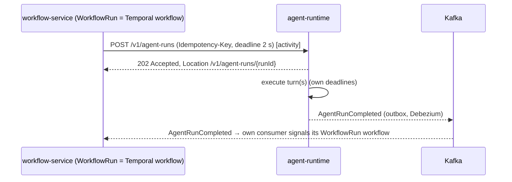

# RFC-0005 - Inter-Service Communication
Status: PROPOSED
Revision 1.3 (2026-10-19): aligned with ADR-0020..0027 (adopted Istio ambient mTLS and AuthorizationPolicy, Redis Streams for run-output fan-out and Redis caches/idempotency, Temporal for long waits, Keycloak token exchange, Avro event compatibility).
Owners: WAVER Architecture (named owner TBD)
Reviewers: TBD
Date: 2026-10-19
Version: 1.3

## Summary
Defines how WAVER services talk to each other: when to use synchronous REST versus Kafka events, contract-first REST clients (Spring HTTP interface clients generated from OpenAPI), service discovery through Kubernetes DNS inside the Istio ambient mesh, Resilience4j defaults for timeouts, retries, circuit breakers and bulkheads (the single retry layer; mesh retries disabled), deadline propagation, service-to-service authentication (Keycloak client credentials and token exchange on top of mesh mTLS and per-edge `AuthorizationPolicy`), the 2-hop limit for synchronous chains on hot paths, fallback patterns, local read models built from events, run-output fan-out through Redis Streams, long waits through Temporal, call versioning and contract testing.

## Context / Problem
ADR-0004 decided REST/OpenAPI for immediate request/response and Kafka for events; AR-004 and AR-014 require versioned contracts and controlled failure handling; AR-013 forbids data-plane dependence on the control plane. Without one communication standard, 33 services would each invent timeouts and retries, chains would grow until a single slow service stalls a chat turn, and retries would amplify outages.

## Goals
- A decision rule that makes "sync or async?" boring.
- Identical client behaviour in every service, configured by `waver-platform-starter` and overridable per call only with justification.
- Bounded latency and bounded blast radius for the hot path (conversational turn, tool execution, inbound channel message).
- Contracts evolve without coordinated deployments (AR-015).

## Non-goals
- Kafka topic, envelope, retry-topic and DLQ design (RFC-0006, ADR-0012).
- External/public API design and BFF allow-lists (RFC-0008).
- Installation and operation of the Istio mesh (ADR-0026, RFC-0010, RFC-0015); this RFC only defines what services rely on (§11).
- Temporal cluster operation and workflow design per service (ADR-0023, service RFCs); this RFC only defines when a wait belongs in Temporal (§13).

## Requirements / ARs
AR-004, AR-006, AR-008, AR-013, AR-014, AR-015. ADR-0004, ADR-0009, ADR-0012, ADR-0015, ADR-0017, ADR-0020 (Redis, supersedes ADR-0013), ADR-0021 (Keycloak, supersedes ADR-0008), ADR-0022 (Vault), ADR-0023 (Temporal, supersedes ADR-0018), ADR-0024 (Avro, Apicurio, Debezium), ADR-0026 (Istio).

## Proposed Design

### 1. Sync vs async decision table
| Situation | Style | Example |
|---|---|---|
| Caller needs data or a decision to continue the current user request | Sync query (`GET`) | contract-service reads price/availability from catalog when building a quote |
| Caller asks another context to change its state and needs the outcome now (validation errors shown to the user) | Sync command (`POST/PUT/PATCH`) with `Idempotency-Key` | customer-service switches reseller relationship in tenant-service |
| Caller starts work that may take longer than the request deadline | Async command: `POST` → `202 Accepted` + resource URL; completion via event | workflow-service starts an AgentRun; evaluation-service starts a sandbox run |
| Other contexts must react to a fact that already happened | Event (outbox → Kafka) | `ContractActivated` → entitlement, billing, notification, audit |
| Data plane needs control-plane facts | Event-fed local read model, never sync | runtime's active Deployments and Entitlements |
| Many consumers, or consumer unknown to producer | Event | `ModelCallCompleted` → usage-metering, audit |
| Notification of a human (e-mail, in-app) | Event to notification-service | `InvoicePastDue` |
| Streaming tokens from a model | Sync streaming (SSE over HTTP) | agent-runtime ← model-gateway |
| Streaming tokens to a user (Workspace) | Start run (`202`) + subscription to the run-output stream in Redis Streams (§12) | workspace-bff starts the run on agent-runtime, then subscribes to agent-runtime's SSE endpoint `GET /v1/conversations/{conversationId}/stream?inputId=` (RFC-0011) (backed by Redis Streams) and relays it to the browser |
| Streaming to a Web Chat end user | 202 Accepted + stream subscription (decoupled, §12) | channel-service accepts the message (202), agent-runtime runs asynchronously, channel-service subscribes to the run's Redis stream; hot-path depth stays ≤ 2 (RFC-0011) |
| Waiting for something that may take minutes to months (user reply timeout, approval, handoff, Flow `Delay`, effective dates, dunning stages) | Temporal workflow in the owning service (§13); outcomes arrive as events that the owner's consumer turns into signals to its own workflow | tool-runtime waits for `ApprovalGranted`; contract-service renewal reminders |
Kafka is not used for request/response (ADR-0004). Events are never used to "ask" another service to do something; commands to another service are API calls (CONVENTIONS: events are past-tense facts). Redis and Temporal are not integration channels between services: the run-output stream (§12) is the only declared Redis-based exchange, and a service never signals another service's workflow (RFC-0002 §8).

### 2. Contract-first REST clients
- Provider contract: `contracts/openapi/<service>/v<N>.yaml` (CONVENTIONS paths `/v{major}/{resource}`, problem+json, cursor pagination, `Idempotency-Key`, `ETag`/`If-Match`).
- OpenAPI Generator produces **Spring HTTP interface clients** (`@HttpExchange` interfaces + DTOs) backed by `RestClient`, published as Maven artifact `br.com.waver.contracts:<service>-client-v<N>`. Generator options: `useJakartaEe`, `enumUnknownDefaultCase=true` (tolerate new enum values), no domain types.
- Services depend on client artifacts only (ADR-0015); the outbound adapter wraps the client behind an application port so the domain never sees DTOs (AR-007).
- Angular `api-clients` are generated from the BFF OpenAPI files the same way (RFC-0021).
- Starter auto-configuration per client (`waver.clients.<service>.*`): base URL, call class, auth mode, Resilience4j instances, metrics/tracing, problem+json decoding into `RemoteProblemException(code, status, correlationId)`.

### 3. Service discovery
- Kubernetes Service DNS only: `http://<service>.<namespace>.svc.cluster.local:8080` (default port 8080, management port 8081). No client-side registry (no Eureka/Consul).
- Plain `http://` in application configuration: Istio ambient (ztunnel) transparently upgrades every pod-to-pod connection to mTLS (§11); services configure no TLS or certificates themselves.
- Base URL is configuration (`waver.clients.<service>.base-url`) set by the Helm chart, so tests and local runs point to WireMock/Testcontainers.
- Load balancing by ztunnel at connection level (L4), and per request by the waypoint proxy for services that have one (§11); HTTP/1.1 keep-alive with connection max-lifetime 5 min (default) so new pods receive traffic after scale-out.
- Readiness probes gate traffic; graceful shutdown drains in-flight requests (30 s default).

### 4. Timeouts, retries, circuit breakers (Resilience4j defaults)
Defaults are engineering defaults, set in the starter, overridable per client in `application.yaml` with a code-review justification.
| Call class | Connect timeout | Response timeout | Retries (max attempts) | Retry on |
|---|---|---|---|---|
| `QUERY` (GET) | 500 ms | 2 s | 3 | connect error, 502/503/504, 429 (honours `Retry-After` ≤ remaining deadline) |
| `COMMAND` (POST with `Idempotency-Key`, PUT, DELETE, PATCH with `If-Match`) | 500 ms | 5 s | 3 | same as QUERY; never on timeout of a non-idempotent call |
| `COMMAND_NON_IDEMPOTENT` (exceptional, must be justified) | 500 ms | 5 s | 1 | none |
| `START` (async command, expects 202) | 500 ms | 2 s | 3 | same as QUERY |
| `STREAM` (SSE) | 500 ms | first byte 15 s, idle 30 s | 2 before the first byte; 1 (no retry) after it | connect error, 503 before the first byte |
| `BOOTSTRAP` (snapshot paging for read models) | 1 s | 10 s | 6 | any 5xx, connect error |
Backoff: exponential, initial 100 ms, multiplier 2, max 1 s, full jitter (BOOTSTRAP: initial 1 s, max 30 s). 4xx other than 408/429 are never retried.
**Single retry layer**: only the first domain service in a chain retries; a service handling an incoming service-to-service request sets downstream retries to 1 attempt (no retry) unless remaining deadline > 3 × response timeout. This prevents 3 × 3 retry amplification.
**Resilience4j is the only synchronous retry layer.** Istio retries are disabled on every route and waypoint (`retries.attempts: 0`, ADR-0026); the mesh only enforces an outer timeout per route as a safety net, set above the client-side budget (default 2 × the call-class response timeout, streaming routes excluded). Temporal activity retries (§13) are durable, coarse-grained retries of a whole activity after the in-call retries above have been exhausted; their first backoff (≥ 1 s) is larger than the in-call budget, so they do not multiply bursts.
A mesh authorization deny (L7 `403 RBAC: access denied` on a waypoint, or a reset connection at L4) is a configuration error, not a transient fault: it is never retried at L7, is counted separately and raises an alert.

Circuit breaker (one instance per downstream service, not per endpoint):
| Setting | Default |
|---|---|
| Sliding window | COUNT_BASED, 50 calls |
| Minimum calls | 20 |
| Failure-rate threshold | 50 % (5xx, timeouts, connect errors; 4xx ignored) |
| Slow-call threshold | 80 % of calls slower than the call-class response timeout |
| Wait in OPEN | 30 s, then HALF_OPEN with 5 trial calls |
| OPEN behaviour | Fail fast with `503` problem `DOWNSTREAM_UNAVAILABLE` or execute the declared fallback (§8) |

### 5. Bulkheads
- Services run on virtual threads (Java 25); isolation therefore uses **semaphore bulkheads** per downstream: default 64 concurrent calls, max wait 0 ms (fail fast with `503` `DOWNSTREAM_SATURATED`).
- agent-runtime keeps separate bulkheads for model-gateway, tool-runtime, knowledge and memory so a slow tool cannot consume capacity for model calls.
- HTTP request handling and Kafka listener concurrency are configured separately (listener concurrency per topic), so event backlogs do not starve API traffic.
- Per-tenant fairness (concurrency caps per org) is defined in RFC-0003 §8.

### 6. Deadline propagation and service-to-service authentication
Deadline:
- edge-gateway sets an absolute deadline per route (defaults: UI routes 10 s, public API 30 s, streaming 120 s) and strips any client-supplied value.
- Propagated as header `X-Request-Deadline` (ISO-8601 UTC with milliseconds). Each outgoing call uses `timeout = min(call-class timeout, deadline − now − 20 ms)`; if ≤ 0 the call is not made and the caller returns `504` problem `DEADLINE_EXCEEDED`.
- On receipt the starter rejects already-expired requests and sets `SET LOCAL statement_timeout` to the smaller of the service default and the remaining time.
- Kafka consumers start a fresh deadline per message (default 30 s); Temporal activities derive the deadline of their calls from the activity's start-to-close timeout (default 30 s).

Authentication (RFC-0004 §8), on top of mesh mTLS (§11):
| Call type | Token sent | Obtained by |
|---|---|---|
| BFF → service (user request) | Exchanged user token, `aud` = target, `act` = BFF | Keycloak token exchange, cached until 30 s before `exp` |
| Service → service on behalf of the user | Exchanged token, `aud` = target, `act` chain extended | Keycloak token exchange from incoming token |
| Service → service for a tenant, no user (consumer, Temporal activity, saga) | Service token with `org_id` of the event/workflow, `roles` = `SERVICE` | Keycloak token exchange with `scope=organization:<orgId>` (per-client allow-list checked by the claims mapper) |
| Service → service platform-wide (snapshots, reconciliation) | Service token without `org_id` | client_credentials (`svc-<service>`, `private_key_jwt` signed via Vault Transit) |
Rules: tokens are never forwarded unchanged to another audience; every service validates `iss` (Keycloak realm `waver`), signature, `exp` and that its own name is in `aud`. Transport identity and authorization come from the mesh: STRICT mTLS and an `AuthorizationPolicy` per destination allow only the source service accounts of the edges in RFC-0002 §4; Kubernetes NetworkPolicies, generated from the same client dependencies, remain as a second layer. Mesh identity authenticates the **workload**; the JWT authenticates the **principal and tenant** — both are required.

### 7. Synchronous chain depth and hot paths
Depth = number of service-to-service edges after the first domain service (edge-gateway and BFFs are not counted). **Hard limit on hot paths: 2.** Elsewhere the target is 2; depth 3 requires an architecture-review exception recorded in the owning RFC.
| Hot path | Chain | Depth |
|---|---|---|
| Interactive turn: model call | agent-runtime → model-gateway | 1 |
| Interactive turn: tool call | agent-runtime → tool-runtime → connector-service | 2 |
| Interactive turn: retrieval | agent-runtime → knowledge-service → model-gateway (query embedding) | 2 |
| Interactive turn: memory | agent-runtime → memory-service → model-gateway | 2 |
| Tool call needing approval | agent-runtime → tool-runtime → approval-service (create request, returns immediately) | 2 — approval-service must resolve approvers from its own read model, not call identity-access |
| Inbound channel message | provider → channel-service → event → agent-runtime | 0 (async boundary) |
| Run output to Web Chat / Workspace | agent-runtime → Redis Stream → channel-service / workspace-bff (§12) | 0 (no service-to-service call) |
| Workflow / evaluation starting a run | workflow-service → agent-runtime `202` | 1, completion by `AgentRunCompleted` |
Leaf services on hot paths (connector-service, model-gateway towards other services except connector) must not add synchronous calls. Approval waits are asynchronous: the tool execution is a Temporal workflow in tool-runtime (namespace `waver-capability`) that waits durably and is signalled by tool-runtime's own consumer of `ApprovalGranted`/`ApprovalRejected`/`ApprovalExpired` (ADR-0023, §13). Temporal is never on the path of an ordinary conversational turn.

### 8. Fallback patterns
| Situation | Pattern | Default behaviour |
|---|---|---|
| Data plane needs control-plane facts | Local read model (§9) | Never a sync call; fail closed only if the fact was never received |
| Authorization or entitlement cannot be determined | Fail closed | `403`/`503`; never permit on error |
| BFF screen composed from several services | Partial response | Widget-level `problem` object; screen still renders |
| Side-effecting command timed out | Retry with the same `Idempotency-Key`, or reconcile by `GET` / event | Never assume failure or success |
| LLM provider failure | Fallback routing inside model-gateway (RFC-0019) | Caller sees one call |
| Retrieval or memory failure during a turn | Policy-driven degradation declared in the AgentVersion (RFC-0011) | Proposed default: continue without long-term memory; fail the turn with a user-safe message when required knowledge is unavailable |
| Downstream circuit OPEN for an async-tolerant action | Run the step as a Temporal activity with a durable retry policy (ADR-0023), or publish through the outbox | e.g., provisioning saga steps |
| Notification delivery failure | Async retry in notification-service | Never blocks the business transaction |
| Redis unavailable (ADR-0020) | Documented degradation per use | Caches miss; rate limiting falls back to a local limiter; quota checks fall back to the PostgreSQL counter and local snapshot; idempotency: endpoints whose idempotency record is also kept in PostgreSQL continue, others answer `503 DEPENDENCY_UNAVAILABLE` (retryable) rather than risk a duplicate side effect; run output is delivered as complete messages (§12) |
| Temporal unavailable | Waits pause, no new workflow starts | Hot path unaffected; the owning service retries the start with the same workflow ID; timers fire late when Temporal is back |

### 9. Local read models from events
Pattern implemented by the starter `readmodel` module:
- Table `rm_<source-context>_<aggregate>` in the consumer's own database with `id`, `org_id` (RLS applies), typed columns needed by the consumer only, `source_version`, `source_event_id`, `refreshed_at`.
- Upsert only if the incoming aggregate `version` > `source_version` (out-of-order and duplicate safe, AR-006).
- Bootstrap/rebuild: (1) record current consumer offsets, (2) page through the source snapshot API `GET /v1/<resource>?updatedAfter=<ts>&cursor=` with call class `BOOTSTRAP`, (3) resume consuming from the recorded offsets; version checks make the overlap harmless. Topic retention must exceed the maximum rebuild duration (RFC-0006).
- Reconciliation job (default daily) compares counts/hashes per org with the source snapshot and repairs drift.
- Metrics: `waver_readmodel_staleness_seconds{source}`, `waver_readmodel_rebuilds_total`. Alert when staleness > 5 min (default) while the source is producing.
- Read models are caches of someone else's truth: the consumer never edits them from its own use cases.
Caches (Caffeine L1 in process, optional shared Redis L2 under `waver:cache:<service>:*`, ADR-0020) are allowed for lookups with a TTL (L1 ≤ 60 s by default) and event-driven eviction; they never replace a read model required by AR-013 — a Redis entry is neither durable nor authoritative.

### 10. Versioning and compatibility of calls
- Major version in the path (`/v1`). Within a major only additive changes: new endpoints, new optional request fields, new response fields, new enum values.
- Clients are tolerant readers (unknown JSON fields ignored, unknown enum values mapped to `UNKNOWN`).
- Breaking change → new major served side by side (`/v2`); the old major stays until no client artifact of it is used by any deployed service (CI knows consumers from the dependency graph) and at least one full release cycle has passed. Responses of a deprecated major carry `Deprecation` and `Sunset` headers.
- Client artifacts use semantic versions; providers deploy before consumers start using new fields (expand → migrate → contract).
- Event compatibility rules are in ADR-0024 / RFC-0006 (Avro, `BACKWARD_TRANSITIVE` per subject in Apicurio Registry, schemas registered by CI).
- Temporal workflow and activity interfaces are internal to the owning service; changes follow worker versioning (build IDs) and replay tests (ADR-0023), never cross-service coordination.
- The run-output stream entry format (§12) is a published language of agent-runtime: additive changes only within `v1`; the entry carries a `schemaVersion` field.

### 11. Service mesh contract (Istio ambient, ADR-0026)
| Concern | What services can rely on | What services must still do |
|---|---|---|
| Transport security | STRICT mTLS between every pair of workloads in `waver-*` namespaces (ztunnel), identities from Kubernetes service accounts | Nothing (no TLS config in apps) |
| Authorization of edges | `AuthorizationPolicy` per destination listing allowed source service accounts, generated by the Helm library chart from declared clients (= RFC-0002 §4 plus declared infrastructure edges); default deny | Validate the JWT (principal, tenant, audience) |
| L7 features | Waypoint proxies only where needed: canary/traffic splitting for data-plane services (RFC-0014) and request-level rules on connector-service, identity-access-service and model-gateway-service (e.g., only model-gateway and channel-service may call lease endpoints; only Keycloak may call `/v1/token-claims`) | Keep endpoint-level permission checks |
| Retries / timeouts | Mesh retries disabled; mesh timeout only as outer safety net (§4) | Resilience4j defaults of §4 |
| Egress | Istio egress gateway with `ServiceEntry` allow-list per destination host for model-gateway (LLM providers), connector-service (tenant systems), channel-service (channel providers), Keycloak (customer IdPs) and billing (payment/fiscal providers) | connector-service keeps its application SSRF checks (private ranges, redirects, DNS rebinding) |
| Telemetry | L4/L7 metrics and access logs exported to the observability backend | Propagate `traceparent` (the mesh does not create application spans) |

### 12. Run-output fan-out (Redis Streams, ADR-0020)
Partial output of an AgentRun (tokens, tool-status updates, message boundaries) is fanned out through Redis so that subscribers are decoupled from the agent-runtime pod that produces it.
- Stream key `waver:run-stream:<agentRunId>`; created by agent-runtime when the run starts, `XADD` with approximate `MAXLEN` bound, TTL 15 min refreshed on activity. Entry fields: `seq`, `type` (`TOKEN`, `TOOL_STATUS`, `MESSAGE_COMPLETED`, `RUN_WAITING`, `RUN_FINISHED`), `messageId`, `orgId`, `payload`, `schemaVersion`.
- Keys are **private to agent-runtime** (only it reads and writes them, ADR-0020). channel-service (Web Chat, WhatsApp) and workspace-bff subscribe through agent-runtime's SSE endpoint `GET /v1/conversations/{conversationId}/stream?inputId=` (RFC-0011); any agent-runtime pod can serve it because the stream is in Redis. Subscribers know the `agentRunId` from the `202` they received; agent-runtime checks the caller's org context; reconnects resume with SSE `Last-Event-ID` = stream entry ID (RFC-0011).
- The stream is a transport, not a record: agent-runtime persists Messages in its database and publishes `AgentMessageCreated` / `AgentRunCompleted`. If Redis is unavailable or the stream has expired, subscribers deliver the complete message from those events or from `GET /v1/agent-runs/{runId}` (no token streaming, no data loss).
- No service-to-service call is added: the Web Chat and Workspace paths keep the depth of §7.

### 13. Long waits and durable processes (Temporal, ADR-0023)
- Anything that must wait longer than a request deadline for a timer, a human or another context's outcome is a **Temporal workflow in the service that owns the process** (table in ADR-0023), not an in-memory timer, a polling job or a `next_wakeup_at` column.
- Other services interact only through the owner's API (commands) and events; the owner's Kafka consumer or API handler translates them into signals to its own workflow. No service starts, signals or queries another service's workflows.
- Workflows are started after the owning transaction commits, with a workflow ID derived from the aggregate ID (a duplicate start is a no-op); a reconciliation job restarts workflows whose start was lost.
- Workflow code is deterministic; all I/O happens in activities that use the starter clients of §2 (Resilience4j, deadlines from the activity timeout, token exchange for the workflow's org), are idempotent (`Idempotency-Key` derived from workflow ID + activity ID) and publish events through the outbox.
- Activity retry policy default: initial 1 s, coefficient 2, maximum interval 5 min, attempts per activity type (non-retryable for 4xx business errors). Workflow and activity timeouts replace the deadline header for work that is not tied to a caller.
- agent-runtime starts a workflow only when a run must wait (`WAITING_USER` beyond a short window, `WAITING_APPROVAL`, `WAITING_HANDOFF`, Flow `Delay`); an ordinary turn never touches Temporal.

## APIs / Events / Data Ownership
- No new aggregates. Every service exposes `GET /v1/<resource>?updatedAfter=&cursor=` snapshot endpoints for aggregates that others keep as read models (RFC-0002).
- Standard internal headers: `Authorization`, `traceparent`, `X-Correlation-Id`, `Idempotency-Key`, `If-Match`, `X-Request-Deadline` (CONVENTIONS).
- Run-output streaming: agent-runtime SSE endpoint `GET /v1/conversations/{conversationId}/stream?inputId=` (RFC-0011), backed by its private Redis Streams `waver:run-stream:<agentRunId>`, §12.
- Standard problem codes added by this RFC: `DEADLINE_EXCEEDED`, `DOWNSTREAM_UNAVAILABLE`, `DOWNSTREAM_SATURATED`, `TENANT_CONTEXT_MISSING`.

## Security & Privacy
- Mandatory service-to-service authentication; no anonymous internal endpoints except health probes on the management port (not exposed via Service).
- STRICT mTLS for all in-cluster traffic and default-deny `AuthorizationPolicy` per destination (ADR-0026); NetworkPolicy default-deny with allow-lists generated from the same declared clients as a second layer.
- Audience narrowing on every hop prevents confused-deputy reuse of tokens.
- Run-output streams carry conversation content: Redis TLS + ACL (writer agent-runtime, read-only for two consumers), TTL 15 min, `orgId` verified by subscribers.
- Logs never contain tokens, API keys or request bodies with credentials; problem+json details exclude internal stack traces.

## Reliability & Failure Modes
| Failure | Detection | Behaviour |
|---|---|---|
| Downstream slow | Slow-call rate in CB, deadline | Fail fast after deadline; CB opens at 80 % slow calls |
| Downstream down | Connect errors | Retries (single layer) then CB OPEN; fallback per §8 |
| Retry storm | Retry metrics | Single retry layer, jitter, CB, `Retry-After` honoured |
| Saturation | Bulkhead rejections | `503 DOWNSTREAM_SATURATED`; HPA scales on in-flight requests |
| Duplicate command after timeout | Idempotency store (Redis, PostgreSQL where required) | Same response replayed (24 h, CONVENTIONS) |
| Read model stale | Staleness metric | Serve last known state; alert; rebuild |
| Version skew during rollout | Contract tests | Additive-only rule within major |
| Keycloak down | Exchange failures | Cached exchanged tokens until expiry; data-plane consumers continue with cached service tokens |
| Undeclared edge used | Mesh authorization denies | Call fails (no L7 retry); alert; fix the declaration, not the policy by hand |
| ztunnel unavailable on a node | Connection failures for pods on that node | DaemonSet with PDB; readiness fails; traffic moves to other replicas |
| Redis unavailable | Client errors, stream gaps | Degradations of §8 and §12 |
| Temporal unavailable | Workflow start/signal failures | Owning service retries with the same workflow ID; hot path unaffected |

## Observability
- Client metrics per downstream: latency histogram, status class, retries, CB state, bulkhead rejections (Micrometer + Resilience4j binders).
- Traces across every hop (W3C `traceparent`); span attributes `waver.org_id`, `waver.deadline_remaining_ms`.
- Nightly comparison of the observed call graph (traces and Istio telemetry) against RFC-0002 §4; depth > 2 on hot-path traces raises an alert; mesh authorization denies are alerted immediately.
- Run-output streams: time from `XADD` to subscriber read, subscriber fallbacks to events. Temporal: workflow starts/failures, schedule-to-start latency, signals per workflow type.

## Testing Strategy
| Test | Tooling |
|---|---|
| Provider conformance: responses validated against own OpenAPI | Spring MVC tests + OpenAPI validator (library selection under STD-013) |
| Consumer behaviour against provider stubs generated from OpenAPI examples | WireMock |
| Resilience: timeouts, 503, 429 + `Retry-After`, slow responses, connection reset | WireMock fault injection; assert CB/bulkhead/deadline behaviour |
| Compatibility: PR OpenAPI vs main within the same major | CI diff gate (tool under STD-013) |
| Read model: out-of-order, duplicate, rebuild overlap | Testcontainers Kafka + PostgreSQL |
| Dependency graph, `AuthorizationPolicy` and NetworkPolicy match | CI graph test (RFC-0002) |
| Mesh: call outside the graph is denied; mesh retries are 0 on every route | Staging test (ADR-0026); Helm chart lint |
| Run-output stream: resume after reconnect, fallback when Redis is down or the stream expired | Testcontainers Redis |
| Workflows: determinism and compatibility of every change | Temporal test framework replay tests |
| Chaos in staging: kill/slow each dependency of agent-runtime, Redis and Temporal | Scheduled game days |

## Deployment / Rollout / Rollback
- Defaults ship in the starter; changing a default is a starter release noted in its changelog and rolled out through the BOM.
- New endpoints deploy provider-first; consumers adopt after the provider is live in the environment.
- Rollback of a provider is safe because only additive changes exist within a major; rollback of a consumer needs nothing.

## Alternatives Considered
- No service mesh (v1.2 position, NetworkPolicy only and in-cluster plain HTTP): superseded by ADR-0026 (Istio ambient) for mTLS, edge authorization and egress control.
- Mesh retries/timeouts as the primary resilience layer: rejected; the application knows idempotency, call classes and deadlines, so Resilience4j stays the single retry layer and mesh retries are disabled.
- PostgreSQL state machines with timer polling for waits (ADR-0018): superseded by Temporal (ADR-0023).
- Subscribing directly to the agent-runtime pod that runs the turn (SSE per pod): replaced by Redis Streams fan-out so that subscribers survive runtime pod restarts and scale independently.
- gRPC internally: new contract technology; REST/OpenAPI is decided (ADR-0004).
- Client-side discovery (Eureka/Spring Cloud LoadBalancer registry): unnecessary on Kubernetes.
- Request/reply over Kafka: rejected; hides latency and complicates errors.
- Per-endpoint circuit breakers: finer, but noisy and memory-heavy; per-downstream is enough for v1.

## Risks
- Defaults that are wrong for a specific call (e.g., large exports) — mitigated by per-client overrides with review.
- Deadline header ignored by a non-starter component — all services must use the starter; CI checks the dependency.
- Read-model proliferation increases event consumers; mitigated by the shared `readmodel` module and staleness alerts.
- Someone enables mesh retries "to fix flakiness", reintroducing amplification; mitigated by the chart lint and review of mesh configuration by the platform team.
- Temporal used for short in-request logic (latency, cost); mitigated by the rule in §13 and architecture review of new workflow types.

## Open Questions
1. ~~`X-Request-Deadline` is a new cross-cutting header.~~ Closed: CONVENTIONS now defines `X-Request-Deadline`.
2. ~~In-cluster transport encryption (mTLS) without a mesh — RFC-0010.~~ Closed by ADR-0026 (Istio ambient, STRICT mTLS).
3. Default degradation for retrieval failure in a turn is a product decision (RFC-0011).
4. ~~The BYOK path (model-gateway → connector-service) conflicts with ADR-0014.~~ Closed by ADR-0022: model-gateway obtains a time-boxed, audited lease (`LLM_PROVIDER_KEY`) from connector-service and decrypts it with Vault Transit under its own policy; the lease is cached for its duration, so there is no connector-service call per model call (RFC-0019).
5. Selection of OpenAPI validation and diff libraries (STD-013).
6. Tenant-scoped service token exchange via `scope=organization:<orgId>` must be confirmed against the pinned Keycloak version (RFC-0004 Open Question 6).

## Decision
PROPOSED.
