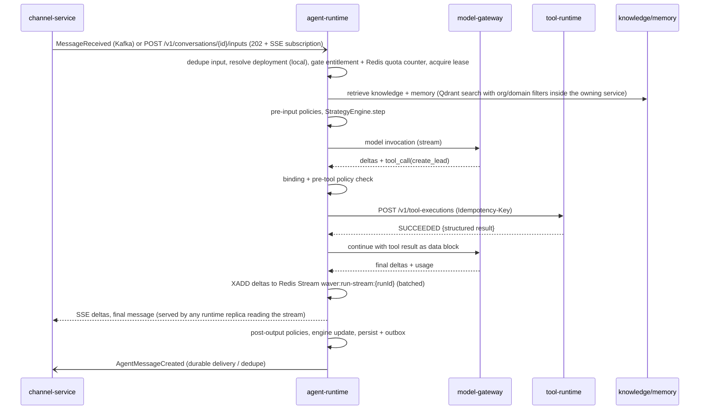

# RFC-0011 - Agent Runtime Architecture
Status: PROPOSED
Revision 1.3 (2026-10-19): aligned with ADR-0020..0027 (adopted Temporal for waiting runs, Redis for output streaming fan-out, real-time quota counters and the per-org turn cap, Qdrant-backed retrieval through knowledge/memory services, Avro + Apicurio Registry + CloudEvents binary mode + Debezium outbox for events, Keycloak-issued service tokens, Istio mTLS/authorization).
Owners: WAVER Architecture (named owner TBD)
Reviewers: TBD
Date: 2026-10-19
Version: 1.3

## Summary
Define the execution lifecycle, state, model calls, policies, tool calls, retries, cancellation, fallback, handoff and resumability of `agent-runtime`, including its two strategy modules `objective-engine` and `flow-engine` (ADR-0019). The runtime executes only published AgentVersions through active Deployments (AR-010), keeps working from local read models when control-plane services are down (AR-013), keeps the AgentRun state machine in PostgreSQL (source of truth) and delegates every long-running wait — `WAITING_USER` beyond a short window, `WAITING_TOOL` (async tools), `WAITING_APPROVAL`, `WAITING_HANDOFF` and Flow `Delay` — to a Temporal workflow owned by agent-runtime (ADR-0023). Ordinary conversational turns never start a workflow.

## Context / Problem
Scope §12 lists what the runtime must do (resolve tenant/deployment, create/resume Session and Conversation, load context, run the Objective or Flow engine, call models and tools, persist state, respond through the channel) but not how. Scope §24 leaves open: runtime state model, objective completion representation, hybrid execution, strategy changes, human handoff and resume semantics. The runtime is the hottest path of the platform: every inbound message of every customer passes through it, so latency, isolation, idempotency and cost control must be designed in, not added later.

## Goals
- One explicit AgentRun state machine and one turn-processing pipeline shared by both strategies.
- Objective engine and Flow engine as separate modules behind one port, with no dependency on each other.
- Exactly one active turn per conversation; idempotent inbound processing; streaming replies where the channel supports it.
- Every wait (user, tool, approval, handoff, timer) is durable and resumable after pod loss.
- Budgets, quotas, entitlements and suspension enforced on the data plane without synchronous calls to control-plane services.
- Prompt-injection resistance by construction: untrusted content is data, authorization is never decided by the model.

## Non-goals
- Channel provider adapters, outbound delivery and WhatsApp/e-mail specifics (channel-service RFC).
- Knowledge ingestion and memory retention rules (knowledge/memory RFCs); this RFC only consumes their retrieval APIs.
- Tool execution internals (RFC-0012), model routing internals (RFC-0019), authoring and compilation (RFC-0016).
- Multi-region execution and voice (future).

## Requirements / ARs
| AR | How this RFC satisfies it |
|---|---|
| AR-002/003/004 | Runtime owns its DB `waver_agent_runtime`; talks to other services only via REST/OpenAPI and Kafka events. |
| AR-006 | Inbound inputs deduplicated; tool calls carry deterministic idempotency keys; consumers use the inbox table. |
| AR-008 | Tenant context from the service token / event extensions; RLS on every table (ADR-0010). |
| AR-009 | Run, tool, handoff and policy-violation decisions emit audit events. |
| AR-010 | Runs execute an immutable runtime artifact of an AgentVersion pinned at run start. |
| AR-011 | Entitlement snapshot checked before run start and before every billable step. |
| AR-012 | Suspension moves runs to `SUSPENDED` (reversible); nothing is deleted. |
| AR-013 | Deployments, artifacts, entitlements, quotas, org status and policy sets are local read models. |
| AR-014 | Timeouts, retries, circuit breakers (Resilience4j) on every outbound dependency; outbox for events. |
| ADR-0019 | `StrategyEngine` port; `objective-engine` and `flow-engine` Maven modules with an ArchUnit no-dependency rule. |
| ADR-0020 | Redis Streams `waver:run-stream:<agentRunId>` for streaming fan-out; real-time quota checks against usage-metering counters `waver:quota:<quotaCounterId>`; cluster-wide per-org turn cap. Redis is never the only holder of run state. |
| ADR-0023 | AgentRun state stays in PostgreSQL; durable waits and timers are `AgentRunWaitWorkflow` instances (namespace `waver-agent`, task queue `agent-runtime.run-wait`); no workflow on the ordinary turn path. |
| ADR-0024 | Events are Avro (schemas in `contracts/events/agent-runtime/`), CloudEvents binary mode (`ce_*` headers), published by Debezium from the outbox table. |
| ADR-0025 | Knowledge and memory retrieval are served by knowledge-service / memory-service on top of their own Qdrant collections; the runtime never talks to Qdrant. |
| ADR-0026 | Calls to model-gateway, tool-runtime, knowledge, memory, handoff and channel go over Istio STRICT mTLS and are allowed by `AuthorizationPolicy` generated from the dependency graph. |

## Proposed Design

### Module layout (one deployable)
| Maven module | Content |
|---|---|
| `agent-runtime-domain` | AgentRun, Turn, Conversation, Session, Message, ExecutionContext, state machines, `StrategyEngine` port, `RunDirective` model. |
| `agent-runtime-application` | Turn pipeline, run scheduler, wait registration (start/cancel of wait workflows), policy enforcement, prompt assembly, read-model projectors. |
| `objective-engine` | ObjectiveDefinition interpretation, ObjectiveState transitions, completion evaluation. Depends only on the domain port. |
| `flow-engine` | FlowVersion graph interpreter, FlowState, node handlers. Depends only on the domain port. |
| `agent-runtime-adapters` | REST (inbound/outbound), Kafka consumers (Avro, registry-aware) and outbox tables, JPA repositories, clients for model-gateway, tool-runtime, knowledge, memory, handoff, channel; Redis adapters (run streams, quota client, turn-cap semaphore); Temporal workflow and activity implementations (`AgentRunWaitWorkflow`, wait-promotion schedule). |
| `agent-runtime-bootstrap` | Spring Boot wiring, virtual-thread executors, Temporal worker registration (worker build ID = service release). |

Workflow classes contain only deterministic orchestration; every side effect (DB update, input enqueue) is an idempotent activity (ADR-0023, ArchUnit rule).

### Core entities (`waver_agent_runtime`)
| Entity | Key fields | Notes |
|---|---|---|
| Conversation | `id, org_id, workspace_id, domain_id, channel_connection_id, participant_ref, status (OPEN, CLOSED), active_run_id, turn_lease_owner, turn_lease_until, last_input_at` | Durable thread; owned by exactly one Domain. Row lock / lease is the per-conversation mutex. |
| Session | `id, conversation_id, started_at, expires_at, summary_ref` | Engagement window inside a conversation (default inactivity expiry 24h); unit for short-term memory window. |
| ConversationInput | `id, conversation_id, source (CHANNEL, API, TRIGGER, HUMAN_AGENT, SYSTEM), external_ref, dedupe_key (unique per org), payload_ref, status (PENDING, CONSUMED, DISCARDED), received_at` | Every inbound item lands here first; unique `dedupe_key` gives idempotency. |
| AgentRun | `id, conversation_id (nullable for task runs), deployment_id, agent_id, agent_version_id, artifact_hash, strategy, mode (LIVE, SANDBOX), state, waiting_on_ref, wait_seq, wait_since, wait_deadline_at, wait_workflow_id (null until the wait is registered in Temporal), suspended_from, cancel_requested, budget_snapshot, started_at, ended_at, outcome_code, version` | Pinned to one AgentVersion for its whole life. `wait_seq` increments on every entry into a `WAITING_*` state and makes late timer/resume signals harmless. `wait_deadline_at` is informative (UI, metrics); the timer itself lives in Temporal. |
| Turn | `id, run_id, seq, input_ids[], state (PROCESSING, COMPLETED, FAILED, CANCELLED), model_calls, tool_calls, tokens_in, tokens_out, started_at, ended_at` | One pipeline execution. |
| Message | `id, conversation_id, run_id, turn_id, author_type (END_USER, AGENT, HUMAN_AGENT, SYSTEM), content (jsonb parts), redaction_state, created_at` | Partitioned by month. |
| ExecutionContext | `run_id, variables (jsonb), extracted_values (jsonb), context_summary, taint_flags` | Run-scoped working memory; FlowVariables live here. |
| ObjectiveState | `run_id, objective_key, status, attempts, last_attempt_turn, value (jsonb), evidence (jsonb), confidence, updated_at` | One row per objective (or per Objective Group instance). |
| FlowState | `run_id, flow_version_id, current_node_id, node_visit_counts (jsonb), call_stack (jsonb), history_ref, waiting_for` | Position and resumability data. |
| RunStep | `id, run_id, turn_id, kind (MODEL_CALL, TOOL_CALL, POLICY_CHECK, NODE, OBJECTIVE_EVAL, HANDOFF), ref_id, status, latency_ms` | Trace for Builder debugging and evaluation assertions. |

Read models (AR-013), all rebuilt from Kafka without control-plane API calls except the one-time artifact fetch:
| Read model | Source |
|---|---|
| `deployment_view`, `channel_route_view` (channel connection → deployment per environment) | compacted `waver.agent-builder.deployment-state.v1` (`DeploymentStateChanged`, RFC-0006 §11) |
| `runtime_artifact` (immutable, keyed by `agent_version_id` + `artifact_hash`) | fetched once from agent-builder on first sight of a deployment |
| `entitlement_snapshot` | compacted `waver.entitlement.entitlement-snapshot.v1` (`EntitlementSnapshotUpdated`, RFC-0013 §8) |
| `quota_state` | compacted `waver.usage-metering.quota-state.v1` (`QuotaStateUpdated`, RFC-0020) — limits, enforcement mode and `quotaCounterId`s; the live consumption value is read from Redis (see Budgets and quotas), this snapshot is the fallback when Redis is unavailable |
| `org_status_view` | `waver.customer.customer.v1` lifecycle events, `waver.tenant.OrganizationStatusChanged.v1` |
| `policy_set_view` | `waver.agent-builder.policy-set.v1` (`PolicySetPublished`) |

### AgentRun state machine
States: `QUEUED, RUNNING, WAITING_USER, WAITING_TOOL, WAITING_APPROVAL, WAITING_HANDOFF, WAITING_TIMER, SUSPENDED, COMPLETED, FAILED, CANCELLED, TIMED_OUT`. Refinements vs. the initial proposal: `WAITING_TIMER` (Flow `Delay`) and `SUSPENDED` (AR-012).

| From | Trigger | To | Side effects |
|---|---|---|---|
| — | Input with no active run / API / TriggerFired | QUEUED | `AgentRunStarted` (outbox) |
| QUEUED | Turn lease acquired, entitlement + quota OK | RUNNING | — |
| QUEUED | Entitlement missing or hard quota exceeded | FAILED | fallback message; `AgentRunFailed(reason=NOT_ENTITLED|QUOTA_EXCEEDED)` |
| RUNNING | Engine directive `AWAIT_USER` | WAITING_USER | `wait_deadline_at = now + inactivityTimeout`; **no workflow yet** (short window, see Durable waits) |
| RUNNING | tool-runtime returned `RUNNING` (async) | WAITING_TOOL | wait workflow registered, deadline = tool deadline + 30s |
| RUNNING | tool-runtime returned `AWAITING_APPROVAL` | WAITING_APPROVAL | wait workflow registered, deadline = approval expiry + 30s |
| RUNNING | Transfer node / policy `HANDOFF` / user asks for human | WAITING_HANDOFF | `HandoffRequested`; wait workflow registered, deadline = max handoff wait (default 7 days) |
| RUNNING | Delay node | WAITING_TIMER | wait workflow registered, deadline = delay end |
| WAITING_USER | New input | RUNNING | wait workflow (if one was registered) cancelled after commit |
| WAITING_TOOL / WAITING_APPROVAL | `ToolExecutionCompleted` / `ToolExecutionFailed` for awaited execution | RUNNING | tool result injected as data; wait workflow completed |
| WAITING_HANDOFF | `HandoffResolved(RETURN_TO_AGENT)` | RUNNING | human transcript summary added to context; wait workflow completed |
| WAITING_HANDOFF | `HandoffResolved(CLOSE)` | COMPLETED | wait workflow completed |
| WAITING_TIMER | Workflow timer fired | RUNNING | — |
| WAITING_* | Wait workflow deadline reached without resume event | TIMED_OUT (user, handoff) / RUNNING with timeout result (tool, approval) | `AgentRunTimedOut` for user inactivity and handoff expiry |
| any non-terminal | Org/entitlement suspended | SUSPENDED | previous state kept in `suspended_from`; wait workflow cancelled |
| SUSPENDED | Reactivated | previous state | new `wait_seq`, deadlines recomputed, wait workflow re-registered |
| RUNNING | Engine directive `END` / all objectives resolved | COMPLETED | `AgentRunCompleted`, `ObjectiveCompleted` already emitted per objective |
| RUNNING | Unrecoverable error after fallback | FAILED | `AgentRunFailed` |
| any non-terminal | Cancel request / conversation closed / customer terminated | CANCELLED | in-flight tool cancel best-effort; wait workflow cancelled |
| any non-terminal | Max run duration (default 30 days) | TIMED_OUT | enforced by the wait workflow deadline `min(wait deadline, run max end)` |

Terminal states are immutable. Every transition is a single PostgreSQL transaction: update row (`version` and `wait_seq` check) + insert outbox events (published by Debezium, ADR-0024); Temporal calls (start, signal, cancel of the wait workflow) happen after commit and are idempotent by workflow ID, so a lost call is repaired by the wait-promotion schedule below.

### Durable waits (Temporal, ADR-0023)
The run state of record is the AgentRun row; Temporal only holds **durable timers and the wait itself**. agent-runtime owns the workflow type, its namespace (`waver-agent`) and task queue (`agent-runtime.run-wait`); other services never signal it — they publish events that agent-runtime consumes (AR-003/AR-004).

- **`AgentRunWaitWorkflow(runId, waitSeq, waitKind, deadline)`**, workflow ID `agent-run-wait:<runId>:<waitSeq>` (duplicate starts are rejected by ID, so registration is idempotent). The workflow waits for the `resumed` signal or the deadline timer, whichever comes first:
  - `resumed` (sent by agent-runtime itself after it has applied a resume transition) → workflow completes, no activity.
  - deadline → activity `enqueueTimeout(runId, waitSeq)` inserts a `ConversationInput(source=SYSTEM, dedupe_key=timeout:{runId}:{waitSeq})` (task runs: a run-scoped resume item) and completes. The normal turn pipeline picks it up, takes the lease and applies the timeout transition **only if** the run is still in that `wait_seq`; otherwise the input is `DISCARDED`.
  - cancellation (cancel, suspension, new input on a promoted WAITING_USER) → workflow ends without activity.
- **Resume events** (`ToolExecutionCompleted/Failed`, `HandoffResolved`) are consumed with the inbox table; the consumer inserts a `ConversationInput(source=SYSTEM, dedupe_key=resume:{runId}:{waitSeq})` carrying the event reference and, after commit, signals `resumed`. Resuming therefore never depends on Temporal being available; only timeouts do.
- **Which waits use Temporal**: `WAITING_TOOL`, `WAITING_APPROVAL`, `WAITING_HANDOFF` and `WAITING_TIMER` register their workflow right after the transition commits. `WAITING_USER` does **not**: most conversations get the next user message within seconds or minutes, so the run only records `wait_since`. The **wait-promotion schedule** (Temporal Schedule `agent-runtime.wait-promotion`, every 1 min, overlap policy SKIP) runs one activity that selects runs with `state = WAITING_USER AND wait_since < now - shortWindow (default 5 min) AND wait_workflow_id IS NULL` (batches of 500, `FOR UPDATE SKIP LOCKED` on an index) and registers their wait workflows; the same query also repairs any other `WAITING_*` run whose registration was lost (e.g., Temporal unavailable at commit time). The inactivity timeout itself (default 24h) is then held precisely by the Temporal timer.
- Determinism and versioning: the workflow code has no I/O; activities are idempotent and keyed by `runId:waitSeq`; worker versioning by build ID follows service releases; workflow changes ship with replay tests (ADR-0023, AR-015).

### Turn processing pipeline
1. **Accept input**: persist `ConversationInput` with `dedupe_key` = `channel:{channelConnectionId}:{externalMessageId}` or `api:{Idempotency-Key}`. Duplicate → return the existing result (HTTP) or ack (Kafka).
2. **Resolve**: `channel_route_view` → Deployment → `runtime_artifact` (local). Missing artifact → retryable error (see Failure Modes).
3. **Gate**: `org_status_view` (suspended/terminated), `entitlement_snapshot` (agent, channel, model profile entitled), real-time quota check against the usage-metering Redis counters (runs, AI credits; `quota_state` snapshot as fallback, see Budgets and quotas). Hard deny → fallback message, no model call.
4. **Lease**: acquire the conversation turn lease (`UPDATE conversation SET turn_lease_owner=:pod, turn_lease_until=now()+60s WHERE id=:id AND (turn_lease_until IS NULL OR turn_lease_until < now())`). If not acquired, the input stays `PENDING`; the lease holder drains pending inputs before releasing (coalescing inputs that arrived during the turn into the next turn). Lease is renewed every 20s while the turn runs.
5. **Load context**: recent messages (token-bounded window), session summary, ExecutionContext, ObjectiveState/FlowState, memory (memory-service retrieve, scope from artifact), knowledge (knowledge-service retrieve with domain filter; both Qdrant-backed, see Retrieval contract), effective policy set (`policy_set_view` + artifact policies).
6. **Pre-input policies**: deterministic guardrails (blocked intents, PII masking rules, injection heuristics, optional classifier call through model-gateway `purpose=POLICY_CLASSIFIER`).
7. **Strategy step**: `StrategyEngine.step(ctx)` returns a `RunDirective`: `ASK_MODEL(instructions, allowedTools, responseSchema)`, `SEND_MESSAGE(text)`, `CALL_TOOL(binding, args)`, `AWAIT_USER`, `DELAY(until)`, `HANDOFF(target)`, `EVALUATE_OBJECTIVES(groupSpec)`, `END(outcome)`.
8. **Prompt assembly**: compiled prompt sections from the artifact (RFC-0016) + dynamic slots (objective focus / current node, retrieved data blocks, tool schemas). No free-text concatenation of untrusted content into instruction sections.
9. **Model call**: model-gateway `POST /v1/model-invocations` (stream when the caller streams) with `modelProfile`, attribution (`runId`, `turnId`, `agentVersionId`) and the turn deadline in `X-Request-Deadline` (CONVENTIONS; turn budget default 60 s, 120 s for streaming per RFC-0005).
10. **Tool loop**: for each tool call proposed by the model: verify the tool is in the artifact bindings and allowed in the current directive (`allowedTools`), run pre-tool policies, call tool-runtime `POST /v1/tool-executions` with idempotency key `sha256(runId:turnId:stepSeq)` and `X-Request-Deadline`. Chain depth stays within the RFC-0005 hot-path limit (agent-runtime → tool-runtime → connector-service = 2). Result (always structured, RFC-0012) goes back to the model as a data block. Default max 5 model↔tool iterations and 10 tool calls per turn.
11. **Post-output policies**: output guardrails (unapproved commitments, PII leakage, link/markdown exfiltration, prompt leakage). Behaviour per policy: `BLOCK`, `REWRITE` (regenerate once with violation feedback), `HANDOFF`, `WARN`.
12. **Engine update**: objective extraction/evaluation or flow transition; may loop to step 7 within the same turn (default max 50 engine steps per turn).
13. **Persist**: messages, states, RunStep rows, outbox events (`AgentMessageCreated`, `ObjectiveCompleted`, ...) in one transaction.
14. **Respond**: deltas already appended to the run's Redis Stream are closed with a final entry (sync path); `AgentMessageCreated` event is the durable delivery path for channel-service (deduplicated by `messageId`).
15. **After turn (async)**: memory write candidates sent to memory-service (which writes PostgreSQL first, then its Qdrant collection); session summary refresh when the window exceeds its budget; if the run entered a `WAITING_*` state other than `WAITING_USER`, the wait workflow is registered (Durable waits).

### Objective engine
ObjectiveDefinition (from the artifact): `key, description, priority (1..5), required, dependsOn[], completion {extractionSchema, rules[], evaluator?}, attemptPolicy {maxAttempts (default 3), minTurnsBetweenAsks (default 2)}, skipWhen?, onFailed (CONTINUE, HANDOFF, END)`.

**Completion conditions (answer to Scope §24 "Objective engine")**: all three, layered, each optional except the schema:
1. **Extraction schema** (JSON Schema of the value): every turn the engine requests structured extraction (`responseSchema` on the main call, or a separate `purpose=OBJECTIVE_EXTRACTION` call with the `fast` profile when the main response streams). Opportunistic: values volunteered for any pending objective are captured.
2. **Rules**: deterministic validators on the extracted value (type/format, CNPJ/CPF check digits, enum, ranges, SpEL with `SimpleEvaluationContext` over the value only).
3. **Evaluator** (optional, for subjective objectives such as "understand motivation"): LLM judge through model-gateway with a rubric; completes only if `confidence ≥ threshold` (default 0.8).

| From | Trigger | To |
|---|---|---|
| PENDING | Selected as focus (highest priority with dependencies satisfied) | IN_PROGRESS |
| PENDING / IN_PROGRESS | Valid value extracted (schema + rules + evaluator) | COMPLETED (emit `ObjectiveCompleted`) |
| IN_PROGRESS | User changes topic; agent answers first | IN_PROGRESS (focus kept, no attempt consumed) |
| IN_PROGRESS | Asked and not obtained | IN_PROGRESS (`attempts+1`) |
| IN_PROGRESS | `attempts == maxAttempts` | FAILED (required) / SKIPPED (optional) |
| PENDING / IN_PROGRESS | `skipWhen` true, user refuses an optional objective, or a dependency FAILED | SKIPPED |
| COMPLETED | User corrects the value | COMPLETED (value replaced, evidence appended, event re-emitted with `revision+1`) |

Focus selection runs each turn; the directive tells the model which objective to pursue *after* answering the user, matching Scope §7.1. `minTurnsBetweenAsks` prevents repetition. Run ends when all required objectives are COMPLETED/SKIPPED (then the configured completion behaviour: closing message, bound tool such as `create_lead`, or handoff) or one required objective FAILED with `onFailed=END|HANDOFF`.

### Flow engine
| Node | Semantics | Waits |
|---|---|---|
| Message | Sends templated text (variables interpolated); optional `naturalize` re-phrasing by the model. Auto-advance. | — |
| Question | Asks; extracts the answer into a typed FlowVariable using a schema + rules; `maxAttempts` then `onInvalid` transition. | WAITING_USER |
| Action | Calls one bound tool with mapped arguments; maps output to variables; transitions `onSuccess` / `onError` / `onRejected`. | WAITING_TOOL / WAITING_APPROVAL if async |
| Condition | Ordered branches with SpEL (`SimpleEvaluationContext`, variables only) or an AI classification with an enumerated outcome set; mandatory `else`. | — |
| Delay | Registers an `AgentRunWaitWorkflow` timer (duration or until a variable timestamp, capped by the run max end). | WAITING_TIMER |
| Transfer | `HUMAN` (handoff-service queue) or `AGENT` (same Domain only, v1). | WAITING_HANDOFF |
| Objective Group | Embedded objectives evaluated with objective-engine semantics; exits on `onComplete` / `onFailed`. | WAITING_USER inside |
| End | Completes the run with an `outcomeCode`. | — |

FlowState is persisted after every node; node execution is idempotent because side effects use step-derived keys (`runId:nodeId:visitCount`). Loop guard: max 50 node steps per turn, max 1000 per run, max visits per node (default 20) → FAILED with `FLOW_LOOP_DETECTED`.

**Hybrid execution (Scope §24) — proposal**: allowed only as the `Objective Group` node inside a FLOW_DRIVEN agent; the agent's strategy remains FLOW_DRIVEN (no hybrid strategy value). To respect ADR-0019 (engines must not depend on each other), the flow engine returns `EVALUATE_OBJECTIVES(groupSpec)`; the runtime application layer invokes the objective engine through the `StrategyEngine` port and hands the group result back to the flow engine. Objective agents cannot embed flows.

**Strategy changes (Scope §24) — proposal**: no in-place migration. Strategy is structural and immutable per Agent; changing it means "duplicate as new agent" in Builder (RFC-0016), which copies shared capabilities but not objectives/flow. Existing runs finish on their pinned version.

### Concurrency, idempotency and streaming
- One active turn per conversation (lease above); inbound `waver.channel.channel-session.v1` events are keyed by `channelSessionId` (RFC-0006 §4), so ordering is preserved per conversation.
- Inputs arriving during a turn are queued and coalesced into the next turn (default; "interrupt current generation" is a future option).
- **Streaming path** (Web Chat widget via channel-service on the `hooks.` host, ADR-0009; Workspace chat, Playground and public API via workspace-bff, RFC-0005 §1): the caller posts `POST /v1/conversations/{id}/inputs` and receives `202` with a stream URL, then holds `GET /v1/conversations/{id}/stream?inputId=` (`text/event-stream`). The turn is a runtime-owned job (RFC-0005 async command pattern), so its outgoing chain is counted from agent-runtime and stays at depth 2.
- **Fan-out through Redis Streams (ADR-0020)**: the pod executing the turn appends deltas, tool-progress markers and the final message to `waver:run-stream:<agentRunId>` (`XADD`, batched every 50–100 ms, `MAXLEN ~ 10000`, key TTL 15 min, entries tagged with `inputId`/`turnId`, no other content than the reply being streamed). Whichever agent-runtime replica receives the SSE subscription reads it with `XREAD BLOCK` and filters by `inputId`; the SSE event ID is the stream entry ID, so a client reconnecting with `Last-Event-ID` resumes without gaps inside the TTL. The SSE subscriber is therefore independent of the pod that holds the turn lease, and several subscribers (e.g., Workspace chat open in two tabs) share one stream. The keys belong to agent-runtime (Redis ACL `~waver:run-stream:*` for the agent-runtime user only); channel-service and workspace-bff consume the stream only through the SSE endpoint, never from Redis directly (AR-002).
- **Redis unavailable**: the accepting pod still executes the turn when it obtains the lease and serves its own subscribers from memory; subscribers on other pods fall back to the final message (read from PostgreSQL after the turn commits). Correctness is unaffected; only incremental streaming degrades.
- **Async path** (WhatsApp, e-mail): `waver.channel.MessageReceived.v1` consumed with the inbox table (consumer deadline 30 s per message, RFC-0005 §6, then the turn gets its own budget); reply delivered via `AgentMessageCreated`.
- Streaming fallback: model-gateway may fall back only before the first token; after that a stream error ends the turn with the fallback message.

### Human handoff
- Owner of queue, assignment, SLA and inbox: handoff-service. Owner of the conversation and its messages: agent-runtime.
- Runtime publishes `HandoffRequested` (reason, target queue, summary, last N message IDs). While `WAITING_HANDOFF`, end-user inputs are stored as Messages and no model calls are made; each one emits `HandoffInputReceived` (conversation topic, only in this state) so the handoff inbox updates without polling. History is read via `GET /v1/conversations/{id}/messages`.
- Human replies are posted by handoff-service through `POST /v1/conversations/{id}/human-messages` and delivered like agent messages (`author_type=HUMAN_AGENT`).
- Resume: `HandoffResolved` with `RETURN_TO_AGENT` (run continues, objective/flow state intact) or `CLOSE` (run COMPLETED). The handoff wait is an `AgentRunWaitWorkflow` owned by agent-runtime; handoff-service keeps its own queue/SLA logic and never signals the runtime's workflow (it publishes `HandoffResolved`).

### Fallback and cancellation
- Model failure after gateway fallback chain → one retry of the turn (if no side-effecting tool executed in it) → configured fallback message → policy (`HANDOFF` or `FAILED`).
- Tool failure → structured error back to the model / Flow `onError` (never a raw exception).
- Cancellation (`POST /v1/agent-runs/{id}/cancel`, `ConversationClosed`, `CustomerTerminated`) sets `cancel_requested`; checked between pipeline steps; open model streams are aborted; the run's wait workflow (if any) is cancelled; tool-runtime gets `POST /v1/tool-executions/{id}/cancel` (best effort; side effects already dispatched are recorded, not reverted).

### Budgets and quotas
- Run limits from the artifact (defaults): 50 turns per run, 100k model tokens per run, 30 tool calls per run, 5 model↔tool iterations per turn.
- Commercial limits (runs/month, AI credits) from `entitlement_snapshot` (limit, enforcement, overagePolicy) + `quota_state` (`QuotaStateUpdated`, which also carries the `quotaCounterId`s), as specified in RFC-0013 §8 and RFC-0020 §2. Entitlement checks use the generated snapshot evaluator from `contracts/` (RFC-0013), not a re-implementation.
- **Real-time quota checks (ADR-0020)**: usage-metering-service owns the counters `waver:quota:<quotaCounterId>` and the Lua scripts that operate on them; agent-runtime uses the quota client published by usage-metering (generated from `contracts/`, same pattern as the entitlement evaluator) with a Redis ACL limited to those scripts and keys. At run start (QUEUED → RUNNING) the client runs an atomic check-and-increment on the `agent.runs` counter; AI-credit counters are read (not incremented) because model-gateway increments them per call (RFC-0019). `HARD/BLOCK` → new runs refused with `QUOTA_EXCEEDED`; in-flight runs finish the current turn; SOFT policies only notify. Overshoot is limited to concurrently admitted runs. The PostgreSQL `quota_counter` in usage-metering is reconciled every minute and stays authoritative for billing.
- **Fallback**: if Redis is unavailable or the call exceeds its 20 ms budget, the gate uses the `quota_state` snapshot (the v1.2 approximate behaviour) and marks the run `quotaCheck=SNAPSHOT` for reconciliation; it never fails closed on Redis loss alone.
- Spend limits on AI cost are enforced again inside model-gateway (RFC-0019), against its own budget counters.

### Retrieval contract (knowledge-service, memory-service; ADR-0025)
The runtime consumes retrieval only through the REST retrieval APIs of knowledge-service and memory-service (contracts owned by those services); it never queries Qdrant or another service's data. Inside the owning services:
- Each service owns its Qdrant collections (`knowledge_chunks_v<N>`, `memory_entries_v<N>`, behind aliases) and a Qdrant API key restricted to them. PostgreSQL remains the source of truth for documents, chunk text, memory entries, metadata and permissions; Qdrant holds vectors plus the filter payload (`org_id`, `workspace_id`, `domain_id`, `knowledge_base_id`, `chunk_id`/`memory_entry_id`, `acl_tags`, `embedding_model`).
- The query embedding comes from model-gateway (`purpose=KNOWLEDGE_QUERY` / `MEMORY_QUERY`, RFC-0019), keeping the hot-path depth at 2.
- The mandatory filter (`org_id` tenant index plus workspace, domain or actively shared domains, knowledge base and ACL tags) is built by the platform library from the validated token context the runtime propagates, never from the request body, and is applied **inside** the vector search before ranking. Knowledge retrieval is hybrid: Qdrant top-k combined with PostgreSQL full-text search and re-ranked in knowledge-service.
- Before returning, the service re-reads the selected chunks/entries from PostgreSQL (existence, permission, purge state); anything missing there is dropped, so a stale Qdrant point can never leak data. Results include provenance (`source`, `knowledgeBaseId`, `chunkId`) that the runtime places in UNTRUSTED data blocks.
- Writes (ingestion workflows in knowledge-service, memory writes after a turn) are idempotent (point ID = chunk/entry ID); re-embedding fills a new versioned collection through a Temporal ingestion workflow and swaps the alias atomically, so retrieval never mixes embedding models.

### Prompt-injection defences
- Instruction/data separation: knowledge chunks, memory, tool outputs, inbound e-mails and web content are inserted only into delimited data blocks with provenance (`source`, `trust=UNTRUSTED`), never into instruction sections.
- Authorization never depends on model output: tool allow-list, permissions, argument constraints and approvals are enforced by runtime and tool-runtime.
- Taint tracking: if the turn consumed untrusted external content, bindings marked `requireApprovalWhenTainted` and all `DESTRUCTIVE` tools require approval.
- Output filters strip links/images to non-allow-listed domains in rich channels and detect system-prompt leakage.
- Optional injection classifier (model-gateway `POLICY_CLASSIFIER`) on inbound and retrieved content for agents with `WRITE`/`DESTRUCTIVE` tools.

### Scaling
- Stateless pods; all durable state in PostgreSQL; wait timers in Temporal; transient stream buffers in Redis. Virtual threads for turn executors (Java 25).
- HPA on external metrics: inbound Kafka consumer lag and `pending_inputs` age p95 (metric pipeline per RFC-0009), plus CPU. Inbound topic partitions ≥ max replicas (default 48). Temporal workers for `agent-runtime.run-wait` run inside the same deployment (low CPU: timers and tiny activities); a separate worker deployment is an option if task-queue backlog appears.
- Bulkheads per dependency (model-gateway, tool-runtime, knowledge, memory) and per-org concurrent-turn cap (default 200 per org cluster-wide, enforced with an expirable Redis semaphore `waver:agent-runtime:org-turns:<orgId>` whose permits expire with the turn lease; per-replica approximation as fallback when Redis is unavailable) so one tenant cannot starve others.

## APIs / Events / Data Ownership
Owned data: AgentRun, Session, Conversation, ConversationInput, Message, Turn, ExecutionContext, ObjectiveState, FlowState, RunStep and the read models listed above.

| Endpoint | Caller | Purpose |
|---|---|---|
| `POST /v1/conversations/{conversationId}/inputs` (`Idempotency-Key`) | channel-service, workspace-bff | Submit input; `202` with stream URL. |
| `GET /v1/conversations/{conversationId}/stream?inputId=` | channel-service, workspace-bff | SSE subscription to deltas and the final message. |
| `POST /v1/agent-runs` | workspace-bff (API channel), workflow-service | Start a task run (Idempotency-Key required). |
| `GET /v1/agent-runs/{runId}` / `GET /v1/agent-runs/{runId}/steps` | BFF, evaluation-service | State and trace. |
| `POST /v1/agent-runs/{runId}/cancel` | BFF, workflow-service | Cancel. |
| `GET /v1/conversations/{conversationId}/messages` | workspace-bff, handoff-service | Cursor-paginated transcript. |
| `POST /v1/conversations/{conversationId}/human-messages` | handoff-service | Human agent replies. |
| `POST /v1/sandbox-runs` / `POST /v1/sandbox-runs/{runId}/inputs` | evaluation-service, agent-builder (Playground) | `mode=SANDBOX`, artifact supplied by reference, tools in MOCK/DRY_RUN (RFC-0012). |

Published (topics `waver.agent-runtime.<aggregate>.v1`, types `waver.agent-runtime.<Event>.v1`):

| Topic | Events | Key |
|---|---|---|
| `waver.agent-runtime.agent-run.v1` | AgentRunStarted, AgentRunCompleted, AgentRunFailed, AgentRunCancelled, AgentRunTimedOut, ObjectiveCompleted | runId |
| `waver.agent-runtime.conversation.v1` | AgentMessageCreated, HandoffRequested, HandoffInputReceived, ConversationClosed | conversationId |

Payloads are Avro (`contracts/events/agent-runtime/<EventName>.v1.avsc`, registered in Apicurio Registry by CI, `BACKWARD_TRANSITIVE`); the CloudEvents envelope travels in binary mode as `ce_*` Kafka headers, including the extensions `orgid`, `workspaceid` and `domainid` plus `aggregateversion` (ADR-0024, RFC-0006 §4). Events are written to the `outbox_event` table in the transition transaction and published by the Debezium Outbox Event Router. Events carry IDs, states, outcome codes and counters; message content is carried only in `AgentMessageCreated` (consumer: channel-service) and `HandoffInputReceived` (consumer: handoff-service), in fields marked with the Avro field property `x-waver-pii`. `waver.agent-runtime.conversation.v1` is therefore classified **RESTRICTED** (3-day retention, dedicated ACLs; RFC-0006 §12); `agent-run.v1` carries no content.

Consumed: compacted `waver.agent-builder.deployment-state.v1`, `waver.entitlement.entitlement-snapshot.v1`, `waver.usage-metering.quota-state.v1` (read models above); `waver.agent-builder.PolicySetPublished.v1`; `waver.customer.CustomerSuspended/CustomerReactivated/CustomerTerminated.v1`; `waver.channel.MessageReceived.v1`; `waver.tool-runtime.ToolExecutionCompleted/Failed.v1`, `waver.handoff.HandoffAssigned/HandoffResolved.v1`, `waver.trigger.TriggerFired.v1` (target type AGENT).

Sync dependencies: model-gateway, tool-runtime, knowledge-service, memory-service (hot path); agent-builder only to fetch an immutable artifact when a deployment is activated (`GET /v1/agent-versions/{id}/runtime-artifact`). Infrastructure dependencies (not services): PostgreSQL (source of truth), Kafka, Redis (streams, quota counters, turn semaphore — all with fallbacks), Temporal (wait workflows).

## Security & Privacy
- Service-to-service calls use Keycloak-issued client-credentials tokens (one client per service, ADR-0021); user-initiated calls carry Keycloak token-exchange tokens (`act` chain). Transport is Istio STRICT mTLS and the mesh only admits callers allowed by the generated `AuthorizationPolicy` (ADR-0026); token validation in the service stays mandatory. Tenant context is set per transaction for RLS.
- Message content is PII-bearing: encrypted at rest (storage level), never logged (STD-006), retained per domain retention policy; purge is an audited job (LGPD). Redaction state is recorded per message. Redis run streams hold streamed reply text only for their 15-minute TTL, over TLS with a per-service ACL user, and never contain PII in key names (ADR-0020).
- Temporal workflow inputs, signals and histories carry IDs only (`runId`, `waitSeq`, `waitKind`, deadline) — never message content or tool payloads.
- Knowledge and memory retrieval are domain-filtered at the source, inside the Qdrant search and re-checked against PostgreSQL (ADR-0025); the runtime never merges data from two domains in one context.
- Support access to transcripts requires an active `support_grant` and is audited.
- Sandbox runs cannot reach LIVE side-effecting tools and are excluded from production conversation lists.

## Reliability & Failure Modes
| Failure | Behaviour |
|---|---|
| Pod dies mid-turn | Lease expires (60s); input still `PENDING`/turn `PROCESSING` → recovery sweep (an activity of the same Temporal schedule as wait promotion, plus a check by any pod that later acquires the lease) marks turn FAILED and re-queues inputs if no side-effecting tool was dispatched; otherwise resumes from the last persisted step (tool results are fetched by idempotency key). |
| model-gateway unavailable | Circuit open → fallback message; run stays `WAITING_USER`; error budget alert. |
| tool-runtime timeout | Execution queried by idempotency key; unknown outcome passed to the model as `OUTCOME_UNKNOWN` (never auto-retried for WRITE/DESTRUCTIVE). |
| knowledge/memory slow or down | Turn proceeds without them after 800 ms / 500 ms deadlines, marked `degradedContext=true`. |
| agent-builder down | Running deployments unaffected; new activation retried with backoff (the previous deployment keeps serving). |
| Duplicate inbound message | Unique `dedupe_key` → no second turn. |
| Lost event / consumer poison | Inbox dedupe, retry topics, `<topic>.dlq` with alert; Avro deserialization failures (unknown schema ID) go to the DLQ, inspected with registry-aware tooling. |
| Temporal unavailable | Ordinary turns, short `WAITING_USER` replies and event-driven resumes keep working (they do not need Temporal). Wait registrations fail after commit and are repaired by the wait-promotion schedule once Temporal is back; timeouts and Delay nodes fire late, never lost. Alert on registration backlog (`WAITING_*` runs with `wait_workflow_id IS NULL` older than 5 min). |
| Wait-workflow task-queue backlog | Temporal schedule-to-start latency metric on `agent-runtime.run-wait`; scale workers; alert at 60 s. |
| Redis unavailable | Streaming falls back to local-pod / final-message delivery; quota gate uses `quota_state`; org turn cap falls back to per-replica approximation. No data loss (ADR-0020). |
| Debezium / Kafka Connect stopped | Outbox rows accumulate; events delayed, not lost; replication-slot lag alert (ADR-0024 runbook). |

SLO defaults (production deployments, monthly): availability of input acceptance 99.9%; runtime overhead excluding model and tool time p95 ≤ 250 ms; time to first streamed token p95 ≤ 2.5 s for `balanced` profile without tools; knowledge retrieval p95 ≤ 300 ms (top-k ≤ 8, Qdrant-backed, ADR-0025); timer firing delay p95 ≤ 5 s for registered waits (Temporal timers); stream relay added latency (Redis XADD → SSE) p95 ≤ 50 ms.

## Observability
- Trace per turn: root span `agentruntime.turn` with child spans per pipeline step, model call, tool execution (trace context propagated to model-gateway and tool-runtime). Attributes: `org_id`, `domain_id`, `agent_id`, `agent_version_id`, `run_id` (no content).
- Metrics: turns/s, turn latency by step, run outcomes by `outcome_code`, objective completion rate, handoff rate, fallback rate, policy violations by policy/severity, tokens and cost per run (from model-gateway), lease contention, pending input age, waits by kind, wait registration backlog, Temporal timer lag and task-queue schedule-to-start latency, Redis stream relay latency and fallbacks, quota checks served from snapshot.
- Temporal Web (operators only, ADR-0023) shows wait workflows by run ID for support investigations; workflow IDs are linked from the run inspector.
- RunStep table powers the Builder run inspector and evaluation assertions.
- Audit: policy BLOCK/HANDOFF decisions, approvals awaited, cancellations, support access.

## Testing Strategy
- Exhaustive transition tests for AgentRun, ObjectiveState and FlowState tables.
- `AgentRunWaitWorkflow` tests with the Temporal Java SDK test environment (time skipping): resume vs. timeout races, stale `wait_seq`, cancellation, suspension/reactivation; workflow replay tests in CI for every workflow change (ADR-0023).
- Engine unit tests with scripted model fakes (deterministic `ModelPort` test double); golden tests for prompt assembly.
- Concurrency tests: N parallel inputs on one conversation → exactly one active turn, ordered coalescing.
- Crash-recovery tests (kill pod between steps) with Testcontainers PostgreSQL/Kafka/Redis.
- Streaming tests: subscriber on a different replica than the turn executor, `Last-Event-ID` reconnect, Redis outage fallback.
- Quota tests: parallel run starts against a Redis counter never exceed the hard limit by more than the concurrently admitted runs; snapshot fallback when Redis is down.
- Avro contract tests for published events against the registered schemas (compatibility check in CI, ADR-0024).
- Prompt-injection red-team suite (tool output and knowledge containing instructions) run in CI against sandbox mode.
- Load test: 2,000 concurrent conversations per 10 pods with mocked model latency, verifying SLOs.

## Deployment / Rollout / Rollback
- Deployed as one Helm release (including its Istio `AuthorizationPolicy`, Redis ACL user and Temporal worker configuration); schema migrations forward-only (Flyway). Runs pin `artifact_hash`, so runtime upgrades never change agent behaviour; engine code changes that alter semantics are gated behind `engineVersion` recorded in the artifact.
- Temporal worker versioning by build ID: in-flight wait workflows continue on the build that started them until they complete; incompatible workflow changes use a new workflow type or `Workflow.getVersion` branches, covered by replay tests.
- Rollout: canary 5% of pods with automatic rollback on SLO burn; agent-level rollback is a Builder action (`DeploymentRolledBack` → new runs use the previous version; in-flight runs keep their pinned version).

## Alternatives Considered
- Separate objective/flow engine services: rejected by ADR-0019.
- Kafka partition affinity as the only per-conversation mutex: insufficient for the synchronous streaming path; DB lease covers both paths.
- Redis lock as the per-conversation turn mutex: not chosen; the lease must be checked in the same PostgreSQL transaction as the run state and must survive for crash recovery, so it stays a row lease (Redis locks are for short in-process coordination only, ADR-0020).
- PostgreSQL timer rows with `next_wakeup_at` polled by `FOR UPDATE SKIP LOCKED` (v1.2, ADR-0018): superseded by ADR-0023; kept only as the shape of the coarse wait-promotion query.
- One Temporal workflow per conversation or per turn: rejected; puts Temporal on the conversational hot path (ADR-0023) and multiplies history size for no durability gain over the PostgreSQL turn pipeline.
- PostgreSQL `LISTEN/NOTIFY` relay for cross-pod streaming (v1.2): replaced by Redis Streams (ADR-0020), which support reconnects, multiple subscribers and do not load the database.
- Migrating in-flight runs to newly deployed versions: rejected; breaks determinism and auditability.

## Risks
- Long conversations grow context cost; mitigated by session summaries and token-bounded windows.
- LLM extraction errors complete objectives wrongly; mitigated by rules, evaluator thresholds and evaluation suites.
- DB hot spot on very busy conversations (API bursts); mitigated by coalescing and per-conversation input rate limit (default 10/s).

## Open Questions
1. Conversation ownership across domains (Scope §24): recommendation — v1 Transfer to AGENT only inside the same Domain; cross-domain creates a new linked conversation with an explicit, policy-approved summary.
2. Inactivity timeout per channel (WhatsApp 24h service window vs web chat): recommendation — default 24h, configurable per Deployment.
3. Should sandbox/playground model usage count against customer AI budgets (business)? Recommendation — metered and visible, counted against a separate non-billable allowance.
4. ~~Entitlement compacted topic name~~ — resolved in the v1.2 review: `waver.entitlement.entitlement-snapshot.v1` / `EntitlementSnapshotUpdated` (RFC-0013, CONVENTIONS, EVENT_CATALOG).
5. MICROSERVICES_MAP lists only five runtime events; this RFC adds AgentRunCancelled, AgentRunTimedOut, AgentMessageCreated, HandoffInputReceived and ConversationClosed — map should be updated, and RFC-0020's `agent.runs` meter should also consume AgentRunCancelled/AgentRunTimedOut.
6. RFC-0005 §7 lists streaming as `workspace-bff ← agent-runtime` only; the Web Chat path through channel-service (ADR-0009 amendment) relies on the 202 + stream-subscription pattern above to keep depth 2. RFC-0005 should list it explicitly.
7. Short window before a `WAITING_USER` run is handed to Temporal (default 5 min, promotion every 1 min): product to confirm whether any channel needs sub-minute inactivity behaviour (e.g., "are you still there?" nudges); if so, those Deployments register the wait immediately.
8. ADR-0020's table lists channel-service and workspace-bff next to the run-stream fan-out; this RFC keeps the Redis keys private to agent-runtime and exposes them only through the SSE endpoint (AR-002, per-service ACLs). ADR-0020 / RFC-0005 should state this reading explicitly.
9. Quota client for `waver:quota:*` (Lua scripts, ACL scope, which meters each data-plane service may increment vs. only read) must be specified by usage-metering in RFC-0020; this RFC assumes agent-runtime increments `agent.runs` only.

## Decision
Proposed: adopt the AgentRun state machine (PostgreSQL) with Temporal-held durable waits outside the hot path, the turn pipeline, Redis Streams fan-out for streaming, real-time Redis quota checks with snapshot fallback, Qdrant-backed retrieval through the owning services, the `StrategyEngine` port with separate objective/flow modules, Objective Group as the only hybrid construct, and "new agent from copy" for strategy changes. To be confirmed in architecture review.
