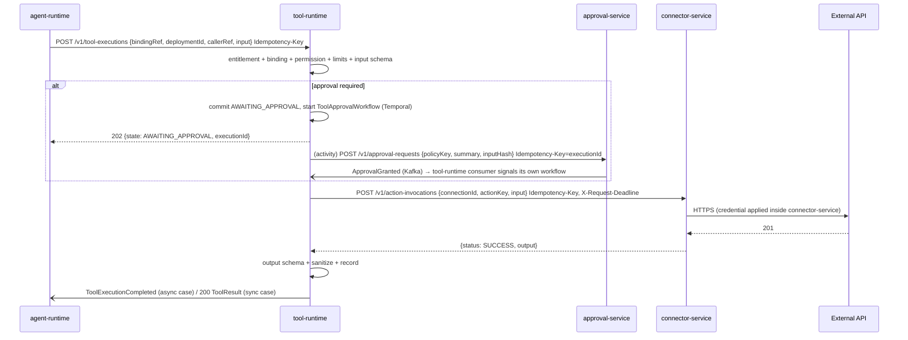

# RFC-0012 - Tool Execution Architecture
Status: PROPOSED
Revision 1.3 (2026-10-19): aligned with ADR-0020..0027 (adopted Temporal for approval waits, Redis for idempotency keys, rate limits and real-time quota checks, HashiCorp Vault as the credential mechanism behind connector-service, Istio mTLS/authorization/egress, Avro + Apicurio Registry + CloudEvents binary mode + Debezium outbox for events).
Owners: WAVER Architecture (named owner TBD)
Reviewers: TBD
Date: 2026-10-19
Version: 1.3

## Summary
Define the tool registry and tool runtime: Tool and ToolVersion contracts (JSON Schema input/output), ToolPermission, ExecutionPolicy, the four tool kinds, the authorization → validation → approval → execution → sanitization pipeline, the ToolExecution state machine, idempotency for side-effecting tools, sandboxing/isolation and egress, approval, timeouts, audit, safe error reporting to the model, versioning/deprecation, and how entitlements decide which tools appear in Builder.

## Context / Problem
Scope §9 makes Tools independent, reusable capabilities consumed by agents through bindings. Scope §22 requires idempotency for side-effecting tool calls and §24 leaves "Tool security" open (approval levels, sandboxing, egress, credential boundaries). The commercial model sells Tools and Connectors as marketplace items, so a tool must only be usable where a valid Entitlement exists (AR-011). Tool calls are proposed by an LLM, which is an untrusted planner: every guarantee must be enforced outside the model.

## Goals
- One semantic contract per capability, independent of whether it is served by a native service, a marketplace connector, a custom API connector or a composed workflow.
- Server-side enforcement of entitlement, binding, permission, argument constraints, approval, rate and spend limits.
- Exactly-once effect where the downstream allows it; never a blind retry of a side effect whose outcome is unknown.
- Structured, safe results and errors the model can reason about without leaking internals or secrets.
- Version and deprecate tools without breaking deployed agents.

## Non-goals
- Connector manifest format, credential storage and HTTP egress engine (RFC-0018).
- Approval routing and approver UX (approval-service).
- Authoring UI for bindings (RFC-0016).
- Arbitrary customer code execution (rejected by ADR-0016 for v1).

## Requirements / ARs
| AR | Application |
|---|---|
| AR-004 | Builder, runtime and workflow-service use tool-runtime only through `POST /v1/tool-executions`; registry metadata via REST/events. |
| AR-006 | Idempotency key mandatory on every execution; deduplicated per `(org_id, idempotency_key)` (Redis fast path, PostgreSQL unique constraint authoritative). |
| AR-008 | Tenant context from token; Connection scope re-checked by connector-service. |
| AR-009 | Every execution, approval link and denial produces an audit event. |
| AR-011 | Entitlement snapshot checked on every execution, not only at authoring time. |
| AR-013 | tool-runtime caches registry data and entitlements locally; executes already-authorized calls while tool-registry/entitlement-service are down. |
| AR-014 | Per-target timeouts, retries, circuit breakers, bulkheads. |
| AR-015 | ToolVersion semantic versioning; breaking change = new major. |
| ADR-0014 / ADR-0022 | tool-runtime never holds credentials and has no Vault Transit permission on tenant credential keys; connector-service (sole owner) decrypts through Vault and executes credentialed calls. tool-runtime's own platform secrets (database credentials, Redis/Kafka/Temporal access) come from Vault (dynamic PostgreSQL credentials, Vault Secrets Operator). |
| ADR-0016 | Every connector action becomes one or more Tools. |
| ADR-0020 | Idempotency keys `waver:idem:tool-runtime:*`, rate-limit buckets and real-time quota checks in Redis; PostgreSQL stays the source of truth. |
| ADR-0023 | Executions awaiting approval are `ToolApprovalWorkflow` instances owned by tool-runtime (namespace `waver-capability`). |
| ADR-0024 | Events in Avro with CloudEvents binary-mode headers, published by Debezium from the outbox. |
| ADR-0026 | tool-runtime has no egress route; Istio `AuthorizationPolicy` restricts who may call it and whom it may call. |

## Proposed Design

### Entities and ownership
| Entity | Owner | Key fields |
|---|---|---|
| Tool | tool-registry | `id, key (e.g. crm.create_lead), owner_scope (PLATFORM, ORGANIZATION), org_id (if ORGANIZATION), kind (NATIVE, INTEGRATION, API, CUSTOM), display_name, category, required_capability_keys[], status (ACTIVE, DEPRECATED, RETIRED)` |
| ToolVersion | tool-registry | `id, tool_id, semver, input_schema (JSON Schema 2020-12), output_schema, model_description, side_effect_class (READ, WRITE, DESTRUCTIVE), permissions_declared[], implementation (see kinds), default_execution_policy, status (DRAFT, PUBLISHED, DEPRECATED, RETIRED), deprecated_at, sunset_at, replaced_by` |
| ToolPermission | tool-registry | `tool_version_id, key (e.g. crm.contacts:write), description, implies[]` — the scopes a version can be granted. |
| ExecutionPolicy (template) | tool-registry | `timeout_ms, retry {max_attempts, backoff, retry_on[]}, idempotency_strategy, approval {mode, approval_policy_key}, rate_limits[], spend_limit?, max_output_bytes` |
| ToolBinding | agent-builder (inside AgentVersion, RFC-0016) | `tool_id, tool_major, resolved_version_id, granted_permissions[], argument_constraints (JSON Schema overlay + fixed values), policy_overrides (tighten only), connection_slot, require_approval_when_tainted` |
| ToolExecution | tool-runtime | `id, org_id, workspace_id, domain_id, tool_version_id, caller (AGENT_RUN, WORKFLOW_RUN, PLAYGROUND, EVALUATION), caller_ref, mode (LIVE, DRY_RUN, MOCK), idempotency_key, request_hash, input_ref, output_ref, state, attempt_count, approval_request_id, approval_workflow_id, error_code, latency_ms, started_at, ended_at, version` |
| ExecutionApprovalLink | tool-runtime | `tool_execution_id, approval_request_id, approved_input_hash, decision, decided_at` |

`ToolBinding` is owned by agent-builder; tool-runtime keeps a read model of it. The caller sends only `bindingRef` (agentVersionId + binding key); tool-runtime resolves permissions, constraints and overrides from the `toolBindings[]` section carried in `waver.agent-builder.AgentVersionCreated.v1` (max 50 bindings per version keeps the event small). Sandbox runs on an unversioned draft pass a `draftArtifactRef`, resolved through agent-builder `GET /v1/draft-artifacts/{id}/tool-bindings` (sandbox only, never on the production path). The caller never sends permissions or constraints itself.

### Tool kinds
| Kind | Implementation reference | Executed by |
|---|---|---|
| NATIVE | `{service, actionKey}` — a WAVER service (e.g. future native CRM/scheduling apps, Scope §19) exposing `POST /v1/tool-invocations`; native services are leaves on the hot path and must not make further synchronous calls (RFC-0005 §7) | The native service, called by tool-runtime |
| INTEGRATION | `{connectorKey, connectorMajor, actionKey}` — marketplace connector action (declarative or coded) | connector-service `POST /v1/action-invocations` with a Connection |
| API | `{connectorId, actionKey}` — action of an organization-scoped Custom API connector (ADR-0016 kind 3) | connector-service, same contract as INTEGRATION |
| CUSTOM | `{workflowId, workflowMajor}` — a customer-composed tool implemented as a workflow-service WorkflowVersion that only calls other tools (no code) | workflow-service, always **asynchronously** (`202`, completion via `WorkflowRunCompleted/Failed`), so the synchronous chain never exceeds depth 2 (RFC-0005 §7); nested tool-in-workflow depth max 3 |

Runtime system actions (send message, transfer to human, end conversation, set variable) are not Tools; they are runtime directives (RFC-0011) and are neither registered nor metered as tool calls.

### Execution pipeline
1. **Receive** `POST /v1/tool-executions` with `Idempotency-Key`. Same key + same request hash → return the existing execution; same key + different hash → `409 IDEMPOTENCY_KEY_REUSED` (see Idempotency strategy for the Redis/PostgreSQL split).
2. **Authorize**:
   - Entitlement snapshot: all `required_capability_keys` entitled and not suspended for the org (and workspace/domain when the entitlement is scoped).
   - Binding: tool is bound in the caller's AgentVersion (or WorkflowVersion); `tool_major` matches; binding not removed by rollback.
   - Permission: permissions required by the action ⊆ `granted_permissions`.
   - Connection: `connection_slot` resolved by the Deployment to a Connection in the same org/workspace/domain scope (re-verified by connector-service).
   - Limits: rate limits (per tool per agent, per org) as cluster-wide Redis token buckets (`waver:tool-runtime:rl:<scope>:<id>`, Lua, per-replica local buckets as fallback) and spend/consumption limits (per run, per day, `tool.calls` meter) checked in real time against the usage-metering Redis counters `waver:quota:<quotaCounterId>` through the usage-metering quota client, with the `quota_state` snapshot as fallback when Redis is unavailable (ADR-0020, RFC-0020).
   - Policy: `TOOL`-scope policies from the effective policy set (e.g., "discount tools require approval").
3. **Validate input** against `input_schema` merged with `argument_constraints` (fixed values injected, narrowed enums, max amounts). Violations return `INPUT_INVALID` with field paths, so the model can correct itself.
4. **Approval** if `approval.mode = ALWAYS`, or `IF_TAINTED` and the caller flagged taint, or side effect is DESTRUCTIVE (default ALWAYS): state `AWAITING_APPROVAL` is committed with `approved_input_hash`, a `ToolApprovalWorkflow` is started (see Approval waits) and the endpoint responds 202. The workflow creates the ApprovalRequest in approval-service with a redacted summary and later dispatches exactly the approved input.
5. **Execute** by kind, with `X-Request-Deadline` = min(caller deadline, now + `timeout_ms`) (default 10 s, max 30 s sync; CUSTOM tools and longer tools run async and complete via event). Single retry layer (RFC-0005 §5): tool-runtime does not retry connector-service calls unless the remaining deadline exceeds 3× the call timeout; retries toward the external API happen inside connector-service and only for safe calls.
6. **Validate/sanitize output**: validate against `output_schema` (non-conforming → `OUTPUT_INVALID`, never passed to the model raw); truncate to `max_output_bytes` (default 32 KB for the model view; full output stored encrypted, retention 30 days); strip control characters and markup; wrap as untrusted data with provenance.
7. **Record** ToolExecution final state; outbox `ToolExecutionCompleted` / `ToolExecutionFailed` (relayed by Debezium, ADR-0024); the event feeds the `tool.calls` meter (RFC-0020) for billing and reconciliation of the real-time counter; priced tools also report spend units.
8. **Respond** with the structured `ToolResult`.



### ToolExecution state machine
| From | Trigger | To |
|---|---|---|
| — | Request accepted | RECEIVED |
| RECEIVED | Authorization or input validation fails | REJECTED (`NOT_ENTITLED`, `NOT_BOUND`, `PERMISSION_DENIED`, `RATE_LIMITED`, `SPEND_LIMIT_REACHED`, `INPUT_INVALID`, `POLICY_DENIED`) |
| RECEIVED | Approval required | AWAITING_APPROVAL |
| RECEIVED | Checks passed | RUNNING |
| AWAITING_APPROVAL | `ApprovalGranted` | RUNNING |
| AWAITING_APPROVAL | `ApprovalRejected` / `ApprovalExpired` | REJECTED (`APPROVAL_REJECTED` / `APPROVAL_EXPIRED`) |
| RUNNING | Success + valid output | SUCCEEDED |
| RUNNING | Definitive error (4xx, business error, output invalid) | FAILED |
| RUNNING | Retryable error and attempts left and side effect is READ or downstream idempotent | RUNNING (`attempt_count+1`) |
| RUNNING | Deadline exceeded, READ tool | TIMED_OUT |
| RUNNING | Deadline exceeded / connection reset after dispatch, WRITE or DESTRUCTIVE without downstream idempotency | OUTCOME_UNKNOWN |
| OUTCOME_UNKNOWN | Reconciliation read (if the action declares `reconcileWith`) finds the effect / proves absence | SUCCEEDED / FAILED |
| RECEIVED, AWAITING_APPROVAL, RUNNING | Cancel requested | CANCELLED (if RUNNING, only before dispatch; otherwise recorded as `cancelRequested` and the final state stands) |

Terminal: SUCCEEDED, FAILED, REJECTED, TIMED_OUT, OUTCOME_UNKNOWN (unless reconciled), CANCELLED. The ToolExecution row in PostgreSQL is the state of record; approval waits are held by Temporal (below).

### Approval waits (Temporal, ADR-0023)
Synchronous executions never touch Temporal; only executions that enter `AWAITING_APPROVAL` start a workflow, so the hot path is unchanged.
- **`ToolApprovalWorkflow(executionId)`**, namespace `waver-capability`, task queue `tool-runtime.tool-approval`, workflow ID `tool-approval:<executionId>` (duplicate starts rejected by ID). Started right after the `AWAITING_APPROVAL` transaction commits; if the start fails, a startup/periodic reconciliation (Temporal Schedule `tool-runtime.approval-reconcile`, every 1 min) starts workflows for `AWAITING_APPROVAL` rows without `approval_workflow_id`.
- Steps (workflow code deterministic; side effects only in idempotent activities):
  1. Activity `createApprovalRequest` → approval-service `POST /v1/approval-requests` with `Idempotency-Key = executionId`; retried with backoff by the activity retry policy while approval-service is down (replaces the v1.2 outbox-driven retry). Stores `approval_request_id` in the ExecutionApprovalLink.
  2. Wait for the `approvalDecided(decision)` signal or the timer `approval expiry + 30 s` (safety net if `ApprovalExpired` is lost). The signal is sent by tool-runtime's own Kafka consumer of `waver.approval.ApprovalGranted/Rejected/Expired.v1` (inbox-deduplicated), which first records the decision in ExecutionApprovalLink; the workflow also reads that link when it starts, so a decision that arrives before the workflow exists is not lost. approval-service never signals tool-runtime's workflow (AR-003/AR-004).
  3. Granted → activity `dispatchApprovedExecution`: re-runs entitlement/binding/limit checks (state may have changed while waiting), verifies `sha256(input) == approved_input_hash`, executes by kind, validates/sanitizes output and records the final state + outbox event in one transaction. Its retry policy follows the tool's `idempotency_strategy`: `maximumAttempts = 1` for WRITE/DESTRUCTIVE without downstream idempotency (an unknown outcome becomes OUTCOME_UNKNOWN, never a blind retry); bounded retries for READ or `DOWNSTREAM_HEADER`/`NATURAL_KEY` actions. Start-to-close timeout = the tool's `timeout_ms`.
  4. Rejected / expired → activity `rejectExecution` (REJECTED with `APPROVAL_REJECTED` / `APPROVAL_EXPIRED`, outbox event).
  5. Cancel request (`POST /v1/tool-executions/{id}/cancel` while AWAITING_APPROVAL) → tool-runtime cancels its workflow; cancellation handler runs `cancelExecution` and asks approval-service to withdraw the request (best effort).
- Workflow inputs and history carry IDs and hashes only; the approved input stays in tool-runtime's encrypted storage and is loaded by the dispatch activity.
- The caller (agent-runtime run in `WAITING_APPROVAL`, workflow-service run) learns the outcome from `ToolExecutionCompleted/Failed` as before.

### Idempotency strategy (side-effecting tools)
- **Key derivation by caller**: agent-runtime `sha256(runId:turnId:stepSeq)`, flow nodes `sha256(runId:nodeId:visitCount)`, workflows `sha256(workflowRunId:stepId:attempt-group)`. Stable across pod restarts because inputs are persisted before dispatch.
- **tool-runtime dedupe (ADR-0020 + PostgreSQL)**: on receive, `SET waver:idem:tool-runtime:<orgId>:<idempotencyKey> {requestHash, executionId} NX EX 604800` (7 days, longer than the 24h HTTP default in CONVENTIONS because runs can wait for approvals). A hit returns the stored execution (same hash) or `409 IDEMPOTENCY_KEY_REUSED` (different hash) without touching the database, and concurrent duplicates are rejected before any work starts. The PostgreSQL unique constraint `(org_id, idempotency_key)` on ToolExecution stays the authoritative backstop and the audit record: if Redis is unavailable or has lost the key, the insert conflict produces the same answers. Redis therefore only accelerates deduplication; it can never cause a double execution.
- **Downstream propagation** per `idempotency_strategy`:
  - `DOWNSTREAM_HEADER` — the connector action declares the header (e.g. `Idempotency-Key`); retries are safe.
  - `NATURAL_KEY` — the action is an upsert on a business key (e.g., external lead ID derived from the key).
  - `NONE` — no retry after dispatch; timeouts become OUTCOME_UNKNOWN; the model receives `OUTCOME_UNKNOWN` with guidance to verify through a READ tool or hand off, never to repeat.
- Publish-time rule: WRITE/DESTRUCTIVE versions with `NONE` must declare `reconcileWith` (a READ action) or be certified with an explicit waiver.

### Result and error contract returned to the model
```json
{
  "executionId": "0192f1c4-...",
  "status": "ERROR",
  "errorCode": "PERMISSION_DENIED",
  "retryable": false,
  "message": "This agent is not allowed to update deals.",
  "fieldErrors": [],
  "data": null
}
```
- `status`: `SUCCESS`, `ERROR`, `PENDING_APPROVAL`, `OUTCOME_UNKNOWN`.
- `message` is chosen from a fixed, localized template per `errorCode`; downstream error bodies, stack traces, hostnames, credential identifiers and HTTP headers are never passed through. Downstream detail is kept in the ToolExecution record for operators.
- `data` is the validated, truncated output, delivered to the runtime marked `trust=UNTRUSTED`.

### Sandboxing, isolation and egress
- tool-runtime has **no internet egress**: no `ServiceEntry`/egress-gateway route exists for it (ADR-0026) and NetworkPolicy denies external traffic as a second layer. Inside the mesh, Istio STRICT mTLS plus `AuthorizationPolicy` generated from the dependency graph let it reach only connector-service, native services, workflow-service, approval-service and its infrastructure (PostgreSQL, Kafka, Redis, Temporal); callers admitted to tool-runtime are agent-runtime, workflow-service and agent-builder/evaluation sandbox paths. All external HTTP leaves through connector-service's guarded engine (RFC-0018), and LLM traffic through model-gateway (ADR-0017).
- No customer code runs anywhere in v1 (CUSTOM tools are workflows of existing tools). Coded connectors are WAVER-reviewed and may be isolated in `connector-runner-<group>` deployments.
- Bulkheads per target (connector, native service) and per org (default 50 concurrent executions per org per replica) so a slow integration or a noisy tenant cannot exhaust threads. These stay in-process: they protect the replica's own threads, not a global budget.
- Execution modes: `LIVE`; `DRY_RUN` (full authorization and validation, no dispatch, returns a schema-valid synthetic output); `MOCK` (returns fixtures defined in the evaluation TestCase or the Playground). Sandbox callers (`PLAYGROUND`, `EVALUATION`) cannot request `LIVE` for WRITE/DESTRUCTIVE tools; READ tools may run LIVE when the Playground session enables it.

### Versioning, deprecation and grandfathering
- ToolVersion is immutable once PUBLISHED. Minor/patch: additive optional input fields, extra output fields, implementation fixes. Major: anything else.
- A binding pins `tool_id + major`; the AgentVersion records the resolved exact version for audit. tool-runtime executes the latest PUBLISHED minor/patch of the bound major (compatible by AR-015). Customers that need exact pinning: see Open Questions.
- Deprecation (`ToolDeprecated`): Builder blocks new bindings to that major and shows a migration hint (`replaced_by`); deployed agents keep working until `sunset_at` (default ≥ 180 days later). Notifications to affected customers and resellers through notification-service.
- Retirement (`ToolRetired`) at `sunset_at`: executions return `TOOL_RETIRED`; Builder validation fails for versions bound to it. Commercial grandfathering (existing contracts keep entitlement while new sales stop) is decided by marketplace/entitlement, not here (commercial §"Tool retirada do catálogo").

### Visibility in Builder (entitlement-gated)
- Builder lists candidate tools via agent-builder → tool-registry `GET /v1/tools?scope=...` and filters with entitlement-service `POST /v1/entitlement-decisions:batch` (RFC-0013 §8); only `ALLOW` is offered. Only entitled tools appear; tools whose connector has no ACTIVE Connection in scope appear as "connect first".
- `required_capability_keys` naming follows RFC-0013 (e.g. connector-level `connector:acme-crm` or tool-level `tool:create-lead`).
- Entitlement checks repeat at version time (RFC-0016), deployment time and every execution (this RFC), because entitlements can change after authoring.

## APIs / Events / Data Ownership
tool-registry-service (control plane, `waver_tool_registry`):

| Endpoint | Purpose |
|---|---|
| `GET /v1/tools`, `GET /v1/tools/{toolId}`, `GET /v1/tools/{toolId}/versions` | Catalog for Builder and runtime caches. |
| `POST /v1/tools`, `POST /v1/tools/{toolId}/versions` | Create (WAVER Product Ops; org admins for API/CUSTOM tools). |
| `POST /v1/tool-versions/{id}/publications`, `/deprecations`, `/retirements` | Lifecycle (audited). |

tool-runtime-service (data plane, `waver_tool_runtime`):

| Endpoint | Purpose |
|---|---|
| `POST /v1/tool-executions` | Execute (sync result ≤ timeout, otherwise 202). |
| `GET /v1/tool-executions/{id}` | State/result (also lookup by `?idempotencyKey=`). |
| `POST /v1/tool-executions/{id}/cancel` | Best-effort cancel. |

Events:

| Topic | Events | Key |
|---|---|---|
| `waver.tool-registry.tool.v1` | ToolVersionPublished, ToolDeprecated, ToolRetired | toolId |
| `waver.tool-runtime.tool-execution.v1` | ToolExecutionCompleted, ToolExecutionFailed (covers REJECTED, TIMED_OUT, OUTCOME_UNKNOWN, CANCELLED via `finalState`) | executionId |

Payloads carry IDs, tool key/version, side-effect class, final state, error code, latency, caller refs and metered units — never input/output content. Consumers: agent-runtime, workflow-service, usage-metering (`tool.calls` meter), audit-service.

Consumed by tool-runtime: `waver.tool-registry.tool.v1`, compacted `waver.entitlement.entitlement-snapshot.v1` (RFC-0013), compacted `waver.usage-metering.quota-state.v1` (RFC-0020; limits, counter IDs and fallback values), `waver.agent-builder.agent-version.v1` (`AgentVersionCreated`: bindings), compacted `waver.agent-builder.deployment-state.v1` (connection-slot mapping), `waver.approval.ApprovalGranted/Rejected/Expired.v1` (signals the matching `ToolApprovalWorkflow`), `waver.connector.ConnectionHealthChanged.v1` (fail fast), `waver.workflow.WorkflowRunCompleted/Failed.v1` (CUSTOM tools). Payloads are Avro (`contracts/events/tool-runtime/`, `contracts/events/tool-registry/`, registered in Apicurio Registry by CI); the CloudEvents envelope, including the `orgid`/`workspaceid`/`domainid` extensions, travels as `ce_*` Kafka headers (ADR-0024). Both services publish through the outbox table and Debezium.

## Security & Privacy
- Threat model required (SECURITY_BASELINE): LLM-proposed calls are treated as untrusted requests from a low-privilege principal.
- Tool inputs/outputs may contain PII: stored encrypted, retention 30 days default (configurable per org within policy), never in events, logs, Redis keys/values or Temporal workflow histories (only IDs and hashes go there).
- Service identity: callers authenticate with Keycloak-issued client-credentials or token-exchange tokens (ADR-0021) over Istio mTLS; tool-runtime validates the token and tenant context itself in addition to the mesh policy.
- Approval summaries shown to approvers are redacted per field annotations in the input schema (`x-waver-pii: true`).
- Audit events: execution of WRITE/DESTRUCTIVE tools, every REJECTED for `PERMISSION_DENIED`/`POLICY_DENIED`, approvals linked, deprecation/retirement actions.
- ORGANIZATION-scoped tools (API, CUSTOM) are invisible to other orgs (RLS on `owner_scope`/`org_id`).

## Reliability & Failure Modes
| Failure | Behaviour |
|---|---|
| tool-registry down | tool-runtime uses cached versions/policies (Caffeine + local table, refreshed by events); new tool publications delayed. |
| entitlement-service down | Last known snapshot keeps serving; staleness never flips to DENY by itself (RFC-0013 §8); snapshot age alert. |
| connector-service down / circuit open | `DEPENDENCY_UNAVAILABLE`, retryable=true for READ; WRITE not dispatched → safe retry by caller. |
| Connection REAUTH_REQUIRED | `CONNECTION_UNAVAILABLE`, retryable=false; runtime can hand off or inform user. |
| approval-service down | Execution stays AWAITING_APPROVAL; the `createApprovalRequest` activity retries with backoff (Temporal retry policy). |
| Temporal unavailable | Synchronous executions unaffected. New approval executions are committed as AWAITING_APPROVAL and their workflows are started by the reconcile schedule when Temporal returns; decisions received meanwhile stay in the inbox-processed ExecutionApprovalLink and are re-signalled on start. |
| Redis unavailable | Idempotency falls back to the PostgreSQL unique constraint; rate limits to per-replica buckets; quota checks to the `quota_state` snapshot. No double execution, limits temporarily approximate (ADR-0020). |
| Duplicate request | Idempotency returns stored result. |
| Downstream 429 | Honour `Retry-After` within deadline; else `RATE_LIMITED` retryable=true. |

SLO defaults: tool-runtime overhead (excluding target time) p95 ≤ 40 ms; availability 99.9%; executions stuck in RUNNING beyond deadline + 60 s = 0 (alert); AWAITING_APPROVAL rows without a running workflow for > 5 min = 0 (alert).

## Observability
- Span `toolruntime.execute` with children per pipeline step and the target call; attributes `tool_key`, `tool_version`, `side_effect_class`, `final_state`, `error_code`, `org_id`.
- Metrics: executions by state/error code, latency p50/p95/p99 per tool and connector, approval wait time (from `ToolApprovalWorkflow` start to decision), approval workflows open by age, idempotency hits served from Redis vs. PostgreSQL, rate-limit and quota fallbacks, OUTCOME_UNKNOWN count (alert > 0 per hour per tool), denial rates.
- Temporal Web (operators only) shows approval workflows by `executionId`; workflow IDs are linked from the execution record.
- Builder and Control show tool error rates per agent/tool/connector.

## Testing Strategy
- Exhaustive ToolExecution transition tests; property tests for idempotency (same key/hash, same key/different hash), including Redis key loss and Redis outage (PostgreSQL constraint still deduplicates) with Testcontainers Redis.
- `ToolApprovalWorkflow` tests with the Temporal Java SDK test environment (time skipping): grant/reject/expire, decision before workflow start, approval-service outage, cancel while waiting, input hash mismatch; replay tests in CI for every workflow change (ADR-0023).
- Contract tests for `POST /v1/tool-invocations` (native) and `POST /v1/action-invocations` (connector-service).
- Authorization matrix tests: entitlement × binding × permission × constraint combinations.
- Fault-injection tests (WireMock): timeouts after dispatch, 429, malformed output, oversized output.
- Security tests: output containing instructions is delivered only as data; error messages never contain downstream bodies.

## Deployment / Rollout / Rollback
- tool-registry and tool-runtime deploy independently. New ToolVersions are data, published through the registry lifecycle, not deploys.
- tool-runtime's Helm chart ships its Istio `AuthorizationPolicy`, Redis ACL user (`~waver:idem:tool-runtime:*`, `~waver:tool-runtime:*`, quota-client scripts) and Vault role; Temporal workers use build-ID versioning so open approval workflows finish on compatible code.
- A bad minor ToolVersion is rolled back by deprecating it with `replaced_by` = previous version and publishing a patch that restores the old behaviour (versions are immutable).

## Alternatives Considered
- Exact version pinning for every binding: maximal determinism, but every connector fix would require new AgentVersions for all customers.
- Agent-runtime calling connector-service directly: duplicates authorization and approval in two places.
- Sandboxed customer scripts as CUSTOM tools: rejected for v1 (ADR-0016).
- Approval waits as PostgreSQL timer rows (`next_wakeup_at`, v1.2 / ADR-0018): superseded by ADR-0023; Temporal gives durable timers, activity retries and visibility without custom pollers.
- A Temporal workflow for every execution: rejected; would put Temporal on the synchronous hot path for the majority of calls that need no approval.
- Idempotency only in Redis: rejected; Redis is non-authoritative (ADR-0020), so the PostgreSQL constraint remains.

## Risks
- OUTCOME_UNKNOWN cases confuse end users; mitigated by `reconcileWith` and handoff guidance.
- Argument constraints are only as good as schema authoring; certification checks constraints for monetary/destructive actions.
- Event-driven entitlement snapshot lag (seconds) can allow a few executions after revocation; acceptable, bounded by consumer lag SLO. (Consumption quotas no longer share this lag: they are checked against real-time Redis counters.)
- An approved execution dispatched hours after approval may meet a changed world (connection revoked, entitlement suspended); the dispatch activity re-checks authorization before executing.

## Open Questions
1. Approval levels (Scope §24 Tool security): recommendation — default `ALWAYS` for DESTRUCTIVE, `NEVER` for READ, `IF_TAINTED` for WRITE; customers can only tighten.
2. ~~Should DESTRUCTIVE tools fail closed on a stale snapshot?~~ — resolved in the v1.2 review: yes, when the snapshot is older than 24 h (default, configurable); recorded in RFC-0013 §8. Security sign-off still required.
3. Exact-version pinning as an enterprise option (strict AR-010 reading): recommendation — offer as a binding flag later, not in v1.
4. Is CUSTOM (workflow-composed tool) the intended meaning of "Custom" in Scope §9? Recommendation — yes for v1; customer code stays out of scope.
5. Billing unit for tool calls (Scope §24 Billing) — tool-runtime events feed the `tool.calls` meter (RFC-0020) and optional spend units; the commercial unit is a business decision.
6. ~~Idempotency retention (7 days) differs from the 24h HTTP default in CONVENTIONS~~ — resolved: CONVENTIONS allows per-endpoint extension and cites this RFC; the 7-day TTL now applies to both the Redis key and the PostgreSQL record.
7. Per-tool rate-limit buckets in Redis (`waver:tool-runtime:rl:*`) are a tool-runtime-local use of ADR-0020's rate-limiting pattern (the ADR table names only edge-gateway); confirm when ADR-0020 is accepted.

## Decision
Proposed: adopt the tool kinds, the authorization → validation → approval → execution → sanitization pipeline, the ToolExecution state machine with OUTCOME_UNKNOWN, Temporal-held approval waits owned by tool-runtime, Redis-accelerated idempotency backed by PostgreSQL, major-pinned bindings, and entitlement checks at authoring, deployment and execution time. To be confirmed in architecture review.
