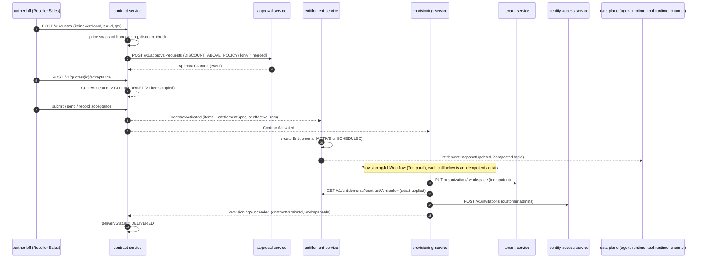
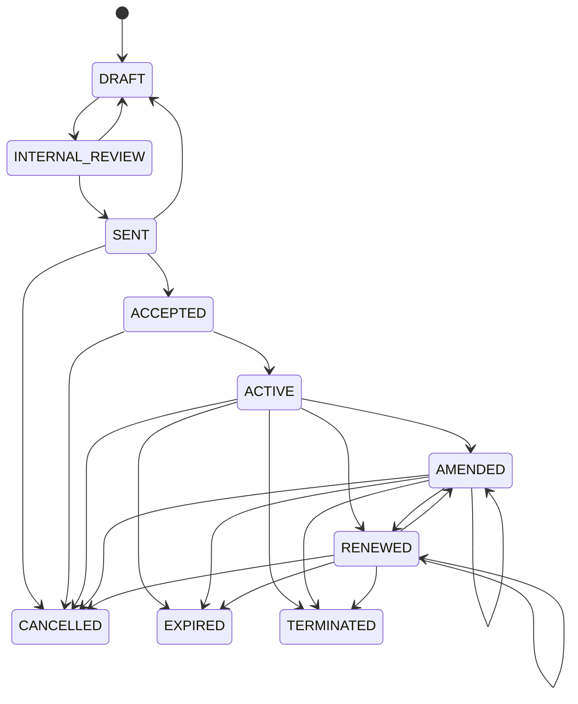

# RFC-0013 - Contract & Entitlement Architecture
Status: PROPOSED
Revision 1.3 (2026-10-19): aligned with ADR-0020..0027 (adopted Temporal, Redis, Apicurio Registry + Avro + Debezium outbox, Keycloak, HashiCorp Vault, Istio).
Owners: WAVER Architecture (named owner TBD)
Reviewers: TBD
Date: 2026-10-19
Version: 1.3
Related: ADR-0006, ADR-0009, ADR-0010, ADR-0012, ADR-0020, ADR-0021, ADR-0022, ADR-0023, ADR-0024, ADR-0026, AR-006, AR-009, AR-011, AR-012, AR-013, RFC-0017, RFC-0020, Commercial §1, §6, §7, §9, §13, §17, §19, §20

## Summary
Define Catalog -> Contract -> Entitlement -> Provisioning and capability enforcement: how a Marketplace Listing becomes a Quote, a Contract with immutable versions and items, technical Entitlements, an idempotent Provisioning saga and finally a usable Customer Workspace, with every ID carried end to end so the chain is traceable (Commercial §19).

## Context / Problem
The commercial principle is **Catalog ≠ Contract ≠ Entitlement ≠ Usage** (Commercial §1). The catalog says what may be sold, the contract what was agreed, the entitlement what is technically enabled, usage what was consumed. Today nothing defines how one becomes the next, which service owns each step, how amendments avoid rewriting history, how suspension reaches the data plane without coupling it to the control plane (AR-013), or how we detect drift between what was sold and what is running. MICROSERVICES_MAP v1.2 assigns the owners: `contract-service` (Quote, Contract, ContractVersion, ContractItem, Amendment, Renewal, Cancellation), `entitlement-service` (Entitlement, EntitlementLimit, FeatureFlag), `provisioning-service` (ProvisioningJob). This RFC specifies them.

## Goals
- One traceable chain `listingVersionId → quoteLineId → contractItemId → entitlementId → provisioningJobId → workspaceId`.
- Contract history is append-only: every commercial change is a new immutable `ContractVersion`.
- Entitlements are the single technical authority (AR-011), evaluated locally by data-plane services from a compacted snapshot topic (AR-013).
- Commercial, financial and technical status are separate fields everywhere (Commercial §13).
- Provisioning is an idempotent, resumable saga with reconciliation and manual review, implemented as a Temporal workflow owned by provisioning-service (ADR-0023).
- A contract never looks delivered before its critical capabilities are provisioned (Commercial §17).
- Every business rule that is still open (Commercial §20) is a configurable policy, not code.

## Non-goals
- Pricing, invoicing, dunning and usage metering (RFC-0020); catalog, marketplace, reseller and customer lifecycles (RFC-0017).
- E-signature vendor selection (port only, see Open Questions).
- Capability-specific runtime enforcement inside agent-runtime/tool-runtime (RFC-0011, RFC-0012); this RFC defines the contract they consume.

## Requirements / ARs
| AR | How this RFC satisfies it |
|---|---|
| AR-002/003/004 | Each service owns its tables; cross-service data only via versioned APIs and events below. |
| AR-006 | Every command takes `Idempotency-Key` (keys held in Redis `waver:idem:<service>:<key>` with TTL, ADR-0020; responses kept in PostgreSQL where audit needs them); every consumer uses the inbox table; provisioning activities are idempotent with deterministic keys and workflow IDs. |
| AR-008 | `org_id` from token; events carry `orgid` extension; RLS on every tenant-owned table (ADR-0010). |
| AR-009 | Every transition is an event consumed by audit-service; approvals via approval-service. |
| AR-010 | Accepted ContractVersions are frozen; production entitlements change only through a new version or an explicit hold. |
| AR-011 | Only entitlement-service decides "is capability X enabled for scope Y". |
| AR-012 | SUSPENDED/RESTRICTED are holds on entitlements and are reversible; REVOKED never deletes data. |
| AR-013 | Data plane evaluates from local snapshot caches, never synchronously calls contract/entitlement on the hot path. |
| AR-014 | Outbox (relayed by Debezium, ADR-0024), retry topics, DLQ, timeouts and circuit breakers on all sync calls; Temporal activity retry policies for saga steps. |

## Proposed Design

### 1. End-to-end chain and traceability

Trace keys carried by every downstream object (`origin` block, never re-derived):

| Object | Carries |
|---|---|
| QuoteLine | `listingId`, `listingVersionId`, `skuId`, `priceBookId`, `priceBookEntryId` |
| ContractItem | all of the above + `quoteId`, `quoteLineId`, `itemLineageId` (stable across versions) |
| Entitlement | `contractId`, `contractVersionId`, `contractItemId`, `itemLineageId`, `listingVersionId`, `skuId` |
| ProvisioningJob / Step | `contractId`, `contractVersionId`, `entitlementIds[]`, `workspaceIds[]` |
| UsageRecord (RFC-0020) | `entitlementId`, `contractItemId` (resolved from snapshot at ingestion) |
| InvoiceLine (RFC-0020) | `contractItemId`, `priceComponentId`, `usageAggregationId` |

The "trace view" in Control/Partner is composed by the BFF from `GET /v1/contracts/{id}`, `GET /v1/entitlements?contractId=` and `GET /v1/provisioning-jobs?contractId=`; no service stores another service's data except event-built read models.

### 2. contract-service domain model
| Entity | Key fields | Notes |
|---|---|---|
| Quote | `id`, `quoteNumber`, `org_id` (seller reseller), `customerOrgId`, `currency`, `priceBookId`, `validUntil`, `status`, `approvalRequestId`, `version` | Non-binding priced proposal. |
| QuoteLine | `id`, `quoteId`, `listingVersionId`, `skuId`, `priceBookEntryId`, `quantity`, `termMonths`, `retailUnitPrice`, `wholesaleUnitPrice`, `discount`, `discountReason` | Prices are snapshots at creation; re-priced only by explicit action. |
| Contract | `id`, `contractNumber`, `org_id` (seller), `customerOrgId`, `contractType` (`RESELLER_CUSTOMER` in v1), `status`, `currentVersionId`, `originQuoteId`, `startDate`, `endDate`, `renewalPolicyKey`, `deliveryStatus` (projection), `version` | `status` is commercial only. |
| ContractVersion | `id`, `contractId`, `versionNo`, `changeType` (`INITIAL`,`AMENDMENT`,`RENEWAL`,`CANCELLATION`), `versionStatus`, `effectiveFrom`, `effectiveTo`, `acceptedAt`, `acceptedBy`, `acceptanceEvidenceRef`, `snapshotHash` | Immutable once `ACCEPTED`: DB trigger rejects updates of frozen rows; `snapshotHash` = SHA-256 of canonical JSON of the version and its items/components. |
| ContractItem | `id`, `contractVersionId`, `itemLineageId`, `listingId`, `listingVersionId`, `skuId`, `quantity`, `effectiveFrom`, `effectiveTo`, `entitlementSpec` (jsonb snapshot from ListingVersion), `critical` | `itemLineageId` identifies "the same item" across versions so amendments are diffs, not re-creations. |
| PriceComponent | `id`, `contractItemId`, `componentType` (`SETUP`,`RECURRING`,`USAGE`,`DISCOUNT`,`CREDIT`,`TAX`), `side` (`RETAIL`,`WHOLESALE`), `chargeModel` (`FLAT`,`PER_UNIT`,`TIERED`,`VOLUME`), `unitPrice` (Money), `tiers`, `billingPeriod`, `meterKey`, `priceBookEntryId`, `taxMetadata` | Wholesale side is never exposed to customer audiences (ADR-0006/0009). |
| Amendment | `id`, `contractId`, `fromVersionId`, `toVersionId`, `amendmentType` (`ADD_ITEM`,`REMOVE_ITEM`,`QUANTITY_CHANGE`,`UPGRADE`,`DOWNGRADE`,`PRICE_CHANGE`), `effectiveDate`, `prorationPolicyKey`, `reason` | Effective dates may be in the future (Commercial §6.2). |
| Renewal | `id`, `contractId`, `fromVersionId`, `toVersionId`, `renewalMode` (`AUTO`,`MANUAL`), `noticeSchedule`, `status` (`UPCOMING`,`PROPOSED`,`ACCEPTED`,`DECLINED`,`LAPSED`) | Renewal = new version of the same contract, so contract identity and trace keys survive. |
| Cancellation | `id`, `contractId`, `kind` (`CANCELLATION`,`TERMINATION`), `reasonCode`, `requestedBy`, `effectiveDate`, `approvalRequestId`, `retentionPolicyKey`, `status` (`REQUESTED`,`PENDING_APPROVAL`,`SCHEDULED`,`COMPLETED`,`REJECTED`,`WITHDRAWN`) | TERMINATION is for cause (e.g., non-payment) and always needs approval (Commercial §11.1). |

Pricing inputs come from catalog-service (`GET /v1/price-books/{id}/entries`, `POST /v1/discount-policy-evaluations`) and availability from marketplace-service (`GET /v1/listings/{id}/availability?resellerOrgId=`). Both are cached (Caffeine as L1, optional shared Redis L2 `waver:cache:contract:<name>:<id>` per ADR-0020; both evicted by `PriceBookActivated`, `AvailabilityChanged`, `ListingRetired`, with TTL as a safety net). A quote line is rejected with `CONTRACT_ITEM_NOT_AVAILABLE` when the listing is not available to the reseller, and with `RESELLER_SALES_RESTRICTED` when the reseller is restricted (RFC-0017 §reseller default).

### 3. Quote lifecycle
| From | To | Trigger / actor | Event |
|---|---|---|---|
| — | DRAFT | `RESELLER_SALES`, `RESELLER_OWNER` | `QuoteCreated` |
| DRAFT | PENDING_APPROVAL | submit; DiscountPolicy evaluation says approval needed | `QuoteSubmitted` |
| DRAFT, PENDING_APPROVAL | APPROVED | no approval needed, or `ApprovalGranted` | `QuoteApproved` |
| PENDING_APPROVAL | DRAFT | `ApprovalRejected` / `ApprovalExpired` | `QuoteReturned` |
| APPROVED | SENT | `RESELLER_SALES` | `QuoteSent` |
| SENT | ACCEPTED | acceptance recorded by reseller (evidence) | `QuoteAccepted` |
| SENT | REJECTED / EXPIRED | customer declined / `validUntil` timer (Temporal durable timer in contract-service, §12) | `QuoteRejected` / `QuoteExpired` |

`QuoteAccepted` creates the Contract in `DRAFT` with version 1 copied from the quote lines (same transaction, outbox).

### 4. Contract lifecycle (Commercial §13.2)
`ACTIVE`, `AMENDED` and `RENEWED` are all **in force** (entitlements live); `AMENDED`/`RENEWED` record the latest change type of the current version. Amendments and renewals are drafted as a new `ContractVersion` with its own `versionStatus` (`DRAFT → INTERNAL_REVIEW → SENT → ACCEPTED → EFFECTIVE | SUPERSEDED | WITHDRAWN`) while the contract stays in force.

| From | To | Trigger / who may trigger | Guard | Event |
|---|---|---|---|---|
| DRAFT | INTERNAL_REVIEW | submit: `RESELLER_SALES`, `RESELLER_OWNER` | items valid, available, reseller not restricted | `ContractSubmitted` |
| INTERNAL_REVIEW | DRAFT | `ApprovalRejected`/`ApprovalExpired`, or reviewer returns (`RESELLER_OWNER`) | — | `ContractReturned` |
| INTERNAL_REVIEW | SENT | `ApprovalGranted` (or no approval required) + send: `RESELLER_SALES` | pricing rules pass | `ContractSent` |
| SENT | DRAFT | withdraw: `RESELLER_SALES` | not accepted | `ContractWithdrawn` |
| SENT | ACCEPTED | acceptance recorded: `RESELLER_SALES` with evidence, or `SignaturePort` callback | evidence present | `ContractAccepted` |
| SENT, ACCEPTED | CANCELLED | declined / cancelled before start: `RESELLER_OWNER` | — | `ContractCancelled` |
| ACCEPTED | ACTIVE | timer at `effectiveFrom` (system) | customer org exists | `ContractActivated` |
| in force | AMENDED | timer at amendment version `effectiveFrom` (system) | version ACCEPTED | `ContractAmended` |
| in force | RENEWED | timer at renewal version `effectiveFrom` (system) | version ACCEPTED | `ContractRenewed` |
| in force | EXPIRED | timer at `endDate` without effective renewal (system) | — | `ContractExpired` |
| in force | CANCELLED | Cancellation `SCHEDULED` reaches `effectiveDate` (system) | approval if policy requires | `ContractCancelled` |
| in force | TERMINATED | Termination approved (`TERMINATION` policy) and effective (system) | `ApprovalGranted` | `ContractTerminated` |

Every "timer at …" trigger above is a durable timer of the contract's Temporal workflow in contract-service (§12); the guard is re-checked by the activity that performs the transition. Approval outcomes reach contract-service as `ApprovalGranted/Rejected/Expired` events; contract-service's own consumer applies them and, when a workflow is waiting, signals its own workflow (approval-service never signals contract-service workflows).

Approval needs (policy keys in approval-service): `DISCOUNT_ABOVE_POLICY` (DiscountPolicy owned by catalog-service decides the threshold), `MARGIN_BELOW_POLICY` (PricingRule), `TERMINATION`, and optionally `CANCELLATION` (policy flag). Thresholds and approvers are configuration (Open Questions Q3).

Amendment effects: contract-service emits `ContractAmended` with the **diff** by `itemLineageId` (`added[]`, `changed[]`, `removed[]`) plus the full item list of the new version. Removal of an item never deletes data; entitlement-service applies the item's `onRemoval` policy (§7).

### 5. Delivery status (contract must not look delivered prematurely)
`Contract.deliveryStatus` is a read model built from provisioning events: `NOT_STARTED → IN_PROGRESS → DELIVERED | PARTIALLY_DELIVERED | DELIVERY_FAILED`. Rules:
- `DELIVERED` only after `ProvisioningSucceeded` for the current version with all items where `critical = true` done.
- `PARTIALLY_DELIVERED` when all critical steps succeeded but at least one non-critical step is in `MANUAL_REVIEW`.
- UIs show the commercial `status` and `deliveryStatus` side by side; Partner/Control must never render "Active" alone. Customer lifecycle `PROVISIONING → ACTIVE` (RFC-0017) also waits for `ProvisioningSucceeded`.
- Billing start trigger is a policy (`billing.startTrigger = CONTRACT_ACTIVATED | PROVISIONING_SUCCEEDED`), see Open Questions Q4.

### 6. entitlement-service domain model
| Entity | Key fields |
|---|---|
| Entitlement | `id`, `org_id` (customer), `resellerOrgId`, `scopeType` (`ORGANIZATION`,`WORKSPACE`,`DOMAIN`), `scopeId`, `capabilityKey` (e.g. `tool:create-lead`, `connector:hubspot`, `channel:whatsapp`, `capacity:agents`, `product:support-inbox`), `capabilityType` (`PRODUCT`,`TOOL`,`CONNECTOR`,`CHANNEL`,`CAPACITY`,`FEATURE`,`SERVICE`), origin block (§1), `validFrom`, `validTo`, `technicalStatus`, `critical`, `suspensionBehavior`, `onRemoval`, `version` |
| EntitlementHold | `id`, `entitlementId` (or `org_id` for org-wide holds), `holdType` (`RESTRICT`,`SUSPEND`), `source` (`CUSTOMER_SUSPENSION`,`CUSTOMER_RESTRICTION`,`RESELLER_DEFAULT`,`CONTRACT_EXPIRED`,`LISTING_RETIRED`,`MANUAL`), `sourceRef` (e.g. suspensionCaseId), `placedAt`, `placedBy`, `liftedAt`, `liftedBy` |
| EntitlementLimit | `id`, `entitlementId`, `limitKey`, `meterKey` (RFC-0020), `limitKind` (`CAPACITY` count of things, `CONSUMPTION` per period), `period` (`NONE`,`DAILY`,`MONTHLY`,`BILLING_PERIOD`,`TERM`), `amount` (numeric), `unit`, `enforcement` (`HARD`,`SOFT`,`NOTIFY_ONLY`), `overagePolicy` (`BLOCK`,`ALLOW_BILLABLE`,`ALLOW_UNBILLED`), `thresholds[]` |
| FeatureFlag | `id`, `org_id`, `flagKey`, `value`, `source` (`ENTITLEMENT`,`PLATFORM_ROLLOUT`), `entitlementId` |
| EntitlementSet (snapshot) | `org_id` (key), `snapshotVersion` (bigint, monotonic per org), `generatedAt`, entitlements + limits + flags + effective status |

**Three statuses, never one field** (Commercial §13): the commercial status lives in contract-service (`Contract.status`), the financial status in billing-service (`DunningCase.stage`), the technical status here (`Entitlement.technicalStatus`). entitlement-service stores only the *reason* of a hold (source + ref), never a copy of the financial status.

Technical status is **derived** from validity and holds: `REVOKED` if revoked; else `SCHEDULED` if `now < validFrom`; else `SUSPENDED` if any open `SUSPEND` hold; else `RESTRICTED` if any open `RESTRICT` hold; else `ACTIVE`. Lifting one hold never reactivates while another hold is open (e.g., a dunning reactivation does not undo a fraud suspension).

| From | To | Trigger (who) | Event |
|---|---|---|---|
| — | SCHEDULED / ACTIVE | `ContractActivated`/`ContractAmended`/`ContractRenewed` adds item (system) | `EntitlementGranted` |
| SCHEDULED | ACTIVE | timer at `validFrom` (system; Temporal durable timer in entitlement-service, §12) | `EntitlementChanged` |
| ACTIVE | RESTRICTED | hold placed: `CustomerRestricted`, `ContractExpired` (policy), `LISTING_RETIRED` grace end, manual `WAVER_SUPPORT`/`WAVER_FINANCE` with reason | `EntitlementRestricted` |
| ACTIVE, RESTRICTED | SUSPENDED | hold placed: `CustomerSuspended`, manual with approval `SUSPENSION_OVERRIDE` | `EntitlementSuspended` |
| RESTRICTED, SUSPENDED | ACTIVE / RESTRICTED | last (or most severe) hold lifted: `CustomerReactivated`, override approved | `EntitlementReinstated` |
| any non-REVOKED | (limits/quantity changed) | amendment diff `changed[]` | `EntitlementChanged` |
| any | REVOKED | item removed (after `onRemoval` window), `ContractCancelled`/`ContractTerminated`/`ContractExpired` (after policy window), `CustomerTerminated` | `EntitlementRevoked` |

`suspensionBehavior` per capability (from the ListingVersion entitlement template, overridable per DunningPolicy): `BLOCK` (default), `READ_ONLY`, `KEEP_INBOUND` (e.g., channels keep receiving and storing inbound messages so nothing is lost while outbound and agent execution stop; Commercial §7.1), `KEEP`. RESTRICTED semantics: block new deployments, new agents/connections and expansion; running workloads continue (Commercial §7).

Combination rules: several entitlements for the same `capabilityKey` and scope merge into one **effective entitlement** in the snapshot: CAPACITY and CONSUMPTION limits are additive, FEATURE values use the most permissive value, technical status is evaluated per source entitlement and the effective status is the most permissive *non-held* one.

### 7. Granularity model (recommendation)
| Level | Role in v1 (recommendation, needs business approval) |
|---|---|
| Organization (customer) | Default subject of every commercial entitlement. |
| Workspace | Optional scope when an item is sold per workspace (e.g., "Platform Base" per workspace). |
| Domain | Not a commercial subject in v1; Customer Admin may later allocate org-level limits to domains (allocation, not entitlement). |
| Agent, User | Never entitlement subjects; they are dimensions of limits (`capacity:agents`, `capacity:seats`) and of usage (RFC-0020). |
| Capability | Always the "what" (`capabilityKey`), combined with one of the scopes above. |

The schema supports `DOMAIN` already, so the decision (Commercial §20 "Entitlement granularity") can change without migration.

### 8. Entitlement decision API and snapshot topic
- **Decision API** (control-plane callers: agent-builder-service, BFFs, contract-service checks): `POST /v1/entitlement-decisions` with `{ workspaceId, domainId, capabilityKey, action, requestedQuantity }`; `orgId` comes from the token. Response `{ decision: ALLOW | ALLOW_RESTRICTED | DENY, reasonCode: NOT_ENTITLED | SCHEDULED | RESTRICTED | SUSPENDED | REVOKED | LIMIT_REACHED, entitlementId, snapshotVersion }`. Batch form `POST /v1/entitlement-decisions:batch` (max 200). The Agent Builder only offers Tools/Channels with `ALLOW` (Commercial §6.1).
- **Snapshot topic** `waver.entitlement.entitlement-snapshot.v1`: `cleanup.policy=compact`, key = customer `orgId`, CloudEvent type `waver.entitlement.EntitlementSnapshotUpdated.v1` in binary mode (CloudEvents attributes and WAVER extensions as `ce_*` Kafka headers; the Kafka value is the Avro-encoded full EntitlementSet, schema `contracts/events/entitlement/EntitlementSnapshotUpdated.v1.avsc` registered in Apicurio Registry, ADR-0024). Written to the outbox in the same transaction as every change and published by the Debezium Outbox Event Router. Org termination + end of retention emits a tombstone (outbox row with empty payload, router configured to emit tombstones on empty payload).
- **Data-plane cache**: agent-runtime, tool-runtime-service, channel-service, knowledge-service and usage-metering-service consume the topic into a local table (`entitlement_snapshot`, their own DB) plus Caffeine (L1). Optionally, per consuming service and off by default, a Redis L2 (`waver:cache:<service>:entitlement-snapshot:<orgId>`, ADR-0020) sits behind Caffeine and in front of the local table so that new or scaled-out pods of that service warm up without reading the table; it is filled read-through from the local table, overwritten when a newer `snapshotVersion` is applied and never written from anywhere else. The local table stays the service's read model of record: losing Redis only means a cache miss. On cold start they read from their table (or the L2), then catch up from the topic. Consumers drop any message with `snapshotVersion` lower than stored.
- **Evaluation** uses the same rules as the decision API, packaged as a generated client + evaluator from `contracts/` (Open Questions Q9). If the topic is unavailable, data-plane services keep the last known snapshot (already-authorized workloads continue; AR-013). Snapshot age is exported as a metric; staleness never flips to DENY by itself — **with one exception** (v1.2 review, PROPOSED): tools whose side-effect class is DESTRUCTIVE (RFC-0012) fail closed when the snapshot is older than 24 h (default, configurable by WAVER security).
- **Capacity limits** (`limitKind = CAPACITY`, e.g., agents, seats, channel numbers) are enforced synchronously by the service that creates the thing (agent-builder, identity-access, channel-service) against its own count and the snapshot. **Consumption limits** (runs, tokens, tool calls, messages) are counted by usage-metering-service; data-plane services combine the snapshot (limit, enforcement, overagePolicy) with the real-time quota counters in Redis owned by usage-metering-service (RFC-0020 §2, ADR-0020); the compacted quota state topic `waver.usage-metering.quota-state.v1` remains their local fallback when Redis is unavailable. Enforcement of consumption limits is near-exact: an atomic check-and-increment admits no count-based unit beyond the limit, and variable-quantity meters (tokens) can overshoot only by calls already in flight when the limit is reached (approximate again only while running on the fallback).

### 9. provisioning-service saga (Temporal, ADR-0023)
The saga runs as a **Temporal workflow** (`ProvisioningJobWorkflow`, namespace `waver-commercial`, task queue `provisioning-service.provisioning-job`) whose workers run inside provisioning-service. Temporal holds the durable execution state (history, timers, retries); provisioning-service's own database keeps the business view (`ProvisioningJob`, `ProvisioningStep`) that the APIs, UIs and reconciliation read. Workflow code is deterministic; every side effect (calls to tenant/identity/entitlement, DB writes, outbox rows) happens in an idempotent activity.

| Entity | Key fields |
|---|---|
| ProvisioningJob | `id`, `org_id` (customer), `resellerOrgId`, `jobType` (`ACTIVATE`,`AMEND`,`RENEW`,`REACTIVATION_VERIFY`,`DEPROVISION`), `contractId`, `contractVersionId`, `state`, `attempt`, `maxAttempts`, `lastErrorCode`, `idempotencyKey` (= `contractVersionId` + `jobType`), `workflowId` (= `provisioning-job:<idempotencyKey>`), `version` |
| ProvisioningStep | `id`, `jobId`, `stepKey`, `ordinal`, `critical`, `state` (`PENDING`,`DONE`,`FAILED`,`SKIPPED`), `stepIdempotencyKey`, `externalRef`, `attempt`, `lastError` |
| ReconciliationRun / ReconciliationFinding | `id`, `scope`, `startedAt`, `findingType`, `subjectRef`, `resolution` (`AUTO_FIXED`,`MANUAL_REVIEW`,`IGNORED`) |

Step catalogue for `ACTIVATE` (others are subsets): `ENSURE_ORGANIZATION` (tenant-service `PUT /v1/organizations/{customerOrgId}` status check), `ENSURE_WORKSPACES` (tenant-service `POST /v1/workspaces` with `Idempotency-Key = UUIDv5(jobId, itemLineageId)`), `AWAIT_ENTITLEMENTS` (the workflow waits for an `entitlementsApplied` signal that provisioning-service's own `EntitlementGranted` consumer sends to its own workflow, with a durable timer fallback that re-checks entitlement-service `GET /v1/entitlements?contractVersionId=` in an activity until all items are applied), `INVITE_ADMINS` (identity-access-service `POST /v1/invitations`, idempotent per email+org; identity-access-service mirrors the membership into the customer's Keycloak organization through the Keycloak Admin API, ADR-0021 — provisioning never calls Keycloak directly), `CAPABILITY_SETUP` (extension point `ProvisioningStepHandler` per `capabilityType`; v1 handlers only for tenancy/identity, see Open Questions Q10), `VERIFY` (read back actual state).

| From | To | Trigger | Event |
|---|---|---|---|
| — | PENDING | `ContractActivated`/`ContractAmended`/`ContractRenewed`/`CustomerReactivated`/`ContractExpired` consumed; the consumer starts the workflow with `workflowId` derived from `idempotencyKey` (duplicate start = no-op, ID reuse policy rejects duplicates); first activity inserts the job row (unique `idempotencyKey`) | `ProvisioningJobCreated` |
| PENDING | RUNNING | a provisioning-service worker picks up the workflow task from the task queue | — |
| RUNNING | SUCCEEDED | all critical steps DONE, VERIFY passed | `ProvisioningSucceeded` |
| RUNNING | FAILED | step error after the activity's own retry policy is exhausted | `ProvisioningFailed` (with `retryable`) |
| FAILED | RETRYING | retryable and `attempt < maxAttempts`; workflow sleeps on a durable timer with exponential backoff | — |
| RETRYING | RUNNING | timer fires; resumes at first non-DONE step | — |
| FAILED | MANUAL_REVIEW | non-retryable or attempts exhausted; workflow waits for an operator signal | `ProvisioningManualReviewRequired` |
| MANUAL_REVIEW | RETRYING | operator retry: `WAVER_SUPPORT`, `RESELLER_SUPPORT` (own portfolio) via `POST /v1/provisioning-jobs/{id}/retry` → `retry` signal | — |
| MANUAL_REVIEW | SUCCEEDED | operator resolves via `POST /v1/provisioning-jobs/{id}/resolution` → `resolve` signal; VERIFY must pass | `ProvisioningSucceeded` |
| PENDING, RETRYING, MANUAL_REVIEW | CANCELLED | superseded by newer version / contract cancelled (system): provisioning-service's own consumer sends a `cancel` signal | `ProvisioningCancelled` |

Rules:
- Every step is an idempotent activity with a deterministic key (`stepIdempotencyKey`, propagated as `Idempotency-Key` to the called service); the activity persists the step result (`ProvisioningStep` row) and any event (outbox row, relayed by Debezium) in one local transaction before the workflow moves to the next step. Activity-level retry policies absorb short transient errors; `attempt`/`maxAttempts` count job-level attempts as before.
- **Signals come only from provisioning-service itself**: operator actions arrive through its API (authorization, reason and actor recorded, audit event emitted) and its event consumers translate other services' events into signals to its own workflows. No other service signals or queries provisioning workflows (ADR-0023).
- Non-critical step failure sets the step to `FAILED` and lets the job succeed with `partialItems[]` (non-critical failures go to a manual-review queue).
- **Compensation**: each `ProvisioningStepHandler` may declare a compensating activity, executed in reverse order when a job is CANCELLED mid-flight. By rule, compensations never delete customer data; the v1 tenancy/identity steps declare none, so a cancelled job leaves created resources in place and the superseding job (or `DEPROVISION`) moves state forward. Steps never delete customer data; `DEPROVISION` only disables new activity (workspace status via tenant-service) and lets retention policies run elsewhere.
- Long-lived jobs (many MANUAL_REVIEW retries) use Continue-As-New to bound workflow history. Workflow changes ship with Temporal worker versioning (build IDs) and replay tests (AR-015).

### 10. Reconciliation
A per-environment `ReconciliationWorkflow` in provisioning-service, started by two **Temporal Schedules** (hourly incremental, nightly full; overlap policy `SKIP`, so at most one run per scope is active — this replaces the former PostgreSQL advisory lock), compares three views per customer org. Each comparison batch and each auto action is an idempotent activity; the `ReconciliationRun`/`ReconciliationFinding` rows remain the business record. On-demand runs (`POST /v1/reconciliation-runs`) trigger the same schedule action:
1. **Contracted**: in-force versions and items (`GET /v1/contract-versions?inForce=true&updatedSince=`).
2. **Entitled**: entitlement-service (`GET /v1/entitlements?orgId=` via the audited portfolio path) and current `snapshotVersion`.
3. **Actual**: tenant-service workspaces/status, identity-access admin memberships, and data-plane `appliedSnapshotVersion` reported via `GET /v1/entitlement-cache/status` on each data-plane service (internal).

| Finding | Auto action |
|---|---|
| In-force item without entitlement | `POST /v1/entitlement-sets/{orgId}:recompute` on entitlement-service (idempotent) |
| Entitlement without in-force item (and not in a removal window) | none; `MANUAL_REVIEW` (never auto-revoke) |
| Workspace missing for a delivered version | new `ACTIVATE` job for that version (idempotency key and workflow ID suffixed with the `findingId`, so it is not deduplicated against the original, completed job) |
| Data-plane snapshot lag above threshold | alert only |
| Hold without open source case | `MANUAL_REVIEW` |

Each finding emits `ReconciliationDiscrepancyDetected` and is visible in Control (WAVER Product Ops/Support) and Partner (own portfolio).

### 11. Listing retirement and grandfathering
marketplace-service owns the listing lifecycle (RFC-0017). Each ListingVersion carries a `retirementPolicy`: `GRANDFATHER_UNTIL_TERM_END`, `GRANDFATHER_INCLUDING_RENEWALS`, or `MIGRATE_TO` (`targetListingId`, `migrationDeadline`). Effects:
- `ListingDeprecated`: contract-service blocks it for **new customers**; expansion on existing contracts follows the policy flag `allowExpansionWhenDeprecated` (recommendation: allowed, needs business approval).
- `ListingRetired`: contract-service rejects new quotes and amendments that add it (`CONTRACT_ITEM_NOT_AVAILABLE`); renewals follow `retirementPolicy`. Existing entitlements are untouched (they are bound to `listingVersionId`); for `MIGRATE_TO`, contract-service opens draft amendments for affected contracts and, at `migrationDeadline`, entitlement-service places a `LISTING_RETIRED` RESTRICT hold only on contracts that did not migrate. Retirement never revokes access by itself.

### 12. Effective dates and scheduling
All future-dated changes are **Temporal durable timers** inside workflows owned by the service that owns the date (ADR-0023, namespace `waver-commercial`); there are no timer tables or polling. The business dates stay in each owner's database; the workflow only schedules the wake-up and re-reads the current state in the activity that performs the transition, so a changed or withdrawn date never acts on stale data.

| Owner | Workflow (task queue `<service>.<workflow>`) | Timers |
|---|---|---|
| contract-service | `ContractScheduleWorkflow`, one per contract (`workflowId = contract:<contractId>`), started when the first version is ACCEPTED | version `effectiveFrom` (→ ACTIVE / AMENDED / RENEWED), `endDate` without effective renewal (→ EXPIRED), Cancellation `effectiveDate` (→ CANCELLED / TERMINATED), renewal notices per `renewalPolicyKey` (e.g. 90/60/30 days before `endDate`) emitting `ContractRenewalDue` |
| contract-service | `QuoteExpiryWorkflow`, one per SENT quote | `validUntil` (→ EXPIRED) |
| entitlement-service | `EntitlementValidityWorkflow`, one per entitlement with a future `validFrom`/`validTo` or a pending policy window (`onRemoval`, `onExpiry`, `migrationDeadline`) | `validFrom` (SCHEDULED → ACTIVE), `validTo`, end of removal/expiry windows (→ REVOKED), `LISTING_RETIRED` hold at `migrationDeadline` |

When contract-service accepts a new version, schedules or withdraws a cancellation, its own API handler signals the contract's workflow (`versionAccepted`, `cancellationScheduled`, `cancellationWithdrawn`) to re-plan timers; long-lived contracts use Continue-As-New at each renewal to bound history. Each timer-driven transition runs as an idempotent activity that updates the aggregate and writes the event to the outbox in one transaction. Entitlement technical status remains *derived* from `validFrom`/`validTo` and holds (§6), so the data-plane evaluator computes SCHEDULED/ACTIVE from the snapshot dates even if a timer fires late; the timer only produces the event and the new snapshot version.

Dates are stored as UTC instants; a contract's local "start of day" is resolved with the contract's time zone field (default `America/Sao_Paulo`, recommendation) before the timer is scheduled.

## APIs / Events / Data Ownership

### APIs (all `/v1`, `Idempotency-Key` on POST, `If-Match` on updates)
| Service | Endpoint | Audience |
|---|---|---|
| contract | `POST /quotes`, `GET /quotes/{id}`, `POST /quotes/{id}/lines`, `POST /quotes/{id}/submission`, `POST /quotes/{id}/sending`, `POST /quotes/{id}/acceptance` | partner, control |
| contract | `GET /contracts`, `GET /contracts/{id}`, `GET /contracts/{id}/versions`, `GET /contract-versions/{id}` (items + price components) | partner, control |
| contract | `POST /contracts/{id}/submission`, `/sending`, `/acceptance`, `/withdrawal` | partner |
| contract | `POST /contracts/{id}/amendments`, `POST /contracts/{id}/renewals`, `POST /contracts/{id}/cancellations` | partner, control |
| contract | `GET /contract-versions?inForce=true&updatedSince=` (reconciliation, billing), `GET /contract-items/impact?listingId=` (reseller org IDs affected; notification recipients) | services |
| contract | `GET /customer-contract-summaries/{customerOrgId}` (no prices, no wholesale) | workspace (optional, Q8) |
| entitlement | `POST /entitlement-decisions`, `POST /entitlement-decisions:batch` | services, all BFFs |
| entitlement | `GET /entitlements?orgId=&contractId=&contractVersionId=&capabilityKey=` | partner, control, provisioning |
| entitlement | `POST /entitlements/{id}/holds`, `DELETE /entitlements/{id}/holds/{holdId}` (manual, reason required) | control (WAVER roles) |
| entitlement | `POST /entitlement-sets/{orgId}:recompute` | provisioning (service account) |
| provisioning | `GET /provisioning-jobs?contractId=&state=`, `GET /provisioning-jobs/{id}`, `POST /provisioning-jobs/{id}/retry`, `POST /provisioning-jobs/{id}/resolution` | partner (own), control |
| provisioning | `GET /reconciliation-findings`, `POST /reconciliation-runs` | control |

### Events
| Topic | Types |
|---|---|
| `waver.contract.quote.v1` | `QuoteCreated`, `QuoteSubmitted`, `QuoteApproved`, `QuoteReturned`, `QuoteSent`, `QuoteAccepted`, `QuoteRejected`, `QuoteExpired` |
| `waver.contract.contract.v1` | `ContractSubmitted`, `ContractReturned`, `ContractSent`, `ContractWithdrawn`, `ContractAccepted`, `ContractActivated`, `ContractAmended`, `ContractRenewed`, `ContractExpired`, `ContractCancelled`, `ContractTerminated`, `ContractDeliveryStatusChanged`, `ContractRenewalDue` (renewal notice timer, schedule per `renewalPolicyKey`) |
| `waver.entitlement.entitlement.v1` | `EntitlementGranted`, `EntitlementChanged`, `EntitlementRestricted`, `EntitlementSuspended`, `EntitlementReinstated`, `EntitlementRevoked` |
| `waver.entitlement.entitlement-snapshot.v1` (compacted) | `EntitlementSnapshotUpdated` |
| `waver.provisioning.provisioning-job.v1` | `ProvisioningJobCreated`, `ProvisioningSucceeded`, `ProvisioningFailed`, `ProvisioningManualReviewRequired`, `ProvisioningCancelled`, `ReconciliationDiscrepancyDetected` |

`ContractActivated|Amended|Renewed` carry `contractId`, `contractVersionId`, `customerOrgId`, `resellerOrgId`, `effectiveFrom/To` and `items[]` (`contractItemId`, `itemLineageId`, `listingVersionId`, `skuId`, `quantity`, `entitlementSpec`, `critical`) — no prices, so entitlement-service stays event-driven (MICROSERVICES_MAP). Billing reads prices via `GET /v1/contract-versions/{id}` (RFC-0020).

Encoding (ADR-0024): every event above has an Avro schema in `contracts/events/<context>/<EventName>.v1.avsc` (contexts `contract`, `entitlement`, `provisioning`), registered by CI in Apicurio Registry with `BACKWARD_TRANSITIVE` compatibility; services never auto-register. CloudEvents attributes and WAVER extensions (`orgid`, `correlationid`, `causationid`, `actorid`, `actortype`, `aggregateversion`, `traceparent`, …) travel as `ce_*` Kafka headers. Each producer writes to its `outbox_event` table and Debezium (Kafka Connect, Outbox Event Router) publishes to the topic named in the row; topic names and types are unchanged.

### Consumed
| Consumer | Events |
|---|---|
| contract-service | `ApprovalGranted/Rejected/Expired`, `ListingDeprecated/Retired`, `AvailabilityChanged`, `PriceBookActivated`, `ResellerRestricted/Suspended/Reinstated`, `CustomerRestricted/Reactivated/Terminated`, `ProvisioningSucceeded/Failed/ManualReviewRequired` |
| entitlement-service | `ContractActivated/Amended/Renewed/Expired/Cancelled/Terminated`, `CustomerRestricted/Suspended/Reactivated/Terminated`, `ResellerSuspended` (only if WAVER escalates to customers, RFC-0017), `ListingRetired` |
| provisioning-service | `ContractActivated/Amended/Renewed/Expired/Cancelled/Terminated`, `EntitlementGranted`, `CustomerReactivated` |

### Data ownership
`waver_contract` (quote, quote_line, contract, contract_version, contract_item, price_component, amendment, renewal, cancellation, outbox_event, processed_event); `waver_entitlement` (entitlement, entitlement_hold, entitlement_limit, feature_flag, entitlement_set_version, outbox/inbox); `waver_provisioning` (provisioning_job, provisioning_step, reconciliation_run, reconciliation_finding, outbox/inbox). The former `timer` tables are gone: workflow and timer state lives in Temporal's own persistence (namespace `waver-commercial`), never in another service's database, and is not a business record — the tables above remain the source of truth. Each producing database runs with `wal_level = logical` and one Debezium replication slot (ADR-0024). `org_id` semantics: seller reseller on contract tables, customer on entitlement/provisioning tables; both carry the counterpart (`customer_org_id` / `reseller_org_id`) for portfolio RLS (Open Questions Q7).

## Security & Privacy
- RLS on all tables (ADR-0010). Resellers reach their customers' entitlements and jobs only through the audited portfolio path on `reseller_org_id`; WAVER oversight through the audited cross-tenant role.
- `side = WHOLESALE` components and `wholesaleUnitPrice` are excluded from every response unless the caller's `org_type` is `PLATFORM` or the owning `RESELLER`. workspace-bff has no client for quote/contract pricing endpoints (ADR-0009 CI rule).
- Manual holds, overrides and termination require reason, actor and timestamp and produce audit events; `SUSPENSION_OVERRIDE` and `TERMINATION` go through approval-service. Segregation of duties: the approver cannot be the requester (approval-service policy).
- Acceptance evidence documents are stored by reference (object storage decision pending, Q11); no PII in events beyond IDs.
- Service-to-service calls (contract → catalog/marketplace/approval, provisioning → tenant/identity-access/entitlement, reconciliation reads of data-plane cache status) run over Istio ambient STRICT mTLS; each destination's `AuthorizationPolicy` is generated from the declared dependency graph, so an undeclared call (e.g., a new `ProvisioningStepHandler` target, Q10) is denied by the mesh until it is declared (ADR-0026). NetworkPolicies remain as a second layer.
- Temporal workflow inputs, signals and histories carry IDs and statuses only (no PII, no prices beyond what the activity re-reads); Temporal Web access is restricted to WAVER operators (Keycloak SSO + Istio authorization). Operator actions on jobs go through the provisioning-service API, never through Temporal Web, so they are authorized and audited.
- Temporal, Redis and Apicurio credentials, and the services' PostgreSQL credentials (dynamic, short-lived), are issued by Vault (ADR-0022).

## Reliability & Failure Modes
| Failure | Behavior |
|---|---|
| catalog/marketplace unavailable during quoting | Quote creation fails fast (`503`, Resilience4j breaker); in-force contracts unaffected. |
| approval-service unavailable | Contract stays in `INTERNAL_REVIEW`; request creation retried via outbox. |
| Duplicate `ContractActivated` | Inbox dedup; deterministic workflow ID (second start rejected by Temporal); job `idempotencyKey` unique constraint. |
| Out-of-order amendment events | Entitlement-service applies versions by `versionNo`; older ones ignored and logged. |
| entitlement-service down | Data plane continues on last snapshot; new grants delayed; provisioning workflow waits in `AWAIT_ENTITLEMENTS` (signal or durable timer fallback). |
| tenant/identity down | Activity retries per its retry policy, then step fails retryable → `RETRYING` with backoff (durable timer) → `MANUAL_REVIEW` after `maxAttempts`. |
| Temporal unavailable | No new jobs start and timers fire late (contract activations, renewals, expiries are delayed, never lost); consumers do not ack events whose workflow start failed, so Kafka redelivers them once Temporal is back. Data plane unaffected (Temporal is not on the hot path). |
| provisioning-service pod dies mid-step | Another worker resumes the workflow from history; the interrupted activity re-runs with the same idempotency key. |
| Debezium / Kafka Connect stopped | Events stay in the outbox (no loss); publish latency grows; alert on replication slot lag and WAL growth (ADR-0024). |
| Redis unavailable | Optional caches miss and read from the local table / owner API; duplicate commands are still caught by the PostgreSQL unique constraints (`idempotencyKey`, inbox, workflow IDs); data-plane quota checks use the quota-state fallback (RFC-0020). No correctness impact (ADR-0020). |
| Snapshot topic lag | Suspension takes effect late (target p99 < 60 s, to be validated); alert on lag. |
| Poison event | Retry topics then `<topic>.dlq`; runbook for replay. |
| Partial provisioning | `deliveryStatus = PARTIALLY_DELIVERED`, customer lifecycle stays `PROVISIONING` if critical items missing. |

## Observability
Metrics: `contract_transitions_total{from,to}`, `quote_approval_wait_seconds`, `entitlement_snapshot_publish_lag_seconds`, `entitlement_snapshot_age_seconds{consumer}`, `entitlement_decisions_total{decision,reason}`, `provisioning_job_duration_seconds{jobType}`, `provisioning_jobs{state}`, `reconciliation_findings_total{type}`; KPI "provisioning success rate" (Commercial §16.1) = SUCCEEDED first attempt / created. Temporal SDK and server metrics (workflow task latency, activity failures, schedule-to-start latency per task queue) are exported to the same backend; Temporal Web gives operators the history of each job workflow (`workflowId` shown in Control next to the job). Traces propagate `traceparent` from the Partner request through events (`ce_traceparent` header, `causationid`) and into workflow activities. Logs always include `orgId`, `contractId`, `contractVersionId`, `jobId`, `workflowId`. Alerts: jobs in `MANUAL_REVIEW`, DLQ non-empty, snapshot age above threshold, Debezium replication slot lag, reconciliation schedule missed.

## Testing Strategy
- Exhaustive state-machine tests for Quote, Contract, ContractVersion, Entitlement status derivation and ProvisioningJob, including forbidden transitions.
- Temporal workflow tests (Temporal Java SDK test framework with time skipping) for `ProvisioningJobWorkflow`, `ReconciliationWorkflow`, `ContractScheduleWorkflow`, `QuoteExpiryWorkflow` and `EntitlementValidityWorkflow`: timers (effective dates, renewal notices, backoff), signals (retry, resolve, cancel, version accepted) and Continue-As-New; replay tests against recorded histories in CI for every workflow change (ADR-0023); ArchUnit rule that workflow classes only call activities.
- Property tests for hold combination and effective entitlement merge rules.
- Immutability tests: updating a frozen ContractVersion fails at DB level; `snapshotHash` stable.
- Event contract tests against the Avro schemas (`.avsc` compatibility check against Apicurio Registry in CI); consumer tests for out-of-order and duplicate delivery; Testcontainers test of the Debezium outbox route for the snapshot topic (including tombstones).
- Saga tests with WireMock-simulated tenant/identity failures at each step; resumption from every step, including worker restart mid-activity.
- Tenancy test kit (reseller A cannot read reseller B's contracts/entitlements); audience tests that workspace-bff never sees wholesale fields.
- Reconciliation tests seeded with each discrepancy class.

## Deployment / Rollout / Rollback
1. Ship contract-service (quote/contract/version) with manual acceptance; entitlement-service with decision API and snapshot topic; provisioning with tenancy/identity steps.
2. Data-plane consumers adopt the snapshot behind a flag (`entitlement.enforcement.mode = OBSERVE | ENFORCE`); OBSERVE logs would-be denials for one release before ENFORCE.
3. Reconciliation in report-only mode first, then enable auto-fix classes one by one.
Prerequisites per environment: Temporal namespace `waver-commercial` and the reconciliation schedules created by the pipeline (configuration as code); event schemas registered in Apicurio Registry by CI before the producing release; Debezium outbox connectors deployed for `waver_contract`, `waver_entitlement` and `waver_provisioning`.
Rollback: services are independently deployable; events are backward compatible within `v1` (enforced by the registry's `BACKWARD_TRANSITIVE` rule); enforcement can return to OBSERVE without data changes. Workflow code changes roll out with Temporal worker versioning, so running workflows keep executing on the build that started them and a rollback redeploys the previous build ID. Flyway migrations are forward-only, so rollbacks ship as new migrations.

## Alternatives Considered
- **Entitlements computed inside contract-service**: fewer services, but couples technical authority to commercial editing and violates the map.
- **Synchronous entitlement checks from the data plane**: simpler consistency, but violates AR-013 and adds a hop to every run.
- **Per-entitlement keyed snapshot topic**: smaller messages, but consumers would see partial updates of a multi-item amendment; per-org sets are atomic.
- **Provisioning choreographed without coordinator**: no single place to see progress or retry; the owner-held Temporal workflow is that coordinator (ADR-0023).
- **Hand-written PostgreSQL state machine with timer polling (`next_wakeup_at`, `FOR UPDATE SKIP LOCKED`) and an advisory-locked reconciliation job** (v1.2, ADR-0018): no extra component, but custom retry/timer/visibility code; superseded by ADR-0023.
- **Data-plane consumption enforcement from the compacted quota-state topic only** (v1.2, ADR-0013): no Redis, but HARD limits could overshoot by a batch plus propagation lag; superseded by ADR-0020 (the topic remains as fallback).

## Risks
- Snapshot size for very large orgs (hundreds of entitlements) — monitor; split by workspace if above 512 KB.
- Consumption enforcement is near-exact but can still overshoot by work in flight when the limit is reached (and by more while data-plane services run on the quota-state fallback during a Redis outage); overage policy must account for it.
- Temporal becomes a dependency of every commercial timer (activation, renewal, expiry): an outage delays these transitions; HA deployment and alerting on schedule-to-start latency are required (ADR-0023).
- Amendment diffs depend on correct `itemLineageId` handling in the UI/BFF.
- Manual acceptance evidence may be inconsistent until a contract engine decision is made.

## Open Questions
| # | Question | Recommended default (recommendation, needs business approval) |
|---|---|---|
| Q1 | Contract engine: signed in platform or only registered? (Commercial §20) | Register acceptance with evidence in v1; `SignaturePort` adapter later. |
| Q2 | Are `AMENDED`/`RENEWED` real states or version change types? | Keep as in-force states per Commercial §13.2 (as above); reconsider in v2. |
| Q3 | Discount/margin thresholds and approvers (Pricing autonomy) | DiscountPolicy per reseller tier; any discount above policy → `RESELLER_OWNER` then `WAVER_COMMERCIAL`. |
| Q4 | When does billing start: activation or delivery? | `PROVISIONING_SUCCEEDED` of critical items. |
| Q5 | Entitlement granularity (Commercial §20) | §7: org default, optional workspace scope. |
| Q6 | Expiry/removal windows before REVOKED; data retention after cancellation | Policy keys `onExpiry`, `onRemoval`, `retentionPolicyKey`; values per business decision. |
| Q7 | ADR-0010 does not define a standard portfolio RLS column; this RFC uses `reseller_org_id` / `customer_org_id` | Amend ADR-0010 to standardise it. |
| Q8 | Should customers see a contract summary in Workspace? | Only via `customer-contract-summaries` projection, off by default per reseller. |
| Q9 | The snapshot evaluator is shared logic; ADR-0015 forbids domain code in `platform/*` | Publish it as a versioned client artifact owned by the entitlement team under `contracts/`, or amend ADR-0015. |
| Q10 | Capability-specific provisioning (channel numbers, connector installs) needs provisioning to call channel/connector services, not listed as its dependencies in MICROSERVICES_MAP | Add them to the map when the first such handler is needed. Since ADR-0026 the declaration is also what generates the Istio `AuthorizationPolicy`, so an undeclared call is denied at runtime. |
| Q11 | Storage for acceptance evidence documents is not defined in TECH_STACK | Decide with the cloud provider ADR. |
| Q12 | MICROSERVICES_MAP lists ProvisioningJob only; this RFC adds ProvisioningStep and Reconciliation* (provisioning-owned) and events `EntitlementRestricted/Reinstated`, `ContractTerminated`, `EntitlementSnapshotUpdated` | Update the map's event column. |
| Q13 | `SCHEDULED` technical status is added to ACTIVE/RESTRICTED/SUSPENDED/REVOKED for future-dated items | Accept as pre-activation state. |
| Q14 | ADR-0023's process table lists contract-service and provisioning-service but not entitlement-service, which needs durable timers for `validFrom`/`validTo`, removal/expiry windows and `migrationDeadline` (§12) | Add "Entitlement validity and policy windows — entitlement-service — `waver-commercial`" to the ADR-0023 table. |

## Decision
PROPOSED. Accept the chain, ownership split, three-status rule, compacted per-org snapshot topic and the provisioning saga as a Temporal workflow owned by provisioning-service (with contract and entitlement dates as Temporal timers in their owners and reconciliation as a Temporal schedule) as the v1 design; Open Questions Q1–Q14 to be resolved by business (Q1, Q3–Q6, Q8) and architecture (Q2, Q7, Q9–Q14) before implementation of the respective slices.
