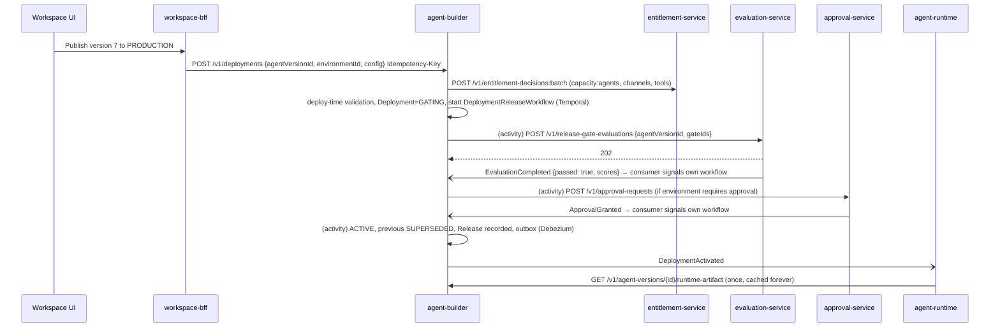

# RFC-0016 - Agent Builder Architecture
Status: PROPOSED
Revision 1.3 (2026-10-19): aligned with ADR-0020..0027 (adopted Temporal for deployment gate/approval waits, Redis Streams-backed streaming in the Playground, Avro + Apicurio Registry + CloudEvents binary mode + Debezium outbox for events, HashiCorp Vault for secrets rules, Nx + NgRx SignalStore + Angular Material behind `wv-*` wrappers for the Builder UI).
Owners: WAVER Architecture (named owner TBD)
Reviewers: TBD
Date: 2026-10-19
Version: 1.3

## Summary
Define the draft/version model, Objective Builder, Flow Builder, policies, shared capabilities, testing (Playground and release gates) and the publish lifecycle of `agent-builder-service`, plus the boundaries of the Builder UX inside the Angular `workspace` app (Nx workspace, ADR-0027). The Builder defines; the runtime executes immutable, compiled AgentVersions activated through Deployments (AR-010, Scope §16).

## Context / Problem
Scope §6, §7, §15, §16 and §20 describe authoring: a creation wizard, two separate builders sharing capabilities, prompt abstraction, environments, deployments, rollback and testing. Scope §24 leaves open strategy changes and evaluation release gates. Commercially, Builder may only offer capabilities with valid Entitlements (commercial §6, AR-011). Without a precise version/deployment model, edits would leak into production and runs would not be reproducible.

## Goals
- Agent → AgentDraft → AgentVersion (immutable, hashed) → Deployment per Environment, with one-click rollback.
- Prompts compiled from structured configuration at version time; no raw system prompt as the primary experience.
- Separate Objective Builder and Flow Builder experiences on one shared capability model.
- Validation before versioning and before deployment (schema, entitlements, tool availability, connections).
- Release gates via evaluation-service; optional human approval for production.
- Playground without side effects.

## Non-goals
- Runtime execution semantics (RFC-0011), tool execution (RFC-0012), connector setup (RFC-0018), model routing (RFC-0019).
- Test suite authoring internals and scoring (evaluation RFC).
- Visual design system details (BRAND_GUIDELINES).

## Requirements / ARs
| AR | Application |
|---|---|
| AR-001/002 | agent-builder-service owns `waver_agent_builder`; reads other contexts via APIs or event-fed read models. |
| AR-006 | Version creation and deployment requests accept `Idempotency-Key`; events consumed idempotently. |
| AR-008 | Agent belongs to org/workspace/domain from the token; RLS everywhere. |
| AR-009 | Version, deployment, rollback, policy publication and permission-relevant actions are audited. |
| AR-010 | Draft edits never reach production; only `DeploymentActivated` changes what runs. |
| AR-011 | Entitlements checked when listing capabilities, creating versions and deploying. |
| AR-012 | Customer RESTRICTED blocks new deployments; nothing is deleted on suspension. |
| AR-013 | agent-runtime does not depend on Builder for running deployments (artifact materialized locally). |
| AR-015 | Runtime artifact schema versioned (`artifactSchemaVersion`) and backward compatible inside a major. |
| ADR-0023 | The deployment release process (gates, optional approval, activation) is a `DeploymentReleaseWorkflow` owned by agent-builder; Deployment state of record stays in PostgreSQL. |
| ADR-0024 | Events in Avro (`contracts/events/agent-builder/`), CloudEvents binary mode, Debezium outbox relay. |
| ADR-0027 | Builder UI as Nx libraries with scope/type tags, NgRx SignalStore for feature state, Angular Material through `wv-*` wrappers; Flow canvas custom on Angular CDK. |

## Proposed Design

### Entities (`waver_agent_builder`)
| Entity | Key fields | Notes |
|---|---|---|
| Agent | `id, org_id, workspace_id, domain_id, name, strategy (OBJECTIVE_DRIVEN, FLOW_DRIVEN), status (ACTIVE, ARCHIVED), copied_from_agent_id, version` | Strategy immutable after creation (ADR-0005). |
| AgentDraft | `agent_id, sections (jsonb per section), etag, last_validated_at, validation_report, updated_by` | Exactly one per Agent; section revisions kept 90 days for undo/history. |
| AgentVersion | `id, agent_id, number (1..n), label, source_draft_etag, definition (jsonb, full snapshot), runtime_artifact (jsonb), artifact_hash (sha256), compiler_version, artifact_schema_version, created_by, created_at, notes` | Immutable. Contains strategy, identity, model profile and overrides, bindings, policies, objectives or flow. |
| ObjectiveDefinition | `agent_version_id/draft, key, description, priority, required, depends_on[], completion (schema, rules, evaluator), attempt_policy, skip_when, on_failed` | See RFC-0011 for semantics. |
| Flow / FlowVersion | `flow.id, agent_id`; `flow_version.id, flow_id, content_hash, nodes, transitions, variables` | FlowVersion is content-addressed and reused across AgentVersions when unchanged. |
| FlowNode / FlowTransition | `node_id, type (MESSAGE, QUESTION, ACTION, CONDITION, DELAY, TRANSFER, OBJECTIVE_GROUP, END), config`; `from, to, guard, priority` | Stored inside FlowVersion. |
| ToolBinding / KnowledgeBinding / MemoryConfig | `tool_id, tool_major, resolved_version_id, granted_permissions, argument_constraints, policy_overrides, connection_slot`; `knowledge_base_id, retrieval_config`; `scopes, retention_ref` | Part of the version snapshot. |
| PolicyDefinition | `id, org_id, scope_type (ORGANIZATION, WORKSPACE, DOMAIN, AGENT, TOOL), scope_id, key, type, severity (CRITICAL, HIGH, MEDIUM, LOW), stages[], evaluation, violation_behavior, locked, status` | AGENT-scope policies live in the draft/version; higher scopes in PolicySets. |
| PolicySet / PolicySetVersion | `scope_type, scope_id`; `number, policies (jsonb), hash, published_by, published_at` | Versioned publication of non-agent policies. |
| Environment | `id, workspace_id, type (DEVELOPMENT, STAGING, PRODUCTION, CUSTOM), name, release_gate_ids[], requires_approval, approval_policy_key, default_slot_map` | Product concept, not infrastructure (CONVENTIONS §Environments). DEV/STAGING/PROD created per Workspace automatically. |
| Deployment | `id, agent_id, agent_version_id, environment_id, config (channel_connection_ids, connection_slot_map, limits, inactivity_timeout), state, gate_results, approval_request_id, release_workflow_id, rollback_of, previous_deployment_id, release_id` | One ACTIVE per (agent, environment). |
| Release | `id, deployment_id, notes, requested_by, approved_by, gate_summary, created_at` | Human-readable publish record. |
| DraftArtifact | `id, agent_id, draft_etag, runtime_artifact, expires_at (24h)` | Ephemeral compile for Playground on drafts; never deployable. |

Invariants: a channel connection is bound to at most one ACTIVE deployment per environment (unique index); an Agent can only be ARCHIVED with no ACTIVE deployments.

### Creation wizard
1. **Domain**: only domains where the user has `agent.create`.
2. **Identity**: name, description, purpose, language (default `pt-BR`), tone/communication preferences.
3. **Strategy**: OBJECTIVE_DRIVEN or FLOW_DRIVEN, with explanation that it cannot change later.
4. **Shared capabilities**: model profile (`fast`, `balanced`, `high-quality`), knowledge bases of the domain, entitled tools, memory scopes, channels (optional, configured per deployment later).

Result: `Agent` + `AgentDraft` (optionally seeded from a template). Templates/Solution Packs are drafts provided by WAVER, filtered by entitlement.

### Builder UX boundaries (Angular `workspace` app in the Nx workspace, lazy feature libraries)
| Route | Nx library (tag `scope:workspace`; folder layout per RFC-0021) | Visible when |
|---|---|---|
| `/builder/agents/:id/overview` | `feature-builder-core` | always |
| `/builder/agents/:id/objectives` | `feature-builder-objectives` | strategy = OBJECTIVE_DRIVEN |
| `/builder/agents/:id/flow` | `feature-builder-flow` (canvas editor) | strategy = FLOW_DRIVEN |
| `/knowledge`, `/tools`, `/policies`, `/model`, `/memory`, `/channels` | `feature-builder-capabilities` | always (shared) |
| `/testing` (Playground, suites) | `feature-builder-testing` | always |
| `/deployments`, `/versions` | `feature-builder-delivery` | always |

Supporting libraries: `data-access-builder` (uses the generated `workspace-bff` client from `libs/workspace/data-access-api`, RFC-0021; NgRx SignalStores: `AgentDraftStore` per open agent holding sections, `etag`, dirty/validation state and section-level conflict merge; `DeploymentStore`; `PlaygroundStore` consuming the SSE stream), `ui-builder` (presentational components built on the shared `wv-*` wrappers), `ui-flow-canvas` (the custom Flow Builder canvas, imported only by `feature-builder-flow`), `util-builder` (graph validation helpers shared by the canvas and the validation panel). App-wide state (session, tenant context, notifications) stays in the shared `@ngrx/store` library `libs/shared/data-access-app-state` used by all three apps (RFC-0021, ADR-0027).

Boundaries are enforced by Nx `enforce-module-boundaries`: all Builder libraries are tagged `scope:workspace` (they can never import `scope:control`/`scope:partner` data-access, complementing ADR-0009) and by type (`type:feature`, `type:data-access`, `type:ui`, `type:util`); `feature-builder-objectives` (tag `builder:objectives`) and `feature-builder-flow` (tag `builder:flow`) carry mutually exclusive `notDependOnLibsWithTags` rules, mirroring ADR-0019. Features never import `@angular/material` directly; forms, tables, dialogs, tabs and steppers (creation wizard) come from the `wv-*` wrappers over Angular Material M3 themed with `--wv-*` tokens. The Flow Builder canvas (nodes, edges, minimap, keyboard editing) is custom on Angular CDK (drag-drop, overlay, a11y), because Material has no equivalent (ADR-0027). Advanced settings (temperature, max output tokens, routing overrides, additional instructions) appear only under "Advanced" (progressive disclosure, Scope §20). The UI talks only to `workspace-bff` (ADR-0009).

### Prompt abstraction and compilation
- The **PromptCompiler** (inside agent-builder, versioned `compiler_version`) turns the definition into a `RuntimeArtifact`:
  - `frame` (platform baseline safety and data-handling instructions; not editable),
  - `identity` (persona, purpose, tone, language),
  - `strategy` (objective focus template or flow node templates),
  - `policies` (instruction-type policies rendered as rules; deterministic/classifier policies rendered as runtime checks, not prompt text),
  - `tools` (model-facing descriptions and schemas from bound ToolVersions with argument constraints applied),
  - `knowledge/memory` retrieval configuration and data-block templates,
  - `model` (profile + bounded overrides), `limits`, `objectives` or `flow`.
- Dynamic slots (`{{retrieved_data}}`, `{{objective_focus}}`, `{{current_node}}`) are filled by the runtime; untrusted content goes only into data slots (RFC-0011).
- Compilation happens at version time; `artifact_hash = sha256(JCS(runtime_artifact))`. A new compiler version never recompiles existing versions; users get "recompile" as a new AgentVersion.
- Optional "additional instructions" (advanced, max 2,000 characters) are placed inside `identity` and cannot override `frame` or policies (see Open Questions).

### Policies
- Types: `CONTENT_GUARDRAIL`, `DATA_HANDLING`, `APPROVAL`, `EXECUTION_LIMIT`, `RATE_LIMIT`, `SPEND_LIMIT`, `ESCALATION`, `BEHAVIORAL_INSTRUCTION`.
- Evaluation: `DETERMINISTIC` (rule over input/output/tool args), `CLASSIFIER` (model-gateway call with a fixed label set), `INSTRUCTION` (compiled into prompt only; lowest assurance, never used for CRITICAL).
- Stages: `PRE_INPUT`, `PRE_MODEL`, `PRE_TOOL`, `POST_OUTPUT`.
- Violation behaviour: `BLOCK`, `REWRITE`, `REQUIRE_APPROVAL`, `HANDOFF`, `END_RUN`, `WARN`.
- Resolution: effective set = ORGANIZATION ∪ WORKSPACE ∪ DOMAIN ∪ AGENT ∪ TOOL; for the same key the most restrictive wins; `locked` higher-scope policies cannot be overridden or disabled below. CRITICAL policies must be DETERMINISTIC or CLASSIFIER.
- AGENT-scope policies are inside the AgentVersion. Higher-scope policies are published as PolicySetVersions (`PolicySetPublished`), which the runtime applies to runs started after publication; publication is a versioned, audited release, consistent with AR-010.

### Validation
| Code | Stage | Rule |
|---|---|---|
| `SCHEMA_INVALID` | draft, version | Every section validates against its JSON Schema. |
| `OBJECTIVE_CYCLE` | version | Objective `depends_on` graph is acyclic; at least one required objective. |
| `FLOW_UNREACHABLE_NODE`, `FLOW_NO_END`, `FLOW_DANGLING_TRANSITION` | version | Every node reachable from start; every path reaches END or a wait; CONDITION has `else`. |
| `FLOW_VARIABLE_UNDECLARED`, `FLOW_TYPE_MISMATCH` | version | Expressions type-check against declared FlowVariables. |
| `TOOL_NOT_ENTITLED`, `TOOL_RETIRED`, `TOOL_DEPRECATED` (warning) | version, deploy | Entitlement-service check; registry status. |
| `PERMISSION_NOT_DECLARED`, `CONSTRAINT_INVALID` | version | Granted permissions ⊆ ToolPermissions; constraints narrow the input schema. |
| `KNOWLEDGE_SCOPE_VIOLATION` | version | Knowledge bases belong to the agent's Domain. |
| `MODEL_PROFILE_NOT_ALLOWED` | version | Profile available to the org (model-profile read model + entitlement). |
| `POLICY_INVALID` | version | Deterministic rules compile; CRITICAL not INSTRUCTION. |
| `CONNECTION_SLOT_UNMAPPED`, `CONNECTION_NOT_ACTIVE` | deploy | Every slot mapped to an ACTIVE Connection in scope (connection read model from `waver.connector.connection.v1`). |
| `CHANNEL_NOT_ENTITLED`, `AGENT_LIMIT_REACHED`, `CUSTOMER_RESTRICTED` | deploy | Entitlement decisions (`channel:<type>`, `capacity:agents` counted synchronously by agent-builder against its own ACTIVE production deployments, RFC-0013 §8) and customer status. |

Errors block; warnings require acknowledgement.

### Deployment state machine
| From | Trigger | To |
|---|---|---|
| — | `POST /v1/deployments` (deploy-time validation passed) | GATING |
| — | Validation failed | (rejected synchronously, 422) |
| GATING | All gates passed (or none configured) | AWAITING_APPROVAL if `requires_approval`, else ACTIVATING |
| GATING | `EvaluationCompleted` with a failed gate | GATES_FAILED (terminal) |
| AWAITING_APPROVAL | `ApprovalGranted` | ACTIVATING |
| AWAITING_APPROVAL | `ApprovalRejected` / `ApprovalExpired` | REJECTED (terminal) |
| ACTIVATING | Entitlement re-check OK; transaction swaps ACTIVE | ACTIVE (`DeploymentActivated`; previous → SUPERSEDED) |
| ACTIVE | Newer deployment activated | SUPERSEDED |
| ACTIVE | Rollback requested | ROLLED_BACK (new deployment of target version becomes ACTIVE; `DeploymentRolledBack`) |
| ACTIVE | Deactivate requested / agent archived | DEACTIVATED (`DeploymentDeactivated`) |

**Release process as a Temporal workflow (ADR-0023).** The Deployment row (state, gate results, approval reference) is the state of record in `waver_agent_builder`; the waits between GATING, AWAITING_APPROVAL and ACTIVATING are held by a `DeploymentReleaseWorkflow(deploymentId)` owned by agent-builder (namespace `waver-agent`, task queue `agent-builder.deployment-release`, workflow ID `deployment-release:<deploymentId>`), started after the `POST /v1/deployments` transaction commits:
1. Activity `requestGateEvaluation` → evaluation-service `POST /v1/release-gate-evaluations` (`Idempotency-Key = deploymentId`); skipped when no gates are configured or for rollbacks.
2. Wait for the `gatesEvaluated` signal or the gate timer (default 60 min → activity marks GATES_FAILED with `GATE_TIMEOUT`).
3. If the environment requires approval: activity `requestApproval` → approval-service `POST /v1/approval-requests`; wait for `approvalDecided` or the approval expiry timer.
4. Activity `activate`: entitlement re-check, then one PostgreSQL transaction swaps ACTIVE/SUPERSEDED, assigns `activationSeq`, records the Release and writes the outbox events.
Signals are sent only by agent-builder's own Kafka consumers of `EvaluationCompleted` and `ApprovalGranted/Rejected/Expired` (which first record the result on the Deployment row, so a result arriving before the workflow starts is read on start); evaluation-service and approval-service never signal agent-builder's workflow (AR-003/AR-004). Cancelling a deployment while GATING/AWAITING_APPROVAL cancels the workflow. Every activity is idempotent and keyed by `deploymentId`; deployments without gates and approval still use the workflow (it completes in seconds), so there is one code path.

### Publish flow with release gates

Default gates (engineering defaults until Scope §24 "Evaluation" is decided): PRODUCTION requires the agent's regression suite with 100% policy assertions passing and no drop > 5 points in objective/task completion vs. the currently active version; STAGING and DEVELOPMENT have no gates. The same immutable version is promoted DEVELOPMENT → STAGING → PRODUCTION.

### Rollback
`POST /v1/deployments/{deploymentId}/rollbacks {targetAgentVersionId?}` (default: previous ACTIVE version in that environment). Creates a new Deployment with `rollback_of`, skips evaluation gates (the target already passed them in this environment), still re-runs deploy-time validation (retired tools, entitlements). New runs use the target version; in-flight runs finish on their pinned version (RFC-0011).

### Strategy changes and copies
No in-place strategy migration (Scope §24 proposal). `POST /v1/agents/{agentId}/copies {name, strategy, domainId}` creates a new Agent with a new draft copying identity, model, tools, policies and memory config; objectives/flow are not converted; knowledge bindings are dropped when the target Domain differs. Cutover = deploying the new agent on the channel connection (which deactivates the old binding by the uniqueness rule) and archiving the old agent.

### Playground
- `POST /v1/playground-sessions {agentId, source: DRAFT | VERSION, versionId?, liveReadTools: false}`. DRAFT compiles a DraftArtifact; VERSION uses the stored artifact.
- Conversations run in agent-runtime `mode=SANDBOX` (`POST /v1/sandbox-runs`). WRITE/DESTRUCTIVE tools run in `MOCK` (fixtures or schema-generated outputs) or `DRY_RUN`; READ tools LIVE only if `liveReadTools=true` and the DEVELOPMENT environment maps the slot to a Connection.
- No channel delivery, no memory writes to production scopes, transcripts kept 7 days, usage metered with `mode=SANDBOX`.
- Streaming: Playground replies stream like Workspace chat — `202` with a stream URL from agent-runtime, then an SSE subscription relayed by workspace-bff; agent-runtime serves it from the run's Redis Stream (`waver:run-stream:<agentRunId>`, RFC-0011), so the stream survives reconnects (`Last-Event-ID`) within its 15-minute TTL and does not depend on which runtime pod executes the turn. agent-builder is not on the streaming path; it only creates the session and the sandbox run.
- Sandbox waits (Delay nodes, approvals, handoff simulation) use the same agent-runtime wait mechanism as live runs (RFC-0011); agent-builder holds no Playground timers.
- The run inspector shows RunSteps (policy checks, objective/flow transitions, tool calls) for debugging. In the UI, `PlaygroundStore` (NgRx SignalStore) holds the session, transcript and inspector selection; the Playground side panel uses `wv-*` components.

### Permissions
Fine-grained permissions evaluated in agent-builder (roles map to them per RFC-0004): `agent.read`, `agent.create`, `agent.edit`, `agent.version.create`, `agent.deploy.nonprod`, `agent.deploy.prod`, `agent.rollback`, `agent.archive`, `policy.manage.{scope}`, `playground.use`. All are checked against the Domain of the agent. Default mapping: Customer Admin → all; Customer Operator → `agent.read`, `playground.use`.

## APIs / Events / Data Ownership
| Endpoint | Purpose |
|---|---|
| `POST /v1/agents`, `GET /v1/agents`, `GET/PATCH /v1/agents/{agentId}` | Wizard result, list, identity metadata. |
| `POST /v1/agents/{agentId}/copies`, `POST /v1/agents/{agentId}/archive` | Copy (strategy change), archive. |
| `GET /v1/agents/{agentId}/draft`, `PATCH /v1/agents/{agentId}/draft/sections/{section}` (`If-Match`) | Draft editing. |
| `POST /v1/agents/{agentId}/draft/validations` | Validation report. |
| `POST /v1/agents/{agentId}/versions` (`Idempotency-Key`), `GET /v1/agents/{agentId}/versions`, `GET /v1/agent-versions/{id}`, `GET /v1/agent-versions/{id}/diff?against=` | Versions. |
| `GET /v1/agent-versions/{id}/runtime-artifact` (service-only, `ETag` = hash) | Runtime materialization. |
| `GET /v1/draft-artifacts/{id}/tool-bindings` (service-only, sandbox) | tool-runtime sandbox resolution (RFC-0012). |
| `GET/POST /v1/policy-definitions`, `POST /v1/policy-sets/{scopeType}/{scopeId}/publications` | Policies. |
| `GET/POST /v1/environments` | Environments. |
| `POST /v1/deployments`, `GET /v1/deployments?agentId=`, `POST /v1/deployments/{id}/rollbacks`, `POST /v1/deployments/{id}/deactivation` | Delivery. |
| `POST /v1/playground-sessions`, `POST /v1/playground-sessions/{id}/messages` | Playground (proxied to runtime sandbox). |

| Topic | Events | Key |
|---|---|---|
| `waver.agent-builder.agent.v1` | AgentCreated, AgentArchived | agentId |
| `waver.agent-builder.agent-version.v1` | AgentVersionCreated (`agentVersionId, agentId, number, artifactHash, strategy, toolBindings[]`) | agentVersionId |
| `waver.agent-builder.deployment.v1` | DeploymentActivated, DeploymentRolledBack, DeploymentDeactivated (`deploymentId, agentId, agentVersionId, artifactHash, environmentId, environmentType, channelConnectionIds, connectionSlotMap, limits, previousDeploymentId, activationSeq`) | deploymentId |
| `waver.agent-builder.deployment-state.v1` (compacted, RFC-0006 §11) | DeploymentStateChanged (full current state of the Deployment, no PII) | deploymentId |
| `waver.agent-builder.policy-set.v1` | PolicySetPublished | policySetId |

Keys follow CONVENTIONS (aggregate ID). Because the superseded and the new deployment are different aggregates, `activationSeq` (monotonic per agent + environment, assigned in the activation transaction) lets consumers pick the current ACTIVE deployment regardless of partition order. agent-runtime builds its routing read model from the compacted state topic. Payloads are Avro (`contracts/events/agent-builder/<EventName>.v1.avsc`, registered in Apicurio Registry by CI, `BACKWARD_TRANSITIVE`); the CloudEvents envelope travels in binary mode, with the `orgid`, `workspaceid`, `domainid` extensions as `ce_*` Kafka headers (ADR-0024). Events are written to the outbox in the same transaction as the state change and published by Debezium; for the compacted `deployment-state.v1` topic the outbox row carries the full current state so the Kafka key/value pair stays the latest snapshot.

Consumed: `waver.tool-registry.tool.v1` (status), `waver.entitlement.entitlement.v1` (to revalidate ACTIVE deployments and warn), `waver.connector.ConnectionCreated/ConnectionHealthChanged.v1` (connection read model), `waver.model-gateway.ModelProfilePublished.v1` (profile read model), `waver.customer.customer.v1` (`CustomerRestricted`, `CustomerReactivated`), `waver.evaluation.EvaluationCompleted.v1`, `waver.approval.ApprovalGranted/Rejected/Expired.v1`.

Sync dependencies: tool-registry, knowledge, entitlement, evaluation (as in MICROSERVICES_MAP), approval-service (production approval).

## Security & Privacy
- All mutations require the permission on the agent's Domain; tenant context from token; RLS.
- Version and deployment actions audited with actor chain (`act`), before/after references and hashes.
- Drafts may contain business data (fixed messages, examples); no credentials are ever stored here (connections referenced by ID only; tenant credentials are owned by connector-service and encrypted through Vault Transit, ADR-0014/ADR-0022; the static check for secret material in drafts and versions applies). agent-builder's own platform secrets come from Vault (dynamic PostgreSQL credentials, Vault Secrets Operator).
- Temporal workflow inputs and histories of `DeploymentReleaseWorkflow` carry IDs, hashes and gate verdicts only — never draft content.
- Playground transcripts are tenant data with 7-day retention; evaluation datasets follow evaluation-service rules.
- `workspace-bff` exposes no marketplace or pricing data in tool lists (ADR-0009); tool cards show only functional metadata.

## Reliability & Failure Modes
| Failure | Behaviour |
|---|---|
| evaluation-service down | The `requestGateEvaluation` activity retries with backoff; Deployment stays GATING until the gate timer fires; no production impact. |
| Temporal unavailable | `POST /v1/deployments` still validates and commits GATING; the workflow start is retried by a reconcile schedule (`agent-builder.release-reconcile`, every 1 min) for GATING/AWAITING_APPROVAL rows without `release_workflow_id`. Running deployments and agent-runtime are unaffected. |
| entitlement-service down | Version/deploy rejected with `DEPENDENCY_UNAVAILABLE` (fail closed on control plane). |
| Concurrent draft edits | `If-Match` → 412; UI merges section-level. |
| Double click on publish | `Idempotency-Key` returns the same Deployment. |
| Runtime fails to materialize artifact | runtime retries; Builder shows "activation pending on runtime" from runtime metrics; previous version keeps serving. |
| Version with retired tool after sunset | Deploy validation blocks; ACTIVE deployments get warning notifications before `sunset_at`. |

SLO defaults: Builder API availability 99.5% (control plane); version creation p95 ≤ 3 s; deploy (without gates) to `DeploymentActivated` p95 ≤ 5 s.

## Observability
- Metrics: versions created, deployments by state, gate failure rate, rollback count, validation error codes, compile time.
- Traces across Builder → evaluation → approval → runtime activation (correlation via `deploymentId`); the `DeploymentReleaseWorkflow` is visible in Temporal Web (operators only) by `deploymentId`.
- Agent dashboards (per agent/version) aggregate runtime metrics by `agent_version_id`, enabling version comparison.

## Testing Strategy
- Golden tests of the PromptCompiler: definition fixtures → expected artifact and stable hash.
- Validation rule tests per code; flow graph property tests (random graphs).
- Deployment transition tests (exhaustive); uniqueness of ACTIVE deployment under concurrency.
- `DeploymentReleaseWorkflow` tests with the Temporal Java SDK test environment (time skipping: gate timeout, approval expiry, results arriving before workflow start, cancellation); replay tests in CI for every workflow change (ADR-0023).
- Angular: component tests per builder library, NgRx SignalStore unit tests (`AgentDraftStore` etag conflicts, `PlaygroundStore` stream handling) with mocked generated clients, visual regression of `ui-builder` in light/dark and compact density, Nx `affected` targets in CI, Playwright E2E for wizard → version → publish → rollback.
- Contract tests for `runtime-artifact` against `contracts/` JSON Schema used by agent-runtime (REST artifact; events are covered by the Avro compatibility checks of ADR-0024).

## Deployment / Rollout / Rollback
- Service rollout normal (canary). Compiler upgrades are released behind `compiler_version`; old versions keep their artifacts. Temporal workers use build-ID versioning so in-flight release workflows complete on compatible code.
- Frontend: Builder libraries ship with the `workspace` app (`frontend-workspace` image); Nx `affected` limits CI and preview builds to changed libraries.
- `artifact_schema_version` changes follow AR-015: runtime supports N and N-1 majors.

## Alternatives Considered
- Compiling prompts at runtime from the definition: rejected; non-reproducible and slower per turn.
- Mutable "live" agents without versions: violates AR-010.
- One builder UI with a strategy toggle: rejected by product decision (separate experiences).
- Converting Objective agents into Flows automatically: unreliable; not offered.
- Gate/approval waits as PostgreSQL timer rows (v1.2, ADR-0018): superseded by ADR-0023.
- Builder UI on a fully custom CDK-only component library with Signals-only state (v1.2): superseded by ADR-0027; only the Flow canvas remains custom.

## Risks
- Policy authoring complexity; mitigated by templates and validation.
- Gate thresholds that are too strict block releases; defaults are configurable per environment.
- Large flows produce large artifacts; limit 500 nodes per flow and 1 MB artifact (defaults).

## Open Questions
1. Evaluation release gates required before production (Scope §24): recommendation — defaults above; product to confirm thresholds and whether customers may disable gates.
2. Should "additional instructions" (free text) exist at all? Recommendation — yes, advanced only, length-limited, never overriding policies.
3. ~~Builder roles~~ — resolved in the v1.2 review: no new role keys. "Agent Editor" = `DOMAIN_BUILDER` (edit drafts, create versions, run evaluations, deploy to non-production environments); "Agent Publisher" = `DOMAIN_ADMIN` or `CUSTOMER_ADMIN` (activate production Deployments, permission `agent:deployment:activate`), as defined in RFC-0004.
4. RFC-0006 names the compacted deployment topic but MICROSERVICES_MAP does not list `DeploymentStateChanged`; map should be updated.
5. MICROSERVICES_MAP should add `PolicySetPublished`, `AgentCreated`, `AgentArchived`, `DeploymentDeactivated`, and approval-service as a dependency of agent-builder.
6. Are Environments per Workspace (proposed) or per Domain? Recommendation — per Workspace, with per-Domain approval policies.
7. ADR-0023's process table does not list the agent-builder deployment release (gates + approval); this RFC uses Temporal for it in namespace `waver-agent`. ADR-0023 should add the row (owner agent-builder-service, task queue `agent-builder.deployment-release`).
8. Should Playground "Delay" nodes offer a sandbox-only "skip wait" action? Would need a sandbox endpoint in agent-runtime (RFC-0011); not in v1 unless product asks.

## Decision
Proposed: adopt the Agent/Draft/Version/Deployment model, version-time prompt compilation with artifact hashes, layered policy resolution with versioned PolicySets, deployment state machine with evaluation gates and optional approval held by a Temporal release workflow, the Nx/NgRx/Angular Material Builder UI boundaries, and "copy as new agent" for strategy changes. To be confirmed in architecture review.
