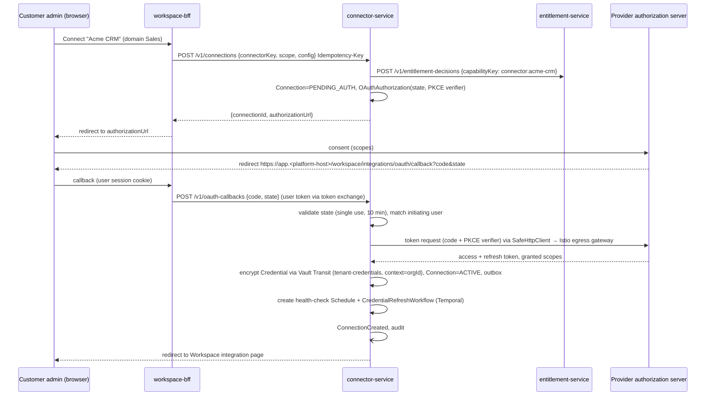

# RFC-0018 - Integration Hub and Connector SDK
Status: PROPOSED
Revision 1.3 (2026-10-19): aligned with ADR-0020..0027 (adopted HashiCorp Vault Transit for tenant credentials and signing with leases as Vault policies, Istio egress gateway + ServiceEntry allow-lists and mTLS/authorization, Temporal schedules/workflows for polling triggers, health checks and token refresh, Redis for rate limiting, throttling and short locks, Avro + Apicurio Registry + CloudEvents binary mode + Debezium outbox for events, Keycloak service identities).
Owners: WAVER Architecture (named owner TBD)
Reviewers: TBD
Date: 2026-10-19
Version: 1.3

## Summary
Define `connector-service` and the connector runtime contract referenced by ADR-0014, ADR-0016 and ADR-0022: Connector, ConnectorVersion, Connection, Credential and WebhookEndpoint; the three connector kinds (declarative manifest, coded SDK, custom API connector); the `connector-manifest` format; the `waver-connector-sdk` Java interfaces; OAuth connection flow; credential protection with Vault Transit and the two audited leases; webhook ingress with signature verification and routing to trigger-service, and signing of outbound webhooks; health, reconnect and credential rotation as Temporal schedules/workflows; SSRF/egress protections in the application plus the Istio egress gateway; per-connection rate limiting; the marketplace certification checklist; a step-by-step guide to adding an integration; and the testing approach.

## Context / Problem
Scope §10 requires connectors, connections, isolated credentials, OAuth/API key/basic/custom auth, inbound webhooks, outbound calls, custom REST connectors, health, reconnect, scopes and rotation. Scope §24 leaves the connector SDK and custom connector deployment model open, which ADR-0016 closes at the decision level. The rate at which WAVER can add integrations, and the safety of every outbound call made on a customer's behalf, depend on this design. The generic HTTP engine is security-critical (ADR-0016 consequences).

## Goals
- Most REST integrations shipped as a reviewed manifest, with no new code and no deploy.
- One execution contract (`POST /v1/action-invocations`) for declarative, coded and custom connectors.
- Plaintext credentials never leave connector-service (ADR-0014), except the two audited leases (model-gateway `LLM_PROVIDER_KEY`, channel-service `CHANNEL_PROVIDER_TOKEN`) enforced by Vault policy (ADR-0022).
- Every outbound request passes SSRF, timeout, size and rate controls in the application and the Istio egress gateway allow-list in the mesh (ADR-0026).
- A repeatable path from "new API" to Tools (RFC-0012), Listing (RFC-0017) and Entitlement (RFC-0013).

## Non-goals
- Channel provider adapters (channel-service), although they consume connector credentials.
- Arbitrary customer code or scripts (rejected for v1 by ADR-0016).
- Access to customer private networks (on-premise relay); see Open Questions.
- Marketplace commercial lifecycle (marketplace-service, RFC-0017).

## Requirements / ARs
| AR / ADR | Application |
|---|---|
| AR-002/003 | connector-service owns `waver_connector`; tool-runtime, knowledge-service, channel-service and model-gateway use its APIs only. |
| AR-006 | Action invocations carry idempotency keys; webhook deliveries deduplicated by `dedupe_key`. |
| AR-008 | Connection scope (org/workspace/domain) checked against the caller's token on every invocation. |
| AR-009 | Audit on credential create/rotate/revoke/use and connection changes (ADR-0014). |
| AR-011 | Connections can only be created for entitled connectors (`connector:<key>` capability, RFC-0013). |
| AR-014 | Per-connection timeouts, retries, circuit breakers and rate limits. |
| AR-015 | ConnectorVersion semver; Connection pinned to a major. |
| ADR-0020 | Cluster-wide rate limiting (Redis token buckets), shared upstream throttle state and short token-refresh locks in Redis; PostgreSQL stays authoritative; documented fallbacks when Redis is down. |
| ADR-0014 / ADR-0022 | Ownership and write-only credential APIs from ADR-0014; mechanism from ADR-0022: Vault Transit encryption with derived keys (context = orgId), signing keys in Transit, platform secrets from Vault, the two lease exceptions (`LLM_PROVIDER_KEY` → model-gateway, `CHANNEL_PROVIDER_TOKEN` → channel-service) implemented as Transit decrypt policies. |
| ADR-0009 | Provider webhooks enter through the `hooks.` host routed directly to connector-service; OAuth callbacks are user-session traffic and go through workspace-bff. |
| ADR-0016 | Three kinds; manifest JSON Schema at `contracts/connectors/connector-manifest.schema.json`. |
| ADR-0023 | Polling triggers and health checks are Temporal Schedules; token refresh, OAuth authorization expiry and superseded-credential destruction are Temporal workflows owned by connector-service (namespace `waver-capability`). |
| ADR-0024 | Events in Avro with CloudEvents binary-mode headers, published by Debezium from the outbox. |
| ADR-0026 | Internet egress only through the Istio egress gateway with `ServiceEntry` allow-lists; waypoint with request-level `AuthorizationPolicy` on connector-service; application SSRF checks remain. |

## Proposed Design

### Entities (`waver_connector`)
| Entity | Key fields | Notes |
|---|---|---|
| Connector | `id, key (acme-crm), owner_scope (PLATFORM, ORGANIZATION), org_id (if ORGANIZATION), kind (DECLARATIVE, CODED, CUSTOM_API), display_name, category, status (ACTIVE, DEPRECATED, RETIRED)` | ORGANIZATION scope = custom API connectors, invisible to other orgs (RLS). |
| ConnectorVersion | `id, connector_id, semver, manifest (jsonb), openapi_ref, openapi_sha256, coded_module (artifact, sdk_version, runner_group), state, certification_ref, published_at, sunset_at` | Immutable once PUBLISHED. Coded connectors also have a manifest (metadata, actions, schemas). |
| Connection | `id, org_id, workspace_id, domain_id, scope_level (ORGANIZATION, WORKSPACE, DOMAIN), connector_id, connector_major, name, config (jsonb, non-secret), granted_scopes[], status, health (last_check_at, consecutive_failures, last_error_code), environment_hint` | Installation for a tenant scope. Deployments map tool `connection_slot`s to Connections (RFC-0016). |
| Credential | `id, org_id, connection_id, type (OAUTH2_TOKEN, API_KEY, BASIC, CUSTOM, WEBHOOK_SECRET, OAUTH_CLIENT, LLM_PROVIDER_KEY, CHANNEL_PROVIDER_TOKEN), ciphertext (Vault Transit `vault:v<N>:...`), transit_key, key_version, expires_at, refresh_at, state (ACTIVE, ROTATING, SUPERSEDED, REVOKED, EXPIRED), refresh_workflow_id, version` | Write-only via API; no plaintext, data key or key material is stored by connector-service. SUPERSEDED kept 24h, then the ciphertext is erased (row kept as metadata for audit). |
| (Vault Transit keys) | `tenant-credentials` (all non-leasable types), `tenant-credentials-llm` (`LLM_PROVIDER_KEY`), `tenant-credentials-channel` (`CHANNEL_PROVIDER_TOKEN`), `outbound-webhooks` (signing) | Derived keys (`derived=true`), context = `orgId`, so a ciphertext of one organization cannot be decrypted under another org's context. Separate keys per leasable type make the lease scope expressible as a Vault policy (refinement of ADR-0022's single key name, see Open Questions). |
| WebhookEndpoint | `id, connection_id, trigger_key, path_token (128-bit random), signature_config, secret_credential_id, provider_subscription_id, status (ACTIVE, DISABLED)` | Public URL `https://hooks.<platform-host>/v1/webhooks/{pathToken}`. |
| WebhookDelivery | `id, endpoint_id, received_at, signature_valid, dedupe_key (unique per endpoint), payload_ref (encrypted, 7 days), status (ACCEPTED, REJECTED, DUPLICATE)` | Inbound log for replay/diagnostics. |
| PollingCursor | `connection_id, trigger_key, cursor, schedule_id, last_polled_at, consecutive_errors` | Cursor of record in PostgreSQL; cadence held by a Temporal Schedule (see Timers and schedules). |
| OAuthAuthorization | `state (random), connection_id, pkce_verifier (encrypted), initiated_by, redirect_after, expires_at (10 min)` | Single use. |

### Connector kinds
| Kind | Authored by | Deploy needed | Listed in marketplace | Execution |
|---|---|---|---|---|
| Declarative | WAVER (later third-party publishers) | No — manifest published via pipeline | Yes, after certification | Generic HTTP engine |
| Coded | WAVER engineers | Yes — connector-service or `connector-runner-<group>` release | Yes, after certification | `waver-connector-sdk` handlers |
| Custom API | Customer admin in Workspace | No | Never (org-scoped) | Generic HTTP engine with stricter limits |

### Connector manifest (declarative)
Validated against `contracts/connectors/connector-manifest.schema.json` in CI and at publish time.

```yaml
apiVersion: waver.connector/v1
kind: ConnectorManifest
metadata:
  key: acme-crm                    # fictional example
  version: 1.3.0
  displayName: Acme CRM
  publisher: waver
  categories: [crm]
  visibility: MARKETPLACE          # MARKETPLACE | ORGANIZATION
  capabilityKey: connector:acme-crm  # entitlement key (RFC-0013)
spec:
  openApi:
    ref: openapi/acme-crm-v3.yaml
    sha256: 9f2c...e1
  connectionConfig:                # non-secret config collected at connect time (JSON Schema)
    type: object
    required: [subdomain]
    properties:
      subdomain: { type: string, pattern: "^[a-z0-9-]{3,40}$" }
  baseUrl: "https://{{config.subdomain}}.acmecrm.example/api/v3"
  egress:                          # also rendered into Istio ServiceEntry allow-lists at publication
    allowedHosts: ["*.acmecrm.example"]
    allowedPorts: [443]
  auth:
    type: oauth2                   # oauth2 | apiKey | basic | custom
    oauth2:
      grantType: authorization_code
      authorizationUrl: https://login.acmecrm.example/oauth/authorize
      tokenUrl: https://login.acmecrm.example/oauth/token
      pkce: true
      scopes: [contacts.read, contacts.write, deals.read]
      clientCredentialsRef: platform:acme-crm-oauth-client   # Vault KV v2 (platform OAuth app), or OAUTH_CLIENT credential for customer-owned apps
      tokenPlacement: { in: header, name: Authorization, prefix: "Bearer " }
      refresh: { enabled: true, refreshBeforeExpiryPercent: 20 }
    # apiKey: { in: header, name: X-Api-Key }
    # basic: {}
    # custom: { strategy: hmac-request-signing }   # implemented by a coded AuthStrategy
  defaults:
    timeoutMs: 10000
    maxResponseBytes: 1048576     # per-action default; engine hard cap 10 MB (RFC-0010)
    retry: { maxAttempts: 3, retryOn: [429, 502, 503, 504], backoff: { initialMs: 200, multiplier: 2.0, maxMs: 2000 }, onlyIfSafe: true }
  rateLimits:
    - { scope: CONNECTION, limit: 100, per: 10s }
    - { scope: CONNECTOR, limit: 2000, per: 1m }     # shared platform OAuth app quota
    respectRetryAfter: true
  pagination:
    default:
      style: cursor                # cursor | offset | page | link-header
      request: { param: after }
      response: { nextCursor: "$.paging.next.after", items: "$.results" }
      maxPages: 10
  healthCheck:
    operationId: getCurrentAccount
    intervalSeconds: 600           # Temporal Schedule interval per Connection
  actions:
    - key: create_lead
      operationId: createContact
      displayName: Create lead
      modelDescription: Creates a lead (contact) in Acme CRM. Use only after collecting name and e-mail.
      sideEffect: WRITE            # READ | WRITE | DESTRUCTIVE
      requiredScopes: [contacts.write]
      permission: crm.contacts:write
      idempotency: { strategy: DOWNSTREAM_HEADER, header: Idempotency-Key }
      reconcileWith: find_lead_by_email
      input:
        schema:
          type: object
          required: [name, email]
          properties:
            name: { type: string, maxLength: 200 }
            email: { type: string, format: email, x-waver-pii: true }
            companyTaxId: { type: string, x-waver-pii: true }
        mapping:
          body.properties.firstname: "$.input.name"
          body.properties.email: "$.input.email"
          body.properties.tax_id: "$.input.companyTaxId"
      output:
        mapping:
          leadId: "$.response.body.id"
          createdAt: "$.response.body.createdAt"
        schema:
          type: object
          required: [leadId]
          properties: { leadId: { type: string }, createdAt: { type: string, format: date-time } }
      errors:
        - { when: "$.response.status == 409", code: DUPLICATE, retryable: false }
    - key: find_lead_by_email
      operationId: searchContacts
      sideEffect: READ
      permission: crm.contacts:read
      pagination: default
      input:  { schema: { type: object, required: [email], properties: { email: { type: string, format: email } } },
                mapping: { query.email: "$.input.email" } }
      output: { mapping: { leads: "$.response.body.results[*].{id: id, name: properties.firstname}" } }
  triggers:
    - key: contact_created
      type: webhook
      subscribe: { operationId: createWebhookSubscription, bodyMapping: { url: "{{endpoint.url}}", events: ["contact.created"] } }
      unsubscribe: { operationId: deleteWebhookSubscription, pathMapping: { id: "{{endpoint.providerSubscriptionId}}" } }
      signature:
        type: hmac-sha256
        header: X-Acme-Signature
        signedPayload: "{{header.X-Acme-Timestamp}}.{{rawBody}}"
        encoding: hex
        toleranceSeconds: 300
      dedupeKey: "$.body.eventId"
      eventFilter: "$.body.type == 'contact.created'"
      output: { mapping: { leadId: "$.body.object.id", email: "$.body.object.email" } }
    - key: deal_updated
      type: polling
      polling:
        operationId: listDeals
        intervalSeconds: 300       # Temporal Schedule interval per (Connection, trigger)
        cursor: { param: updatedAfter, from: "max($.results[*].updatedAt)" }
        dedupeKey: "$.id"
      output: { mapping: { dealId: "$.id", stage: "$.stage" } }
```

Mapping expressions are a restricted JSONPath subset plus `{{...}}` templates, implemented in the platform engine (no scripting). Each action becomes one Tool (RFC-0012) with `kind=INTEGRATION`; `permission` values become ToolPermissions; `requiredScopes` are checked against the Connection's `granted_scopes`.

### Connector SDK (`platform/java/waver-connector-sdk`)
Coded connectors depend only on the SDK (no Spring, no HTTP client of their own, no direct sockets — enforced by ArchUnit and a forbidden-APIs check in CI).

```java
public interface ConnectorDefinition {
    ConnectorDescriptor descriptor();                 // key, version, auth, actions, triggers, schemas (same model as the manifest)
    AuthStrategy authStrategy();
    Map<String, ActionHandler> actions();
    Map<String, TriggerHandler> triggers();
    default HealthCheck healthCheck() { return HealthCheck.fromDescriptor(); }
}

public interface ActionHandler {
    ActionResult execute(ActionContext ctx, JsonNode input) throws ConnectorException;
}

public interface TriggerHandler {
    default WebhookVerification verify(WebhookRequest request, WebhookSecrets secrets) { return WebhookVerification.unsupported(); }
    default List<TriggerEvent> parse(WebhookRequest request) { return List.of(); }
    default PollResult poll(PollContext ctx, Optional<String> cursor) throws ConnectorException { return PollResult.empty(); }
}

public interface AuthStrategy {
    void apply(OutboundRequest.Builder request, CredentialHandle credential);          // material is used inside, never returned
    default Optional<RefreshOutcome> refresh(CredentialHandle credential, SafeHttpClient http) { return Optional.empty(); }
}

public interface ActionContext {
    TenantRef tenant();                      // orgId, workspaceId, domainId (read-only)
    JsonNode connectionConfig();             // non-secret config
    SafeHttpClient http();                   // the only egress path: allow-list, SSRF guard, limits, auth applied
    String idempotencyKey();
    Instant deadline();
    ConnectorLogger log();                   // structured, redacting
}

public sealed interface ActionResult permits ActionResult.Success, ActionResult.Failure {
    record Success(JsonNode output) implements ActionResult {}
    record Failure(String code, boolean retryable, boolean dispatched, String safeMessage) implements ActionResult {}
}
```
`CredentialHandle` is opaque: `AuthStrategy.apply` receives material through a package-private accessor in the engine; connector code cannot log or return it. Coded connectors live in `services/connector-service/connectors/<key>` modules (ADR-0015) and are loaded by key; heavy or high-risk ones are packaged in a `connector-runner-<group>` deployment of the same service code base (still connector-service, so ADR-0014 holds; each runner has its own Kubernetes service account, Vault role and Istio identity, with a Transit policy no wider than connector-service's).

### Action execution contract
`POST /v1/action-invocations` (callers: tool-runtime; knowledge-service for source sync; workflow-service only through tool-runtime):
- Request body: `connectionId, connectorMajor, actionKey, input, mode (LIVE, DRY_RUN), callerRef`; headers `Idempotency-Key` (from the ToolExecution) and `X-Request-Deadline` (CONVENTIONS). Work is not started after the deadline. connector-service is a leaf on the hot path and makes no further synchronous calls to other services (RFC-0005 §7); Vault Transit, Redis and the egress gateway are infrastructure calls, not service hops.
- Response: `status (SUCCESS, ERROR), output, errorCode, retryable, dispatched, upstreamStatus, upstreamRequestId, latencyMs`.
- `dispatched` tells tool-runtime whether bytes left the cluster, enabling the `OUTCOME_UNKNOWN` rule (RFC-0012).
- Error codes: `CONNECTION_UNAVAILABLE`, `CONNECTOR_AUTH_FAILED`, `CONNECTOR_SCOPE_MISSING`, `CONNECTOR_RATE_LIMITED`, `CONNECTOR_TIMEOUT`, `CONNECTOR_BAD_REQUEST`, `CONNECTOR_UPSTREAM_ERROR`, `CONNECTOR_RESPONSE_TOO_LARGE`, `EGRESS_BLOCKED`, `MAPPING_FAILED`.

### OAuth connection flow

The callback is user-session traffic, so it goes through workspace-bff (ADR-0009), not the `hooks.` host. The `state` is bound to the initiating user (`sub`) and org; mismatch → `OAUTH_STATE_INVALID`. The PKCE verifier is Transit-encrypted like any credential. Expiry of an unanswered authorization is a 10-minute Temporal timer (`OAuthAuthorizationTimeoutWorkflow`, see Timers and schedules) that moves the Connection from PENDING_AUTH to DISABLED if no callback arrived. Granted scopes narrower than required are stored; actions needing missing scopes fail with `CONNECTOR_SCOPE_MISSING` and the UI offers re-consent.

### Webhook ingress and routing
1. Provider calls `https://hooks.<platform-host>/connectors/v1/webhooks/{pathToken}`; per the ADR-0009 amendment, edge-gateway routes this path on the `hooks.` host directly to connector-service (never through a BFF), with strict per-route rate limits and a 1 MB body limit. connector-service, as the owning service, verifies the signature.
2. connector-service looks up the endpoint by `pathToken` (constant-time), verifies the signature per manifest/`TriggerHandler.verify` (HMAC with timestamp tolerance; during secret rotation both secrets are accepted for 24h). The provider-shared secret is a `WEBHOOK_SECRET` Credential, decrypted through Vault Transit only for the verification and kept in memory for the request. Invalid → 401, WebhookDelivery REJECTED, metric; no event.
3. Dedupe on `dedupeKey` (unique per endpoint, 7 days) → duplicates return 200 without a new event.
4. Payload stored encrypted (`payload_ref`, 7 days), mapped to the trigger output schema, respond 2xx within 2 s (processing is async).
5. Outbox `WebhookReceived {endpointId, connectionId, connectorKey, triggerKey, dedupeKey, output (≤ 64 KB, else outputRef), receivedAt}`; trigger-service matches Triggers by `connectionId + triggerKey` and emits `TriggerFired` (to agent-runtime or workflow-service). Because trigger outputs are connector-specific, the Avro schema carries `output` as a JSON-encoded string plus `outputSchemaRef` (the trigger's output JSON Schema in the ConnectorVersion), which trigger-service validates against (ADR-0024 keeps the envelope and the event schema stable while the mapped payload varies).

Polling triggers run on Temporal Schedules (below) and emit `PollingItemDetected` with the same shape; the cursor advances only in the same transaction as the outbox rows.

### Outbound webhook signing (deliveries to customers)
Per MICROSERVICES_MAP, notification-service owns outbound `WebhookSubscription`s and connector-service performs delivery (it already owns egress and SSRF controls). Signing keys never leave Vault (ADR-0022):
- connector-service signs `t=<timestamp>.<rawBody>` with Vault Transit `sign` on key `outbound-webhooks` (Ed25519, derived per orgId) and sends `Waver-Signature: t=<ts>,kid=<orgId>:v<keyVersion>,sig=<base64>`; the delivery ID header doubles as the receiver's dedupe key.
- Customers verify with the public key of their organization, published by connector-service (`GET /v1/webhook-signing-keys`, also exposed through workspace-bff), listing all non-retired key versions so rotation (`transit/keys/outbound-webhooks/rotate`) has an overlap window.
- Delivery uses `SafeHttpClient` (customer endpoints must resolve to public addresses) through the egress gateway's dynamic-host route (see SSRF and egress protections), with bounded retries and backoff; payloads contain only what the subscription's event type allows.
- Any internal HMAC connector-service needs also uses Transit `hmac` with keys that never leave Vault.

### Connection lifecycle, health, reconnect and rotation
| From | Trigger | To |
|---|---|---|
| — | Create | PENDING_AUTH (OAuth) / ACTIVE (API key/basic after successful health check) |
| PENDING_AUTH | Callback OK | ACTIVE |
| PENDING_AUTH | Authorization expired (10 min) | DISABLED |
| ACTIVE | 3 consecutive health/transport failures (non-auth) | DEGRADED |
| DEGRADED | Successful check | ACTIVE |
| ACTIVE / DEGRADED | 401/`invalid_grant`/revoked token | REAUTH_REQUIRED |
| REAUTH_REQUIRED | Re-consent / new credential | ACTIVE |
| any | Admin disables | DISABLED (reversible) |
| any | Admin deletes / entitlement revoked + retention end | REVOKED (credential ciphertext erased, schedules/workflows deleted; see Open Questions on crypto-shredding) |

Every change emits `ConnectionHealthChanged`; notification-service alerts admins; tool-runtime fails fast on non-ACTIVE connections (DEGRADED still executes).
- **Token refresh**: `CredentialRefreshWorkflow` timer at `refresh_at` (default 80% of lifetime). The refresh activity takes a short Redis lock `waver:connector:lock:refresh:<credentialId>` (Redisson, lease 30 s > refresh timeout 10 s), re-reads the Credential `version` and skips the refresh if another caller already rotated it, so rotating refresh tokens are never used twice; the new ciphertext is written with an optimistic `version` check (the correctness backstop if a lock lease ever expires). On-demand refresh on a 401 uses the same lock and check. If Redis is unavailable, the lock falls back to a PostgreSQL row lock on the Credential (`SELECT ... FOR UPDATE NOWAIT`), held only around the version check and write, not around the provider call.
- **Rotation**: `PUT /v1/connections/{id}/credential` (write-only) creates a new Credential version (Transit-encrypted), old one SUPERSEDED (24h grace held by a Temporal timer, then its ciphertext is erased); `CredentialRotated` emitted. Key rotation of the Transit keys is a Vault operation (`rotate`); a background rewrap job (`transit/rewrap`, plaintext never leaves Vault) moves stored ciphertexts to the latest key version, after which `min_decryption_version` is raised.
- **Entitlement suspended** (`EntitlementSuspended`): connections stay intact but invocations return `CONNECTION_UNAVAILABLE` (AR-012) and the Connection's schedules are paused; revoked → DISABLED, purge per retention policy.

### Timers and schedules (Temporal, ADR-0023)
connector-service owns these workflows (namespace `waver-capability`); PostgreSQL keeps the state of record (Connection, Credential, PollingCursor) and workflows only hold time and retries. Workflow code is deterministic; every activity is idempotent and writes events through the outbox.

| Timer | Temporal construct | Lifecycle |
|---|---|---|
| Polling trigger | Schedule `connector-poll:<connectionId>:<triggerKey>` (interval from the manifest, jitter, overlap policy SKIP) running `PollTriggerWorkflow` on task queue `connector-service.poll-trigger` | Created when a Trigger subscribes to a polling trigger of an ACTIVE Connection; paused on REAUTH_REQUIRED, DISABLED and entitlement suspension (DEGRADED keeps polling, like invocations); deleted on REVOKED. The activity reads the cursor, calls the provider through `SafeHttpClient`, writes `PollingItemDetected` outbox rows and the new cursor in one transaction. |
| Health check | Schedule `connector-health:<connectionId>` (manifest `healthCheck.intervalSeconds`, overlap SKIP) running `HealthCheckWorkflow` on `connector-service.health-check` | Same pause/delete rules; on-demand checks (`POST /v1/connections/{id}/health-checks`) call the activity logic directly. |
| Token refresh, superseded-credential erasure | `CredentialRefreshWorkflow(credentialId)` on `connector-service.credential-refresh`: timer to `refresh_at` → refresh activity → continue-as-new with the next `refresh_at` | Started with each OAuth credential; cancelled on REVOKED; on SUPERSEDED it waits the 24h grace and then erases the ciphertext. |
| OAuth authorization expiry | `OAuthAuthorizationTimeoutWorkflow(connectionId)`: 10-minute timer → activity disables the Connection if still PENDING_AUTH | Completed early by the callback. |

Lifecycle operations on schedules and workflows happen after the corresponding PostgreSQL commit and are idempotent by ID; a reconcile schedule (`connector-service.schedule-reconcile`, every 5 min) compares Connections/Credentials with existing schedules and workflows and repairs drift (e.g., after a Temporal outage). Only connector-service creates, signals or cancels these workflows (AR-003/AR-004).

### Credential protection with Vault (ADR-0022)
- connector-service authenticates to Vault with the Kubernetes auth method (one Vault role per service account); its policy allows `encrypt`/`decrypt`/`rewrap` on `tenant-credentials`, `tenant-credentials-llm`, `tenant-credentials-channel` and `sign` on `outbound-webhooks`. No other service has encrypt or decrypt rights on `tenant-credentials`.
- Write path: plaintext from the write-only API is sent to `transit/encrypt/<key>` with `context = base64(orgId)`; only the returned ciphertext and key version are stored. The plaintext is discarded from memory after the call.
- Use path: per invocation, `transit/decrypt/<key>` with the Credential's `orgId` context; the plaintext lives only inside `AuthStrategy.apply` for that request (`CredentialHandle`) and is never logged, cached in Redis, written to events or returned. Decryption is part of the invocation overhead budget (SLO below).
- Platform secrets (platform OAuth app client secrets, database credentials — dynamic PostgreSQL credentials with 1h TTL —, Kafka/Redis/Temporal credentials) are delivered by the Vault Secrets Operator or Vault Agent; nothing secret is in Git, Helm values or images.
- The Vault audit device records every encrypt/decrypt/sign call with the service identity; Vault audit logs are shipped to the observability backend and correlated with audit-service events by `credentialId`/`correlationId` (passed as Vault request metadata where supported).

### Credential leases (ADR-0014 exceptions, implemented with Vault policies per ADR-0022)
Two credential types may be used outside connector-service, because the services that need them have their own provider egress and cannot route those calls through connector-service:
| Type | Lessee | Why |
|---|---|---|
| `LLM_PROVIDER_KEY` | model-gateway-service | The only service allowed to reach LLM providers (ADR-0017). |
| `CHANNEL_PROVIDER_TOKEN` | channel-service | Delivers and receives channel traffic (WhatsApp, e-mail) on its own provider egress; routing every message through connector-service would add a hop on the delivery path. |

- Storage: `LLM_PROVIDER_KEY` is a Credential under a Connection of a platform connector `llm-provider-<providerKey>`; `CHANNEL_PROVIDER_TOKEN` under a Connection of a platform connector `channel-provider-<providerKey>`. Both connectors have a manifest with `auth.apiKey` (or the provider's token scheme), no actions, no triggers and are never a Tool source. Created by a customer admin (BYOK) or by provisioning/channel setup through `POST /v1/connections` (write-only). workspace-bff then registers the ProviderAccount in model-gateway (RFC-0019); channel-service references the `credentialId` in its ChannelConnection.
- Lease: `POST /v1/credentials/{credentialId}/leases` with body `{purpose: MODEL_CALL | CHANNEL_DELIVERY, consumerRef (providerAccountId or channelConnectionId)}`. Authorization in connector-service: caller identity (Keycloak client-credentials token of model-gateway or channel-service, audience `connector-service`, and the Istio peer identity checked by the waypoint `AuthorizationPolicy`) must match the credential type in the table, credential `org_id` must match the `orgid` of the token-exchanged caller context, Connection ACTIVE. Anything else → `403 LEASE_NOT_ALLOWED` plus a security audit event.
- Response: `{leaseId, ciphertext, transitKey, expiresAt}` with TTL ≤ 15 minutes (default 10), `Cache-Control: no-store`. connector-service never returns plaintext; the lessee decrypts with `transit/decrypt/<transitKey>` and `context = base64(orgId)` under its own Vault role. **Vault policies are the second gate**: model-gateway's policy allows only `decrypt` on `tenant-credentials-llm`, channel-service's only `decrypt` on `tenant-credentials-channel`; neither can decrypt `tenant-credentials` nor encrypt anything. The lessee keeps the plaintext (and the ciphertext) in memory only — never persisted, logged, cached in Redis or written to disk — discards both at `expiresAt` and requests a new lease to continue.
- Every lease (granted or denied) produces an audit event (`credentialId`, `consumerRef`, `leaseId`, caller identity, expiry), and every decrypt appears in the Vault audit log. Revocation or rotation emits `CredentialRevoked` / `CredentialRotated`; lessees drop cached material on these events, so a revoked credential stops being used within the event lag (worst case lease TTL).
- No other service and no other credential type can be leased; a CI contract test asserts the allow-list in code, and the Vault policy-as-code review (ADR-0022) asserts the same in Vault.

### SSRF and egress protections (`SafeHttpClient`)
- HTTPS only (plain `http` only for explicitly certified connectors, RFC-0010 §6); ports from the manifest allow-list (default 443); hosts must match `egress.allowedHosts`.
- DNS resolved by the engine; every resolved IP checked against deny lists (loopback, RFC 1918, link-local incl. `169.254.169.254`, CGNAT, multicast, IPv6 ULA/link-local, cluster pod/service CIDRs); the connection is pinned to the checked IP (DNS-rebinding defence).
- Redirects: max 3, each re-validated; cross-host redirects only within the allow-list.
- Limits (RFC-0010 defaults): connect timeout 5 s, total timeout min(caller `X-Request-Deadline`, action timeout, 30 s), response cap per action (default 1 MB, hard cap 10 MB) with streaming abort, header count/size caps, decompression-bomb guard.
- Outbound headers sanitized (no hop-by-hop, no internal correlation beyond `traceparent` when the manifest allows it).
- Custom API connectors: base URL must resolve to public addresses; stricter defaults (timeout 10 s, 1 MB, 60 requests/min per connection).

**Mesh layer (Istio egress gateway, ADR-0026)** — the application checks above stay; the mesh adds a host allow-list that application code cannot bypass:
- No pod has direct internet egress: NetworkPolicies allow external traffic only from the egress gateway pods, and deny cluster CIDRs and metadata endpoints as before. All connector traffic leaves through the egress gateway; `AuthorizationPolicy` on the gateway admits only connector-service and `connector-runner-*` identities for connector hosts (model-gateway and channel-service have their own host sets, RFC-0019 and the channel RFC).
- **Certified connectors (declarative and coded)**: `ServiceEntry` objects are generated from the manifest `egress.allowedHosts`/`allowedPorts` by the publication pipeline (configuration as code, reviewed with the certification checklist) and applied before the ConnectorVersion is PUBLISHED; wildcard hosts are allowed only one level below a registrable domain (no wildcard top-level domains, item 2 of the checklist). A host missing from the mesh allow-list is blocked at the gateway even if a manifest or SDK bug lets the request through the application.
- **Dynamic hosts** (Custom API connectors, outbound webhook targets, customer-specific OAuth/tenant subdomains not covered by a wildcard): hosts are not known at publication time and connector-service has no right to write Kubernetes objects. They go through a dedicated egress-gateway route for TLS on port 443 restricted to connector-service's identity, where `SafeHttpClient` (public-address resolution, IP pinning, deny lists) remains the enforcing allow-list. This route is the residual risk the application SSRF guard covers (see Open Questions).
- Mesh retries are disabled; retries stay in `SafeHttpClient`/Resilience4j so `dispatched` and OUTCOME_UNKNOWN semantics are preserved (RFC-0012). Mesh timeouts are set above the application's 30 s ceiling as an outer safety net only.
- Egress gateway access logs (host, SNI, bytes, source identity — no payloads) complement the `connector.invoke` spans.

### Per-connection rate limiting
- Cluster-wide token buckets in Redis (ADR-0020) for CONNECTION, CONNECTOR and ORGANIZATION scopes from the manifest: keys `waver:connector:rl:<scope>:<id>`, atomic Lua checks (CONNECTION and ORGANIZATION buckets share the hash tag `{<orgId>}` and are checked in one call; the CONNECTOR bucket, shared by all orgs, in a second call). Limits are exact across replicas, which matters for shared platform OAuth app quotas. Fallback when Redis is unavailable or slow (> 10 ms): per-replica buckets sized `limit / replicaCount` (the v1.2 approximate behaviour).
- Upstream `429`/`Retry-After` writes `waver:connector:throttle:<connectionId>` (or `<connectorKey>` for app-wide limits) with TTL = `Retry-After`, read through a 1 s Caffeine L1, so all replicas back off. If Redis is down, each replica honours the `Retry-After` it observed itself.
- Per-connection concurrency cap (default 10 in-flight, Redis expirable semaphore, per-replica fallback). Over limit → `CONNECTOR_RATE_LIMITED` with `retryAfterMs`.
- Bulkhead per connector so one slow provider cannot exhaust the engine's thread pool (in-process).
- Webhook ingress per-endpoint limits (default 50 req/s) are enforced at edge-gateway with `RedisRateLimiter` keyed by `pathToken` (ADR-0020), before the request reaches connector-service.

### Certification checklist (marketplace publication)
1. Manifest validates against the schema; OpenAPI hash matches; `capabilityKey` registered in catalog.
2. Egress allow-list minimal; HTTPS only; no wildcard top-level domains; generated Istio `ServiceEntry` reviewed and applied in staging.
3. Auth uses the least scopes needed; each action lists `requiredScopes`.
4. Every action declares `sideEffect`; WRITE/DESTRUCTIVE declare an idempotency strategy or `reconcileWith`.
5. Input/output schemas strict (`additionalProperties: false` on outputs), PII fields annotated `x-waver-pii`.
6. Model descriptions clear, non-instructive, reviewed for injection-prone wording.
7. Error mapping covers 4xx business errors with stable codes.
8. Pagination bounded (`maxPages`); rate limits match provider documentation.
9. Webhooks verify signatures with timestamp tolerance; dedupe key defined.
10. Health check is a cheap READ operation.
11. Fixtures and contract tests pass; live smoke test passes against a sandbox account.
12. Coded connectors: SDK-only dependencies, forbidden-API scan clean, dependency/SBOM scan clean, code review by connector-service owners.
13. Data-handling statement (what data leaves WAVER, provider region) recorded in Certification (marketplace-service).
14. Rollback plan: previous minor version identified.

### How to add a new integration
**Declarative path**
1. Create `contracts/connectors/<key>/` with `manifest.yaml`, `openapi.yaml` (vendor or hand-written minimal subset) and `fixtures/`.
2. Write auth, actions (operationId + mappings + schemas + sideEffect), triggers, pagination, rate limits and health check.
3. Run `tooling/connector-cli validate` and `test` locally (schema, mappings against fixtures, SSRF lint).
4. Record fixtures against a WAVER sandbox account (recorder strips secrets/PII), commit, open a PR; CI runs schema, contract and fixture tests.
5. Pipeline publishes the ConnectorVersion to the staging infrastructure environment (`DRAFT → VALIDATED`) and applies the `ServiceEntry` generated from `egress`; certification checklist executed (`IN_CERTIFICATION → CERTIFIED`, record in marketplace-service).
6. Product Ops publishes (`PUBLISHED`); `ConnectorVersionPublished` makes tool-registry derive one Tool per action (RFC-0012); Product Ops reviews tool texts and publishes ToolVersions.
7. Product Ops creates the Listing and SKU (RFC-0017) referencing `connector:<key>` and its tools; sets availability per reseller.
8. A contract item grants `connector:<key>` (RFC-0013); the customer sees "Connect" in Workspace and the tools in Builder.
9. Repeat 5–6 in production infrastructure (including the `ServiceEntry`).

**Coded path**
1. Create module `services/connector-service/connectors/<key>` depending only on `waver-connector-sdk`.
2. Implement `ConnectorDefinition`, handlers and (if needed) `AuthStrategy`; keep the descriptor in a `manifest.yaml` for metadata and schemas.
3. Unit tests with `ConnectorTestKit` (fake `SafeHttpClient`, fixture playback); contract tests against OpenAPI.
4. Choose packaging: in-process (default) or `connector-runner-<group>` (heavy CPU/memory, file processing, higher-risk protocols).
5. Release connector-service/runner through the normal pipeline; then steps 5–9 of the declarative path.

**Custom API connector (customer)**: Workspace → Integrations → "Custom API": base URL, auth type, import OpenAPI or define operations, declare side effects; publish creates an ORGANIZATION-scoped ConnectorVersion and Tools of kind `API`. Requires the entitlement `feature:custom-api-connector` and permission `integration.custom.manage`. Egress uses the dynamic-host route of the egress gateway (no per-customer `ServiceEntry`).

## APIs / Events / Data Ownership
| Endpoint | Caller | Purpose |
|---|---|---|
| `GET /v1/connectors`, `GET /v1/connectors/{id}/versions`, `GET /v1/connector-versions/{id}/actions` | BFFs, tool-registry | Catalog and action descriptors. |
| `POST /v1/connectors`, `POST /v1/connectors/{id}/versions`, `POST /v1/connector-versions/{id}/publications`, `/deprecations` | Pipeline, Product Ops, customer admin (custom) | Lifecycle (audited). |
| `POST /v1/connections`, `GET /v1/connections`, `PATCH /v1/connections/{id}`, `POST /v1/connections/{id}/reauthorizations`, `POST /v1/connections/{id}/disable` | workspace-bff | Connections. |
| `PUT /v1/connections/{id}/credential` | workspace-bff | Write-only credential replace. |
| `POST /v1/connections/{id}/health-checks` | workspace-bff | On-demand test. |
| `POST /v1/action-invocations` | tool-runtime, knowledge-service | Execute action. |
| `POST /v1/oauth-callbacks` | workspace-bff | Complete OAuth authorization (code + state). |
| `POST /v1/webhooks/{pathToken}` | Providers via edge-gateway `hooks.` host | Webhook ingress (signature verified here). |
| `POST /v1/credentials/{credentialId}/leases` | model-gateway (`LLM_PROVIDER_KEY`), channel-service (`CHANNEL_PROVIDER_TOKEN`) only — service identity allow-list plus waypoint `AuthorizationPolicy` | Lease returning Transit ciphertext; decryption gated by the lessee's Vault policy (ADR-0014/ADR-0022). |
| `GET /v1/webhook-signing-keys` | workspace-bff | Public keys (all active versions) to verify outbound webhook signatures. |

| Topic | Events | Key |
|---|---|---|
| `waver.connector.connector.v1` | ConnectorVersionPublished, ConnectorVersionDeprecated | connectorId |
| `waver.connector.connection.v1` | ConnectionCreated, ConnectionHealthChanged, ConnectionRevoked | connectionId |
| `waver.connector.polling-cursor.v1` | PollingItemDetected | pollingCursorId |
| `waver.connector.credential.v1` | CredentialRotated, CredentialRevoked | credentialId |
| `waver.connector.webhook-endpoint.v1` | WebhookReceived | endpointId |

`webhook-endpoint.v1` and `polling-cursor.v1` carry mapped provider payloads and are classified RESTRICTED (3-day retention, consumer: trigger-service only; RFC-0006 §12). All other connector topics carry IDs and states only. Payloads are Avro (`contracts/events/connector/<EventName>.v1.avsc`, registered in Apicurio Registry by CI, `BACKWARD_TRANSITIVE`); the CloudEvents envelope travels in binary mode, with `orgid` and, when the Connection is scoped, `workspaceid`/`domainid` as `ce_*` Kafka headers (ADR-0024). connector-service writes events to its `outbox_event` table in the state-change transaction; Debezium (Outbox Event Router on Kafka Connect) publishes them.

Consumed: `waver.entitlement.*` (suspend/revoke), `waver.customer.CustomerTerminated.v1` (retention start), `waver.tenant.OrganizationStatusChanged.v1`.

## Security & Privacy
- High-security service (ADR-0014/ADR-0022): dedicated NetworkPolicy, Istio waypoint with request-level `AuthorizationPolicy` (ADR-0026: `/v1/action-invocations` only from tool-runtime and knowledge-service, `/v1/credentials/*/leases` only from model-gateway and channel-service, connection management only from workspace-bff/control-bff/provisioning-service, webhook ingress only from edge-gateway), optional dedicated node pool, no debug endpoints, minimal admin roles, all admin actions audited.
- Plaintext credentials exist only in memory during a request (decrypted by Vault Transit per use); never logged (redacting logger), never in events, Redis or Temporal histories, never returned by APIs. connector-service stores no key material: losing its database exposes only ciphertext bound to Vault.
- Credential-use audit (ADR-0014) emitted asynchronously per invocation with minimal fields (`credentialId`, `connectionId`, `actionKey`, `callerRef`); Vault's audit device independently records each decrypt.
- Webhook payloads and action outputs may contain PII: encrypted at rest, 7-day retention for deliveries, no content in metrics/logs.
- No other service receives plaintext credentials, with the two lease exceptions above (model-gateway, channel-service), each limited by its Vault policy to one Transit key.

## Reliability & Failure Modes
| Failure | Behaviour |
|---|---|
| Provider down | Circuit breaker per connector/host (Resilience4j); `CONNECTOR_UPSTREAM_ERROR` retryable; connections DEGRADED after health failures. |
| Refresh token race | Redis lock serializes; version check makes the second caller reuse the new token (row-lock fallback without Redis). |
| Vault unavailable | Tier-0 (ADR-0022): new pods cannot obtain secrets and stay not ready; running pods fail closed on decrypt — invocations return `CONNECTION_UNAVAILABLE` (retryable), webhook signature verification returns 503 so providers retry, new credentials cannot be stored. No plaintext fallback cache. |
| Redis unavailable | Rate limits fall back to per-replica buckets, throttle state to per-replica `Retry-After`, refresh lock to the PostgreSQL row lock; no correctness loss. |
| Temporal unavailable | Polls, health checks and scheduled refreshes pause; on-demand refresh on 401 still works (it does not need Temporal); the reconcile schedule repairs schedules/workflows on recovery; lag alert. |
| Webhook burst | Accept fast (2xx) and queue via outbox; edge-gateway `RedisRateLimiter` per endpoint returns 429 to the provider beyond default 50 req/s. |
| Polling backlog | Schedule overlap policy SKIP; per-connector worker concurrency on `connector-service.poll-trigger`; lag metric (time since `last_polled_at` vs interval) alert at 2× interval. |
| Egress gateway unavailable | All provider calls fail with `CONNECTOR_UPSTREAM_ERROR` (retryable for READ, `dispatched=false`); HA gateway replicas and PodDisruptionBudget (platform team). |
| Debezium / Kafka Connect stopped | Outbox rows accumulate; events delayed, never lost; replication-slot lag alert. |
| Bad manifest version published | Deprecate with `replaced_by` previous minor; connections follow the latest PUBLISHED minor of their major. |

SLO defaults: action invocation overhead (excluding upstream, including Vault Transit decrypt and Redis rate-limit checks) p95 ≤ 30 ms; webhook acknowledgement p95 ≤ 300 ms; availability 99.9%; token refresh success ≥ 99.5% excluding provider revocations.

## Observability
- Spans `connector.invoke` (attributes `connector_key`, `connector_version`, `action_key`, `upstream_status`, `org_id`), `connector.webhook`, `connector.poll`.
- Metrics: invocations by connector/action/error code, upstream latency, rate-limit rejections (Redis vs fallback), connections by status, refresh failures, webhook signature failures, egress blocks at application and egress gateway (alert on spikes — possible attack or bad manifest), Vault Transit latency/errors, lease grants/denials by lessee, Temporal schedule lag and workflow failures per task queue.
- Control dashboard: integration health per connector and per reseller portfolio (support L2/L3).

## Testing Strategy
- Manifest schema and mapping unit tests; fixture playback with WireMock; contract validation of generated requests against the OpenAPI document.
- `ConnectorTestKit` for coded connectors; ArchUnit/forbidden-API rules.
- SSRF test corpus (private IPs, DNS rebinding, redirect chains, IPv6 forms, decimal/octal IP encodings) run against `SafeHttpClient` in CI; staging test that a host outside the generated `ServiceEntry` set is blocked by the egress gateway even when the application allows it.
- Credential tests against a Vault dev server in Testcontainers: encrypt/decrypt with org context, cross-org context decryption fails, rewrap, lessee policies (model-gateway cannot decrypt `tenant-credentials` or `tenant-credentials-channel`; channel-service cannot decrypt `tenant-credentials-llm`).
- Temporal workflow tests (time skipping) for `PollTriggerWorkflow`, `CredentialRefreshWorkflow`, `OAuthAuthorizationTimeoutWorkflow`; replay tests in CI (ADR-0023). Rate-limit and refresh-lock tests with Testcontainers Redis, including Redis outage fallbacks.
- Sandbox accounts per certified connector (WAVER-owned, staging infrastructure); nightly live smoke tests; failures open a ticket and block new publications of that connector.
- Chaos tests: 429 storms, slow responses, oversized/malformed bodies, token revocation mid-flight.

## Deployment / Rollout / Rollback
- Declarative and custom connectors are data: published via API, rolled back by deprecating to the previous minor.
- Coded connectors ship with connector-service/runner releases (canary 10%); a faulty coded connector can be disabled by key (`status=DEPRECATED` + kill switch) without redeploying.
- Engine changes run the full manifest regression suite (all published manifests against fixtures) before release.
- `ServiceEntry` objects for certified connectors are versioned with the ConnectorVersion and applied/removed by the pipeline; retiring a connector removes its hosts after `sunset_at`.
- Vault policies, Transit key configuration and the connector-service Vault role are policy-as-code, reviewed per release (ADR-0022). Temporal workers use build-ID versioning.

## Alternatives Considered
- Code-only connectors (rejected, ADR-0016); customer scripts (rejected, ADR-0016).
- External integration-platform product: new vendor, conflicts with the approved stack.
- General credential leasing to calling services: rejected; only the two leases (model-gateway, channel-service) are allowed (ADR-0014/ADR-0022).
- Application envelope encryption with per-credential DEKs wrapped by a KEK in Kubernetes Secrets (v1.2, ADR-0014 mechanism): superseded by Vault Transit (ADR-0022); it gave per-credential crypto-shredding but kept key material in the cluster.
- Executing channel provider calls inside connector-service instead of leasing to channel-service: extra hop on the message delivery path; superseded by the ADR-0022 lease exception.
- PostgreSQL timer rows polled with `SKIP LOCKED` for polling/health/refresh (v1.2, ADR-0018): superseded by Temporal (ADR-0023).
- Mesh-only host allow-listing (dropping `SafeHttpClient` checks): rejected; ADR-0026 keeps application SSRF checks for connectors, and dynamic hosts cannot be allow-listed in the mesh.

## Risks
- The generic engine is a single point of compromise; mitigated by defence in depth (application SSRF checks + egress gateway allow-list + NetworkPolicy), fuzzing and external pentest.
- Rate limiting falls back to approximate per-replica buckets when Redis is down and can exceed provider quotas briefly; mitigated by Retry-After propagation.
- Provider API drift breaks declarative connectors silently; mitigated by nightly smoke tests.
- Vault is in the invocation path (decrypt per use): a Vault outage stops all credentialed calls. Mitigated by Vault HA and the tier-0 runbook; caching plaintext to ride out outages is deliberately not done.
- Lease expiry is enforced by the lessee's code and audit, not by Vault: a compromised lessee could re-decrypt a retained ciphertext until the credential is rotated. Same trust level as v1.2 (where the lessee received plaintext), now additionally visible in the Vault audit log and limited to one Transit key per lessee.

## Open Questions
1. ~~channel-service needs provider tokens but ADR-0014 allowed leases only to model-gateway~~ — resolved by ADR-0022: second lease exception `CHANNEL_PROVIDER_TOKEN` → channel-service, implemented with the Vault policy on `tenant-credentials-channel` (see Credential leases).
2. The OAuth callback is routed through workspace-bff (user session) rather than the `hooks.` host; ADR-0009 should state this explicitly to avoid two callback patterns.
3. ADR-0014 "audit on every use" generates audit volume equal to tool-call volume; recommendation — allow aggregated per-minute use records.
4. Monorepo location for manifests (`contracts/connectors/<key>/`) extends the ADR-0015 tree; confirm.
5. Access to customer private networks (on-prem systems) is not supported; product to decide whether a relay is needed after v1.
6. Third-party publishers (Scope §24 Marketplace): manifests from publishers would follow the same certification; publisher onboarding is a marketplace decision.
7. ADR-0022 names a single Transit key `tenant-credentials`; scoping the leases "to those credential kinds" by Vault policy requires one Transit key per leasable kind (`tenant-credentials-llm`, `tenant-credentials-channel`), as designed here. ADR-0022 should record this refinement.
8. Per-credential crypto-shredding: with derived Transit keys, a single credential (or a single organization) cannot be shredded by destroying a key; erasure relies on deleting ciphertext plus backup expiry. If LGPD/contract requires cryptographic erasure per organization, use per-org Transit keys (`tenant-credentials-<orgId>`, deletable on purge) at the cost of many keys. Recommendation — derived keys in v1; legal to confirm with the tenant purge design.
9. Dynamic-host egress (Custom API connectors, outbound customer webhooks): the mesh cannot allow-list hosts unknown at publication, so the egress-gateway route for them relies on `SafeHttpClient`. Alternative: an operator-approved host registry rendered into `ServiceEntry` objects by the platform pipeline (adds approval latency for customers). Recommendation — dynamic route in v1, revisit after the first security review.
10. ADR-0023's process table does not list connector-service; this RFC uses Temporal for polling triggers, health checks, token refresh and OAuth expiry (namespace `waver-capability`). ADR-0023 should add the row.

## Decision
Proposed: adopt the manifest format, SDK interfaces, `POST /v1/action-invocations` contract, OAuth and webhook flows (including Transit-signed outbound webhooks), Vault Transit credential protection with policy-scoped leases to model-gateway and channel-service, SafeHttpClient egress controls behind the Istio egress gateway allow-list, Temporal schedules/workflows for connector timers, Redis-backed rate limiting, connection state machine and certification checklist described above. To be confirmed in architecture review.
