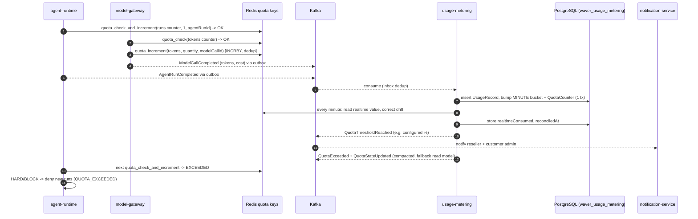
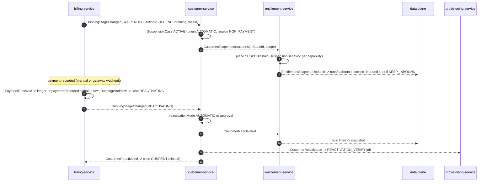

# RFC-0020 - Usage Metering & Billing
Status: PROPOSED
Revision 1.3 (2026-10-19): aligned with ADR-0020..0027 (adopted Redis, Temporal, HashiCorp Vault, Apicurio Registry + Avro + Debezium outbox, Istio).
Owners: WAVER Architecture (named owner TBD)
Reviewers: TBD
Date: 2026-10-19
Version: 1.3
Related: ADR-0004, ADR-0012, ADR-0014, ADR-0017, ADR-0020, ADR-0022, ADR-0023, ADR-0024, ADR-0026, AR-006, AR-009, AR-012, AR-013, RFC-0013, RFC-0017, Commercial §6, §7, §8, §10, §16, §17, §20

## Summary
Define how consumption is measured (`usage-metering-service`: Meters, UsageRecords, aggregation, quota counters) and how it is turned into money (`billing-service`: billing relationships, rating, invoices, payments, credits, append-only ledger, dunning, month-end close), with payment gateway and fiscal documents behind ports because both are open business decisions. Dunning drives suspension only through events consumed by customer-service and entitlement-service, so financial status never collapses into commercial or technical status.

## Context / Problem
"Usage registers what was effectively consumed" (Commercial §1) and must feed limits, analytics and billing (Commercial §6). The commercial model is B2B2B with two money flows (WAVER → Reseller, Reseller → Customer) whose exact shape — who invoices whom, fiscal issuer, gateway, grace periods — is still open (Commercial §20, Master §15). AI cost of goods sold comes from `ModelCallCompleted` (ADR-0017). Without one design, quota enforcement, invoicing and suspension would each invent their own counters and statuses.

## Goals
- One meter catalogue and one deduplicated UsageRecord store for limits, analytics and billing.
- Real-time quota counters in Redis (ADR-0020) that the data plane checks directly, making HARD limits near-exact, reconciled every minute into PostgreSQL, which stays authoritative for billing; a local fallback keeps enforcement working without Redis (AR-013).
- Rating against the prices snapshotted in contracts (RFC-0013) for both sides of every item (retail and wholesale).
- Append-only financial history: corrections are credits/adjustments, never rewrites (Commercial §17).
- Dunning as a durable Temporal workflow in billing-service (ADR-0023) with per-contract/plan policy, driving restriction/suspension through events (AR-012); billing runs and month-end close likewise.
- Payment gateway and fiscal provider pluggable via ports; manual operation possible in v1.
- Revenue share/commission schema prepared, disabled.

## Non-goals
- Choosing a payment gateway, fiscal provider, tax engine or accounting system.
- Revenue recognition accounting (export to an accounting system is a later RFC).
- Price definition (catalog-service, RFC-0017) and contract pricing (contract-service, RFC-0013).
- Multi-currency conversion (one currency per billing relationship in v1).

## Requirements / ARs
| AR | Application |
|---|---|
| AR-002/004 | Metering reads producers' events only; billing reads usage aggregates and contract versions via APIs (MICROSERVICES_MAP dependencies). |
| AR-006 | UsageRecord unique on `(meter_key, source_event_id)`; real-time quota increments deduplicated per `unitId` (run, tool execution, delivery or model call ID) in Redis; payments unique on `(source, external_ref)`; billing runs and invoice issuance idempotent per `(billing_relationship_id, period)` (also the basis of the Temporal workflow IDs). |
| AR-008 | All rows carry `org_id`; RLS; reseller portfolio path via `reseller_org_id`. |
| AR-009 | Every financial and dunning transition is an event consumed by audit-service; manual actions need reason. |
| AR-012 | Dunning never deletes data; TERMINATED is never reached by timer alone. |
| AR-013 | Data plane checks quota counters in Redis without calling usage-metering-service; quota state is also published on a compacted topic as the local fallback when Redis is unavailable. |

## Proposed Design

### 1. Meters (usage-metering-service)
| Meter key | Kind | Unit | Source event (producer) | Dimensions |
|---|---|---|---|---|
| `agent.runs` | COUNTER | run | `AgentRunCompleted`, `AgentRunFailed` (agent-runtime) | org, workspace, domain, agent, agentVersion, outcome |
| `model.tokens.input` / `model.tokens.output` | COUNTER | token | `ModelCallCompleted` (model-gateway) | org, workspace, agent, modelProfile, provider, byok |
| `model.cost` | COUNTER (internal, never billable) | currency | `ModelCallCompleted.cost` | as above — source of AI COGS |
| `tool.calls` | COUNTER | call | `ToolExecutionCompleted`, `ToolExecutionFailed` (tool-runtime) | org, workspace, agent, toolId, toolVersion, outcome |
| `channel.messages` | COUNTER | message | `MessageDelivered`, `MessageReceived` (channel-service) | org, workspace, channelType, direction |
| `channel.numbers` | GAUGE (daily peak) | number | channel connection lifecycle events (Open Questions Q9) | org, workspace, channelType |
| `storage.bytes` | GAUGE (daily max) | GiB | `StorageUsageReported` from knowledge/memory (Q9) | org, workspace, store |
| `seats.active` | GAUGE (daily peak) | seat | `MembershipChanged` (identity-access) | org, workspace |
| `agents.deployed` | GAUGE (daily peak) | agent | `DeploymentActivated`/`DeploymentRolledBack` (agent-builder) | org, workspace, domain |

| Entity | Key fields |
|---|---|
| Meter | `id`, `meterKey`, `kind` (`COUNTER`,`GAUGE`), `unit`, `aggregation` (`SUM`,`MAX`,`LAST`), `sourceEventTypes[]`, `quantityPath`, `billable`, `version` |
| UsageRecord | `id`, `org_id`, `reseller_org_id`, `workspaceId`, `domainId`, `agentId`, `meterKey`, `quantity` (numeric), `unit`, `occurredAt`, `recordedAt`, `sourceEventId`, `sourceEventType`, `dimensions` (jsonb), `capabilityKey`, `entitlementId` (resolved from local snapshot), `periodKey`, `late` |
| UsageAggregation | `id`, `org_id`, `meterKey`, `scopeType`/`scopeId`, `granularity` (`MINUTE`,`HOUR`,`DAY`,`BILLING_PERIOD`), `windowStart`, `windowEnd`, `quantity`, `status` (`OPEN`,`FINAL`) |
| QuotaCounter | `id`, `org_id`, `entitlementLimitId`, `limitKey`, `meterKey`, `scopeType`/`scopeId`, `periodStart`, `periodEnd`, `limitAmount`, `consumed` (authoritative, from ingested UsageRecords), `realtimeConsumed` (last value read from Redis), `reconciledAt`, `thresholdsFired[]`, `state` (`OK`,`WARNING`,`EXCEEDED`), `enforcement`, `overagePolicy`, `version` |

Ingestion rules:
- **Deduplication**: unique `(meter_key, source_event_id)`; gauges unique `(meter_key, org_id, scope, observation_window)`. Redelivery is a no-op (AR-006).
- **Attribution**: usage-metering consumes `waver.entitlement.entitlement-snapshot.v1` (RFC-0013) to resolve `entitlementId`/`capabilityKey` and to create/update QuotaCounters from `EntitlementLimit` rows (`limitKind = CONSUMPTION`). Unresolvable usage is stored with `entitlementId = null` and counted in an "unattributed" metric — never dropped.
- **Storage**: `usage_record` is range-partitioned by month on `occurred_at` (PostgreSQL native partitioning); retention per data-retention policy (Open Questions Q8).
- **Aggregation windows**: consumers write records and update MINUTE buckets and the PostgreSQL QuotaCounters in the same transaction (batched per poll, `consumed = consumed + :delta`); HOUR/DAY roll-ups and the BILLING_PERIOD finalization check run as short, idempotent scheduled jobs inside usage-metering-service, coordinated across pods with a short Redis lock (`RedisLockRegistry`, ADR-0020; these are re-runnable batch steps, not long-running processes, so they do not need Temporal). BILLING_PERIOD aggregation becomes `FINAL` after the period end plus `metering.lateArrivalWindow` (configurable). The real-time Redis counters (§2) are a separate, faster path; PostgreSQL remains the record for aggregations and billing.
- **Late events**: a record arriving after its period is FINAL is stored with `late = true` and assigned to the current open period; billing rates it as a `LATE_USAGE` line. Final aggregations are never reopened.

### 2. Quotas and enforcement interplay
Thresholds come from `EntitlementLimit.thresholds[]` (configurable per listing/contract). On each counter update: crossing a threshold emits `QuotaThresholdReached`; reaching `limitAmount` emits `QuotaExceeded`; a new period emits `QuotaPeriodReset`. The current state of every counter is also published to the compacted topic `waver.usage-metering.quota-state.v1` (key `quotaCounterId`, `QuotaStateUpdated`), which data-plane services keep in their local read model as the **fallback** for when Redis is unavailable.

**Real-time counters in Redis (ADR-0020).** usage-metering-service owns the real-time copy of every open QuotaCounter in Redis; PostgreSQL stays authoritative.
- **Keys**: `waver:quota:<quotaCounterId>` (hash: `consumed`, `limitAmount`, `enforcement`, `overagePolicy`, `periodEnd`, `thresholdsFired`) plus an index `waver:quota:idx:<entitlementLimitId>:<scopeId>` → current `quotaCounterId`, so data-plane services resolve the counter from the entitlement snapshot without calling usage-metering. usage-metering-service creates both when it creates or updates the QuotaCounter (from `EntitlementLimit`), switches the index at period reset and lets old keys expire after `periodEnd` + `metering.lateArrivalWindow`. Keys contain IDs only, no PII.
- **Scripts and client**: usage-metering-service owns the Lua scripts and publishes the quota client that runs them (generated from `contracts/` and exposed through the platform starter, same pattern as the entitlement evaluator, RFC-0013 Q9). Every script runs atomically in Redis and is idempotent per `unitId`: it sets a dedup marker `waver:quota:<quotaCounterId>:unit:<unitId>` (`SET NX`, TTL 24 h) and only increments if the marker is new, recording newly crossed thresholds in `thresholdsFired`.
  - `quota_check_and_increment(counterIds, quantity, unitId)`: for units whose quantity is known at admission (a run, a tool call, an outbound message), checks each counter and, if admitted, increments it in the same atomic step. `unitId` is the run, tool execution or delivery ID.
  - `quota_check(counterIds)`: read-only decision, used where the quantity is only known afterwards (model tokens / AI credits) and by services that must respect a counter they do not increment (e.g., agent-runtime reading AI-credit counters).
  - `quota_increment(counterIds, quantity, unitId)`: post-hoc increment by the producer of a variable-quantity unit (model-gateway-service per model call, RFC-0019).
  Each returns per counter `OK | WARNING | EXCEEDED` and the decision for its `enforcement`/`overagePolicy`.
- **Admission**: before starting a metered unit (a run in agent-runtime at QUEUED → RUNNING, RFC-0011; a tool call in tool-runtime-service; an outbound message in channel-service; a model call in model-gateway-service), the data-plane service calls the quota client for the applicable counters. `HARD`/`BLOCK` with the counter at or above `limitAmount` → denied with `QUOTA_EXCEEDED`.
- **Consumption**: count-based units are already counted at admission; variable-quantity units (tokens) are incremented by model-gateway-service when the call completes. Retries reuse the same `unitId`, so they never double-count.
- **ACL**: usage-metering-service has full access to `~waver:quota:*`; the four data-plane services (agent-runtime, tool-runtime-service, channel-service, model-gateway-service) have an ACL user restricted to `EVALSHA` of the published scripts on `~waver:quota:*` (no direct reads or writes). This is the explicit exception to "no service touches another service's keys" that ADR-0020 implies with "data plane checks counters directly" (Open Questions Q14).
- **Per-minute reconciliation into PostgreSQL**: a usage-metering job (every minute, short Redis lock) reads the Redis value of every counter active in the open period, stores it as `realtimeConsumed`/`reconciledAt` on the PostgreSQL QuotaCounter and compares it with the authoritative `consumed` (sum of ingested, deduplicated UsageRecords). If PostgreSQL is ahead (increments lost, e.g., Redis failover or a producer on the fallback path), Redis is raised to the PostgreSQL value. If Redis is ahead, that is normal for units admitted but not yet completed and for events still on their way to ingestion; a gap that persists beyond `metering.quotaDriftWindow` (configurable) is recorded as drift (metric + log) and Redis is reset to the PostgreSQL value. Billing never reads Redis.
- **Events**: `QuotaThresholdReached`/`QuotaExceeded` are still emitted only by usage-metering-service through its outbox, once per counter, threshold and period (`thresholdsFired[]` in PostgreSQL), as soon as ingestion or the per-minute reconciliation (which reads the Redis `thresholdsFired`) sees the crossing. Enforcement does not wait for these events: it happens in Redis at admission.
- **Fallback**: if Redis is unavailable or slow (short client timeout, Resilience4j circuit breaker), data-plane services evaluate the local quota-state read model plus the entitlement snapshot, exactly as in v1.2 (approximate), and skip the Redis increment; ingestion keeps PostgreSQL correct and the reconciliation re-seeds Redis once it is back (ADR-0020: losing Redis degrades precision, never correctness).

Data-plane services (agent-runtime, tool-runtime, channel-service; model-gateway-service for token meters) combine the counter state with the entitlement snapshot and decide:

| enforcement / overagePolicy | Counter EXCEEDED behavior |
|---|---|
| `HARD` / `BLOCK` | new runs/calls/messages for that scope denied with `QUOTA_EXCEEDED`; in-flight work completes |
| `SOFT` / `ALLOW_BILLABLE` | allowed; usage above limit rated as overage |
| `SOFT` / `ALLOW_UNBILLED` | allowed; notification only |
| `NOTIFY_ONLY` | allowed; notification only |

Because admission checks and increments hit the shared Redis counter atomically, HARD limits are **near-exact**: count-based meters (runs, tool calls, messages) never admit a unit beyond the limit; variable-quantity meters (tokens / AI credits) can overshoot only by the consumption of calls already in flight when the limit is reached. Only while a data-plane service runs on the fallback path during a Redis outage does the v1.2 overshoot (about one ingestion batch plus propagation lag) apply again. Usage above the limit is always recorded and rated per `overagePolicy`. Capacity limits (seats, agents, numbers) are enforced synchronously by their owning services (RFC-0013 §8).

### 3. Billing relationships (billing-service)
The billing hierarchy is data, not code. A `BillingRelationship` links an issuer org to a payer org:

| Field | Meaning |
|---|---|
| `id`, `org_id` (issuer), `payerOrgId`, `reseller_org_id` | parties |
| `relationshipType` | `PLATFORM_TO_RESELLER`, `RESELLER_TO_CUSTOMER`, `PLATFORM_TO_CUSTOMER` (direct billing; disabled until decided) |
| `invoicingMode` | `PLATFORM_ISSUES` (billing-service issues invoices for the issuer) or `STATEMENT_ONLY` (charges computed; issuer invoices outside WAVER) |
| `currency`, `billingCycle`, `billingDay`, `timeZone`, `paymentTermsKey` | cycle settings |
| `dunningPolicyId`, `fiscalProfileRef`, `paymentGatewayAccountRef` | policies and port configuration |
| `exposeBillingToCustomer` | only for `RESELLER_TO_CUSTOMER`; controls the Workspace billing projection (Commercial §18) |
| `status`, `validFrom`, `validTo` | lifecycle |

Created by consuming `ResellerActivated` (PLATFORM_TO_RESELLER) and the first `ContractActivated` per customer (RESELLER_TO_CUSTOMER); defaults for `invoicingMode` per relationship type are a policy (Open Questions Q1).

### 4. Charges, rating and proration
- **ChargeSchedule** (read model): for each in-force contract version, billing fetches `GET /v1/contract-versions/{id}` (RFC-0013) and stores per PriceComponent the charge plan: RECURRING (period, advance/arrears per policy), ONE_TIME (on activation or delivery per `billing.startTrigger`), USAGE (meterKey, included quantity, tiers). Prices are the contract's snapshots of the PriceBook (RFC-0013), so PriceBook changes affect only new contracts/renewals.
- **Two sides per item**: RETAIL components are rated onto the RESELLER_TO_CUSTOMER relationship; WHOLESALE components onto the PLATFORM_TO_RESELLER relationship (one reseller invoice with lines per customer contract item, plus agreement-level fees if any).
- **Usage rating**: `GET /v1/usage-aggregations?orgId=&periodKey=&status=FINAL` → for each USAGE component: `billable = max(0, quantity − includedQuantity)` priced by `chargeModel` (`PER_UNIT`, `TIERED` graduated, `VOLUME` all-units), only for `overagePolicy = ALLOW_BILLABLE` or explicit usage-priced items.
- **Proration**: `prorationPolicyKey` on the Amendment (RFC-0013): `DAILY` (amount × days in force / days in period), `NONE`, `NEXT_CYCLE`. Upgrades produce `PRORATION` charge lines; downgrades produce `PRORATION` credit lines or apply next cycle per policy.
- **Money**: `numeric(19,4)` and Money objects per CONVENTIONS; rounding to the currency's minor unit at line level with HALF_EVEN (recommendation, needs business/fiscal approval).

### 5. Financial entities
| Entity | Key fields |
|---|---|
| Invoice | `id`, `invoiceNumber` (assigned at issue, sequence per issuer org), `org_id` (issuer), `payerOrgId`, `billingRelationshipId`, `billingRunId`, `periodStart`, `periodEnd`, `currency`, `subtotal`, `discountTotal`, `taxTotal`, `total`, `amountDue`, `dueDate`, `status` (`DRAFT`,`ISSUED`,`PARTIALLY_PAID`,`PAID`,`VOIDED`), `fiscalStatus` (`NOT_REQUIRED`,`PENDING`,`ISSUED`,`FAILED`,`CANCELLED`), `issuedAt` |
| InvoiceLine | `id`, `invoiceId`, `lineType` (`RECURRING`,`ONE_TIME`,`USAGE`,`LATE_USAGE`,`PRORATION`,`DISCOUNT`,`CREDIT_APPLIED`,`ADJUSTMENT`), `side`, `contractId`, `contractVersionId`, `contractItemId`, `priceComponentId`, `quantity`, `unit`, `unitPrice`, `amount`, `servicePeriodStart/End`, `usageAggregationIds[]`, `prorationFactor`, `taxMetadata` |
| Payment | `id`, `org_id` (receiving issuer), `billingRelationshipId`, `amount`, `receivedAt`, `source` (`MANUAL`,`GATEWAY`,`BANK_IMPORT`), `externalRef`, `status` (`RECEIVED`,`APPLIED`,`PARTIALLY_APPLIED`,`UNAPPLIED`,`REVERSED`), `evidenceRef`, `recordedBy` |
| PaymentAllocation | `paymentId`, `invoiceId`, `amount` |
| Credit | `id`, `billingRelationshipId`, `amount`, `remaining`, `reasonCode` (`DUPLICATE_PAYMENT`,`OVERPAYMENT`,`DOWNGRADE`,`SLA_CREDIT`,`GOODWILL`,`WRONGFUL_SUSPENSION`), `approvalRequestId`, `status` |
| Refund | `id`, `creditId`, `amount`, `status` (`REQUESTED`,`APPROVED`,`SENT`,`COMPLETED`,`FAILED`), `gatewayRef` |
| Adjustment | `id`, `billingRelationshipId`, `invoiceId`, `amount` (signed), `reasonCode`, `approvalRequestId`, `createdBy` |
| LedgerEntry | `id`, `org_id`, `billingRelationshipId`, `entryType` (`INVOICE_ISSUED`,`PAYMENT_RECEIVED`,`PAYMENT_REVERSED`,`CREDIT_ISSUED`,`CREDIT_APPLIED`,`REFUND_PAID`,`ADJUSTMENT`,`INVOICE_VOIDED`,`WRITE_OFF`), `direction` (`DEBIT`,`CREDIT`), `amount`, `currency`, `refType`, `refId`, `accountingPeriod`, `postedAt`, `postedBy`, `prevHash`, `hash` |
| AccountingPeriod | `org_id` (issuer), `period` (`YYYY-MM`), `status` (`OPEN`,`CLOSING`,`CLOSED`) |
| FiscalDocument | `id`, `invoiceId`, `providerKey`, `externalNumber`, `status`, `documentRef`, `issuedAt` |
| Commission, RevenueShare, Settlement | schema only; `billing.revenueShare.enabled = false`; events `CommissionAccrued`, `SettlementIssued` defined, not emitted |

**Ledger rules**: the application DB role has only INSERT/SELECT on `ledger_entry` (the short-lived PostgreSQL credentials that Vault's database secrets engine issues to billing-service are created from a role with exactly these grants, ADR-0022; schema migrations use a separate migration role); a trigger rejects UPDATE/DELETE; each entry chains `prevHash` per relationship for tamper evidence. Balances are sums; period-end balances are snapshotted. Entries post only into `OPEN` periods; corrections to closed periods post into the current period with a reference to the original. Issued invoices are never edited: voiding (only without payments) posts `INVOICE_VOIDED` and cancels the fiscal document through the port; anything else is a Credit or Adjustment (approval above `billing.adjustmentApprovalThreshold`, a policy value).

**Duplicate payments** (Commercial §17): an identical notification (same `source` + `externalRef`) is ignored idempotently; a distinct payment for an already-settled invoice is recorded as `UNAPPLIED`, a `Credit` (`DUPLICATE_PAYMENT`) is issued and either applied to the next invoice or refunded on request (approval). The original invoice and ledger stay untouched.

### 6. Dunning
| Entity | Key fields |
|---|---|
| DunningPolicy | `id`, `scope` (`DEFAULT`,`PLAN`,`CONTRACT`,`RELATIONSHIP`), `stages[]` (`stage`, `offsetFromDueDate`, `notices[]`, `action` `NONE`/`RESTRICT`/`SUSPEND`, `requireManualConfirmation`), `reactivationMode` (`AUTOMATIC`,`APPROVAL_REQUIRED`), `reactivationThreshold` (`OVERDUE_SETTLED`,`FULL_BALANCE`), `capabilityOverrides` (e.g., critical channels `KEEP_INBOUND`), `terminationEligibilityOffset`, `version` |
| DunningCase | `id`, `org_id` (issuer), `billingRelationshipId`, `payerOrgId`, `payerOrgType`, `policyId` + `policyVersion` (snapshot), `stage`, `overdueAmount`, `oldestOverdueInvoiceId`, `workflowId`, `pausedUntil`, `pauseReason`, `openedAt`, `closedAt`, `version` |

Policy resolution: CONTRACT > PLAN > RELATIONSHIP > DEFAULT. All offsets and thresholds are configuration; seed values require business approval (Open Questions Q3). The case's financial `stage` is billing's only; customer-service projects it as `financialStatus` and keeps its own `accessStatus` (RFC-0017).

**Dunning as a Temporal workflow** (ADR-0023): each billing relationship has one `DunningWorkflow` in billing-service (namespace `waver-commercial`, task queue `billing-service.dunning`, `workflowId = dunning:<billingRelationshipId>`). The stages, triggers, roles and events in the table below are unchanged; the workflow replaces the `next_wakeup_at` timer polling:
- When an invoice is issued, the issuing activity calls signal-with-start on the relationship's workflow (`invoiceIssued(invoiceId, dueDate)`); while no case is open (CURRENT) the workflow only holds due-date timers. When a due date passes, an activity re-reads `amountDue` and, if positive, opens the DunningCase row (policy and version snapshotted) and emits `InvoicePastDue`/`DunningStageChanged`.
- Stage offsets, notice reminders (`GRACE_ENDING`, `TERMINATION_ELIGIBLE`, …) and `pausedUntil` are durable timers computed from the snapshotted policy version, so a policy change never alters a running case (deterministic workflow code; the policy is an input, not re-read by workflow code).
- Inputs arrive as signals sent **only by billing-service itself**: `paymentRecorded`/`paymentReversed` from its own payment handling (manual API, gateway notifications, bank import), `pause`/`resume`/`override` from its API (`POST /v1/dunning-cases/{id}/pause`, `/resume`, `/override`; the override's `SUSPENSION_OVERRIDE` approval arrives as an approval event consumed by billing-service), and `CustomerReactivated`, `ResellerRestrictionLifted`, `ContractTerminated`, `CustomerTerminated`, `ResellerTerminated` translated by billing-service's own consumers. customer-service, reseller-service and approval-service never signal billing workflows.
- Every stage change is an idempotent activity that updates the DunningCase row and writes `DunningStageChanged`/`DunningNoticeDue` to the outbox in one transaction. After a case closes, the workflow continues-as-new in CURRENT so history stays bounded.

| From | To | Trigger / who | Event |
|---|---|---|---|
| CURRENT (no case) | PAST_DUE | timer: invoice `dueDate` passed with `amountDue > 0` | `InvoicePastDue`, `DunningStageChanged` |
| PAST_DUE | GRACE_PERIOD | timer at policy offset | `DunningStageChanged` |
| GRACE_PERIOD | RESTRICTED | timer at policy offset | `DunningStageChanged` (`action = RESTRICT`) |
| RESTRICTED | SUSPENDED | timer at policy offset | `DunningStageChanged` (`action = SUSPEND`) |
| SUSPENDED | TERMINATED | `ContractTerminated`/`CustomerTerminated` (or `ResellerTerminated`) consumed — never by timer | `DunningStageChanged` |
| PAST_DUE, GRACE_PERIOD | CURRENT | payment meets `reactivationThreshold` before any restriction | `DunningStageChanged` (case closed) |
| RESTRICTED, SUSPENDED | REACTIVATING | payment meets threshold, or `WAVER_FINANCE` override with approval `SUSPENSION_OVERRIDE` | `DunningStageChanged` |
| REACTIVATING | CURRENT | `CustomerReactivated` (customer) / `ResellerRestrictionLifted` (reseller) consumed | `DunningStageChanged` (case closed) |
| REACTIVATING | previous stage | payment reversed (`PaymentReversed`) | `DunningStageChanged` |
| any open | same (paused) | `RESELLER_FINANCE` (own portfolio) or `WAVER_FINANCE`: pause/extend with reason | `DunningCasePaused` / `DunningCaseResumed` |
| SUSPENDED | SUSPENDED | timer at `terminationEligibilityOffset` | `DunningNoticeDue` (`TERMINATION_ELIGIBLE`) |

Notice timers (reminders, `GRACE_ENDING`; durable timers of the dunning workflow) emit `DunningNoticeDue` for notification-service. A RESTRICTED/SUSPENDED stage is a **request** for access change; customer-service decides and records the SuspensionCase (automatic or with confirmation per `requireManualConfirmation`). For `payerOrgType = RESELLER`, reseller-service applies `ResellerDefaultPolicy` instead (RFC-0017 §2).

### 7. Ports for open decisions
| Port | Operations | v1 adapters | Later |
|---|---|---|---|
| `PaymentGatewayPort` | `createCharge`, `getPaymentStatus`, `refund`, `parseWebhook(headers, body)` | `ManualPaymentAdapter` (finance users record payments with evidence), `BankStatementImportAdapter` (file import, optional) | gateway adapters after business decision |
| `FiscalDocumentPort` | `issue(invoiceSnapshot, fiscalProfile)`, `cancel`, `getStatus` | `ExternalReferenceAdapter` (record number/URL of a document issued elsewhere), `NotRequiredAdapter` | fiscal provider adapter |
| `TaxQuotePort` (optional) | `quoteTaxes(invoiceDraft)` | `NoTaxLinesAdapter` (tax handled by external issuer) | provider adapter |

Gateway webhooks enter through edge-gateway on a dedicated path to `POST /v1/payment-notifications/{adapterKey}`; the adapter verifies signatures, and processing is idempotent on `externalRef`.

**Secrets (ADR-0022).** WAVER-owned payment gateway and fiscal provider secrets (API keys, webhook signing secrets, client certificates) are platform secrets in **HashiCorp Vault** (KV v2 under a billing-service path, e.g. `waver/billing/<adapterKey>`), readable only by billing-service's Vault role (Kubernetes auth) and delivered via the Vault Secrets Operator to short-lived Kubernetes Secrets or read at startup with lease renewal; they never appear in Git, Helm values or images, and rotation in Vault requires no release. Outbound signatures that WAVER itself generates (if an adapter requires request signing) use Vault Transit so the key never leaves Vault. Reseller-owned gateway accounts would be tenant credentials owned by connector-service and stored as Transit ciphertext (Open Questions Q5); billing-service would not receive a lease for them unless ADR-0022's lease list is extended. Vault audit logs cover every secret read. No card data is ever stored; only gateway token references.

**Egress (ADR-0026).** Calls to payment gateways and fiscal providers leave the cluster only through the Istio egress gateway, with a `ServiceEntry` allow-list per provider host bound to billing-service's identity; adding a provider adapter includes adding its host there.

### 8. Billing run and month-end close
Each BillingRun is a `BillingRunWorkflow` in billing-service (namespace `waver-commercial`, task queue `billing-service.billing-run`, `workflowId = billing-run:<issuerOrgId>:<billingCycleKey>:<periodKey>`, so a second start for the same run is rejected). The `billing_run` row keeps the business state shown below; the workflow drives it (ADR-0023).

| BillingRun state | Meaning / trigger |
|---|---|
| SCHEDULED | period end per `billingDay`/`timeZone`: a Temporal Schedule (calendar spec in the relationship's `timeZone`) per billing cycle starts the run workflow |
| WAITING_USAGE | waits for `UsagePeriodClosed` for all payers in the run: billing-service's own consumer signals its own run workflow (`usagePeriodClosed(payerOrgId, periodKey)`); a durable timer raises the fallback alert after a configured wait |
| RATING | ChargeSchedule + FINAL usage → DRAFT invoices (idempotent per relationship + period); one activity per relationship, each in its own transaction |
| IN_REVIEW | drafts visible to `RESELLER_FINANCE`/`WAVER_FINANCE`; adjustments allowed (through the billing API); window configurable (durable timer) |
| ISSUING | numbers assigned, ledger posted, `InvoiceIssued` (outbox), fiscal port called — one idempotent activity per invoice; issuance also signal-with-starts the relationship's `DunningWorkflow` (§6) |
| COMPLETED | all invoices issued; `fiscalStatus` failures tracked separately |
| FAILED → MANUAL_REVIEW | rating or issuing errors after the activities' retry policies are exhausted; the workflow waits for a `retry` signal sent by billing-service's own API (`POST /v1/billing-runs/{id}/retry`, `WAVER_FINANCE`, reason recorded) and resumes at the first unfinished relationship/invoice |

Month-end close (Commercial §8.1 "Mensal") is an `AccountingPeriodCloseWorkflow` in billing-service (`workflowId = period-close:<issuerOrgId>:<period>`), started by `POST /v1/accounting-periods/{period}/close`, with each step an idempotent activity: (1) usage periods closed after the late-arrival window; (2) WHOLESALE runs (PLATFORM_TO_RESELLER) and RETAIL runs (RESELLER_TO_CUSTOMER, `PLATFORM_ISSUES` only) complete (the close workflow waits for their completion signals, sent by billing-service's run workflows — same service); (3) `AccountingPeriod` → CLOSING, reconcile ledger totals vs issued invoices and payments; (4) → CLOSED, balances, MRR and aging snapshots stored; (5) exports for accounting (format TBD). Revenue share/commission steps are skipped while disabled.

### 9. Reports and KPIs (Commercial §16)
| KPI | Definition (owner) |
|---|---|
| MRR / ARR | Σ monthly-normalized RECURRING amounts of in-force items at the snapshot date, from ChargeSchedule; RETAIL side for reseller portfolio MRR, WHOLESALE side for WAVER revenue; ARR = 12 × MRR (billing) |
| Expansion / churn / NRR | MRR deltas classified by amendment type, cancellations and terminations (billing) |
| DSO, aging | receivables from ledger; aging buckets configurable (billing) |
| Default / recovery / suspended revenue | DunningCases by stage and outcome (billing) |
| AI COGS | Σ `model.cost` by org, reseller, capabilityKey, modelProfile, provider (usage-metering) |
| Reseller margin (visible to the reseller) | RETAIL revenue − WHOLESALE cost per customer/product (billing) |
| WAVER margin (Control only) | WHOLESALE revenue − AI COGS (and other COGS when defined) per reseller/product (control-bff composition) |

Customer-facing projections show quantities and limits only; WAVER cost and wholesale never leave Control/Partner (ADR-0009).

## APIs / Events / Data Ownership
| Service | Endpoints (`/v1`) |
|---|---|
| usage-metering | `GET /meters`; `GET /usage-aggregations?orgId=&meterKey=&granularity=&from=&to=&status=`; `GET /usage-summaries` (quantities only, all audiences); `GET /quota-counters?orgId=`; `GET /cost-aggregations` (WAVER only) |
| billing | `GET /billing-relationships`, `PUT /billing-relationships/{id}` (policy refs); `GET /invoices`, `GET /invoices/{id}`, `POST /invoices/{id}/voiding`; `POST /payments` (manual), `POST /payment-notifications/{adapterKey}`; `POST /credits`, `POST /refunds`, `POST /adjustments`; `GET /ledger-entries?billingRelationshipId=`; `GET/PUT /dunning-policies`; `GET /dunning-cases`, `POST /dunning-cases/{id}/pause`, `/resume`, `/override`; `POST /billing-runs`, `GET /billing-runs/{id}`, `POST /billing-runs/{id}/retry` (MANUAL_REVIEW only); `POST /accounting-periods/{period}/close`; `GET /customer-invoices` (retail projection, Workspace, only if exposed) |

| Topic | Event types |
|---|---|
| `waver.usage-metering.usage-aggregation.v1` | `UsageAggregated` (HOUR/DAY/BILLING_PERIOD), `UsagePeriodClosed` |
| `waver.usage-metering.quota-counter.v1` | `QuotaThresholdReached`, `QuotaExceeded`, `QuotaPeriodReset` |
| `waver.usage-metering.quota-state.v1` (compacted) | `QuotaStateUpdated` |
| `waver.billing.invoice.v1` | `InvoiceDrafted`, `InvoiceIssued`, `InvoicePastDue`, `InvoicePaid`, `InvoiceVoided`, `FiscalDocumentIssued`, `FiscalDocumentFailed` |
| `waver.billing.payment.v1` | `PaymentReceived`, `PaymentReversed`, `CreditIssued`, `RefundCompleted`, `AdjustmentPosted` |
| `waver.billing.dunning-case.v1` | `DunningStageChanged`, `DunningNoticeDue`, `DunningCasePaused`, `DunningCaseResumed` |
| `waver.billing.billing-run.v1` | `BillingRunCompleted`, `AccountingPeriodClosed` |

`DunningStageChanged` carries `dunningCaseId`, `billingRelationshipId`, `payerOrgId`, `payerOrgType`, `fromStage`, `toStage`, `action`, `requireManualConfirmation`, `capabilityOverrides`, `reactivationMode` — never amounts beyond `overdueAmount`, never wholesale data in RESELLER_TO_CUSTOMER cases.

Encoding (ADR-0024): every event type above has an Avro schema in `contracts/events/<context>/<EventName>.v1.avsc` (contexts `usage-metering`, `billing`), registered by CI in Apicurio Registry with `BACKWARD_TRANSITIVE` compatibility (money amounts as decimal strings, per CONVENTIONS, never Avro floats). CloudEvents attributes and WAVER extensions travel as `ce_*` Kafka headers; the Kafka value is the Avro `data`. Both services write events to their `outbox_event` table in the business transaction and Debezium's Outbox Event Router publishes them; the compacted `quota-state` topic is produced the same way (key `quotaCounterId`). Consumers keep the inbox, retry topics and DLQ, and deserialize with the registry-aware Avro deserializer.

Consumed: usage-metering ← `AgentRunCompleted/Failed`, `ModelCallCompleted`, `ToolExecutionCompleted/Failed`, `MessageDelivered/Received`, `MembershipChanged`, `DeploymentActivated/RolledBack`, storage/number events (Q9), `EntitlementSnapshotUpdated`. billing ← `ContractActivated/Amended/Renewed/Expired/Cancelled/Terminated`, `ProvisioningSucceeded` (start trigger), `ResellerActivated/Terminated`, `CustomerReactivated/Terminated`, `CustomerOwnershipTransferred`, `ResellerRestrictionLifted`, `UsagePeriodClosed`, `ApprovalGranted/Rejected`.

Databases: `waver_usage_metering` (meter, usage_record [partitioned], usage_aggregation, quota_counter, entitlement_snapshot read model, outbox/inbox) and `waver_billing` (billing_relationship, charge_schedule, invoice, invoice_line, payment, payment_allocation, credit, refund, adjustment, ledger_entry, accounting_period, fiscal_document, dunning_policy, dunning_case, billing_run, commission/revenue_share/settlement [inactive], outbox/inbox). The former `timer` tables are gone. Non-authoritative stores: Redis keys `waver:quota:*` (usage-metering-service, real-time counters) and `waver:idem:billing:*` / `waver:idem:usage-metering:*` (idempotency keys; for financial POSTs — payments, credits, refunds, adjustments — the stored response is also kept in PostgreSQL for audit, ADR-0020); Temporal persistence for the dunning, billing-run and period-close workflows (namespace `waver-commercial`). Neither holds a business fact that is not in PostgreSQL.

## Security & Privacy
- billing-service is a high-risk domain (SECURITY_BASELINE threat model): MFA for finance roles, segregation of duties (`RESELLER_SALES` cannot record payments; requester ≠ approver for credits/refunds/adjustments above threshold).
- RLS: issuer `org_id` plus `reseller_org_id` portfolio path; a reseller sees both its WHOLESALE invoices (as payer) and its RETAIL invoices (as issuer), never other resellers'.
- `model.cost` and WHOLESALE lines are excluded from Partner customer views and all Workspace projections by separate projection schemas.
- No card or bank credentials stored; gateway tokens only; evidence documents by reference (storage TBD, RFC-0013 Q11). Gateway and fiscal provider secrets live only in Vault (§7, ADR-0022); billing-service's PostgreSQL credentials are dynamic and short-lived.
- Service-to-service traffic runs over Istio ambient STRICT mTLS with `AuthorizationPolicy` generated from the declared dependency graph (billing → usage-metering, contract-service, approval-service); outbound provider traffic only through the egress gateway allow-list (ADR-0026). The payment-notification path through edge-gateway keeps its application-level signature verification.
- Redis ACLs restrict each service to its own key prefix; the data-plane quota exception is limited to `EVALSHA` of the published quota scripts (§2). Quota keys and values carry IDs and numbers only. Temporal workflow inputs and signals carry IDs and stages, never contact PII or wholesale amounts; Temporal Web is restricted to WAVER operators and finance actions go through the billing API (authorized, audited), never through Temporal Web.
- Financial records retention follows legal requirements (Q8); LGPD deletion requests never remove ledger entries — they pseudonymise contact data in profiles (customer-service), not financial facts.

## Reliability & Failure Modes
| Failure | Behavior |
|---|---|
| Event burst from data plane | metering consumers scale by partitions; lag alert; real-time enforcement is unaffected (Redis counters are incremented by the producers); only PostgreSQL aggregation and threshold notifications run late. |
| Duplicate / replayed source events | unique key → no double counting in PostgreSQL; Redis increments happen once per `unitId` at admission or completion, never per event delivery, so replays cannot double-increment. |
| metering down | data plane keeps checking and incrementing the Redis counters (AR-013); usage is not lost (Kafka retention covers the outage; retention ≥ late-arrival window); reconciliation catches up when it returns. |
| Redis unavailable | data plane falls back to the local quota-state read model + entitlement snapshot (approximate, as in v1.2); PostgreSQL counters stay correct from ingestion; the per-minute reconciliation re-seeds Redis afterwards. No billing impact (billing never reads Redis). |
| Redis counter drift | per-minute reconciliation raises Redis to PostgreSQL when behind, resets it after `metering.quotaDriftWindow` when ahead; drift metric and alert. |
| contract-service down during rating | run waits in RATING with activity retries; no partial invoice issued (per-relationship transaction). |
| Temporal unavailable | dunning timers, billing runs and period close are delayed, never lost (Temporal persists state; Schedules catch up per their catch-up window); payments are still recorded, and the `paymentRecorded` signal is retried until delivered; no effect on the data plane. |
| billing-service pod dies mid-run | another worker resumes the workflow from history; the interrupted activity re-runs idempotently (per relationship + period, per invoice). |
| Debezium / Kafka Connect stopped | events wait in the outboxes; publish latency grows; alert on replication slot lag / WAL growth (ADR-0024). |
| Vault unavailable | new pods cannot obtain secrets or database credentials and fail to start; running pods keep their current leases until expiry; gateway calls fail closed (ADR-0022 tier-0). |
| Payment webhook duplicates/out of order | idempotent on `externalRef`; status changes applied by gateway timestamp. |
| Fiscal provider failure | invoice stays ISSUED with `fiscalStatus = FAILED`; retried by the issuing activity's retry policy, then by a per-invoice `FiscalDocumentRetryWorkflow` in billing-service with backoff timers (replaces the v1.2 retry job); dunning due dates follow policy flag `dunning.waitForFiscalDocument`. |
| Wrongful automatic suspension | override path (RFC-0017) + `WRONGFUL_SUSPENSION` credit by policy. |
| Clock/period boundary errors | periods computed in the relationship `timeZone`, stored in UTC; property tests on DST/month ends. |

## Observability
Metrics: `usage_records_ingested_total{meter}`, `usage_ingest_lag_seconds`, `usage_unattributed_total`, `quota_state{state}`, `quota_enforcement_overshoot` (sampled), `quota_redis_check_latency_seconds`, `quota_redis_fallback_total{service}`, `quota_redis_pg_drift{meter}` and `quota_reconciliation_corrections_total{direction}`, `billing_run_duration_seconds`, `invoices_issued_total{side}`, `fiscal_failures_total`, `dunning_cases{stage,payerOrgType}`, `ledger_hash_chain_breaks_total` (must be 0), `payments_unapplied_total`; Temporal SDK metrics per task queue (`billing-service.dunning`, `billing-service.billing-run`). Traces from source event to UsageRecord via `causationid` (`ce_*` headers). Operators can open the dunning or billing-run workflow of a record in Temporal Web by its `workflowId`. Alerts: ledger chain break, billing run in MANUAL_REVIEW, UsagePeriodClosed missing, DLQ non-empty, persistent Redis/PostgreSQL quota drift, data plane on quota fallback, Debezium replication slot lag.

## Testing Strategy
- Golden-file rating tests (per chargeModel, tiers, included quantities, proration policies, rounding) using decimal strings only.
- Property tests: Σ invoice lines = ledger debits; credits never exceed balances; replaying any event stream yields identical aggregations.
- Exhaustive DunningCase and BillingRun transition tests on the Temporal workflows (Java SDK test framework with time skipping for stage offsets, notice timers, pauses and review windows; every signal: payment recorded/reversed, pause/resume/override, reactivation/termination events, usage period closed, retry); replay tests against recorded histories in CI for every workflow change (ADR-0023); ArchUnit rule that workflow classes only call activities.
- Quota tests with Testcontainers Redis: concurrent `quota_check_and_increment` load proving no count-based overshoot and token overshoot ≤ in-flight calls; a repeated `unitId` never double-counts; reconciliation corrects both drift directions; Redis-down chaos test proving fallback and no data loss (ADR-0020).
- Idempotency tests for duplicate events, duplicate payments and repeated billing runs.
- Contract tests for consumed producer events (ModelCallCompleted, AgentRunCompleted, ToolExecutionCompleted, MessageDelivered) against their registered Avro schemas; CI compatibility check of this RFC's `.avsc` files against Apicurio Registry.
- Audience tests: Workspace projections contain no cost/wholesale fields; tenancy kit for reseller isolation.
- Port contract tests run against every adapter (manual adapters included).

## Deployment / Rollout / Rollback
1. usage-metering in shadow mode: ingest, aggregate, expose usage dashboards; Redis counters maintained and reconciled, quota enforcement `OBSERVE` only (would-be denials logged and compared with the PostgreSQL counters).
2. billing in `STATEMENT_ONLY` for all relationships with manual payments; reconcile against the current manual process for at least one full cycle.
3. Enable dunning notices; automatic RESTRICT/SUSPEND actions remain off (`dunning.autoActions = false`) until policies are approved.
4. Enable `PLATFORM_ISSUES` per relationship and fiscal/gateway adapters as decisions close.
Prerequisites: Redis ACL users per service and the published quota scripts; Temporal namespace `waver-commercial` and billing Schedules created by the pipeline; Vault roles/policies for billing-service (KV paths, database role); Avro schemas registered and Debezium outbox connectors for `waver_usage_metering` and `waver_billing`; egress `ServiceEntry` per enabled provider.
Rollback: flags revert enforcement/automation without touching data; billing runs can be re-run idempotently while DRAFT; issued invoices are corrected only via credits/adjustments. Workflow code changes use Temporal worker versioning, so running dunning cases and billing runs finish on the build that started them.

## Alternatives Considered
- **Counting usage inside each data-plane service**: duplicates logic and makes billing reconcile many sources. (The real-time Redis increments in §2 are not this: they use the owner's scripts and keys, and billing still uses only usage-metering's PostgreSQL records.)
- **PostgreSQL-only quota counters propagated via the compacted quota-state topic** (v1.2, ADR-0013): no extra component, but HARD limits could overshoot by about one batch plus propagation lag; superseded by ADR-0020 (kept as the fallback path).
- **Redis as the authoritative usage store**: fastest, but losing Redis would lose billable facts; rejected — PostgreSQL stays authoritative (ADR-0020).
- **Dunning, billing runs and close as hand-written PostgreSQL state machines with timer polling** (v1.2, ADR-0018): no extra component, more custom timer/retry code; superseded by Temporal workflows in billing-service (ADR-0023).
- **External billing SaaS**: would be a new vendor and still needs WAVER's two-sided B2B2B model; kept possible later behind ports.
- **Rating against live PriceBook**: rejected; contracts snapshot prices (RFC-0013), live prices would rewrite agreements.
- **Mutable invoice/ledger with audit log**: rejected by Commercial §17 (never rewrite history).

## Risks
- HARD quotas are near-exact but not exact: residual overshoot (in-flight work; token meters can overshoot by the size of in-flight model calls; larger while on the Redis fallback) must be documented for customers, and overage policies must tolerate it.
- Redis/PostgreSQL drift if producers or reconciliation misbehave; drift metrics and alerts are mandatory, and billing must never read Redis.
- Data-plane producers depend on usage-metering's client library and scripts; script changes must stay backward compatible across rolling deployments.
- Two-sided rating doubles the surface for pricing errors; golden tests and reconciliation are mandatory.
- Month boundaries and fiscal rules are country-specific; wrong defaults are expensive to correct once invoices are issued.
- Event volume (tokens per model call) may grow quickly; partitioning and aggregation must be load-tested.

## Open Questions
| # | Question | Recommended default (recommendation, needs business approval) |
|---|---|---|
| Q1 | Who invoices whom; any direct WAVER → Customer billing? (Commercial §20) | WAVER → Reseller `PLATFORM_ISSUES`; Reseller → Customer `STATEMENT_ONLY` until resellers opt in; `PLATFORM_TO_CUSTOMER` disabled. |
| Q2 | Who issues the fiscal document to the end customer? | Reseller, outside the platform (`ExternalReferenceAdapter`). |
| Q3 | Grace period length, stage offsets, restriction levels, who can override (Commercial §20) | Policy values per plan; `requireManualConfirmation = true` for SUSPEND in v1. |
| Q4 | Billing usage unit(s) (Scope §24: tokens, runs, conversations, agents, tool calls, seats, hybrid) | Meter all; bill runs + channel messages + capacity; tokens as internal COGS only. |
| Q5 | Payment gateway in v1 or manual status/API? Reseller-owned gateway accounts? | Manual + bank import in v1; one WAVER gateway account later (secrets in Vault KV, §7); reseller accounts via connector-service credentials (Vault Transit) — this needs either a third lease kind for billing-service in ADR-0022 or connector-service performing the gateway calls; decide with the gateway choice. |
| Q6 | Proration and rounding rules | `DAILY` for upgrades, `NEXT_CYCLE` for downgrades; HALF_EVEN at minor unit. |
| Q7 | Revenue share/commission from day one? | Prepared, disabled. |
| Q8 | Retention periods for usage records and financial data after cancellation | Usage detail per policy; financial per legal minimum; aggregates kept. |
| Q9 | Producer events not in MICROSERVICES_MAP: channel number lifecycle, `StorageUsageReported` | Add to channel/knowledge/memory owners' event lists. |
| Q10 | Topic naming for multi-word contexts/aggregates is not defined in CONVENTIONS (`usage-metering`, `quota-state`) | Kebab-case segments as used here; Java package `br.com.waver.usagemetering`; amend CONVENTIONS. |
| Q11 | CONVENTIONS does not cover compacted state topics (`quota-state`, `entitlement-snapshot`) | Closed: CONVENTIONS §Events now defines their naming and keys; ADR-0024 defines the encoding (CloudEvents binary mode with `ce_*` headers, Avro value, Debezium outbox relay; tombstones via the router's empty-payload option); `cleanup.policy=compact`. |
| Q12 | Billing period boundaries in UTC (CONVENTIONS) vs local fiscal month | Boundaries in the relationship `timeZone` (default `America/Sao_Paulo`), stored as UTC instants. |
| Q13 | Map lists billing sync deps only on usage-metering and contract-service; fiscal/gateway adapters and approval-service are new dependencies | Add to MICROSERVICES_MAP (the Istio `AuthorizationPolicy` and egress `ServiceEntry` allow-lists are generated from it, ADR-0026). |
| Q14 | ADR-0020 says the data plane checks quota counters directly, but also that no service reads another service's keys | Accept the narrow exception in §2 (data-plane producers may only `EVALSHA` usage-metering's published quota scripts on `~waver:quota:*`) and record it in ADR-0020. |

## Decision
PROPOSED. Accept metering (meters, dedup, aggregation, real-time quota counters in Redis reconciled every minute into authoritative PostgreSQL, compacted quota state as fallback) and billing (relationships, two-sided rating, append-only ledger, dunning and billing runs as Temporal workflows in billing-service driving suspension only via events, ports for gateway/fiscal with secrets in Vault) as the v1 design. Business decisions Q1–Q8 configure policies and adapters without code changes; Q9, Q10, Q12–Q14 require map/conventions/ADR updates.
